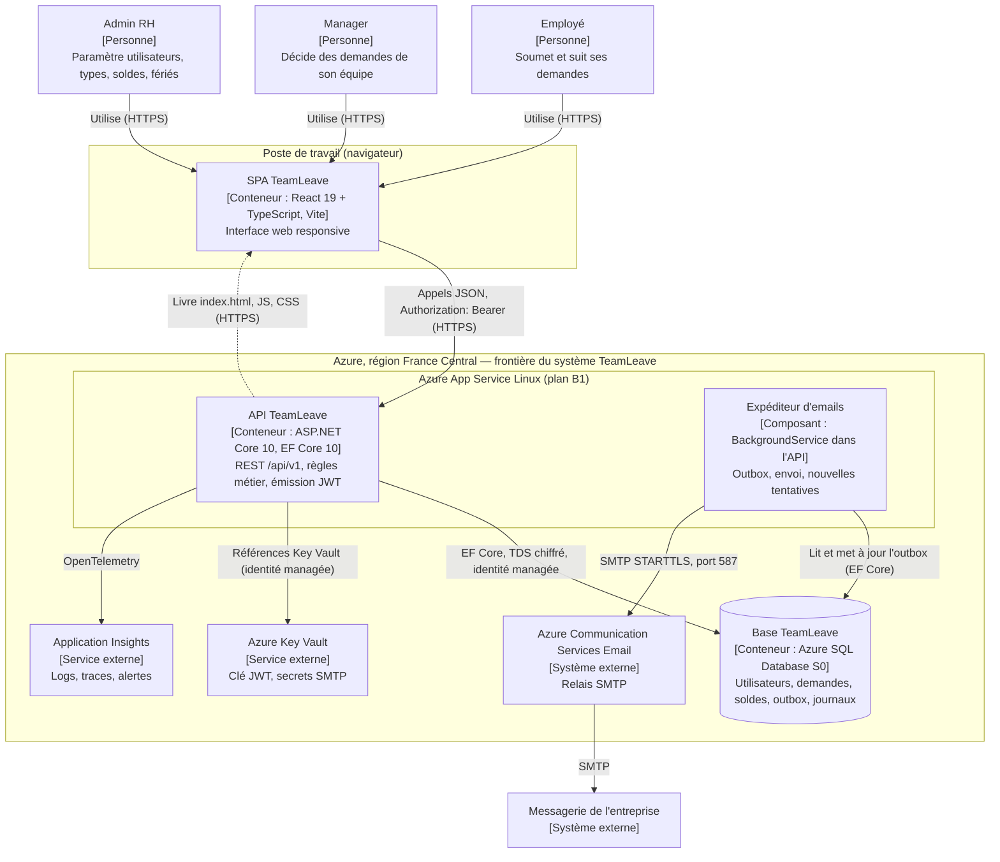
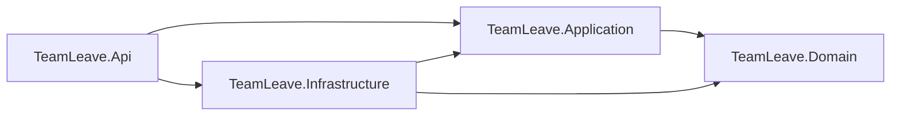
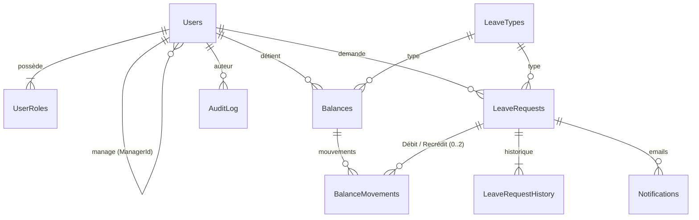

# TeamLeave — Dossier d'architecture et de conception système

| Élément | Valeur |
|---|---|
| Produit | TeamLeave, application interne de gestion des congés (PME de 50 personnes) |
| Entrées | `00_brief.md` (brief produit), `step1_spec.md` (spécification technico-fonctionnelle v1.0) |
| Étape | 2 sur 4 (architecture). L'implémentation backend (étape 3) et frontend (étape 4) ne sont pas traitées ici. |
| Version | 1.0 |
| Public | Équipe de développement qui reprend le projet sans réunion de cadrage |

Conventions :

- Les identifiants **US-xx, CA-xx.y, RB-xx, H-xx, ENF-xx, P-xx, EX-x, R-xx** renvoient à `step1_spec.md`.
- **GAP-xx** : point où la spécification est insuffisante ou contradictoire, avec la décision prise ici. Liste complète en §0.2.
- **ADR-0x** : décision d'architecture détaillée en §10.
- Les prix sont des **estimations** (voir §9.4).
- Aucun code applicatif n'est écrit dans ce document. Seul le SQL de création (§4) est fourni, comme l'autorise la consigne.

---

## 0. Synthèse des décisions et insuffisances de la spécification

### 0.1 Décisions renvoyées à l'étape 2 par la spécification

La spécification (§9.4, H-18, H-19, ENF-S2, ENF-S4) délègue explicitement les décisions suivantes. Chacune est tranchée ci-dessous et détaillée à la section indiquée.

| Sujet délégué | Décision | Alternative écartée | Détail |
|---|---|---|---|
| Base de données (§9.4) | Azure SQL Database (moteur SQL Server), niveau Standard S0 | PostgreSQL (Azure Database for PostgreSQL Flexible Server) | §2.3 |
| Algorithme de signature du JWT (§9.4) | HMAC-SHA256 (HS256), clé de 256 bits dans Key Vault, rotation à deux clés | RS256 / ES256 (asymétrique) | §2.4, §7.1 |
| Stratégie de rafraîchissement (§9.4, H-19) | Aucun jeton de rafraîchissement en v1 ; réauthentification à l'expiration | Jeton de rafraîchissement avec rotation | §2.4, ADR-02 |
| Durée de vie du jeton (ENF-S2, H-19) | **60 minutes**, tolérance d'horloge 30 s | 15 min + refresh ; 8 h | §7.1 |
| Comptes locaux ou SSO (H-18) | Comptes locaux, JWT émis par l'API | Microsoft Entra ID (SSO) | ADR-02 |
| Hachage des mots de passe (ENF-S4) | PBKDF2-HMAC-SHA512, 210 000 itérations, sel aléatoire de 128 bits (`PasswordHasher` de `Microsoft.Extensions.Identity.Core`) | Argon2id (bibliothèque tierce) ; ASP.NET Core Identity complet | §2.4 |
| Envoi asynchrone des emails (§9.4, ENF-P4) | Outbox transactionnelle en base + `BackgroundService` dans le processus API | Azure Service Bus + Azure Functions ; envoi direct | ADR-03 |
| Gestion de la concurrence (§9.4, ENF-I1) | Concurrence optimiste par jeton de version applicatif, points de sérialisation explicites (« touch »), rejeu automatique du cas d'usage | Verrous pessimistes (`UPDLOCK`) ; isolation `SERIALIZABLE` | §6, ADR-01 |
| Découpage en couches (§9.4) | Domain / Application / Infrastructure / Api, dépendances vers l'intérieur, contrôlées par des tests d'architecture | Projet unique en tranches verticales | §3 |

### 0.2 Insuffisances et contradictions de la spécification, décisions prises

| ID | Constat dans la spécification | Décision prise dans ce dossier | Section |
|---|---|---|---|
| GAP-01 | **Contradiction.** ENF-S7 impose 404 pour une demande hors périmètre de lecture. CA-10.5 et CA-17.6 imposent 403 quand un manager non approbateur tente de décider, alors que ce manager ne peut pas lire la demande. | Lecture (`GET`) hors périmètre : **404**. Décision (`approve`, `reject`) par un utilisateur qui a le rôle Manager ou Admin RH mais n'est pas l'approbateur : **403 `NOT_APPROVER`**. Les CA priment pour les endpoints de décision, car ils sont testables et explicites. La fuite d'existence est limitée aux managers et aux admins RH (population de confiance) et les identifiants sont des GUID non énumérables. Un utilisateur sans rôle Manager ni Admin RH reçoit 403 `FORBIDDEN` par la politique de rôle, avant tout chargement. | §5.4, §7.2 |
| GAP-02 | Annulation (`cancel`) par un autre que le demandeur : code non précisé. | 404 si la demande n'est pas lisible par l'appelant. 403 `NOT_REQUESTER` si elle est lisible (approbateur, admin RH). | §5.4 |
| GAP-03 | Calendrier `scope=team` pour un utilisateur **sans manager** : l'« équipe » de RB-03 n'est pas définie. | L'équipe se réduit à l'utilisateur lui-même : il voit ses seules absences approuvées. Pour un manager, `scope=team` montre l'équipe de **son propre** manager (ses pairs) ; ses subordonnés sont dans `scope=reports`. | §5.5 |
| GAP-04 | Retrait du rôle Manager à un utilisateur qui a des subordonnés actifs : non traité (RB-03 exige que le manager ait ce rôle). | Refus **422 `HAS_ACTIVE_REPORTS`** (code existant réutilisé). Rattacher un utilisateur à un manager inactif ou sans rôle Manager : **422 `INVALID_MANAGER`**. | §5.6 |
| GAP-05 | Passage d'un type de « soumis à décompte » à « non soumis » (ou l'inverse) alors que des demandes de ce type sont **en attente** : non traité. Le débit à l'approbation deviendrait incohérent avec le contrôle fait à la soumission. | Refus **422 `LEAVE_TYPE_HAS_PENDING_REQUESTS`**. RB-24 (soldes non nuls) produit **422 `LEAVE_TYPE_HAS_BALANCES`**. Le passage à « soumis » crée un solde à 0 pour chaque utilisateur. | §5.6, §6.3 |
| GAP-06 | Transmission du mot de passe initial (création de compte, §6.3) et du mot de passe réinitialisé (`reset-password`) : non précisée, aucun événement email n'existe pour cela. | L'admin RH saisit un **mot de passe temporaire** dans la requête ; il le communique hors de l'application (remise en main propre, téléphone). Le compte porte `MustChangePassword = true` : tant que le mot de passe n'est pas changé, seuls `GET /me` et `PUT /me/password` sont accessibles (403 `PASSWORD_CHANGE_REQUIRED`). Aucun mot de passe ne transite par email. Un lien d'invitation à usage unique est reporté à un lot ultérieur. | §5.2, §7.1 |
| GAP-07 | ENF-S2 impose de vérifier à chaque requête que l'utilisateur est actif, mais ne dit rien d'un **changement de rôles** ou d'une réinitialisation de mot de passe pendant la validité du jeton. | Le jeton porte un claim `sst` (*security stamp*). Le tampon est régénéré à chaque désactivation, changement de rôles, changement ou réinitialisation de mot de passe. Chaque requête compare le claim à la base : tout écart donne 401. Les rôles du jeton sont donc toujours à jour. | §7.1 |
| GAP-08 | Déconnexion (§2.1) : un JWT sans état ne se révoque pas individuellement. | Déconnexion côté client (suppression du jeton). Pas d'endpoint serveur. La révocation forcée passe par la régénération du `sst` (désactivation, réinitialisation de mot de passe). | §7.1 |
| GAP-09 | « Horodatage avec fuseau » (§6.1) : format de stockage non précisé. | Stockage en **UTC** (`datetime2(3)`, colonnes suffixées `Utc`). L'API renvoie des horodatages ISO 8601 en UTC (`Z`) ; le frontend les affiche en Europe/Paris. Raison : portabilité du schéma entre SQL Server et SQLite (tests, §8) et absence d'ambiguïté lors des changements d'heure. Les **dates** de congé restent des dates civiles sans heure (`date`). | §4 |
| GAP-10 | Simulation (US-03) : la spécification donne `NO_WORKING_DAY` en 422 mais ne dit pas si un solde insuffisant ou une date passée fait échouer la simulation. | Les erreurs qui empêchent de **calculer** le décompte (format, `NO_WORKING_DAY`, `PERIOD_TOO_LONG`, `LEAVE_TYPE_INACTIVE`) sont renvoyées en erreur. Les règles d'**acceptabilité** (`INSUFFICIENT_BALANCE`, `PAST_DATE_NOT_ALLOWED`, `OVERLAPS_OWN_REQUEST`) sont renvoyées en 200 dans `blockingReasons`, avec `isSubmittable = false`. L'objectif de US-03 est d'informer avant l'envoi. | §5.3 |
| GAP-11 | Annulation d'une demande approuvée d'un employé **sans manager** : RB-22 prévoit un email « au manager actuel », qui n'existe pas. | Email envoyé à tous les admins RH actifs sauf le demandeur, par symétrie avec RB-21. | §5.3, ADR-03 |
| GAP-12 | Le dernier admin RH actif peut retirer son propre rôle ou être désactivé, ce qui supprimerait toute capacité d'administration. | Refus **422 `LAST_HR_ADMIN`**. | §5.6 |
| GAP-13 | ENF-RGPD6 demande la journalisation des « accès aux données personnelles » sans préciser lesquels. | Journal d'administration (RB-26) : toutes les écritures RH et chaque **export** RGPD (`GET /users/{id}/export`). Les lectures RH des données d'autrui sont tracées dans la télémétrie des requêtes (utilisateur, route, horodatage, sans corps), conservée 90 jours. | §7.4 |
| GAP-14 | Journal des notifications (`GET /notifications`) : contenu exposé non précisé. Le corps d'un email de refus contient le commentaire du manager. | Le corps est stocké (instantané au moment de l'événement) mais **n'est pas exposé** par l'API. Seules les métadonnées sont listées (minimisation, ENF-RGPD2). | §5.7 |
| GAP-15 | Création des soldes « de valeur initiale 0 » (RB-09) : moment non précisé. | Création **immédiate** dans la même transaction : à la création d'un utilisateur (un solde par type soumis à décompte) et à la création ou au passage à « soumis » d'un type (un solde par utilisateur). Une contrainte d'unicité (utilisateur, type) empêche les doublons. | §4, §6.3 |
| GAP-16 | Jours fériés initiaux (§6.3) : mode d'alimentation non précisé. | Au premier démarrage sur une table vide, l'application insère les 11 jours fériés légaux de France métropolitaine (Pâques calculée) pour l'année en cours et la suivante. Ensuite, l'admin RH est seul responsable de la liste. | §4.4 |
| GAP-17 | Compte admin RH initial (§6.3) : mode de fourniture non précisé. | Au démarrage, si aucun utilisateur n'existe, création à partir de la configuration (`Seed:InitialAdminEmail`, mot de passe temporaire lu dans Key Vault), avec les rôles Employé et Admin RH et `MustChangePassword = true`. | §9.3 |
| GAP-18 | Tris par défaut des listes : seul CA-05.1 en fixe un. | `scope=mine` : date de début décroissante (CA-05.1). `scope=to-decide` : date de soumission croissante (la plus ancienne d'abord). `scope=all` : date de début décroissante. Mouvements : ordre chronologique (CA-16.5). Journal : antéchronologique. | §5 |
| GAP-19 | Verrouillage de compte (ENF-S5) : fenêtre et compteur non précisés. | Le compteur est remis à zéro après une connexion réussie ou si le premier échec de la série date de plus de 15 minutes. Pendant le verrouillage, les tentatives ne prolongent pas le verrou. | §7.1 |
| GAP-20 | Réactivation d'un utilisateur désactivé : ni demandée ni interdite. | Hors périmètre v1 (pas d'endpoint). Une erreur de désactivation se corrige par recréation du compte avec une autre adresse ou par intervention technique tracée. À confirmer par le commanditaire. | §5.6 |
| GAP-21 | Plafond de débit de l'endpoint de connexion par IP (ENF-S5) : valeur non fixée. | 10 requêtes par minute et par adresse IP, fenêtre fixe, réponse 429 `RATE_LIMITED`. | §7.1 |
| GAP-22 | ENF-D1 impose des interruptions planifiées hors heures ouvrées. Le niveau App Service retenu (B1) n'offre pas d'emplacements de déploiement (*slots*). | Les déploiements en production ont lieu hors heures ouvrées (coupure de 30 à 60 s au redémarrage). Le passage au niveau S1 (slots) est l'évolution prévue si ce n'est plus acceptable. | §9.5 |
| GAP-23 | §8.2 de la spécification réserve `/holidays` à l'admin RH, alors que le frontend a besoin des jours fériés pour afficher le calendrier et expliquer les simulations. | **Écart assumé** : `GET /holidays` est ouvert à tout utilisateur authentifié (aucune donnée personnelle). La création et la suppression restent réservées à l'admin RH. | §5.6 |
| GAP-24 | §8.2 de la spécification inclut l'analyse de chevauchement dans le détail pour l'approbateur et l'admin RH, sans condition de statut ni d'identité. Or les rôles sont cumulatifs (RB-01) : lu littéralement, un admin RH verrait l'analyse de **sa propre** demande, ce qu'interdisent RB-19 et CA-05.3. Pour une demande décidée, un recalcul n'a plus de sens (RB-17 vise la décision). | `overlap` (détail) et `overlapAlert` (listes) sont renseignés seulement pour une demande **en attente**, pour son approbateur ou un admin RH, et **jamais pour ses propres demandes, quel que soit le rôle**. Pour une demande décidée, l'acquittement enregistré (auteur, horodatage, taux) reste visible dans `decision.overlapAcknowledgement`. | §5.3, §5.4 |

---

## 1. Vue d'ensemble : C4 niveau conteneurs

### 1.1 Contexte (C4 niveau 1, rappel)

TeamLeave est un système unique utilisé par trois populations internes : employés, managers et admins RH (§3.1 de la spécification). Il dépend de deux systèmes externes :

- un **service d'envoi d'emails** (Azure Communication Services Email, en relais SMTP), pour les notifications RB-21 et RB-22 ;
- la **messagerie de l'entreprise**, qui reçoit ces emails.

Il n'y a pas d'annuaire d'entreprise dans la v1 (H-18, ADR-02).

### 1.2 Conteneurs (C4 niveau 2)

| Conteneur | Technologie | Responsabilités | Exigences principales |
|---|---|---|---|
| **SPA TeamLeave** | React 19 + TypeScript, construit avec Vite. Fichiers statiques servis par l'API ; s'exécute dans le navigateur. | Écrans employé, manager et RH. Contrôles de saisie ergonomiques uniquement (ENF-I2). Stockage du jeton en `sessionStorage`. Affichage des horodatages en Europe/Paris. | ENF-A1 à ENF-A4, ENF-D5, ENF-P5 |
| **API TeamLeave** | ASP.NET Core 10 (LTS), EF Core 10, hébergée sur Azure App Service Linux. | API REST `/api/v1`. Authentification et émission du JWT. Autorisation par rôle et par périmètre. Application de toutes les règles RB-01 à RB-28. Écriture atomique (ENF-I1). Service des fichiers statiques de la SPA. Points de santé. | ENF-S1 à ENF-S9, ENF-I1, ENF-I2, ENF-P2 |
| **Expéditeur d'emails** (composant de l'API) | `BackgroundService` hébergé dans le même processus que l'API. | Lecture périodique de la table d'outbox `Notifications`, envoi SMTP, nouvelles tentatives, passage en « Échec » (RB-28). Ce n'est pas un conteneur séparé au sens du déploiement ; il est isolé logiquement (ADR-03). | RB-28, ENF-P4, ENF-D3 |
| **Base TeamLeave** | Azure SQL Database, niveau Standard S0. | Données de référence, demandes, soldes et mouvements, historique, outbox, journal d'administration. Contraintes d'intégrité de dernier recours (CHECK, unicité, droits `DENY`). | ENF-I1, ENF-D2, RB-25, RB-26 |
| **Azure Key Vault** (externe au code) | Service managé. | Clé de signature JWT, identifiants SMTP, mot de passe temporaire de l'admin initial. Lus par l'API via des références Key Vault et l'identité managée. | ENF-S8 |
| **Application Insights / Log Analytics** (externe) | Service managé, alimenté par OpenTelemetry. | Journaux structurés, traces, métriques, alertes. | ENF-D4, ENF-S9 |
| **Azure Communication Services Email** (externe) | Service managé, relais SMTP. | Remise des emails. | RB-21, RB-22, RB-28 |

### 1.3 Diagramme des conteneurs

Notation C4 (personnes, conteneurs, systèmes externes), rendue avec un `flowchart` Mermaid pour garantir l'affichage.



### 1.4 Flux principaux

| Flux | Déroulé | Règles |
|---|---|---|
| Connexion | SPA → `POST /auth/login` → vérification du hachage, du verrouillage et de l'état actif → JWT de 60 min. | RB-02, ENF-S2, ENF-S5 |
| Soumission | SPA → `POST /leave-requests` → contrôles RB-05 à RB-10 → analyse de chevauchement RB-16 → une seule transaction : demande, historique, outbox email, mise à jour des jetons de version → 201. L'expéditeur envoie l'email ensuite. | RB-05 à RB-10, RB-16, RB-21, RB-26, ENF-I1, ENF-P4 |
| Décision | SPA → `POST /leave-requests/{id}/approve` ou `reject` → vérification de l'approbateur → recalcul de l'analyse et acquittement → une seule transaction : statut, mouvement de débit, solde, historique, outbox → 200. | RB-04, RB-12, RB-15, RB-17, RB-18, ENF-I1 |
| Notification | L'expéditeur relève toutes les 30 s les lignes `Queued` échues → SMTP → `Sent`, ou planification de la tentative suivante, ou `Failed`. | RB-28, ADR-03 |
| Calendrier | SPA → `GET /calendar` → requête filtrée par périmètre de rôle sur les demandes approuvées qui recoupent la fenêtre (≤ 93 jours). | RB-23, ENF-P3 |

---

## 2. Choix technologiques justifiés

Chaque choix indique l'alternative écartée et la raison de l'arbitrage. Les contraintes du brief (ASP.NET Core LTS, EF Core, React + TypeScript + Vite, xUnit, JWT avec rôles) ne sont pas rediscutées : seuls les choix laissés ouverts le sont.

### 2.1 Backend

| Sujet | Choix | Alternative écartée | Raison de l'arbitrage | Exigence |
|---|---|---|---|---|
| Version du framework | **.NET 10 / ASP.NET Core 10** (LTS sortie en novembre 2025, supportée jusqu'en novembre 2028) | .NET 9 (STS, fin de support plus proche) | Le brief impose la dernière LTS. .NET 10 couvre la durée de vie prévisible de la v1 sans montée de version forcée. | Brief |
| Style d'API | **Contrôleurs** `[ApiController]` | Minimal APIs | Structure uniforme et familière pour une équipe qui reprend le code. Validation automatique des modèles, filtres et conventions Problem Details éprouvés. Les Minimal APIs n'apporteraient qu'un gain de concision, sans valeur ajoutée sur 33 endpoints. | ENF-S6 |
| ORM et schéma | **EF Core 10**, migrations EF générées depuis le modèle, appliquées par un *migration bundle* dans le pipeline | Migrations SQL manuelles (DbUp) | Le brief impose EF Core. Les migrations restent alignées sur le modèle. Le bundle s'exécute avec une identité de déploiement distincte de l'identité applicative (§7.4). | Brief, ENF-S8 |
| Orchestration des cas d'usage | **Classes de handlers explicites** injectées par le conteneur DI (une classe par cas d'usage) | MediatR | Aucune dépendance supplémentaire (MediatR est passé sous licence commerciale en 2025). Le flux contrôleur → handler reste lisible et navigable dans l'IDE. Chaque handler est testable isolément. | ENF-I3 |
| Validation | **DataAnnotations** sur les DTO pour le format (400) ; règles métier dans le domaine (422/409) | FluentValidation | Les règles de format sont simples (longueurs, formats, plages). Les règles métier vivent dans le domaine, pas dans des validateurs, pour être testées unitairement (ENF-I3). | ENF-S6, ENF-I2 |
| Contrat d'API | **OpenAPI** généré par `Microsoft.AspNetCore.OpenApi` (`/openapi/v1.json`, exposé hors production) | Swashbuckle | Composant intégré au framework. Le frontend génère ses types TypeScript depuis ce document (étape 4), ce qui évite les divergences de contrat. | Brief (chaîne étape 3 → étape 4), ENF-I2 |
| Horloge | **`TimeProvider`** (BCL) injecté ; « aujourd'hui » calculé en Europe/Paris | `DateTime.Now` | Les CA reposent sur une date fixe (« aujourd'hui » = 2026-03-02) : il faut une horloge substituable en test (`FakeTimeProvider`). Le fuseau Europe/Paris est imposé par RB-05. | RB-05, RB-14 |
| Identifiants | **GUID** (version 7, générés par l'application) pour les entités exposées ; `bigint IDENTITY` pour les journaux en ajout seul | Entiers auto-incrémentés partout | Les GUID ne sont pas énumérables (défense en profondeur contre l'IDOR, ENF-S6). L'ordre d'insertion des journaux est donné par l'identité. La fragmentation d'index des GUID est sans effet à cette volumétrie (ENF-P1 : ~7 500 demandes en 5 ans). | ENF-S6, ENF-S7 |

### 2.2 Frontend

| Sujet | Choix | Alternative écartée | Raison de l'arbitrage | Exigence |
|---|---|---|---|---|
| Hébergement de la SPA | **Servie par l'API** (fichiers `wwwroot`, repli vers `index.html` pour les routes hors `/api`) | Azure Static Web Apps + API séparée | Même origine : pas de CORS, une seule ressource à déployer, une seule politique CSP. Coût nul. | ENF-S1, ENF-S6 |
| Données serveur | **TanStack Query** | Redux Toolkit | Cache, invalidation et états de chargement sans état global à maintenir. | ENF-P5 |
| Types d'API | **Générés depuis OpenAPI** (`openapi-typescript`) | Types écrits à la main | Un seul contrat, source de vérité côté backend. | Brief (chaîne étape 3 → étape 4), ENF-I2 |

Le détail du frontend relève de l'étape 4.

### 2.3 Base de données

| Choix | Alternative écartée | Raison de l'arbitrage |
|---|---|---|
| **Azure SQL Database (SQL Server), niveau Standard S0** (10 DTU, rétention de restauration à un instant donné configurable jusqu'à 35 jours) | **PostgreSQL** (Azure Database for PostgreSQL Flexible Server, niveau Burstable B1ms) | Voir ci-dessous. |

Critères comparés :

| Critère | Azure SQL Database S0 | PostgreSQL Flexible B1ms | Exigence |
|---|---|---|---|
| Sauvegarde 30 jours | Restauration à un instant donné configurable de 1 à 35 jours en Standard (le niveau Basic plafonne à 7 jours, d'où S0). RPO de quelques minutes. | Rétention configurable de 7 à 35 jours. | ENF-D2 |
| SLA | 99,99 % pour une base unique, tous niveaux. | 99,9 % sans haute disponibilité ; la HA n'est pas proposée en Burstable. | ENF-D1 |
| Fournisseur EF Core | Fourni et maintenu par Microsoft, livré au même rythme que .NET 10. | Npgsql : excellent, mais tiers, livré avec un léger décalage. | Brief |
| Authentification sans mot de passe | Identité managée Microsoft Entra native. | Supportée aussi. | ENF-S8 |
| Coût mensuel estimé | ≈ 13–16 € | ≈ 13–15 € de calcul + stockage | §9.4 |
| Image Docker pour les tests | Lourde (~1,5 Go, 2 Go de RAM). | Légère. | §8 |

Arbitrage : les deux moteurs satisfont les besoins fonctionnels (contraintes CHECK, index filtrés, transactions, type `date`). **SQL Server l'emporte sur le SLA, l'intégration Microsoft de bout en bout (fournisseur EF Core, identité managée, outillage) et l'adéquation à une équipe .NET.** L'avantage de PostgreSQL sur la légèreté de l'image de test est neutralisé par la stratégie de tests (§8), qui n'exige pas de moteur SQL Server pour `dotnet test`.

Conséquences de conception tirées de ce choix :

- Azure SQL active `READ_COMMITTED_SNAPSHOT` par défaut : les lectures ne bloquent pas les écritures. La cohérence repose sur les jetons de version (§6), pas sur le niveau d'isolation.
- Les montants de solde sont stockés en **centièmes de jour** (`int`), pour rester exacts et portables (§4.1).

### 2.4 Authentification et sécurité

| Sujet | Choix | Alternative écartée | Raison de l'arbitrage | Exigence |
|---|---|---|---|---|
| Fournisseur d'identité | **Comptes locaux**, JWT émis par l'API | Microsoft Entra ID (SSO) | La spécification retient les comptes locaux (H-18) et l'existence d'un annuaire n'est pas confirmée (point ouvert n° 6). La conception isole l'émission du jeton pour permettre une bascule ultérieure (ADR-02). | H-18, R-08 |
| Signature du jeton | **HS256**, clé aléatoire de 256 bits dans Key Vault ; validation acceptant la clé courante et la précédente (rotation sans coupure) | RS256 / ES256 | L'émetteur et le seul validateur sont la même application : la cryptographie asymétrique n'apporte rien et ajoute la gestion d'une paire de clés. À reconsidérer si un tiers doit valider les jetons. | ENF-S2, ENF-S8 |
| Session | **60 min, pas de jeton de rafraîchissement** | Jeton de rafraîchissement avec rotation et détection de vol | Outil interne à usage ponctuel (soumettre, décider). Un refresh token impose stockage serveur, révocation et détection de réutilisation : complexité non justifiée en v1 (H-19). | H-19, ENF-S2 |
| Hachage | **PBKDF2-HMAC-SHA512, 210 000 itérations** (valeur recommandée par l'OWASP Password Storage Cheat Sheet pour PBKDF2-SHA512), via `PasswordHasher<T>` de `Microsoft.Extensions.Identity.Core` configuré | Argon2id ; ASP.NET Core Identity complet | Argon2id est le premier choix de l'OWASP mais exige une bibliothèque tierce non maintenue par Microsoft ; PBKDF2 à ce nombre d'itérations reste conforme. ASP.NET Core Identity complet impose ses tables `AspNet*` et un modèle orienté cookies, inadaptés au modèle de la spécification (§6.1). Le format de hachage est versionné, donc une migration vers Argon2id reste possible. | ENF-S4 |
| Stockage du jeton côté client | **`sessionStorage`** + en-tête `Authorization: Bearer` | Cookie `HttpOnly` | La spécification fixe l'en-tête Bearer (§8.1). Le risque XSS est réduit par une CSP stricte, l'échappement natif de React et l'interdiction de `dangerouslySetInnerHTML` (§7.3). `sessionStorage` limite la portée à l'onglet. | ENF-S6 |

### 2.5 Exploitation et intégrations

| Sujet | Choix | Alternative écartée | Raison de l'arbitrage | Exigence |
|---|---|---|---|---|
| Hébergement | **Azure App Service Linux, plan B1** (production) | Azure Container Apps ; AKS | App Service : PaaS sans gestion de conteneurs, Always On, certificats managés gratuits, SLA 99,95 %. Container Apps avec mise à l'échelle à zéro provoque des démarrages à froid et ne réduit pas le coût à charge constante en heures ouvrées. AKS est disproportionné pour 50 utilisateurs. | ENF-D1, ENF-P1 |
| Région | **France Central** (Paris) | West Europe | Hébergement UE (ENF-RGPD6), latence minimale pour des utilisateurs en France. | ENF-RGPD6, ENF-P5 |
| Envoi asynchrone | **Outbox transactionnelle + `BackgroundService`** dans l'API | Azure Service Bus + Azure Functions | Voir ADR-03. | RB-28, ENF-P4 |
| Fournisseur d'email | **Azure Communication Services Email** (emplacement des données : Europe), via SMTP avec MailKit | SMTP Microsoft 365 de l'entreprise ; SendGrid | Service Azure natif, facturé à l'usage (coût négligeable). Accès en SMTP standard : le code ne dépend que d'une interface `IEmailSender` et d'un serveur SMTP, donc le fournisseur reste interchangeable. Microsoft a annoncé le retrait progressif de l'authentification basique SMTP AUTH dans Exchange Online, ce qui fragilise l'option Microsoft 365. | RB-28, ENF-RGPD6 |
| Secrets | **Key Vault** + références Key Vault dans les paramètres d'App Service + identité managée | Variables d'environnement en clair dans App Service | Aucun secret dans le code ni dans la configuration versionnée. Rotation sans redéploiement. | ENF-S8 |
| Accès à la base | **Identité managée** de l'App Service, utilisateur SQL Entra | Login SQL avec mot de passe | Pas de mot de passe de base à gérer. | ENF-S8 |
| Observabilité | **OpenTelemetry + Azure Monitor** (Application Insights, Log Analytics) | Serilog vers un stockage de fichiers | Traces, métriques et logs corrélés, alertes natives. Le volume reste sous la franchise gratuite. | ENF-D4 |
| CI/CD | **GitHub Actions** avec fédération OIDC vers Azure (aucun secret de déploiement stocké) | Azure DevOps Pipelines | Les deux conviennent ; GitHub Actions est retenu pour sa simplicité et la fédération OIDC. Choix réversible si l'entreprise utilise déjà Azure DevOps. | ENF-S8 |
| Base des tests d'intégration | **SQLite** (fichier temporaire par test) pour `dotnet test` ; suite SQL Server conditionnelle | SQL Server via Testcontainers pour tous les tests | Le brief exige des tests qui passent sur tout poste ; Docker n'est pas garanti. Les limites de SQLite sont listées et couvertes par une suite dédiée (§8.3). | Brief, ENF-I3 |

---

## 3. Architecture logicielle du backend

### 3.1 Projets et responsabilités

```
src/
  TeamLeave.Domain/          Entités, objets valeur, services de domaine, erreurs métier
  TeamLeave.Application/     Cas d'usage (handlers), DTO, ports, politiques d'accès, unité de travail
  TeamLeave.Infrastructure/  EF Core (DbContext, configurations, migrations, intercepteurs), SMTP,
                             expéditeur d'outbox, hachage, émission JWT, amorçage des données
  TeamLeave.Api/             Contrôleurs, authentification/autorisation, Problem Details,
                             limitation de débit, santé, fichiers statiques de la SPA, composition DI
web/                         SPA React + TypeScript (Vite) ; son build est copié dans TeamLeave.Api/wwwroot
tests/
  TeamLeave.Domain.Tests/          Tests unitaires du domaine
  TeamLeave.IntegrationTests/      Tests de handlers et tests HTTP (WebApplicationFactory + SQLite)
  TeamLeave.ArchitectureTests/     Règles de dépendance entre couches
  TeamLeave.SqlServerTests/        Tests sur moteur SQL Server réel (conditionnels, §8.3)
```

| Couche | Contenu | Exemples |
|---|---|---|
| **Domain** | Modèle métier pur, sans dépendance technique. Toutes les règles calculables sans base de données. | Entités `User`, `LeaveType`, `Balance`, `BalanceMovement`, `LeaveRequest`, `LeaveRequestHistoryEntry`, `PublicHoliday`, `Notification`, `AuditEntry`. Objets valeur `DateRange`, `DayAmount` (centièmes de jour), `Rate` (fraction exacte, RB-20), `EmailAddress`. Services `WorkingDayCalculator` (RB-06, RB-07), `OverlapAnalyzer` (RB-16, RB-20), `ApproverPolicy` (RB-04), `HierarchyValidator` (RB-03). Machine à états de `LeaveRequest` (RB-13 à RB-15). `DomainException` portant un code métier stable (§5.8). |
| **Application** | Orchestration d'un cas d'usage : charger, vérifier l'accès, appeler le domaine, persister en **une** transaction, mettre en file les notifications, journaliser. | `SubmitLeaveRequestHandler`, `ApproveLeaveRequestHandler`, `GetCalendarHandler`, `AdjustBalanceHandler`… Ports : `ITeamLeaveDbContext`, `IPasswordHasher`, `ITokenIssuer`, `ICurrentUser`, `INotificationComposer`. `UnitOfWork` avec rejeu sur conflit de concurrence (§6). `AccessScopes` : prédicats de périmètre de lecture par rôle (§7.2). |
| **Infrastructure** | Adaptateurs techniques qui implémentent les ports. | `TeamLeaveDbContext` (fournisseurs SQL Server et SQLite), configurations Fluent, migrations SQL Server, intercepteur de version, intercepteur d'ajout seul, `SmtpEmailSender` (MailKit), `OutboxDispatcher` (`BackgroundService`), `JwtTokenIssuer`, `Pbkdf2PasswordHasher`, `DataSeeder`, traduction des violations d'unicité propres au fournisseur. |
| **Api** | Adaptateur HTTP et racine de composition. | Contrôleurs fins (désérialisation, appel du handler, mapping de la réponse). Politiques d'autorisation. Middleware Problem Details. Limiteur de débit. `/health/live`, `/health/ready`. |

### 3.2 Graphe de dépendances



Les dépendances pointent vers le domaine. `Api` ne référence `Infrastructure` que pour la composition DI (`Program.cs`).

### 3.3 Dépendances autorisées et interdites

| Couche | Peut dépendre de | Interdit |
|---|---|---|
| Domain | BCL .NET uniquement | Tout autre projet. Tout package NuGet, y compris EF Core : pas d'attributs de mapping, le mapping est fait en Fluent dans Infrastructure. `DateTime.Now`, `DateTime.UtcNow` : la date du jour est passée en paramètre. Accès réseau, fichier, base. |
| Application | Domain ; `Microsoft.EntityFrameworkCore` (abstractions `DbSet`, `IQueryable`, exceptions de concurrence) ; `Microsoft.Extensions.*` (DI, logging, options) | Infrastructure et Api. `Microsoft.AspNetCore.*` (pas de `HttpContext` : l'utilisateur courant arrive par `ICurrentUser`). Fournisseurs EF (`SqlServer`, `Sqlite`). MailKit, `System.Net.Mail`. SQL brut. `DateTime.Now` / `UtcNow` (utiliser `TimeProvider`). |
| Infrastructure | Application, Domain, packages techniques | Api. Logique métier : une règle RB-xx ne s'implémente jamais dans une configuration EF ou un intercepteur. Les contraintes SQL ne sont que des garde-fous redondants. |
| Api | Application (handlers, DTO), Infrastructure (composition uniquement) | Utiliser `TeamLeaveDbContext` dans un contrôleur. Renvoyer une entité du domaine dans une réponse : les réponses sont toujours des DTO. Contenir une règle métier. Lier un corps de requête directement à une entité (affectation de masse, ENF-S6). |
| Toutes | — | SQL construit par concaténation de chaînes. État statique mutable. Journalisation de mots de passe, jetons ou commentaires libres (ENF-S9). |

Ces règles sont **vérifiées automatiquement** par `TeamLeave.ArchitectureTests` (bibliothèque NetArchTest), exécutés à chaque build (§8).

Choix assumé : la couche Application dépend des abstractions d'EF Core (`ITeamLeaveDbContext` exposant des `DbSet`) plutôt que de dépôts dédiés par agrégat. Raison : les règles qui méritent des tests unitaires rapides sont dans le domaine, qui reste pur. Des dépôts n'ajouteraient qu'une couche de délégation. Les handlers sont testés en intégration (§8).

### 3.4 Traitement d'une requête

Ordre du pipeline ASP.NET Core :

1. `ForwardedHeaders` : adresse IP cliente réelle derrière les frontaux App Service, nécessaire à la limitation de débit (ENF-S5).
2. Gestionnaire d'exceptions → Problem Details (RFC 9457).
3. HSTS, redirection HTTPS (ENF-S1), en-têtes de sécurité (CSP…, §7.3).
4. Fichiers statiques de la SPA.
5. Routage.
6. Limiteur de débit (endpoint de connexion).
7. Authentification JWT. À la validation du jeton : chargement de l'utilisateur, contrôle `IsActive` et `sst` (ENF-S2, GAP-07).
8. Autorisation. Politique de repli « authentifié » (refus par défaut, ENF-S3), politiques de rôle, politique « mot de passe à changer » (GAP-06).
9. Contrôleur → handler → domaine → `SaveChanges` (une transaction).
10. Repli SPA : `index.html` pour toute route qui ne commence ni par `/api` ni par `/health`.

Traduction des exceptions en réponses HTTP (dans le middleware, jamais dans les contrôleurs) :

| Exception | HTTP | `code` |
|---|---|---|
| Échec de validation de format (DataAnnotations) | 400 | `VALIDATION_ERROR` (+ `errors` par champ) |
| `DomainException` | Selon le code, table §5.8 | Code porté par l'exception |
| `NotFoundException` | 404 | `NOT_FOUND` |
| `ForbiddenException` | 403 | `FORBIDDEN`, `NOT_APPROVER`, `NOT_REQUESTER`, `SELF_APPROVAL_FORBIDDEN` |
| Conflit de concurrence après épuisement des rejeux (§6.4) | 409 | `CONCURRENCY_CONFLICT` |
| Violation d'unicité non anticipée | 409 | Code dédié selon l'index (§5.8) |
| Toute autre exception | 500 | Aucun détail technique renvoyé ; `traceId` pour la corrélation |

### 3.5 Règles de conception transverses

- **Une transaction par cas d'usage** : un seul appel `SaveChanges` regroupe les changements d'état, les mouvements, l'historique, l'outbox et le journal d'administration (ENF-I1, RB-12).
- **Périmètre appliqué dans la requête SQL** : les listes et les lectures unitaires filtrent par périmètre dans la clause `WHERE`, jamais après chargement (ENF-S3, ENF-S6, §7.2).
- **Domaine riche** : les changements d'état passent par des méthodes du domaine (`Approve`, `Reject`, `Cancel`, `Debit`…) qui valident les invariants. Les propriétés n'ont pas de mutateurs publics.
- **Ajout seul** : `BalanceMovement`, `LeaveRequestHistoryEntry` et `AuditEntry` ne sont jamais modifiés ni supprimés. Un intercepteur EF lève une exception si c'est tenté, et des droits `DENY` en base le garantissent aussi (RB-25, RB-26, §4.3).
- **Formule de chevauchement isolée** : `OverlapAnalyzer` est la seule implémentation de RB-16. Changer d'interprétation (R-01, H-14) ne touche que cette classe et ses tests.

---

## 4. Schéma de base de données

### 4.1 Principes

| Principe | Décision | Motif |
|---|---|---|
| Source du schéma | Le modèle EF Core et ses migrations produisent le schéma. Le SQL ci-dessous est la **référence attendue** : la migration initiale doit lui être équivalente (vérifié par un test de la suite SQL Server, §8.3). | Brief (EF Core) |
| Nommage | Tables au pluriel, PascalCase, schéma `dbo`. Contraintes préfixées `PK_`, `FK_`, `UQ_`, `UX_` (index unique), `IX_`, `CK_`, `DF_`. | Lisibilité |
| Horodatages | `datetime2(3)` en UTC, colonnes suffixées `Utc`. Valeurs fixées par l'application (`TimeProvider`), pas par `SYSDATETIME()`. | GAP-09, testabilité |
| Dates de congé | `date` (jour civil Europe/Paris). | RB-05 |
| Montants de solde | `int` en **centièmes de jour** (`2500` = 25,00 jours). Exposés en décimal par l'API. Le domaine manipule un objet valeur `DayAmount`, converti par EF. | RB-10 (2 décimales au plus, H-09). Arithmétique exacte. Comparaisons et sommes portables vers SQLite, qui ne gère pas nativement le type décimal (§8.3). |
| Taux de chevauchement | Stockés en **fraction exacte** : numérateur (absents) et dénominateur (effectif N). | RB-20 : la comparaison au seuil n'utilise jamais une valeur arrondie. |
| Énumérations | `varchar` lisible + contrainte `CHECK`. | Lisibilité en exploitation, intégrité |
| Concurrence | Colonne `Version int` sur les tables modifiables qui servent de point de sérialisation, déclarée jeton de concurrence dans EF. | §6, ADR-01 |
| Portabilité des contraintes | Les expressions `CHECK` et les filtres d'index n'utilisent que le sous-ensemble commun SQL Server / SQLite (comparaisons, `IN`, `IS NULL`, `AND`, `OR`). Pas de `LEN`, `DATEDIFF`, `LIKE` ni de fonction propre à un moteur : ces contrôles sont faits dans le domaine. | §8.3 |
| Suppression physique | Interdite sur `Users`, `LeaveRequests`, `Balances` et les journaux, par des droits `DENY` (§4.3). Les clés étrangères sont toutes `NO ACTION`. | RB-25, RB-26, RB-27 |

### 4.2 Tables, clés et index



| Table | Rôle | Clé primaire | Clés uniques / index notables | Règles |
|---|---|---|---|---|
| `Users` | Utilisateurs, hiérarchie, authentification | `Id` (GUID) | `UQ_Users_NormalizedEmail` ; `IX_Users_ManagerId` | RB-02, RB-03, RB-27, ENF-S4, ENF-S5 |
| `UserRoles` | Rôles cumulatifs | (`UserId`, `Role`) | `IX_UserRoles_Role` | RB-01 |
| `LeaveTypes` | Types de congé | `Id` (GUID) | `UQ_LeaveTypes_Code` | RB-08, RB-09, RB-24 |
| `Balances` | Solde par (utilisateur, type soumis à décompte) | `Id` (GUID) | `UQ_Balances_User_LeaveType` | RB-09, RB-11, RB-25 |
| `BalanceMovements` | Mouvements de solde, ajout seul | `Id` (`bigint IDENTITY`) | `UX_BalanceMovements_Request_Kind` (filtré) ; `IX_BalanceMovements_Balance` | RB-25, RB-26 |
| `LeaveRequests` | Demandes de congé | `Id` (GUID) | `IX_LeaveRequests_Requester_Status` ; `IX_LeaveRequests_Approved_Dates` (filtré) ; `IX_LeaveRequests_Pending_Submitted` (filtré) ; `IX_LeaveRequests_LeaveTypeId` | RB-05 à RB-18 |
| `LeaveRequestHistory` | Historique des statuts, ajout seul | `Id` (`bigint IDENTITY`) | `IX_LeaveRequestHistory_Request` | RB-13, RB-26 |
| `PublicHolidays` | Jours fériés | `Date` | — (la clé primaire garantit l'unicité par date) | RB-07, RB-24 |
| `Notifications` | Outbox et journal des emails | `Id` (GUID) | `IX_Notifications_Due` (filtré) ; `IX_Notifications_Status_Created` | RB-21, RB-22, RB-28 |
| `AuditLog` | Journal d'administration, ajout seul | `Id` (`bigint IDENTITY`) | `IX_AuditLog_OccurredAt` ; `IX_AuditLog_Entity` | RB-26, ENF-RGPD6 |

Justification des index par requête critique (ENF-P2) :

| Requête | Index utilisé |
|---|---|
| Disponible = solde − jours en attente (RB-10) ; chevauchement avec ses propres demandes (RB-05) ; liste `scope=mine` | `IX_LeaveRequests_Requester_Status` (colonnes incluses : dates, type, jours) |
| Analyse de chevauchement (RB-16) et calendrier (RB-23) : demandes approuvées qui recoupent une période | `IX_LeaveRequests_Approved_Dates`, filtré sur `Status = 'Approved'` |
| File `scope=to-decide` (US-08) | `IX_LeaveRequests_Pending_Submitted`, filtré sur `Status = 'Pending'` |
| Type utilisé par au moins une demande (CA-15.3) | `IX_LeaveRequests_LeaveTypeId` |
| Équipe d'un manager (RB-03) ; contrôle `HAS_ACTIVE_REPORTS` | `IX_Users_ManagerId` |
| Admins RH actifs (RB-04, RB-21) | `IX_UserRoles_Role` |
| Relevé de mouvements (CA-16.5) | `IX_BalanceMovements_Balance` |
| Expéditeur d'emails : lignes échues | `IX_Notifications_Due`, filtré sur `Status = 'Queued'` |

Choix de dénormalisation : `Balances.AmountHundredths` est égal à la somme des mouvements (RB-25). Il est stocké, et non recalculé à chaque lecture, pour deux raisons : servir de point de sérialisation (§6) et porter la contrainte `CHECK >= 0` (RB-11). La colonne est mise à jour dans la même transaction que l'insertion du mouvement, et `BalanceMovements.BalanceAfterHundredths` en garde la trace. Une requête de réconciliation (somme des mouvements = solde) est exécutée par un test d'intégration après chaque scénario de concurrence, et peut être lancée en exploitation.

À l'inverse, les jours **en attente** et le **disponible** ne sont **pas** stockés : ils sont calculés à la demande à partir de `LeaveRequests` (RB-10). Il n'existe donc qu'une seule source de vérité.

### 4.3 SQL de création (T-SQL, Azure SQL Database)

```sql
-- =====================================================================
-- TeamLeave — schéma de référence v1 (Azure SQL Database)
-- Montants : centièmes de jour (int). Horodatages : UTC (datetime2(3)).
-- =====================================================================

CREATE TABLE dbo.Users (
    Id                     uniqueidentifier NOT NULL,
    Email                  nvarchar(254)    NOT NULL,
    NormalizedEmail        nvarchar(254)    NOT NULL,  -- majuscules invariantes (RB-02, insensible à la casse)
    FirstName              nvarchar(100)    NOT NULL,
    LastName               nvarchar(100)    NOT NULL,
    ManagerId              uniqueidentifier NULL,
    IsActive               bit              NOT NULL,
    PasswordHash           nvarchar(256)    NOT NULL,  -- PBKDF2-HMAC-SHA512, format versionné (ENF-S4)
    SecurityStamp          uniqueidentifier NOT NULL,  -- régénéré : désactivation, rôles, mot de passe (GAP-07)
    MustChangePassword     bit              NOT NULL,  -- GAP-06
    FailedLoginCount       int              NOT NULL CONSTRAINT DF_Users_FailedLoginCount DEFAULT 0,
    FirstFailedLoginAtUtc  datetime2(3)     NULL,      -- début de la fenêtre de 15 min (GAP-19)
    LockoutEndUtc          datetime2(3)     NULL,      -- ENF-S5
    CreatedAtUtc           datetime2(3)     NOT NULL,
    DeactivatedAtUtc       datetime2(3)     NULL,
    Version                int              NOT NULL CONSTRAINT DF_Users_Version DEFAULT 0,
    CONSTRAINT PK_Users PRIMARY KEY (Id),
    CONSTRAINT FK_Users_Manager FOREIGN KEY (ManagerId) REFERENCES dbo.Users (Id),
    CONSTRAINT UQ_Users_NormalizedEmail UNIQUE (NormalizedEmail),
    CONSTRAINT CK_Users_NotOwnManager CHECK (ManagerId IS NULL OR ManagerId <> Id),            -- RB-03
    CONSTRAINT CK_Users_FailedLoginCount CHECK (FailedLoginCount >= 0),
    CONSTRAINT CK_Users_Deactivation CHECK (
        (IsActive = 1 AND DeactivatedAtUtc IS NULL) OR (IsActive = 0 AND DeactivatedAtUtc IS NOT NULL))
);
CREATE INDEX IX_Users_ManagerId ON dbo.Users (ManagerId) INCLUDE (IsActive);

CREATE TABLE dbo.UserRoles (
    UserId  uniqueidentifier NOT NULL,
    Role    varchar(20)      NOT NULL,
    CONSTRAINT PK_UserRoles PRIMARY KEY (UserId, Role),
    CONSTRAINT FK_UserRoles_Users FOREIGN KEY (UserId) REFERENCES dbo.Users (Id),
    CONSTRAINT CK_UserRoles_Role CHECK (Role IN ('Employee', 'Manager', 'HrAdmin'))           -- RB-01
);
CREATE INDEX IX_UserRoles_Role ON dbo.UserRoles (Role) INCLUDE (UserId);

CREATE TABLE dbo.LeaveTypes (
    Id                 uniqueidentifier NOT NULL,
    Code               varchar(10)      NOT NULL,   -- format ^[A-Z0-9]{2,10}$ contrôlé par le domaine (RB-24)
    Label              nvarchar(100)    NOT NULL,
    IsTracked          bit              NOT NULL,   -- soumis à décompte (RB-09)
    AllowsRetroactive  bit              NOT NULL,   -- RB-05, H-10
    IsSystem           bit              NOT NULL,   -- type initial non supprimable (RB-24)
    IsActive           bit              NOT NULL,   -- RB-08
    Version            int              NOT NULL CONSTRAINT DF_LeaveTypes_Version DEFAULT 0,
    CONSTRAINT PK_LeaveTypes PRIMARY KEY (Id),
    CONSTRAINT UQ_LeaveTypes_Code UNIQUE (Code)
);

CREATE TABLE dbo.Balances (
    Id                uniqueidentifier NOT NULL,
    UserId            uniqueidentifier NOT NULL,
    LeaveTypeId       uniqueidentifier NOT NULL,
    AmountHundredths  int              NOT NULL,    -- = somme des mouvements (RB-25)
    Version           int              NOT NULL CONSTRAINT DF_Balances_Version DEFAULT 0,
    CONSTRAINT PK_Balances PRIMARY KEY (Id),
    CONSTRAINT FK_Balances_Users FOREIGN KEY (UserId) REFERENCES dbo.Users (Id),
    CONSTRAINT FK_Balances_LeaveTypes FOREIGN KEY (LeaveTypeId) REFERENCES dbo.LeaveTypes (Id),
    CONSTRAINT UQ_Balances_User_LeaveType UNIQUE (UserId, LeaveTypeId),                         -- RB-09
    CONSTRAINT CK_Balances_Amount_NonNegative CHECK (AmountHundredths >= 0)                     -- RB-11
);

CREATE TABLE dbo.LeaveRequests (
    Id                           uniqueidentifier NOT NULL,
    RequesterId                  uniqueidentifier NOT NULL,
    LeaveTypeId                  uniqueidentifier NOT NULL,
    StartDate                    date             NOT NULL,
    EndDate                      date             NOT NULL,
    DaysCount                    int              NOT NULL,   -- jours ouvrés, figé à la soumission (RB-06)
    RequesterComment             nvarchar(500)    NULL,
    Status                       varchar(20)      NOT NULL,
    SubmittedAtUtc               datetime2(3)     NOT NULL,
    SubmissionOverlapAlert       bit              NOT NULL,   -- RB-17
    SubmissionOverlapMaxAbsent   int              NOT NULL,   -- numérateur du taux max (0 si sans objet)
    SubmissionOverlapTeamSize    int              NOT NULL,   -- N (0 si sans manager ou équipe vide)
    DecidedById                  uniqueidentifier NULL,
    DecidedAtUtc                 datetime2(3)     NULL,
    DecisionComment              nvarchar(1000)   NULL,       -- obligatoire si refus (RB-15)
    OverlapAcknowledgedById      uniqueidentifier NULL,       -- RB-18
    OverlapAcknowledgedAtUtc     datetime2(3)     NULL,
    OverlapAcknowledgedAbsent    int              NULL,
    OverlapAcknowledgedTeamSize  int              NULL,
    CancelledById                uniqueidentifier NULL,       -- NULL avec CancelledAtUtc renseigné = Système (RB-27)
    CancelledAtUtc               datetime2(3)     NULL,
    CancellationReason           nvarchar(200)    NULL,
    Version                      int              NOT NULL CONSTRAINT DF_LeaveRequests_Version DEFAULT 0,
    CONSTRAINT PK_LeaveRequests PRIMARY KEY (Id),
    CONSTRAINT FK_LeaveRequests_Requester FOREIGN KEY (RequesterId) REFERENCES dbo.Users (Id),
    CONSTRAINT FK_LeaveRequests_LeaveTypes FOREIGN KEY (LeaveTypeId) REFERENCES dbo.LeaveTypes (Id),
    CONSTRAINT FK_LeaveRequests_DecidedBy FOREIGN KEY (DecidedById) REFERENCES dbo.Users (Id),
    CONSTRAINT FK_LeaveRequests_AcknowledgedBy FOREIGN KEY (OverlapAcknowledgedById) REFERENCES dbo.Users (Id),
    CONSTRAINT FK_LeaveRequests_CancelledBy FOREIGN KEY (CancelledById) REFERENCES dbo.Users (Id),
    CONSTRAINT CK_LeaveRequests_Dates CHECK (EndDate >= StartDate),                              -- RB-05
    CONSTRAINT CK_LeaveRequests_DaysCount CHECK (DaysCount >= 1),                                -- RB-06
    CONSTRAINT CK_LeaveRequests_Status CHECK (Status IN ('Pending', 'Approved', 'Rejected', 'Cancelled')),
    CONSTRAINT CK_LeaveRequests_SubmissionOverlap CHECK (
        SubmissionOverlapTeamSize >= 0
        AND SubmissionOverlapMaxAbsent >= 0
        AND SubmissionOverlapMaxAbsent <= SubmissionOverlapTeamSize),
    CONSTRAINT CK_LeaveRequests_Decision CHECK (
           (Status = 'Pending' AND DecidedById IS NULL AND DecidedAtUtc IS NULL)
        OR (Status IN ('Approved', 'Rejected') AND DecidedById IS NOT NULL AND DecidedAtUtc IS NOT NULL)
        OR (Status = 'Cancelled')),                                                              -- RB-13, RB-15
    CONSTRAINT CK_LeaveRequests_NoSelfDecision CHECK (DecidedById IS NULL OR DecidedById <> RequesterId), -- RB-04
    CONSTRAINT CK_LeaveRequests_RejectionComment CHECK (Status <> 'Rejected' OR DecisionComment IS NOT NULL), -- RB-15
    CONSTRAINT CK_LeaveRequests_Cancellation CHECK (
           (Status = 'Cancelled' AND CancelledAtUtc IS NOT NULL)
        OR (Status <> 'Cancelled' AND CancelledAtUtc IS NULL AND CancelledById IS NULL)),
    CONSTRAINT CK_LeaveRequests_Acknowledgement CHECK (
           (OverlapAcknowledgedById IS NULL AND OverlapAcknowledgedAtUtc IS NULL
            AND OverlapAcknowledgedAbsent IS NULL AND OverlapAcknowledgedTeamSize IS NULL)
        OR (OverlapAcknowledgedById IS NOT NULL AND OverlapAcknowledgedAtUtc IS NOT NULL
            AND OverlapAcknowledgedTeamSize > 0
            AND OverlapAcknowledgedAbsent >= 0
            AND OverlapAcknowledgedAbsent <= OverlapAcknowledgedTeamSize))                       -- RB-18
);
CREATE INDEX IX_LeaveRequests_Requester_Status
    ON dbo.LeaveRequests (RequesterId, Status) INCLUDE (StartDate, EndDate, LeaveTypeId, DaysCount);
CREATE INDEX IX_LeaveRequests_Approved_Dates
    ON dbo.LeaveRequests (StartDate, EndDate) INCLUDE (RequesterId, LeaveTypeId)
    WHERE Status = 'Approved';
CREATE INDEX IX_LeaveRequests_Pending_Submitted
    ON dbo.LeaveRequests (SubmittedAtUtc) INCLUDE (RequesterId, LeaveTypeId, DaysCount)
    WHERE Status = 'Pending';
CREATE INDEX IX_LeaveRequests_LeaveTypeId ON dbo.LeaveRequests (LeaveTypeId);

CREATE TABLE dbo.LeaveRequestHistory (
    Id              bigint IDENTITY(1,1) NOT NULL,
    LeaveRequestId  uniqueidentifier     NOT NULL,
    FromStatus      varchar(20)          NULL,       -- NULL à la création
    ToStatus        varchar(20)          NOT NULL,
    AuthorId        uniqueidentifier     NULL,       -- NULL = Système (RB-27)
    OccurredAtUtc   datetime2(3)         NOT NULL,
    Comment         nvarchar(1000)       NULL,
    CONSTRAINT PK_LeaveRequestHistory PRIMARY KEY (Id),
    CONSTRAINT FK_LeaveRequestHistory_LeaveRequests FOREIGN KEY (LeaveRequestId) REFERENCES dbo.LeaveRequests (Id),
    CONSTRAINT FK_LeaveRequestHistory_Author FOREIGN KEY (AuthorId) REFERENCES dbo.Users (Id),
    CONSTRAINT CK_LeaveRequestHistory_FromStatus CHECK (
        FromStatus IS NULL OR FromStatus IN ('Pending', 'Approved', 'Rejected', 'Cancelled')),
    CONSTRAINT CK_LeaveRequestHistory_ToStatus CHECK (ToStatus IN ('Pending', 'Approved', 'Rejected', 'Cancelled'))
);
CREATE INDEX IX_LeaveRequestHistory_Request ON dbo.LeaveRequestHistory (LeaveRequestId, Id);

CREATE TABLE dbo.BalanceMovements (
    Id                      bigint IDENTITY(1,1) NOT NULL,  -- ordre chronologique = ordre d'insertion (CA-16.5)
    BalanceId               uniqueidentifier     NOT NULL,
    Kind                    varchar(20)          NOT NULL,
    QuantityHundredths      int                  NOT NULL,  -- signé
    BalanceAfterHundredths  int                  NOT NULL,
    Reason                  nvarchar(500)        NULL,
    LeaveRequestId          uniqueidentifier     NULL,
    AuthorId                uniqueidentifier     NOT NULL,
    OccurredAtUtc           datetime2(3)         NOT NULL,
    CONSTRAINT PK_BalanceMovements PRIMARY KEY (Id),
    CONSTRAINT FK_BalanceMovements_Balances FOREIGN KEY (BalanceId) REFERENCES dbo.Balances (Id),
    CONSTRAINT FK_BalanceMovements_LeaveRequests FOREIGN KEY (LeaveRequestId) REFERENCES dbo.LeaveRequests (Id),
    CONSTRAINT FK_BalanceMovements_Author FOREIGN KEY (AuthorId) REFERENCES dbo.Users (Id),
    CONSTRAINT CK_BalanceMovements_Kind CHECK (Kind IN ('Allocation', 'Adjustment', 'Debit', 'Recredit')), -- RB-25
    CONSTRAINT CK_BalanceMovements_Quantity_NonZero CHECK (QuantityHundredths <> 0),
    CONSTRAINT CK_BalanceMovements_BalanceAfter CHECK (BalanceAfterHundredths >= 0),           -- RB-11
    CONSTRAINT CK_BalanceMovements_Sign CHECK (
           (Kind = 'Allocation' AND QuantityHundredths > 0)
        OR (Kind = 'Adjustment')
        OR (Kind = 'Debit'      AND QuantityHundredths < 0)
        OR (Kind = 'Recredit'   AND QuantityHundredths > 0)),
    CONSTRAINT CK_BalanceMovements_Links CHECK (
           (Kind IN ('Allocation', 'Adjustment') AND Reason IS NOT NULL AND LeaveRequestId IS NULL)
        OR (Kind IN ('Debit', 'Recredit') AND LeaveRequestId IS NOT NULL))
);
-- Au plus un Débit et un Recrédit par demande : garde-fou contre le double débit (CA-10.3, RB-15)
CREATE UNIQUE INDEX UX_BalanceMovements_Request_Kind
    ON dbo.BalanceMovements (LeaveRequestId, Kind)
    WHERE LeaveRequestId IS NOT NULL;
CREATE INDEX IX_BalanceMovements_Balance ON dbo.BalanceMovements (BalanceId, Id);

CREATE TABLE dbo.PublicHolidays (
    [Date]  date          NOT NULL,
    Label   nvarchar(100) NOT NULL,
    CONSTRAINT PK_PublicHolidays PRIMARY KEY ([Date])                                           -- RB-24 : un par date
);

CREATE TABLE dbo.Notifications (
    Id                uniqueidentifier NOT NULL,
    EventType         varchar(30)      NOT NULL,
    LeaveRequestId    uniqueidentifier NOT NULL,
    RecipientEmail    nvarchar(254)    NOT NULL,
    Subject           nvarchar(200)    NOT NULL,
    Body              nvarchar(max)    NOT NULL,     -- texte simple, instantané ; non exposé par l'API (GAP-14)
    Status            varchar(10)      NOT NULL,
    Attempts          int              NOT NULL CONSTRAINT DF_Notifications_Attempts DEFAULT 0,
    NextAttemptAtUtc  datetime2(3)     NULL,
    LockedUntilUtc    datetime2(3)     NULL,         -- réservation par l'expéditeur (ADR-03)
    CreatedAtUtc      datetime2(3)     NOT NULL,
    LastAttemptAtUtc  datetime2(3)     NULL,
    SentAtUtc         datetime2(3)     NULL,
    LastError         nvarchar(500)    NULL,
    Version           int              NOT NULL CONSTRAINT DF_Notifications_Version DEFAULT 0,
    CONSTRAINT PK_Notifications PRIMARY KEY (Id),
    CONSTRAINT FK_Notifications_LeaveRequests FOREIGN KEY (LeaveRequestId) REFERENCES dbo.LeaveRequests (Id),
    CONSTRAINT CK_Notifications_EventType CHECK (
        EventType IN ('Submission', 'Approval', 'Rejection', 'ApprovedCancellation')),
    CONSTRAINT CK_Notifications_Status CHECK (Status IN ('Queued', 'Sent', 'Failed')),           -- RB-28
    CONSTRAINT CK_Notifications_Attempts CHECK (Attempts >= 0 AND Attempts <= 4),
    CONSTRAINT CK_Notifications_Sent CHECK (
        (Status = 'Sent' AND SentAtUtc IS NOT NULL) OR (Status <> 'Sent' AND SentAtUtc IS NULL)),
    CONSTRAINT CK_Notifications_Queued CHECK (Status <> 'Queued' OR NextAttemptAtUtc IS NOT NULL)
);
CREATE INDEX IX_Notifications_Due ON dbo.Notifications (NextAttemptAtUtc) WHERE Status = 'Queued';
CREATE INDEX IX_Notifications_Status_Created ON dbo.Notifications (Status, CreatedAtUtc);

CREATE TABLE dbo.AuditLog (
    Id             bigint IDENTITY(1,1) NOT NULL,
    AuthorId       uniqueidentifier     NOT NULL,
    Action         varchar(40)          NOT NULL,   -- ex. UserCreated, RolesChanged, LeaveTypeDeactivated, UserDataExported
    EntityType     varchar(40)          NOT NULL,   -- ex. User, LeaveType, Balance, PublicHoliday
    EntityId       nvarchar(64)         NOT NULL,
    Details        nvarchar(max)        NOT NULL,   -- JSON {before, after}, jamais de secret (RB-26)
    OccurredAtUtc  datetime2(3)         NOT NULL,
    CONSTRAINT PK_AuditLog PRIMARY KEY (Id),
    CONSTRAINT FK_AuditLog_Author FOREIGN KEY (AuthorId) REFERENCES dbo.Users (Id)
);
CREATE INDEX IX_AuditLog_OccurredAt ON dbo.AuditLog (OccurredAtUtc);
CREATE INDEX IX_AuditLog_Entity ON dbo.AuditLog (EntityType, EntityId);
```

Droits de l'identité applicative. Ce script est exécuté par le pipeline avec l'identité de déploiement, jamais par l'application :

```sql
-- L'application se connecte avec l'identité managée de l'App Service (ENF-S8)
CREATE USER [app-teamleave-prd] FROM EXTERNAL PROVIDER;
ALTER ROLE db_datareader ADD MEMBER [app-teamleave-prd];
ALTER ROLE db_datawriter ADD MEMBER [app-teamleave-prd];

-- Journaux en ajout seul (RB-25, RB-26)
DENY UPDATE, DELETE ON dbo.BalanceMovements    TO [app-teamleave-prd];
DENY UPDATE, DELETE ON dbo.LeaveRequestHistory TO [app-teamleave-prd];
DENY UPDATE, DELETE ON dbo.AuditLog            TO [app-teamleave-prd];

-- Aucune suppression physique (RB-27 ; l'historique des demandes et des soldes est conservé)
DENY DELETE ON dbo.Users         TO [app-teamleave-prd];
DENY DELETE ON dbo.LeaveRequests TO [app-teamleave-prd];
DENY DELETE ON dbo.Balances      TO [app-teamleave-prd];
-- Suppressions autorisées : UserRoles (retrait de rôle), LeaveTypes (type jamais utilisé, CA-15.3),
-- PublicHolidays (US-18), Notifications (aucune suppression applicative prévue en v1).
```

La purge ou l'anonymisation RGPD (ENF-RGPD4) n'est pas une fonction applicative en v1. Elle est exécutée par une procédure d'exploitation documentée, avec une identité privilégiée distincte, et tracée.

### 4.4 Données initiales

```sql
-- Types initiaux (§6.3 de la spécification). Identifiants fixes pour les tests et les scripts.
INSERT INTO dbo.LeaveTypes (Id, Code, Label, IsTracked, AllowsRetroactive, IsSystem, IsActive, Version) VALUES
    ('00000000-0000-0000-0001-000000000001', 'CP',     N'Congés payés', 1, 0, 1, 1, 0),
    ('00000000-0000-0000-0001-000000000002', 'RTT',    N'RTT',          1, 0, 1, 1, 0),
    ('00000000-0000-0000-0001-000000000003', 'MALADIE', N'Maladie',     0, 1, 1, 1, 0),
    ('00000000-0000-0000-0001-000000000004', 'AUTRE',  N'Autre',        0, 0, 1, 1, 0);
```

Les codes `MALADIE` et `AUTRE` respectent le format de RB-24 (2 à 10 caractères alphanumériques majuscules). Les libellés affichés restent « Maladie » et « Autre ».

Les données suivantes ne sont pas des insertions SQL fixes. Elles sont créées par le `DataSeeder` au démarrage, de façon idempotente :

- **Jours fériés** (GAP-16) : sur une table vide, les 11 jours fériés légaux de France métropolitaine pour l'année en cours et la suivante : 1er janvier, lundi de Pâques, 1er mai, 8 mai, Ascension, lundi de Pentecôte, 14 juillet, 15 août, 1er novembre, 11 novembre, 25 décembre.
- **Admin RH initial** (GAP-17) : sur une table `Users` vide, à partir de la configuration.

---

## 5. Contrat d'API détaillé

### 5.1 Conventions

- Base : `/api/v1`. JSON UTF-8. Propriétés en camelCase. Énumérations sérialisées en chaînes anglaises stables (`Pending`, `Approved`, `Rejected`, `Cancelled` ; `Employee`, `Manager`, `HrAdmin`). Le frontend les traduit.
- Dates : `YYYY-MM-DD`. Horodatages : ISO 8601 UTC, par exemple `2026-03-02T08:12:44.120Z` (GAP-09).
- Montants de solde : nombres décimaux à 2 décimales au plus (`25.0`, `12.5`). Une valeur à plus de 2 décimales donne 400.
- Authentification : `Authorization: Bearer <jeton>` sur tout endpoint sauf `POST /auth/login`, `/health/*`, et les fichiers statiques.
- Pagination (ENF-P3) : `page` (≥ 1, défaut 1) et `pageSize` (1 à 100, défaut 20). Réponse : `{ "items": [...], "page": 1, "pageSize": 20, "totalCount": 42 }`.
- Erreurs : Problem Details (RFC 9457), type MIME `application/problem+json`, avec les extensions `code` (stable, §5.8), `traceId` et, pour les erreurs de format, `errors` par champ.
- Ordre des contrôles, identique pour tous les endpoints : authentification (401) → rôle (403) → format du corps (400) → existence et périmètre de lecture (404) → droit d'agir sur la ressource (403) → état (409) → règles métier (422). L'ordre garantit par exemple qu'un refus sans commentaire laisse la demande « En attente » (CA-11.2).
- Les endpoints d'écriture sont **non idempotents** sauf mention contraire. Un double clic est absorbé par les contrôles d'état : une deuxième approbation donne 409.

Exemples de réponses d'erreur :

```json
{
  "type": "https://teamleave/errors/insufficient-balance",
  "title": "Solde insuffisant",
  "status": 422,
  "detail": "La demande décompte 3 jours ; le disponible CP est de 2 jours.",
  "code": "INSUFFICIENT_BALANCE",
  "traceId": "00-4bf92f3577b34da6a3ce929d0e0e4736-00f067aa0ba902b7-01"
}
```

```json
{
  "type": "https://teamleave/errors/validation",
  "title": "Requête invalide",
  "status": 400,
  "code": "VALIDATION_ERROR",
  "errors": {
    "endDate": ["La date de fin doit être postérieure ou égale à la date de début."]
  },
  "traceId": "00-9a1c0e3f2b7d4e6f8a9b0c1d2e3f4a5b-1a2b3c4d5e6f7a8b-01"
}
```

Le champ `type` est un identifiant stable. Il n'a pas besoin d'être résolvable.

### 5.2 Authentification et profil

| Verbe et chemin | Rôle | Corps | Succès | Erreurs | Règles / US |
|---|---|---|---|---|---|
| `POST /auth/login` | Public | `{ email, password }` | 200 `TokenResponse` | 400 `VALIDATION_ERROR` ; 401 `INVALID_CREDENTIALS` (mauvais email, mauvais mot de passe ou compte inactif, même message) ; 429 `ACCOUNT_LOCKED` ; 429 `RATE_LIMITED` | RB-02, ENF-S5, GAP-19, GAP-21 / US-01 |
| `GET /me` | Authentifié (accessible même si `MustChangePassword`) | — | 200 `Me` | 401 `UNAUTHENTICATED` | US-01 |
| `PUT /me/password` | Authentifié (accessible même si `MustChangePassword`) | `{ currentPassword, newPassword }` | 204. Le `sst` est régénéré, donc le client doit se reconnecter. | 400 `VALIDATION_ERROR` (politique : 12 à 128 caractères, différent de l'actuel) ; 422 `INVALID_CURRENT_PASSWORD` | ENF-S4, GAP-06 |
| `GET /me/balances` | Authentifié | — | 200 `Balance[]` (types soumis à décompte uniquement) | 401 | RB-09, RB-10 / US-02 |
| `GET /me/balances/{typeId}/movements` | Authentifié | `?page&pageSize` | 200 page de `Movement` | 404 `NOT_FOUND` (type inconnu ou non soumis à décompte) | RB-25 / US-02 |

`POST /auth/login` — requête et réponse :

```json
{ "email": "alice.martin@pme.fr", "password": "correct horse battery" }
```

```json
{
  "accessToken": "eyJhbGciOiJIUzI1NiIsInR5cCI6IkpXVCJ9...",
  "tokenType": "Bearer",
  "expiresAtUtc": "2026-03-02T09:12:44Z",
  "mustChangePassword": false
}
```

Réponse 429 en cas de verrouillage (CA-01.4) :

```json
{
  "type": "https://teamleave/errors/account-locked",
  "title": "Compte temporairement verrouillé",
  "status": 429,
  "detail": "Trop de tentatives. Réessayez après 09:27 (heure de Paris).",
  "code": "ACCOUNT_LOCKED",
  "lockoutEndUtc": "2026-03-02T08:27:44Z"
}
```

Un en-tête `Retry-After` (en secondes) accompagne les deux réponses 429.

`GET /me` :

```json
{
  "id": "0193b2f4-6c1e-7a3b-9d2e-5f8a1b2c3d4e",
  "email": "alice.martin@pme.fr",
  "firstName": "Alice",
  "lastName": "Martin",
  "roles": ["Employee"],
  "manager": { "id": "0193b2f4-6c1e-7a3b-9d2e-000000000010", "fullName": "Marc Durand" },
  "mustChangePassword": false
}
```

`GET /me/balances` (CA-02.1 : solde 25, 3 jours en attente) :

```json
[
  {
    "leaveType": { "id": "00000000-0000-0000-0001-000000000001", "code": "CP", "label": "Congés payés" },
    "amount": 25.0,
    "pending": 3.0,
    "available": 22.0
  },
  {
    "leaveType": { "id": "00000000-0000-0000-0001-000000000002", "code": "RTT", "label": "RTT" },
    "amount": 6.0,
    "pending": 0.0,
    "available": 6.0
  }
]
```

`Movement` (également utilisé en §5.6) :

```json
{
  "id": 1042,
  "kind": "Debit",
  "quantity": -5.0,
  "balanceAfter": 15.0,
  "reason": null,
  "leaveRequestId": "0193c001-2a3b-7c4d-8e5f-6a7b8c9d0e1f",
  "author": { "id": "0193b2f4-6c1e-7a3b-9d2e-000000000010", "fullName": "Marc Durand" },
  "occurredAtUtc": "2026-03-03T10:05:00Z"
}
```

### 5.3 Demandes de congé

| Verbe et chemin | Rôle | Corps / paramètres | Succès | Erreurs | Règles / US |
|---|---|---|---|---|---|
| `POST /leave-requests/simulate` | Authentifié | `{ leaveTypeId, startDate, endDate }` | 200 `Simulation` (aucune écriture, aucun email) | 400 `VALIDATION_ERROR` ; 404 `NOT_FOUND` (type) ; 422 `NO_WORKING_DAY`, `PERIOD_TOO_LONG`, `LEAVE_TYPE_INACTIVE`. Les règles d'acceptabilité sont renvoyées dans `blockingReasons` (GAP-10). | RB-05 à RB-10, RB-19 / US-03 |
| `POST /leave-requests` | Authentifié (pour soi uniquement, H-11) | `{ leaveTypeId, startDate, endDate, comment? }` (`comment` ≤ 500 caractères) | 201 `LeaveRequest` + en-tête `Location` | 400 `VALIDATION_ERROR` (dont fin < début, CA-04.3) ; 404 `NOT_FOUND` (type) ; 409 `CONCURRENCY_CONFLICT` ; 422 `NO_WORKING_DAY`, `PAST_DATE_NOT_ALLOWED`, `PERIOD_TOO_LONG`, `LEAVE_TYPE_INACTIVE`, `INSUFFICIENT_BALANCE`, `OVERLAPS_OWN_REQUEST` | RB-04 à RB-10, RB-16, RB-21, RB-26 / US-04 |
| `GET /leave-requests?scope=mine` | Authentifié | `status?`, `leaveTypeId?`, `from?`, `to?`, `page`, `pageSize` | 200 page de `LeaveRequestSummary` (sans données de chevauchement), tri par date de début décroissante | 400 | RB-19 / US-05 |
| `GET /leave-requests?scope=to-decide` | Manager, Admin RH | `page`, `pageSize` | 200 page de `LeaveRequestSummary` avec `overlapAlert` **recalculé**, tri par date de soumission croissante | 403 `FORBIDDEN` | RB-04, RB-17, RB-18 / US-08 |
| `GET /leave-requests?scope=all` | Admin RH | `status?`, `leaveTypeId?`, `from?`, `to?`, `managerId?`, `requesterId?`, `page`, `pageSize` | 200 page de `LeaveRequestSummary`, avec `overlapAlert` pour les demandes en attente, sauf les propres demandes de l'appelant (GAP-24) | 403 `FORBIDDEN` | H-30 / US-19 |
| `GET /leave-requests/{id}` | Demandeur, approbateur, Admin RH | — | 200 `LeaveRequest`. `overlap` est renseigné (recalculé) seulement pour l'approbateur et l'admin RH, seulement si la demande est en attente, et jamais pour ses propres demandes, quel que soit le rôle (GAP-24). Sinon `null`. | 404 `NOT_FOUND` (inexistante ou hors périmètre, ENF-S7) | RB-17, RB-19 / US-05, US-09 |
| `GET /leave-requests/{id}/overlap` | Approbateur, Admin RH | — | 200 `OverlapAnalysis` recalculée | 404 (hors périmètre de lecture) ; 403 `FORBIDDEN` (demandeur qui lit sa propre demande) | RB-16, RB-17, RB-19 / US-09 |
| `POST /leave-requests/{id}/approve` | Manager, Admin RH | `{ comment?, overlapAcknowledged }` (`comment` ≤ 1 000 caractères, `overlapAcknowledged` booléen, défaut `false`) | 200 `LeaveRequest` | 400 ; 404 ; 403 `SELF_APPROVAL_FORBIDDEN`, `NOT_APPROVER` ; 409 `INVALID_STATUS_TRANSITION`, `CONCURRENCY_CONFLICT` ; 422 `OVERLAP_NOT_ACKNOWLEDGED` (avec l'analyse recalculée), `INSUFFICIENT_BALANCE` (garde-fou RB-12) | RB-04, RB-11, RB-12, RB-13, RB-15, RB-17, RB-18, RB-22, RB-25, RB-26 / US-09, US-10 |
| `POST /leave-requests/{id}/reject` | Manager, Admin RH | `{ comment }` | 200 `LeaveRequest` | 400 `REJECTION_COMMENT_REQUIRED` (vide ou espaces), `VALIDATION_ERROR` (> 1 000 caractères) ; 404 ; 403 `SELF_APPROVAL_FORBIDDEN`, `NOT_APPROVER` ; 409 `INVALID_STATUS_TRANSITION`, `CONCURRENCY_CONFLICT` | RB-04, RB-13, RB-15, RB-18, RB-22, RB-26 / US-11 |
| `POST /leave-requests/{id}/cancel` | Demandeur | Corps vide | 200 `LeaveRequest` | 404 ; 403 `NOT_REQUESTER` (GAP-02) ; 409 `INVALID_STATUS_TRANSITION` (déjà refusée ou annulée, CA-06.4), `CONCURRENCY_CONFLICT` ; 422 `ALREADY_STARTED` | RB-13, RB-14, RB-22, RB-25, RB-26 / US-06 |

Périmètre de lecture d'une demande (`GET /leave-requests/{id}`) : demandeur, manager direct **actuel** du demandeur, admin RH (H-30). Un admin RH n'est approbateur que des employés sans manager (RB-04, H-31), mais il lit toutes les demandes. Après un changement de rattachement, l'ancien manager perd la lecture : 404 en `GET` et 403 `NOT_APPROVER` en décision (CA-17.6, GAP-01).

`POST /leave-requests/simulate` (CA-03.1) :

```json
{ "leaveTypeId": "00000000-0000-0000-0001-000000000001", "startDate": "2026-03-06", "endDate": "2026-03-10" }
```

```json
{
  "daysCount": 3,
  "workingDays": ["2026-03-06", "2026-03-09", "2026-03-10"],
  "balance": { "amount": 25.0, "pending": 0.0, "availableBefore": 25.0, "availableAfter": 22.0 },
  "isSubmittable": true,
  "blockingReasons": []
}
```

Pour un type non soumis à décompte, `balance` vaut `null`. Si le disponible est insuffisant : `"isSubmittable": false, "blockingReasons": ["INSUFFICIENT_BALANCE"]`. La réponse ne contient jamais d'information sur les collègues (CA-03.5, RB-19).

`POST /leave-requests` (CA-04.1) :

```json
{
  "leaveTypeId": "00000000-0000-0000-0001-000000000001",
  "startDate": "2026-03-09",
  "endDate": "2026-03-13",
  "comment": "Vacances scolaires"
}
```

Réponse 201, `Location: /api/v1/leave-requests/0193c001-2a3b-7c4d-8e5f-6a7b8c9d0e1f` :

```json
{
  "id": "0193c001-2a3b-7c4d-8e5f-6a7b8c9d0e1f",
  "requester": { "id": "0193b2f4-6c1e-7a3b-9d2e-5f8a1b2c3d4e", "fullName": "Alice Martin" },
  "leaveType": { "id": "00000000-0000-0000-0001-000000000001", "code": "CP", "label": "Congés payés" },
  "startDate": "2026-03-09",
  "endDate": "2026-03-13",
  "daysCount": 5,
  "comment": "Vacances scolaires",
  "status": "Pending",
  "submittedAtUtc": "2026-03-02T08:12:44Z",
  "decision": null,
  "cancellation": null,
  "history": [
    {
      "fromStatus": null,
      "toStatus": "Pending",
      "author": { "id": "0193b2f4-6c1e-7a3b-9d2e-5f8a1b2c3d4e", "fullName": "Alice Martin" },
      "occurredAtUtc": "2026-03-02T08:12:44Z",
      "comment": null
    }
  ],
  "overlap": null
}
```

Le demandeur reçoit toujours `"overlap": null`, même si l'analyse à la soumission est en alerte (CA-05.3). L'alerte calculée à la soumission est enregistrée en base (CA-04.8) mais n'est exposée qu'à l'approbateur et à l'admin RH.

`LeaveRequest` d'une demande refusée (CA-05.2) — extraits :

```json
{
  "status": "Rejected",
  "decision": {
    "outcome": "Rejected",
    "decidedBy": { "id": "0193b2f4-6c1e-7a3b-9d2e-000000000010", "fullName": "Marc Durand" },
    "decidedAtUtc": "2026-03-03T09:40:00Z",
    "comment": "Période de clôture",
    "overlapAcknowledgement": null
  }
}
```

`LeaveRequest` annulée par le système (CA-17.5) — extrait :

```json
{
  "status": "Cancelled",
  "cancellation": { "cancelledBy": null, "isSystem": true, "cancelledAtUtc": "2026-03-04T15:00:00Z", "reason": "Compte désactivé" }
}
```

`LeaveRequestSummary` (élément de liste) :

```json
{
  "id": "0193c001-2a3b-7c4d-8e5f-6a7b8c9d0e1f",
  "requester": { "id": "0193b2f4-6c1e-7a3b-9d2e-5f8a1b2c3d4e", "fullName": "Alice Martin" },
  "leaveType": { "id": "00000000-0000-0000-0001-000000000001", "code": "CP", "label": "Congés payés" },
  "startDate": "2026-03-09",
  "endDate": "2026-03-13",
  "daysCount": 5,
  "status": "Pending",
  "submittedAtUtc": "2026-03-02T08:12:44Z",
  "overlapAlert": { "isAlert": true, "maxRatePercent": 67 }
}
```

`overlapAlert` est `null` dans `scope=mine` et pour les demandes qui ne sont pas en attente. Le frontend affiche l'alerte en texte : « Chevauchement > 50 % » (CA-08.2, ENF-A4).

`GET /leave-requests/{id}/overlap` (exemple EX-1 / CA-09.1) :

```json
{
  "leaveRequestId": "0193c001-2a3b-7c4d-8e5f-6a7b8c9d0e1f",
  "computedAtUtc": "2026-03-02T09:00:00Z",
  "applicable": true,
  "teamSize": 3,
  "isAlert": true,
  "maxRate": { "absent": 2, "teamSize": 3, "percent": 67 },
  "daysOverThreshold": [
    {
      "date": "2026-03-10",
      "rate": { "absent": 2, "teamSize": 3, "percent": 67 },
      "absentColleagues": [
        { "id": "0193b2f4-6c1e-7a3b-9d2e-000000000021", "fullName": "Bruno Petit" },
        { "id": "0193b2f4-6c1e-7a3b-9d2e-000000000022", "fullName": "Chloé Roux" }
      ]
    }
  ]
}
```

`applicable` vaut `false` si le demandeur n'a pas de manager ou si N = 0 (RB-16, EX-4). Dans ce cas `isAlert = false` et `maxRate = null`. `percent` est l'arrondi à l'entier le plus proche, pour l'affichage uniquement. La décision utilise `absent` / `teamSize` (RB-20).

`POST /leave-requests/{id}/approve` :

```json
{ "comment": "Bon repos", "overlapAcknowledged": true }
```

Réponse 200 : `LeaveRequest` avec `status = "Approved"` et `decision.overlapAcknowledgement = { "acknowledgedBy": {...}, "acknowledgedAtUtc": "...", "rate": { "absent": 2, "teamSize": 3, "percent": 67 } }` si l'analyse recalculée était en alerte (CA-09.5). Si `overlapAcknowledged = true` mais que l'analyse recalculée n'est pas en alerte, l'approbation réussit et aucun acquittement n'est enregistré.

Réponse 422 sans acquittement (CA-09.4) :

```json
{
  "type": "https://teamleave/errors/overlap-not-acknowledged",
  "title": "Chevauchement d'équipe à acquitter",
  "status": 422,
  "detail": "Plus de 50 % de l'équipe est absente sur au moins un jour de la demande. Confirmez l'approbation en connaissance de cause.",
  "code": "OVERLAP_NOT_ACKNOWLEDGED",
  "overlap": {
    "teamSize": 3,
    "isAlert": true,
    "maxRate": { "absent": 2, "teamSize": 3, "percent": 67 },
    "daysOverThreshold": [ { "date": "2026-03-10", "rate": { "absent": 2, "teamSize": 3, "percent": 67 }, "absentColleagues": [] } ]
  }
}
```

(La liste `absentColleagues` est remplie comme dans l'exemple `overlap` ci-dessus ; elle est abrégée ici.)

`POST /leave-requests/{id}/reject` :

```json
{ "comment": "Période de clôture" }
```

### 5.4 Codes d'autorisation sur les endpoints de décision et d'annulation

| Situation | approve / reject | cancel | GET détail |
|---|---|---|---|
| Appelant sans rôle Manager ni Admin RH, demande d'un autre | 403 `FORBIDDEN` (politique de rôle, avant chargement) | 404 | 404 |
| Demande inexistante | 404 | 404 | 404 |
| Appelant = demandeur (y compris un manager ou un admin RH pour sa propre demande) | 403 `SELF_APPROVAL_FORBIDDEN` | autorisé | 200, avec `overlap = null` (RB-19, CA-05.3, GAP-24) |
| Manager non approbateur (autre équipe, ancien manager) | 403 `NOT_APPROVER` (CA-10.5, CA-17.6, GAP-01) | 404 | 404 |
| Admin RH, demandeur avec un manager | 403 `NOT_APPROVER` (H-31) | 403 `NOT_REQUESTER` | 200 |
| Admin RH, demandeur sans manager (et ≠ appelant) | autorisé | 403 `NOT_REQUESTER` | 200 |
| Manager direct actuel | autorisé | 403 `NOT_REQUESTER` | 200 |

### 5.5 Calendrier

| Verbe et chemin | Rôle | Paramètres | Succès | Erreurs | Règles / US |
|---|---|---|---|---|---|
| `GET /calendar` | Selon `scope` | `from`, `to` (obligatoires, `to - from + 1 ≤ 93` jours), `scope` = `team` \| `reports` \| `all`, `managerId?` (`all` uniquement) | 200 `Calendar` : demandes **approuvées** qui recoupent `[from, to]` | 400 `VALIDATION_ERROR` (dates absentes, `from > to`) ; 400 `RANGE_TOO_LONG` (> 93 jours, CA-07.3) ; 403 `FORBIDDEN` (`reports` sans rôle Manager, `all` sans rôle Admin RH) | RB-03, RB-23, ENF-P3 / US-07, US-12, US-19 |

| `scope` | Population | Type affiché | Règle |
|---|---|---|---|
| `team` | Équipe de l'appelant : utilisateurs actifs de même manager, appelant compris. Sans manager : l'appelant seul (GAP-03). | Non (`leaveType = null`, affiché « Absent ») | RB-23, CA-07.1 |
| `reports` | Subordonnés directs actifs de l'appelant | Oui, Maladie comprise | RB-23, CA-12.1 |
| `all` | Tous les utilisateurs, ou les subordonnés directs de `managerId` | Oui | RB-23, H-30, CA-19.2 |

```json
{
  "from": "2026-03-01",
  "to": "2026-03-31",
  "scope": "team",
  "absences": [
    {
      "user": { "id": "0193b2f4-6c1e-7a3b-9d2e-000000000021", "fullName": "Bruno Petit" },
      "startDate": "2026-03-10",
      "endDate": "2026-03-12",
      "leaveType": null
    }
  ]
}
```

En `scope=reports` ou `all`, `leaveType` vaut `{ "id": "...", "code": "MALADIE", "label": "Maladie" }`. L'identifiant de la demande n'est jamais exposé dans le calendrier : il ne servirait à rien à un employé, qui reçoit 404 sur le détail. Les dates renvoyées sont celles de la demande, non tronquées à la fenêtre : le frontend fait la troncature à l'affichage.

### 5.6 Administration (Admin RH)

Tous les endpoints de cette section exigent le rôle Admin RH (403 `FORBIDDEN` sinon, CA-15.5, CA-02.3), sauf `GET /leave-types`, ouvert à tout utilisateur authentifié. Chaque écriture produit une entrée dans `AuditLog` (RB-26).

**Types de congé**

| Verbe et chemin | Corps / paramètres | Succès | Erreurs | Règles / US |
|---|---|---|---|---|
| `GET /leave-types` | `includeInactive?` (ignoré pour les non-RH, qui ne voient que les types actifs, CA-15.4) | 200 `LeaveType[]` | — | RB-08 / US-15 |
| `POST /leave-types` | `{ code, label, isTracked, allowsRetroactive }` | 201 `LeaveType`. Si `isTracked`, un solde à 0 est créé pour chaque utilisateur (GAP-15). | 400 `VALIDATION_ERROR` (code hors format `^[A-Z0-9]{2,10}$`, libellé vide ou > 100) ; 409 `LEAVE_TYPE_CODE_ALREADY_USED` (CA-15.2) | RB-24 / US-15 |
| `PUT /leave-types/{id}` | `{ label, isTracked, allowsRetroactive, isActive }` (le code est immuable) | 200 `LeaveType` | 400 ; 404 ; 409 `CONCURRENCY_CONFLICT` ; 422 `LEAVE_TYPE_HAS_BALANCES` (passage à non soumis avec soldes non nuls, RB-24), `LEAVE_TYPE_HAS_PENDING_REQUESTS` (changement de `isTracked` avec demandes en attente, GAP-05) | RB-08, RB-09, RB-24 / US-15 |
| `DELETE /leave-types/{id}` | — | 204 | 404 ; 409 `SYSTEM_LEAVE_TYPE` (type initial) ; 409 `LEAVE_TYPE_IN_USE` (au moins une demande, CA-15.3 ; `detail` indique que seule la désactivation est possible) | RB-24 / US-15 |

```json
{ "code": "FORM", "label": "Formation", "isTracked": true, "allowsRetroactive": false }
```

```json
{
  "id": "0193d100-0000-7000-8000-000000000005",
  "code": "FORM",
  "label": "Formation",
  "isTracked": true,
  "allowsRetroactive": false,
  "isSystem": false,
  "isActive": true
}
```

**Utilisateurs**

| Verbe et chemin | Corps / paramètres | Succès | Erreurs | Règles / US |
|---|---|---|---|---|
| `GET /users` | `isActive?`, `managerId?`, `role?`, `hasManager?` (repérer les employés sans approbateur manager, R-06), `search?` (nom ou email), `page`, `pageSize` | 200 page de `User` | 400 | US-17 |
| `POST /users` | `{ email, firstName, lastName, roles, managerId?, temporaryPassword }` | 201 `User`. `Employee` est ajouté d'office aux rôles (RB-01). Soldes à 0 créés pour chaque type soumis à décompte (GAP-15). `MustChangePassword = true` (GAP-06). | 400 `VALIDATION_ERROR` (email invalide, mot de passe < 12 caractères, rôle inconnu) ; 404 (manager inconnu) ; 409 `EMAIL_ALREADY_USED` (CA-17.2) ; 422 `INVALID_MANAGER` (manager inactif ou sans rôle Manager, GAP-04) | RB-01, RB-02, RB-03 / US-17 |
| `GET /users/{id}` | — | 200 `User` | 404 | US-17 |
| `PUT /users/{id}` | `{ email, firstName, lastName, roles, managerId }` (remplacement complet) | 200 `User`. Si les rôles changent, le `sst` est régénéré (GAP-07). | 400 ; 404 ; 409 `EMAIL_ALREADY_USED`, `CONCURRENCY_CONFLICT` ; 422 `HIERARCHY_CYCLE` (CA-17.3, y compris « son propre manager »), `INVALID_MANAGER`, `HAS_ACTIVE_REPORTS` (retrait du rôle Manager, GAP-04), `LAST_HR_ADMIN` (GAP-12) | RB-01, RB-03, RB-04 / US-17 |
| `POST /users/{id}/deactivate` | Corps vide | 200 `User`. Demandes « En attente » annulées par le Système avec le motif « Compte désactivé » (CA-17.5) ; `sst` régénéré, donc les jetons sont refusés dès la requête suivante. | 404 ; 409 `USER_ALREADY_INACTIVE`, `CONCURRENCY_CONFLICT` ; 422 `HAS_ACTIVE_REPORTS` (CA-17.4), `LAST_HR_ADMIN` | RB-27 / US-17 |
| `POST /users/{id}/reset-password` | `{ temporaryPassword }` | 204. `MustChangePassword = true`, `sst` régénéré, verrouillage levé. | 400 ; 404 ; 409 `USER_ALREADY_INACTIVE` | ENF-S4, GAP-06 / US-17 |
| `GET /users/{id}/export` | — | 200 `application/json` : profil (sans hachage), rôles, demandes et historiques, soldes et mouvements, métadonnées des notifications reçues, entrées du journal dont l'utilisateur est l'objet. En-tête `Content-Disposition: attachment`. Une entrée `UserDataExported` est ajoutée au journal (GAP-13). | 404 | ENF-RGPD5, ENF-RGPD6 / US-17 |

```json
{
  "email": "alice.martin@pme.fr",
  "firstName": "Alice",
  "lastName": "Martin",
  "roles": ["Employee"],
  "managerId": "0193b2f4-6c1e-7a3b-9d2e-000000000010",
  "temporaryPassword": "Bienvenue-2026-xK7p"
}
```

```json
{
  "id": "0193b2f4-6c1e-7a3b-9d2e-5f8a1b2c3d4e",
  "email": "alice.martin@pme.fr",
  "firstName": "Alice",
  "lastName": "Martin",
  "roles": ["Employee"],
  "manager": { "id": "0193b2f4-6c1e-7a3b-9d2e-000000000010", "fullName": "Marc Durand" },
  "isActive": true,
  "mustChangePassword": true,
  "activeReportsCount": 0,
  "createdAtUtc": "2026-03-02T08:00:00Z",
  "deactivatedAtUtc": null
}
```

**Soldes**

| Verbe et chemin | Corps / paramètres | Succès | Erreurs | Règles / US |
|---|---|---|---|---|
| `GET /users/{id}/balances` | — | 200 `Balance[]` (même forme que `/me/balances`) | 404 | RB-10 / US-16 |
| `GET /users/{id}/balances/{typeId}/movements` | `page`, `pageSize` | 200 page de `Movement`, ordre chronologique avec `balanceAfter` (CA-16.5) | 404 | RB-25 / US-16 |
| `POST /users/{id}/balances/{typeId}/movements` | `{ kind: "Allocation" \| "Adjustment", quantity, reason }` (`reason` obligatoire, 1 à 500 caractères ; `quantity` ≠ 0, > 0 pour une allocation, 2 décimales au plus) | 201 `Movement` | 400 `VALIDATION_ERROR` (motif absent, CA-16.3 ; quantité invalide ; `kind` = `Debit` ou `Recredit`, réservés au système) ; 404 ; 409 `CONCURRENCY_CONFLICT` ; 422 `LEAVE_TYPE_NOT_TRACKED` (CA-16.4), `BALANCE_BELOW_PENDING` (CA-16.2) | RB-09, RB-11, RB-25, RB-26 / US-16 |

```json
{ "kind": "Allocation", "quantity": 25.0, "reason": "Droits 2026" }
```

```json
{
  "id": 1001,
  "kind": "Allocation",
  "quantity": 25.0,
  "balanceAfter": 25.0,
  "reason": "Droits 2026",
  "leaveRequestId": null,
  "author": { "id": "0193b2f4-6c1e-7a3b-9d2e-000000000001", "fullName": "Hélène RH" },
  "occurredAtUtc": "2026-03-02T08:30:00Z"
}
```

Note : pour un type non soumis à décompte, `GET .../movements` renvoie 404 (aucun solde n'existe), et `POST .../movements` renvoie 422 `LEAVE_TYPE_NOT_TRACKED`, comme l'exige CA-16.4.

**Jours fériés**

| Verbe et chemin | Corps / paramètres | Succès | Erreurs | Règles / US |
|---|---|---|---|---|
| `GET /holidays` | `year` (obligatoire). Accessible à tout utilisateur authentifié : le frontend en a besoin pour l'affichage du calendrier et des simulations. | 200 `Holiday[]` triés par date | 400 | RB-07 / US-18 |
| `POST /holidays` | `{ date, label }` | 201 `Holiday` | 400 ; 409 `HOLIDAY_ALREADY_EXISTS` (CA-18.2) | RB-07, RB-24 / US-18 |
| `DELETE /holidays/{date}` | — | 204. Les jours décomptés des demandes existantes ne changent pas (RB-06). | 404 | RB-06 / US-18 |

```json
{ "date": "2026-05-01", "label": "Fête du travail" }
```

Écart assumé avec la spécification (GAP-23) : la **lecture** des jours fériés est ouverte à tous parce qu'elle ne contient aucune donnée personnelle. L'écriture reste réservée à l'admin RH.

### 5.7 Journaux (Admin RH)

| Verbe et chemin | Paramètres | Succès | Erreurs | Règles / US |
|---|---|---|---|---|
| `GET /notifications` | `status?` (`Queued` \| `Sent` \| `Failed`), `leaveRequestId?`, `page`, `pageSize` ; tri antéchronologique | 200 page de `Notification` (métadonnées sans corps, GAP-14) | 400 ; 403 | RB-28, H-32 / US-13, US-14 |
| `GET /audit-log` | `from?`, `to?`, `entityType?`, `entityId?`, `authorId?`, `page`, `pageSize` ; tri antéchronologique | 200 page d'`AuditEntry` | 400 ; 403 | RB-26 / US-19 |

```json
{
  "id": "0193c002-0000-7000-8000-00000000abcd",
  "eventType": "Submission",
  "leaveRequestId": "0193c001-2a3b-7c4d-8e5f-6a7b8c9d0e1f",
  "recipientEmail": "marc.durand@pme.fr",
  "status": "Failed",
  "attempts": 4,
  "createdAtUtc": "2026-03-02T08:12:44Z",
  "lastAttemptAtUtc": "2026-03-02T09:17:50Z",
  "sentAtUtc": null,
  "lastError": "SMTP 451 4.7.0 Temporary server error"
}
```

```json
{
  "id": 5120,
  "author": { "id": "0193b2f4-6c1e-7a3b-9d2e-000000000001", "fullName": "Hélène RH" },
  "action": "LeaveTypeDeactivated",
  "entityType": "LeaveType",
  "entityId": "0193d100-0000-7000-8000-000000000005",
  "details": { "before": { "isActive": true }, "after": { "isActive": false } },
  "occurredAtUtc": "2026-03-05T14:02:11Z"
}
```

Points de santé, hors `/api/v1` et sans authentification : `GET /health/live` (processus vivant) et `GET /health/ready` (base joignable). Réponse 200 ou 503, sans détail interne (ENF-D4).

Récapitulatif : 33 couples verbe/chemin, qui couvrent toutes les ressources de §8.2 de la spécification. Les trois portées de `GET /leave-requests` et de `GET /calendar` partagent un même chemin.

### 5.8 Catalogue des codes d'erreur

Les 16 codes de la spécification (§8.3) sont repris sans changement. Les codes marqués « nouveau » sont introduits ici pour les cas que la spécification ne couvre pas.

| Code | HTTP | Origine | Règle / motif | Endpoints |
|---|---|---|---|---|
| `VALIDATION_ERROR` | 400 | nouveau | ENF-S6 : format, longueur, plage, champ manquant | Tous les endpoints avec corps ou paramètres |
| `REJECTION_COMMENT_REQUIRED` | 400 | spec | RB-15 | `reject` |
| `RANGE_TOO_LONG` | 400 | nouveau | ENF-P3 : calendrier > 93 jours (CA-07.3) | `GET /calendar` |
| `UNAUTHENTICATED` | 401 | nouveau | Jeton absent, invalide, expiré (CA-01.5), utilisateur inactif ou `sst` périmé (ENF-S2, GAP-07) | Tous sauf login |
| `INVALID_CREDENTIALS` | 401 | nouveau | RB-02 : identifiants faux ou compte inactif, message identique (CA-01.2, CA-01.3) | `POST /auth/login` |
| `FORBIDDEN` | 403 | nouveau | ENF-S3 : rôle insuffisant ou action interdite sur une ressource visible | Tous les endpoints à rôle |
| `SELF_APPROVAL_FORBIDDEN` | 403 | spec | RB-04 | `approve`, `reject` |
| `NOT_APPROVER` | 403 | nouveau | RB-04, H-31, GAP-01 (CA-10.5, CA-17.6) | `approve`, `reject` |
| `NOT_REQUESTER` | 403 | nouveau | RB-14, GAP-02 | `cancel` |
| `PASSWORD_CHANGE_REQUIRED` | 403 | nouveau | GAP-06 | Tous sauf `GET /me`, `PUT /me/password` |
| `NOT_FOUND` | 404 | nouveau | ENF-S7 : inexistant ou hors périmètre de lecture | Tous les endpoints avec identifiant |
| `INVALID_STATUS_TRANSITION` | 409 | spec | RB-13, RB-15 (CA-06.4, CA-10.3, CA-10.6) | `approve`, `reject`, `cancel` |
| `CONCURRENCY_CONFLICT` | 409 | nouveau | ENF-I1 : conflit persistant après 3 tentatives (§6.4) | Toutes les écritures |
| `EMAIL_ALREADY_USED` | 409 | nouveau | RB-02 (CA-17.2) | `POST /users`, `PUT /users/{id}` |
| `LEAVE_TYPE_CODE_ALREADY_USED` | 409 | nouveau | RB-24 (CA-15.2) | `POST /leave-types` |
| `LEAVE_TYPE_IN_USE` | 409 | nouveau | RB-24 (CA-15.3) | `DELETE /leave-types/{id}` |
| `SYSTEM_LEAVE_TYPE` | 409 | nouveau | RB-24 : types initiaux non supprimables | `DELETE /leave-types/{id}` |
| `HOLIDAY_ALREADY_EXISTS` | 409 | nouveau | RB-24 (CA-18.2) | `POST /holidays` |
| `USER_ALREADY_INACTIVE` | 409 | nouveau | RB-27 : action sur un compte déjà désactivé | `deactivate`, `reset-password` |
| `NO_WORKING_DAY` | 422 | spec | RB-06 | `simulate`, `POST /leave-requests` |
| `PAST_DATE_NOT_ALLOWED` | 422 | spec | RB-05 | `POST /leave-requests` (`blockingReasons` en simulation) |
| `PERIOD_TOO_LONG` | 422 | spec | RB-05, H-34 | `simulate`, `POST /leave-requests` |
| `LEAVE_TYPE_INACTIVE` | 422 | spec | RB-08 | `simulate`, `POST /leave-requests` |
| `LEAVE_TYPE_NOT_TRACKED` | 422 | spec | RB-09 | `POST .../movements` |
| `INSUFFICIENT_BALANCE` | 422 | spec | RB-10, RB-12 | `POST /leave-requests`, `approve` (`blockingReasons` en simulation) |
| `BALANCE_BELOW_PENDING` | 422 | spec | RB-11 | `POST .../movements` |
| `OVERLAPS_OWN_REQUEST` | 422 | spec | RB-05, H-33 | `POST /leave-requests` (`blockingReasons` en simulation) |
| `ALREADY_STARTED` | 422 | spec | RB-14 | `cancel` |
| `OVERLAP_NOT_ACKNOWLEDGED` | 422 | spec | RB-18 | `approve` |
| `HIERARCHY_CYCLE` | 422 | spec | RB-03 | `PUT /users/{id}`, `POST /users` (impossible à la création mais contrôlé) |
| `HAS_ACTIVE_REPORTS` | 422 | spec | RB-27 ; RB-03 pour le retrait du rôle Manager (GAP-04) | `deactivate`, `PUT /users/{id}` |
| `INVALID_MANAGER` | 422 | nouveau | RB-03 : manager inactif ou sans rôle Manager (GAP-04) | `POST /users`, `PUT /users/{id}` |
| `LAST_HR_ADMIN` | 422 | nouveau | GAP-12 | `PUT /users/{id}`, `deactivate` |
| `LEAVE_TYPE_HAS_BALANCES` | 422 | nouveau | RB-24 | `PUT /leave-types/{id}` |
| `LEAVE_TYPE_HAS_PENDING_REQUESTS` | 422 | nouveau | GAP-05 | `PUT /leave-types/{id}` |
| `INVALID_CURRENT_PASSWORD` | 422 | nouveau | ENF-S4 | `PUT /me/password` |
| `ACCOUNT_LOCKED` | 429 | spec | RB-02, ENF-S5 | `POST /auth/login` |
| `RATE_LIMITED` | 429 | nouveau | ENF-S5 : limite par IP (GAP-21) | `POST /auth/login` |

Total : 38 codes, dont 16 issus de la spécification et 22 nouveaux.

---

## 6. Stratégie de concurrence et de cohérence

Décision détaillée : ADR-01. Exigence directrice : ENF-I1. Risque traité : R-07.

### 6.1 Invariants à protéger

| ID | Invariant | Source |
|---|---|---|
| INV-1 | Une demande n'est décidée qu'une fois ; une seule transition s'applique à partir d'un état donné. | RB-13, RB-15, CA-10.3 |
| INV-2 | Pour chaque solde : `solde ≥ somme des jours en attente du type`, donc disponible ≥ 0. | RB-10, RB-11, CA-04.10, CA-16.2 |
| INV-3 | Un solde n'est jamais négatif et vaut toujours la somme de ses mouvements. | RB-11, RB-25 |
| INV-4 | Au plus un Débit et un Recrédit par demande. | §6.2 de la spécification, RB-12 |
| INV-5 | Un employé n'a pas deux demandes « En attente » ou « Approuvée » qui se recoupent, quel que soit le type. | RB-05, H-33 |
| INV-6 | Changement de statut, mouvement, historique, email en file : tout ou rien. | RB-12, ENF-I1, RB-28 |
| INV-7 | Hiérarchie sans cycle ; un manager est actif et a le rôle Manager ; un utilisateur désactivé n'a pas de subordonné actif. | RB-03, RB-27 |
| INV-8 | Il reste au moins un admin RH actif. | GAP-12 |
| INV-9 | Pas de changement de décompte d'un type tant que des demandes de ce type sont en attente. | GAP-05 |

### 6.2 Mécanismes

**M1 — Une transaction par cas d'usage.** Tous les changements d'un cas d'usage sont enregistrés par un seul `SaveChanges`, donc dans une seule transaction de base. Cela couvre INV-6 : l'email est une ligne de l'outbox écrite dans la même transaction (ADR-03).

**M2 — Jeton de version applicatif (concurrence optimiste).** Les tables `Users`, `LeaveTypes`, `Balances`, `LeaveRequests` et `Notifications` portent une colonne `Version int` déclarée jeton de concurrence dans EF Core. Toute mise à jour d'une de ces lignes incrémente `Version` et produit :

```sql
UPDATE ... SET ..., Version = @nouvelle WHERE Id = @id AND Version = @lue;
```

Si 0 ligne est affectée, EF lève `DbUpdateConcurrencyException` et toute la transaction est annulée. Le jeton est géré par l'application, et non par `rowversion`, pour fonctionner à l'identique sous SQL Server et sous SQLite (tests, §8).

**M3 — Points de sérialisation (« touch »).** Une insertion ne modifie aucune ligne existante, donc le jeton de version seul ne détecte pas deux soumissions concurrentes. D'où la règle de conception :

> Toute ligne dont le contenu, ou l'ensemble de lignes qu'elle représente, a été lu pour valider un invariant qu'une transaction concurrente pourrait casser, est **« touchée »** par le cas d'usage. Toucher une ligne, c'est incrémenter sa `Version` sans changer ses autres colonnes.

Deux transactions qui valident le même invariant touchent donc la même ligne : la seconde échoue en M2 et rejoue (M4).

| Cas d'usage | Lignes modifiées | Lignes touchées (sérialisation) | Invariants couverts |
|---|---|---|---|
| Soumission | — (insertion de la demande, de l'historique, de l'outbox) | `Users[demandeur]` (toujours) ; `Balances[demandeur, type]` (si soumis à décompte) ; `LeaveTypes[type]` | INV-2, INV-5, INV-9 ; course avec la désactivation (RB-27) |
| Approbation | `LeaveRequests[id]` ; `Balances[demandeur, type]` (débit) | — | INV-1, INV-2, INV-3, INV-4 |
| Refus | `LeaveRequests[id]` | — | INV-1 |
| Annulation d'une demande en attente | `LeaveRequests[id]` | — | INV-1 |
| Annulation d'une demande approuvée | `LeaveRequests[id]` ; `Balances[demandeur, type]` (recrédit) | — | INV-1, INV-3, INV-4 |
| Allocation / ajustement RH | `Balances[utilisateur, type]` | — | INV-2, INV-3 |
| Création / modification d'utilisateur (rattachement, rôles) | `Users[cible]` | `Users[nouveau manager]` et chacun de ses ascendants jusqu'à la racine ; tous les admins RH actifs si le rôle Admin RH est retiré | INV-7, INV-8 |
| Désactivation | `Users[cible]` ; ses `LeaveRequests` en attente | Tous les admins RH actifs si la cible est admin RH | INV-7, INV-8, RB-27 |
| Modification d'un type (décompte) | `LeaveTypes[id]` | — | INV-9 |
| Connexion (échec ou succès) | `Users[cible]` : compteur d'échecs, `FirstFailedLoginAtUtc`, `LockoutEndUtc`, rehachage éventuel | — | ENF-S5 (CA-01.4) : deux échecs parallèles ne perdent pas d'incrément ; le conflit est rejoué (M4) au lieu de produire une 500. Effet de bord sans gravité : une connexion peut faire rejouer une soumission concurrente du même utilisateur. |

Pourquoi l'approbation ne touche pas `LeaveTypes` : le changement de décompte (INV-9) lit l'ensemble des demandes en attente du type. Une approbation **retire** une demande de cet ensemble ; elle ne peut donc pas rendre faux un contrôle déjà passé. Seule une **insertion** (soumission) crée le risque de « ligne fantôme », d'où le touch de `LeaveTypes` à la soumission.

**M4 — Rejeu complet du cas d'usage.** Sur `DbUpdateConcurrencyException`, l'unité de travail vide le suivi des entités, puis **rejoue tout le cas d'usage** : relecture, recontrôle des règles, recalcul de l'analyse de chevauchement. Au plus 3 tentatives, sans délai pour la première, puis avec une attente aléatoire de 10 à 50 ms. Après 3 échecs : 409 `CONCURRENCY_CONFLICT`. Le rejeu complet fait que **le perdant d'une course reçoit l'erreur métier exacte** qu'il aurait reçue en arrivant second (voir S1 et S2), et non une erreur technique.

**M5 — Garde-fous en base (défense en profondeur).** Ils ne remplacent pas M2 à M4 ; ils garantissent qu'un défaut applicatif ne corrompt pas les données.

- `CK_Balances_Amount_NonNegative` (INV-3) ;
- `UX_BalanceMovements_Request_Kind` (INV-4) ;
- `CK_LeaveRequests_Decision`, `CK_LeaveRequests_NoSelfDecision`, `CK_LeaveRequests_RejectionComment` (INV-1, RB-04, RB-15) ;
- droits `DENY UPDATE, DELETE` sur les journaux (RB-25, RB-26).

Une violation de ces contraintes en production est un défaut : elle produit une 500 et une alerte.

**Isolation.** Azure SQL utilise `READ COMMITTED SNAPSHOT` par défaut : les lectures voient la dernière version validée, sans bloquer. La cohérence repose sur M2/M3, qui vérifient au moment de l'écriture que rien n'a changé depuis la lecture. Aucune instruction propre à un moteur (`UPDLOCK`, `SERIALIZABLE`) n'est utilisée.

### 6.3 Scénarios de course, déroulés

**S1 — Deux soumissions simultanées sur le même solde (CA-04.10).** Disponible CP = 5, deux demandes de 3 jours sur des périodes distinctes.

1. T1 et T2 lisent `Balances` (Version = 7), `Users[A]` (Version = 3), en attente = 0. Disponible = 5 ≥ 3 : les deux contrôles passent.
2. T1 valide : insertion de R1, `Users[A]` passe à la Version 4, `Balances` à la Version 8.
3. T2 tente `UPDATE Users ... WHERE Version = 3` : 0 ligne. Exception, annulation complète, R2 n'est pas inséré.
4. Rejeu de T2 : en attente = 3, disponible = 2 < 3. Réponse **422 `INSUFFICIENT_BALANCE`**.
5. Résultat : une demande créée (201), disponible = 2. C'est exactement CA-04.10.

**S2 — Deux approbations simultanées de la même demande (CA-10.3).** Demande CP de 5 jours, solde 20.

1. T1 et T2 lisent la demande (Pending, Version = 1) et le solde (2 000 centièmes, Version = 4).
2. T1 valide : statut Approved, Version 2 ; mouvement Débit −5 ; solde à 1 500, Version 5 ; historique ; outbox.
3. T2 échoue sur `LeaveRequests` ou `Balances` (0 ligne). Annulation.
4. Rejeu de T2 : la demande est Approved, la transition est interdite. Réponse **409 `INVALID_STATUS_TRANSITION`**.
5. Résultat : un seul Débit, solde 15. Même si un défaut contournait M2, `UX_BalanceMovements_Request_Kind` refuserait le second Débit.

**S3 — Ajustement RH concurrent d'une soumission (RB-11, CA-16.2).** Solde 10, 4 jours en attente. L'admin RH ajuste de −6 (disponible résultant 0, accepté seul). En parallèle, l'employé soumet 2 jours (disponible 6, accepté seul). Si les deux passaient : solde 4 pour 6 jours en attente, soit un disponible de −2. Les deux transactions écrivent `Balances` : la seconde échoue et rejoue. Elle obtient selon l'ordre **422 `BALANCE_BELOW_PENDING`** ou **422 `INSUFFICIENT_BALANCE`**. INV-2 est préservé.

**S4 — Approbation concurrente d'une annulation (RB-13, RB-14).** Les deux écrivent `LeaveRequests[id]`. Si l'approbation gagne, l'annulation rejouée voit « Approuvée » : recrédit si la date de début est future, sinon `ALREADY_STARTED`. Si l'annulation gagne, l'approbation rejouée obtient 409 `INVALID_STATUS_TRANSITION`.

**S5 — Désactivation concurrente d'une soumission (RB-27).** La désactivation modifie `Users[cible]` ; la soumission touche `Users[demandeur]`, la même ligne. Si la désactivation gagne, la soumission rejouée constate que le demandeur est inactif : 401 `UNAUTHENTICATED`. Si la soumission gagne, la désactivation rejouée trouve la nouvelle demande en attente et l'annule aussi. Aucune demande en attente ne survit à la désactivation.

**S6 — Deux soumissions concurrentes qui se recoupent, type non soumis à décompte (RB-05, H-33).** Deux demandes Maladie qui se recoupent n'ont pas de solde commun, mais touchent toutes deux `Users[demandeur]`. La seconde rejoue et obtient **422 `OVERLAPS_OWN_REQUEST`**.

**S7 — Cycle hiérarchique par modifications concurrentes (RB-03).** L'admin 1 fait de B le manager de A, l'admin 2 fait de A le manager de B. T1 modifie A et touche B ; T2 modifie B et touche A. Les ensembles écrits se recoupent : la seconde rejoue et obtient **422 `HIERARCHY_CYCLE`**. Le touch de toute la chaîne d'ascendants étend la garantie aux cycles plus longs.

**S8 — Création concurrente d'un utilisateur et d'un type soumis à décompte (RB-09, GAP-15).** Chacun lit l'ensemble de l'autre sans le voir : le nouvel utilisateur peut manquer de solde pour le nouveau type. Traitement : les cas d'usage qui ont besoin d'un solde (soumission, allocation) font un « lire ou créer à 0 ». `UQ_Balances_User_LeaveType` empêche un doublon ; la violation d'unicité est traitée comme un conflit et rejouée (M4).

### 6.4 Paramètres du rejeu

| Paramètre | Valeur | Motif |
|---|---|---|
| Tentatives maximales | 3 | À 10 utilisateurs simultanés (ENF-P1), une deuxième collision consécutive est déjà improbable. |
| Attente entre tentatives | 0 ms, puis 10 à 50 ms aléatoires | Désynchronise deux rejeux concurrents sans impact sensible sur ENF-P2 (< 500 ms). |
| Exceptions rejouées | `DbUpdateConcurrencyException` ; violation d'unicité sur `UQ_Balances_User_LeaveType` | Les autres violations d'unicité (email, code de type, date fériée) sont des erreurs métier : elles sont traduites en 409 avec leur code, sans rejeu. |
| Effets externes | Aucun avant validation | L'email est une ligne d'outbox écrite dans la transaction : un rejeu ne peut pas produire de double envoi. |

### 6.5 Risques résiduels acceptés

| Risque | Analyse | Décision |
|---|---|---|
| Deux approbations simultanées de demandes **différentes** d'une même équipe, sur les mêmes jours : chacune calcule l'analyse de chevauchement sans voir l'autre, et l'alerte peut manquer. | RB-16 est une **aide à la décision** (RB-18 : « la décision reste au manager »), pas un invariant de données. Le décideur est le même manager, qui agit en pratique séquentiellement. L'analyse est recalculée à chaque affichage (RB-17). | Accepté. Sérialiser toutes les approbations d'une équipe (touch du manager) est possible si le commanditaire le demande ; le coût est faible. |
| Email envoyé deux fois si le processus s'arrête entre l'envoi SMTP et l'enregistrement « Envoyé ». | Sémantique « au moins une fois », inhérente à une outbox sans transaction distribuée. | Accepté (ADR-03). |
| Mise à l'échelle à plusieurs instances. | M2 à M4 sont indépendants du nombre d'instances. L'expéditeur réserve ses lignes (`LockedUntilUtc` + `Version`, ADR-03). Le limiteur de débit en mémoire devient approximatif (par instance). | Une seule instance en v1 (ENF-P1) ; les deux points sont documentés pour un passage à plusieurs instances. |

---

## 7. Sécurité

### 7.1 Authentification (JWT)

**Connexion (`POST /auth/login`)** :

1. Limiteur de débit par IP : 10 requêtes par minute (GAP-21). Au-delà : 429 `RATE_LIMITED`.
2. Recherche par `NormalizedEmail`. Si l'utilisateur est inconnu, une vérification de hachage factice est quand même exécutée, pour que le temps de réponse ne révèle pas l'existence du compte. Réponse 401 `INVALID_CREDENTIALS`.
3. Si `LockoutEndUtc > maintenant` : 429 `ACCOUNT_LOCKED`, même avec le bon mot de passe (CA-01.4).
4. Vérification du hachage PBKDF2. En cas d'échec : incrément de `FailedLoginCount`, avec remise à zéro préalable si `FirstFailedLoginAtUtc` date de plus de 15 minutes. Au 5e échec dans la fenêtre : `LockoutEndUtc = maintenant + 15 min` (ENF-S5, GAP-19). Réponse 401 `INVALID_CREDENTIALS`.
5. Si `IsActive = 0` : 401 `INVALID_CREDENTIALS`, même message (CA-01.3).
6. Succès : remise à zéro du compteur. Si le format de hachage est ancien (itérations inférieures à la configuration), le hachage est recalculé. Émission du jeton.

**Jeton émis** :

| Élément | Valeur |
|---|---|
| Algorithme | HS256. Seul algorithme accepté à la validation : `alg: none` et toute confusion d'algorithme sont rejetés. |
| Clé | 256 bits aléatoires, dans Key Vault (`Jwt--SigningKeys--Current`, `Jwt--SigningKeys--Previous`). Rotation annuelle ou sur incident : la clé courante devient la précédente, et la précédente est acceptée pendant 60 min. |
| Durée de vie | 60 min (`exp`), tolérance d'horloge 30 s (ENF-S2, H-19). |
| `iss` / `aud` | `teamleave-api` / `teamleave-spa`, vérifiés. |
| `sub` | Identifiant de l'utilisateur (GUID). |
| `role` | Un claim par rôle : `Employee`, `Manager`, `HrAdmin` (RB-01, CA-01.1). |
| `name`, `email` | Affichage uniquement ; jamais utilisés pour une décision d'autorisation. |
| `sst` | Security stamp courant (GAP-07). |
| `mcp` | `true` si le mot de passe doit être changé (GAP-06). |
| `jti`, `iat`, `nbf` | Standard. |

**Validation à chaque requête** : signature, `iss`, `aud`, `exp`/`nbf`. Puis, dans l'événement de validation du jeton, une lecture de `Users` par clé primaire (moins de 5 ms) : `IsActive = 1` et `SecurityStamp = sst`, sinon 401 (ENF-S2, RB-27). Ce contrôle n'est pas mis en cache, pour que la désactivation prenne effet « dès la requête suivante » comme l'exige RB-27.

**Mot de passe à changer** (GAP-06) : si `mcp = true`, une politique d'autorisation refuse tout endpoint autre que `GET /me` et `PUT /me/password`, avec 403 `PASSWORD_CHANGE_REQUIRED`.

**Politique de mot de passe** (ENF-S4) : 12 à 128 caractères. Pas de règle de composition imposée (recommandation NIST SP 800-63B). Refus d'un mot de passe égal à l'email ou présent dans une liste embarquée des mots de passe les plus courants.

**Déconnexion** (GAP-08) : suppression du jeton dans le `sessionStorage`. À l'expiration (401), la SPA redirige vers l'écran de connexion.

### 7.2 Autorisation : rôles et périmètres

Deux niveaux, tous deux côté serveur (ENF-S3, ENF-I2) :

1. **Politiques de rôle** sur les contrôleurs. La politique de repli exige un utilisateur authentifié (refus par défaut) ; `RequireManagerOrHrAdmin` et `RequireHrAdmin` s'ajoutent.
2. **Contrôle de ressource** dans la couche Application : prédicats de périmètre appliqués dans la requête SQL pour les lectures (`AccessScopes`), `ApproverPolicy` (domaine) pour les décisions.

| Matrice (spec §3.2) | Endpoint(s) | Contrôle de rôle | Contrôle de périmètre |
|---|---|---|---|
| P-01 | `POST /auth/login`, `GET /me`, `PUT /me/password` | Public / authentifié | Soi |
| P-02 | `GET /me/balances`, `GET /me/balances/{typeId}/movements` | Authentifié | Soi (identifiant tiré du jeton, jamais de l'URL) |
| P-03 | `POST /leave-requests/simulate`, `POST /leave-requests` | Authentifié | Demandeur = soi (aucun champ `requesterId` dans le corps, H-11) |
| P-04 | `GET /leave-requests?scope=mine`, `GET /leave-requests/{id}` | Authentifié | `RequesterId = moi` |
| P-05 | `POST /leave-requests/{id}/cancel` | Authentifié | `RequesterId = moi`, RB-14 |
| P-06 | — | Aucun endpoint n'accepte de demandeur tiers | — |
| P-07 | `GET /calendar?scope=team` | Authentifié | Utilisateurs actifs de même manager que moi, ou moi seul (GAP-03) ; type masqué |
| P-08 | `GET /calendar?scope=reports` | Manager | `ManagerId = moi` |
| P-09 | `GET /calendar?scope=all` | Admin RH | Tous |
| P-10 | `GET /leave-requests?scope=to-decide` | Manager ou Admin RH | `Status = Pending` ET `RequesterId ≠ moi` ET (`demandeur.ManagerId = moi` OU (`demandeur.ManagerId IS NULL` ET je suis Admin RH)) |
| P-11 | `GET /leave-requests/{id}/overlap`, champ `overlap` du détail | Manager ou Admin RH | Approbateur (P-10) ou Admin RH |
| P-12 | `POST /leave-requests/{id}/approve`, `reject` | Manager ou Admin RH | `ApproverPolicy` (RB-04) : jamais soi-même, manager direct **actuel**, ou Admin RH si pas de manager |
| P-13 | `GET /leave-requests?scope=all` | Admin RH | Tous |
| P-14 | `POST/PUT/DELETE /leave-types` | Admin RH | — |
| P-15 | `/users/{id}/balances…` | Admin RH | — |
| P-16 | `/users…` | Admin RH | — |
| P-17 | `POST /holidays`, `DELETE /holidays/{date}` | Admin RH | — |
| P-18 | `GET /audit-log`, `GET /notifications` | Admin RH | — |

Règle 404/403 : la lecture hors périmètre donne 404 (ENF-S7). Pour les décisions, la règle de GAP-01 s'applique (table §5.4).

### 7.3 OWASP : les trois risques les plus applicables

Référence : OWASP Top 10, édition 2021. Les trois risques retenus sont ceux qui exposent le plus TeamLeave : des données personnelles, dont une donnée de santé (type Maladie), circulent entre rôles aux droits différents, avec une identité gérée localement.

**1. A01:2021 — Contrôle d'accès défaillant (Broken Access Control).**

| Menace dans TeamLeave | Mesures |
|---|---|
| IDOR : lire `GET /leave-requests/{id}` ou `/users/{id}` d'un autre en changeant l'identifiant (CA-05.4). | Périmètre dans la clause `WHERE` (§3.5) ; 404 hors périmètre ; identifiants GUID non énumérables. |
| Un manager décide hors de son équipe, un ancien manager décide encore (CA-10.5, CA-17.6). | `ApproverPolicy` évaluée au moment de la décision sur le rattachement **actuel** (RB-04, H-22). |
| Fuite d'une donnée de santé : type Maladie visible d'un collègue, analyse de chevauchement visible du demandeur. | DTO distincts selon le périmètre : `leaveType = null` en `scope=team`, `overlap = null` pour le demandeur (RB-19, RB-23, ENF-RGPD3). |
| Élévation de privilège par affectation de masse (s'ajouter le rôle Admin RH, fixer `requesterId`). | DTO d'entrée explicites, jamais d'entité liée au corps ; les rôles ne sont modifiables que par `PUT /users/{id}` (Admin RH). |
| Rôles périmés dans un jeton encore valide. | `sst` vérifié à chaque requête (GAP-07). |

Tests : la matrice P-01 à P-18 est rejouée en tests HTTP paramétrés (chaque endpoint × chaque profil → code attendu), §8.2.

**2. A07:2021 — Défaillances d'identification et d'authentification.**

| Menace | Mesures |
|---|---|
| Force brute, credential stuffing. | Verrouillage 5 échecs / 15 min (ENF-S5) ; limite de 10 requêtes/min par IP ; mot de passe ≥ 12 caractères et liste noire. |
| Vol de base de données → mots de passe. | PBKDF2-HMAC-SHA512, 210 000 itérations, sel par utilisateur (ENF-S4) ; hachage jamais renvoyé ni journalisé. |
| Énumération de comptes. | Message et temps de réponse identiques pour un compte inconnu, un mot de passe faux ou un compte inactif (CA-01.2, CA-01.3). Limite connue : `ACCOUNT_LOCKED` n'est renvoyé que pour un compte existant (exigence CA-01.4) ; la limite par IP réduit ce risque. |
| Jeton volé ou forgé. | Durée de 60 min, HS256 imposé, clé de 256 bits dans Key Vault, révocation par `sst`, HTTPS uniquement. |
| Mot de passe initial connu de l'admin RH. | Changement obligatoire à la première connexion (GAP-06). |

**3. A03:2021 — Injection (SQL, XSS, en-têtes d'email).**

| Menace | Mesures |
|---|---|
| Injection SQL via les filtres de liste ou la recherche d'utilisateurs. | EF Core paramètre toutes les requêtes ; SQL brut interdit hors Infrastructure, et uniquement en forme interpolée paramétrée (`FromSql`) ; règle vérifiée en revue et par les tests d'architecture. |
| XSS stockée via les commentaires (demande, refus), les libellés de type, les noms. | Échappement natif de React ; `dangerouslySetInnerHTML` interdit (règle de lint) ; CSP stricte `default-src 'self'; script-src 'self'; object-src 'none'; frame-ancestors 'none'; base-uri 'self'` ; validation des longueurs (ENF-S6). |
| Injection d'en-têtes ou de contenu dans les emails. | Emails en texte simple (RB-21) ; sujet construit à partir de champs contrôlés, retours chariot supprimés ; adresses destinataires prises en base, jamais dans la requête. |

### 7.4 Autres mesures

| Domaine | Mesure | Exigence |
|---|---|---|
| Transport | HTTPS seul (App Service « HTTPS Only »), TLS 1.2 minimum, HSTS d'un an. | ENF-S1 |
| En-têtes | CSP (ci-dessus), `X-Content-Type-Options: nosniff`, `Referrer-Policy: no-referrer`, `Permissions-Policy` restrictive. Pas de CORS : même origine. | ENF-S6 |
| Secrets | Key Vault + identité managée ; aucun secret dans le dépôt ni dans `appsettings*.json` versionnés ; secrets de développement via `dotnet user-secrets`. | ENF-S8 |
| Journaux | Pas de corps de requête ni de réponse ; en-tête `Authorization` exclu ; commentaires libres jamais journalisés ; identifiants (GUID) plutôt que noms ou emails dans les messages. | ENF-S9 |
| Erreurs | Problem Details sans trace de pile ni message d'exception en production ; `traceId` pour la corrélation. | ENF-S6 |
| Base de données | Identité applicative sans droits DDL ; `DENY` sur les journaux (§4.3) ; chiffrement au repos (TDE, activé par défaut sur Azure SQL). | RB-25, RB-26 |
| Traçabilité des accès | Journal d'administration pour toutes les écritures RH et les exports ; télémétrie des requêtes (utilisateur, route, statut) conservée 90 jours. | RB-26, ENF-RGPD6, GAP-13 |
| Dépendances | Dependabot (NuGet, npm) ; `dotnet list package --vulnerable` et `npm audit --audit-level=high` bloquants dans la CI. | — |
| RGPD | Hébergement France Central ; aucune donnée médicale collectée, avertissement sur le champ commentaire (ENF-RGPD3) ; export par utilisateur (ENF-RGPD5) ; purge et anonymisation par procédure d'exploitation (ENF-RGPD4, H-24). | ENF-RGPD1 à 6 |

---

## 8. Stratégie de tests

Exigences directrices : ENF-I3 (chaque règle couverte par au moins un test xUnit, EX-1 à EX-7 obligatoires), ENF-I1 (concurrence), brief (« des tests qui passent »).

### 8.1 Pyramide

| Niveau | Part indicative | Outils | Exécution |
|---|---|---|---|
| Unitaire (domaine) | ~60 % | xUnit, `FakeTimeProvider` | Chaque build, < 5 s |
| Intégration (handlers + HTTP) | ~35 % | xUnit, `WebApplicationFactory`, SQLite (fichier temporaire), faux expéditeur SMTP | Chaque build, < 2 min |
| Architecture | quelques tests | xUnit + NetArchTest | Chaque build |
| Moteur SQL Server réel | quelques dizaines | xUnit + Testcontainers (image SQL Server 2022) | CI sur `main` et sur demande (conditionnel, §8.3) |
| Frontend (composants) | étape 4 | Vitest, React Testing Library, MSW, axe-core | Chaque build |
| Bout en bout | 3 à 5 parcours | Playwright | Recette, après chaque déploiement |
| Performance | 1 scénario | k6 | Recette, avant chaque mise en production majeure |

Commande de référence : `dotnet test` à la racine doit réussir **sans Docker ni SQL Server**. Les tests SQL Server apparaissent alors comme « ignorés » avec leur motif, jamais en échec ni masqués.

### 8.2 Ce qui est testé à quel niveau

**Unitaire — `TeamLeave.Domain.Tests`** (aucune base, aucune horloge réelle)

| Cible | Cas couverts |
|---|---|
| `WorkingDayCalculator` (RB-06, RB-07) | CA-03.1 (vendredi → mardi = 3), CA-03.2 (lundi de Pâques férié = 2), CA-03.3 (week-end : `NO_WORKING_DAY`), CA-18.1 (1er mai), bornes incluses, période d'un jour. |
| `OverlapAnalyzer` (RB-16, RB-20) | **EX-1 à EX-7** un par un ; CA-09.1 (67 %, noms de B et C), CA-09.2 (50 % : pas d'alerte), CA-09.3 (recalcul) ; demandeur exclu du numérateur et du dénominateur ; collègues inactifs exclus ; demandes en attente, refusées et annulées ignorées ; arrondi d'affichage (2/3 → 67, 1/3 → 33) sans effet sur la comparaison. |
| Machine à états `LeaveRequest` (RB-13, RB-14, RB-15) | Table complète « statut × événement » : 6 transitions autorisées, toutes les autres en `INVALID_STATUS_TRANSITION` ; `ALREADY_STARTED` (début = aujourd'hui, début passé, début demain) ; commentaire de refus vide, espaces seuls, 1 000 et 1 001 caractères ; acquittement exigé seulement à l'approbation en alerte (CA-09.4, CA-11.4). |
| `DateRange` et validation de soumission (RB-05) | Fin < début ; 366 et 367 jours (`PERIOD_TOO_LONG`) ; rétroactivité par type (CA-04.4, CA-04.5) ; « aujourd'hui » en Europe/Paris autour de minuit UTC. |
| `Balance`, `DayAmount` (RB-09 à RB-12, RB-25) | Disponible = solde − en attente ; débit refusé s'il rend le solde négatif ; ajustement refusé s'il rend le disponible négatif (`BALANCE_BELOW_PENDING`) ; `BalanceAfter` exact ; conversion en centièmes et refus de plus de 2 décimales. |
| `ApproverPolicy` (RB-04) | Manager direct ; admin RH pour un employé sans manager ; admin RH refusé si l'employé a un manager (H-31) ; auto-décision refusée ; seul admin RH sans manager (cas H-03). |
| `HierarchyValidator` (RB-03) | Soi-même comme manager, cycle de 2 et de 3 niveaux, manager inactif ou sans rôle (`INVALID_MANAGER`). |
| Politique de mot de passe (ENF-S4) | 11 et 12 caractères, mot de passe = email, liste noire. |

**Intégration — `TeamLeave.IntegrationTests`** (application complète en mémoire, base SQLite créée depuis le modèle EF, horloge fixée au lundi 2026-03-02 Europe/Paris, expéditeur SMTP factice qui capture les messages)

| Cible | Cas couverts |
|---|---|
| Critères d'acceptation | **Au moins un test HTTP par CA** de US-01 à US-19 : codes HTTP, codes métier, corps de réponse, effets en base (soldes, mouvements, historique, outbox, journal). |
| Matrice des permissions | P-01 à P-18 : test paramétré « endpoint × profil (anonyme, employé, manager de l'équipe, manager d'une autre équipe, admin RH) → code attendu ». Inclut les règles 404/403 de §5.4. |
| Confidentialité | `overlap` absent pour le demandeur (CA-05.3), simulation sans données de collègues (CA-03.5), `leaveType` masqué en `scope=team` (CA-07.1), corps d'email absent de `GET /notifications`. |
| Concurrence, version déterministe | Entrelacement forcé avec deux portées DI : lecture T1, lecture T2, validation T1, validation T2. Scénarios S1, S2, S3, S5, S6, S7 de §6.3, avec vérification du code exact du perdant (422 ou 409). |
| Concurrence, version parallèle | CA-04.10 et CA-10.3 par `Task.WhenAll` sur HTTP, 20 itérations ; après chaque itération, requête de réconciliation : solde = somme des mouvements, disponible ≥ 0, un seul Débit. |
| Outbox (RB-28) | Email créé dans la même transaction que la demande ; aucun email pour une simulation (CA-03.4) ni pour l'annulation d'une demande en attente (CA-14.3) ; SMTP en échec : la demande est créée (CA-13.4) ; calendrier de tentatives (§10, ADR-03) vérifié en avançant l'horloge factice ; statut `Failed` après la 4e tentative. |
| Authentification | Verrouillage après 5 échecs, 429 au 6e même avec le bon mot de passe, déverrouillage après 15 min (CA-01.4) ; jeton expiré (CA-01.5) ; jeton refusé après désactivation, changement de rôles, réinitialisation (GAP-07) ; `PASSWORD_CHANGE_REQUIRED`. |
| Format des erreurs | Problem Details et `code` sur chaque famille d'erreurs. |

**Architecture — `TeamLeave.ArchitectureTests`** : règles de §3.3 (dépendances interdites, absence de `DateTime.Now`, pas d'entité du domaine dans les signatures des contrôleurs), plus un test de **traçabilité** : chaque règle RB-01 à RB-28 est référencée par au moins un test (`[Trait("Rule", "RB-xx")]`), conformément à ENF-I3.

**SQL Server — `TeamLeave.SqlServerTests`** : voir §8.3.

**Frontend et bout en bout** (étape 4) : composants et formulaires (Vitest, RTL, MSW) ; contrôles d'accessibilité automatisés avec axe-core (ENF-A1, ENF-A2) ; Playwright en recette sur 3 à 5 parcours (connexion, soumission, approbation avec acquittement, refus, calendrier).

**Performance** (ENF-P2) : script k6 en recette sur un jeu synthétique représentatif de 5 ans (100 utilisateurs, 7 500 demandes, 15 000 mouvements). Seuils p95 : lectures < 300 ms ; soumission, décision et analyse < 500 ms ; calendrier de 93 jours < 1 s.

### 8.3 Limites de SQLite et tests sur moteur réel

Les tests d'intégration s'exécutent sur SQLite (ADR-01 rend la concurrence indépendante du moteur). SQLite ne vérifie pas tout fidèlement :

| Ce que SQLite ne vérifie pas fidèlement | Conséquence | Couverture |
|---|---|---|
| Migrations EF SQL Server (le schéma de test est créé depuis le modèle, pas par les migrations) | Une migration erronée passerait les tests | `SqlServerTests` : application de toutes les migrations sur une base vide, puis comparaison avec le schéma de référence (§4.3) : tables, index, contraintes |
| Isolation `READ COMMITTED SNAPSHOT`, verrous, délais d'attente | Comportement concurrent réel non observé | `SqlServerTests` : S1 et S2 en parallèle sur SQL Server |
| Droits `DENY` sur les journaux | Non testables | `SqlServerTests` : connexion avec un utilisateur aux droits de production, `UPDATE` et `DELETE` refusés |
| Performances et plans d'exécution | Non représentatifs | Test k6 en recette (§8.2) |
| Types : `datetime2(3)` (précision à la milliseconde), `nvarchar` (longueurs) | Écarts de troncature possibles | `SqlServerTests` : aller-retour des valeurs limites |

Choix de conception qui rendent SQLite fiable pour le reste : montants en entiers (pas de `decimal`, mal géré par SQLite), horodatages UTC en `datetime2` (pas de `DateTimeOffset`, dont SQLite ne sait pas trier les valeurs côté serveur), contraintes `CHECK` et filtres d'index écrits dans le sous-ensemble SQL commun (§4.1), jeton de version applicatif plutôt que `rowversion`.

**Conditionnement de `SqlServerTests`, explicite et non silencieux** : un attribut `[SqlServerFact]` marque le test « ignoré » avec le motif « Définir TEAMLEAVE_SQLSERVER_TESTS=1 et démarrer Docker » si la variable est absente. La CI définit la variable sur `main` : si Docker est alors indisponible, les tests **échouent** au lieu d'être ignorés.

### 8.4 Portes de qualité (CI)

- Build sans avertissement (`TreatWarningsAsErrors`), analyseurs .NET activés.
- 100 % des tests verts ; aucun test ignoré hors `SqlServerTests` en local.
- Couverture de lignes : Domain ≥ 90 %, Application ≥ 80 % (indicateur, pas objectif en soi).
- Traçabilité RB-01 à RB-28 vérifiée par le test d'architecture (§8.2).
- Audit de vulnérabilités NuGet et npm sans sévérité haute ou critique.

---

## 9. Plan de déploiement Azure minimal

### 9.1 Services

Un groupe de ressources `rg-teamleave` en **France Central** (ENF-RGPD6). Les deux environnements y sont distingués par des étiquettes `env=prd` / `env=stg` et par des ressources de données séparées.

| Service Azure | Production | Recette | Rôle | Exigence |
|---|---|---|---|---|
| App Service Plan Linux | **B1** (1 cœur, 1,75 Go), partagé | (même plan) | Héberge les deux applications web | ENF-P1, ENF-D1 |
| App Service (Web App) | `app-teamleave-prd` : Always On, HTTPS Only, TLS 1.2 minimum, contrôle de santé sur `/health/ready`, identité managée | `app-teamleave-stg` : même configuration | API + SPA | ENF-S1, ENF-D4 |
| Azure SQL (serveur logique) | `sql-teamleave`, authentification Entra uniquement | (même serveur) | — | ENF-S8 |
| Azure SQL Database | `sqldb-teamleave-prd` : **Standard S0**, restauration à un instant donné sur **30 jours**, sauvegardes géo-redondantes (région appairée France Sud, dans l'UE) ; rétention longue mensuelle sur 12 mois pour le test annuel de restauration | `sqldb-teamleave-stg` : **Basic** (5 DTU), rétention 7 jours | Données | ENF-D2, ENF-RGPD6 |
| Key Vault | `kv-teamleave-prd` | `kv-teamleave-stg` | Secrets | ENF-S8 |
| Azure Communication Services + Email Communication Service | Domaine personnalisé vérifié (SPF, DKIM), emplacement des données Europe | (même ressource, expéditeur distinct) | Emails | RB-21, RB-22 |
| Log Analytics + Application Insights | `appi-teamleave-prd`, rétention 90 jours | `appi-teamleave-stg`, rétention 30 jours | Supervision | ENF-D4, GAP-13 |

Le partage du plan B1 entre production et recette est assumé : la recette est peu sollicitée et le partage économise un plan. Le niveau gratuit F1 a été écarté pour la recette : quota de 60 minutes de CPU par jour, pas d'Always On. Les données de recette sont **synthétiques** ; aucune copie des données de production (ENF-RGPD2).

### 9.2 Environnements

| Environnement | Hébergement | Base | Emails | Usage |
|---|---|---|---|---|
| Développement (poste) | `dotnet run` + serveur de dev Vite (proxy `/api`) | SQL Server en conteneur Docker ou LocalDB ; SQLite pour les tests | Mailpit ou smtp4dev (capture locale) | Développement, tests |
| Recette (`stg`) | `app-teamleave-stg` | `sqldb-teamleave-stg` | ACS, expéditeur de recette, destinataires de test | Validation fonctionnelle, Playwright, k6 |
| Production (`prd`) | `app-teamleave-prd` | `sqldb-teamleave-prd` | ACS | Exploitation |

### 9.3 Configuration

| Clé | Source | Exemple / remarque |
|---|---|---|
| `ConnectionStrings__TeamLeave` | Paramètre d'application | `Server=tcp:sql-teamleave.database.windows.net;Database=sqldb-teamleave-prd;Authentication=Active Directory Default;Encrypt=True` (pas de mot de passe) |
| `Jwt__Issuer`, `Jwt__Audience`, `Jwt__LifetimeMinutes` | Paramètre d'application | `teamleave-api`, `teamleave-spa`, `60` |
| `Jwt__SigningKeys__Current`, `Jwt__SigningKeys__Previous` | Référence Key Vault | 256 bits, encodés en Base64 |
| `Smtp__Host`, `Smtp__Port`, `Smtp__From` | Paramètre d'application | `smtp.azurecomm.net`, `587`, `teamleave@pme.fr` |
| `Smtp__Username`, `Smtp__Password` | Référence Key Vault | Identifiants SMTP ACS |
| `App__PublicBaseUrl` | Paramètre d'application | Utilisée pour les liens dans les emails (RB-21) |
| `Notifications__PollIntervalSeconds` | Paramètre d'application | `30` |
| `Seed__InitialAdminEmail`, `Seed__InitialAdminTemporaryPassword` | Paramètre / référence Key Vault | Utilisés uniquement si la table `Users` est vide (GAP-17) |
| `ASPNETCORE_FORWARDEDHEADERS_ENABLED` | Paramètre d'application | `true` (IP cliente pour la limitation de débit) |
| `APPLICATIONINSIGHTS_CONNECTION_STRING` | Paramètre d'application | Télémétrie |

### 9.4 Coût mensuel estimé

Estimation au tarif public à l'usage, hors taxes, région France Central, établie en novembre 2026. **À vérifier dans l'Azure Pricing Calculator** avant engagement : les prix varient selon la région, le change et les remises de l'entreprise.

| Poste | Estimation mensuelle |
|---|---|
| App Service Plan B1 Linux (production et recette) | ≈ 12–15 € |
| Azure SQL Database S0 (production) | ≈ 13–16 € |
| Azure SQL Database Basic (recette) | ≈ 4–5 € |
| Stockage des sauvegardes (restauration sur 30 jours incluse jusqu'à la taille maximale de la base en modèle DTU ; rétention longue mensuelle d'une base < 1 Go) | < 1 € |
| Key Vault ×2 (quelques milliers d'opérations) | < 0,50 € |
| Azure Communication Services Email (~400 emails par mois) | < 0,20 € |
| Log Analytics / Application Insights (sous la franchise gratuite mensuelle de 5 Go) | ≈ 0 € |
| Règles d'alerte (4) et test de disponibilité | ≈ 1–3 € |
| **Total** | **≈ 31–40 € par mois** (≈ 400–480 € par an) |

Évolutions et leur surcoût :

- passage au niveau App Service S1 pour disposer de slots et déployer sans coupure : ≈ +55–60 € par mois ;
- passage à deux instances (haute disponibilité applicative) : ×2 sur le poste App Service.

### 9.5 Pipeline et procédure de déploiement

```mermaid
flowchart LR
    pr["Pull request"] --> ci["CI : build, tests unitaires,<br/>intégration, architecture,<br/>frontend, audit de vulnérabilités"]
    ci --> main["Fusion sur main"]
    main --> sqlt["Tests SQL Server<br/>(Testcontainers)"]
    sqlt --> art["Artefact : API + SPA (wwwroot)<br/>+ bundle de migrations EF"]
    art --> stg["Déploiement recette :<br/>migrations puis zip deploy"]
    stg --> smoke["Tests de fumée + Playwright"]
    smoke --> appr["Approbation manuelle<br/>(environnement GitHub « production »)"]
    appr --> prd["Déploiement production<br/>hors heures ouvrées"]
    prd --> smoke2["Tests de fumée production"]
```



| Étape | Détail | Exigence |
|---|---|---|
| Authentification du pipeline | Fédération OIDC GitHub → Microsoft Entra ID (aucun secret stocké). Deux identités : déploiement de l'application et migrations (`db_owner` limité à la base cible). | ENF-S8 |
| Migrations | Bundle EF `--idempotent`, exécuté **avant** le déploiement du code. Discipline « expand / contract » : une version n'introduit que des changements compatibles avec le code précédent (ajouts) ; les suppressions de colonnes arrivent dans une version ultérieure. Ainsi un retour arrière du code ne nécessite pas de retour arrière du schéma. | ENF-D1 |
| Fenêtre de déploiement en production | Hors heures ouvrées (avant 8 h ou après 19 h, Europe/Paris), car B1 n'a pas de slots : coupure de 30 à 60 s au redémarrage (GAP-22). | ENF-D1 |
| Tests de fumée | `GET /health/ready` = 200 ; page d'accueil servie ; connexion d'un compte technique de recette (recette uniquement). | ENF-D4 |
| Retour arrière | Redéploiement de l'artefact précédent (conservé 90 jours). | ENF-D1 |

### 9.6 Exploitation

| Sujet | Disposition | Exigence |
|---|---|---|
| Supervision | Alertes Azure Monitor : contrôle de santé en échec ; plus de 5 réponses 5xx en 5 min ; DTU > 80 % pendant 15 min ; au moins une notification `Failed` (requête de journal quotidienne). Test de disponibilité Application Insights sur `/health/ready` toutes les 5 min. | ENF-D1, ENF-D4, RB-28 |
| Sauvegarde | Restauration à un instant donné sur 30 jours (RPO de quelques minutes, inférieur à l'objectif de 24 h). | ENF-D2 |
| Restauration (RTO ≤ 4 h) | Procédure écrite : restauration à un instant donné vers une nouvelle base (moins d'une heure pour une base de cette taille), contrôle par la requête de réconciliation des soldes, bascule de la chaîne de connexion, redémarrage. Test annuel sur une base temporaire, supprimée ensuite. | ENF-D2 |
| Mises à jour | Patching de la plateforme assuré par Azure (PaaS). Montées de version .NET et npm via Dependabot et la CI. | — |
| Reprise initiale des données (R-06) | Avant ouverture : création des comptes et des rattachements, allocation des soldes initiaux (mouvements « Allocation » avec motif « Reprise »), contrôle des employés sans manager (`GET /users?hasManager=false`) et de la règle des deux admins RH (H-03). | R-06, H-03 |

---

## 10. Architecture Decision Records

Les trois décisions retenues sont celles dont une erreur coûterait le plus cher : intégrité des soldes, sécurité de l'identité, fiabilité des notifications. Statut des trois ADR : **acceptée** (2026-11-25).

### ADR-01 — Concurrence optimiste par jeton de version, points de sérialisation explicites et rejeu du cas d'usage

**Contexte**

- ENF-I1 exige qu'aucune opération concurrente ne produise une double décision (CA-10.3), un dépassement du disponible (CA-04.10), un solde négatif ou un solde incohérent avec ses mouvements (RB-10, RB-11, RB-15, RB-25). Le risque R-07 est de probabilité faible mais d'impact élevé.
- Les codes attendus diffèrent selon le scénario. Le perdant de deux soumissions concurrentes doit recevoir **422 `INSUFFICIENT_BALANCE`** (CA-04.10), celui de deux approbations **409** (CA-10.3). Le mécanisme doit donc rendre l'erreur métier, pas une erreur technique générique.
- Le contrôle du disponible (RB-10) et celui des chevauchements personnels (RB-05, H-33) portent sur un **ensemble** de lignes (les demandes en attente). Une soumission ne fait qu'insérer : aucune ligne existante n'est modifiée, donc un verrou ou un jeton sur une ligne existante ne voit rien sans conception explicite.
- Les tests doivent passer sans SQL Server (brief, §8) : le mécanisme doit fonctionner à l'identique sur SQLite.
- La charge est faible : 10 utilisateurs simultanés (ENF-P1). La contention est rare.
- Options examinées :
  - (a) verrous pessimistes (`SELECT … WITH (UPDLOCK, ROWLOCK)` sur le solde) ;
  - (b) isolation `SERIALIZABLE` pour les cas d'usage d'écriture ;
  - (c) verrou applicatif en mémoire (`SemaphoreSlim` par employé) ;
  - (d) concurrence optimiste par jeton de version, avec points de sérialisation et rejeu.

**Décision**

Option (d) :

1. Chaque cas d'usage écrit en une seule transaction (`SaveChanges` unique).
2. Les tables `Users`, `LeaveTypes`, `Balances`, `LeaveRequests` et `Notifications` portent une colonne `Version int`, jeton de concurrence géré par l'application. Toute mise à jour vérifie la version lue.
3. Règle de conception : toute ligne qui représente un ensemble lu pour valider un invariant est « touchée » (version incrémentée). La soumission touche `Users[demandeur]`, `Balances[demandeur, type]` et `LeaveTypes[type]` ; la table complète des points de sérialisation est en §6.2.
4. Sur conflit, l'unité de travail rejoue **tout** le cas d'usage (relecture, recontrôle), jusqu'à 3 tentatives, puis renvoie 409 `CONCURRENCY_CONFLICT`.
5. Des contraintes en base servent de dernier rempart : `CHECK` sur le solde, index unique filtré « un Débit et un Recrédit par demande », `CHECK` d'état.

Options écartées :

- (a) Les verrous pessimistes sont propres à SQL Server, donc non testables sous SQLite, et exposent aux interblocages quand deux cas d'usage verrouillent dans des ordres différents (approbation : demande puis solde ; ajustement : solde seul).
- (b) L'isolation `SERIALIZABLE` pose des verrous de plage, qui provoquent davantage d'interblocages, dépendent du moteur et ne produisent pas mieux le code métier attendu.
- (c) Un verrou en mémoire ne fonctionne qu'avec une seule instance et ne protège pas contre les écritures concurrentes d'un admin RH sur le même solde.

**Conséquences**

- Positives :
  - Les invariants INV-1 à INV-9 (§6.1) sont garantis quel que soit le nombre d'instances.
  - Le perdant d'une course reçoit l'erreur métier exacte, grâce au rejeu : CA-04.10 et CA-10.3 sont satisfaits.
  - Le mécanisme est identique sous SQL Server et SQLite, donc testable de façon déterministe (entrelacement forcé, §8.2).
  - Aucune attente de verrou en fonctionnement normal.
- Négatives :
  - Discipline à respecter : un développeur qui ajoute une règle portant sur un ensemble doit ajouter le touch correspondant. Mitigation : la table §6.2 fait référence, chaque scénario de §6.3 a son test, et la revue de code vérifie ce point.
  - Les soumissions concurrentes d'un même type entrent en conflit sur `LeaveTypes[type]` et rejouent. C'est acceptable à 10 utilisateurs simultanés ; à reconsidérer au-delà de quelques centaines d'utilisateurs.
  - Le rejeu impose que les handlers soient sans effet externe avant validation. C'est garanti par l'outbox (ADR-03).
  - Risque résiduel accepté : l'analyse de chevauchement de deux approbations simultanées de demandes différentes peut manquer une alerte (§6.5).

### ADR-02 — Comptes locaux et JWT émis par l'API (HS256, 60 minutes, sans jeton de rafraîchissement)

**Contexte**

- Le brief impose une authentification JWT avec rôles. La spécification retient des comptes locaux créés par l'admin RH (H-18). L'existence d'un fournisseur d'identité d'entreprise reste à confirmer (point ouvert n° 6).
- Le risque R-08 (gestion d'identité locale moins sûre qu'un SSO) est identifié. ENF-S2, ENF-S4 et ENF-S5 fixent les exigences : jeton court, utilisateur actif vérifié à chaque requête, hachage adaptatif, verrouillage.
- La durée de session et le rafraîchissement sont renvoyés à l'étape 2 (H-19).
- RB-27 exige que les jetons d'un utilisateur désactivé soient refusés dès la requête suivante. Les rôles peuvent changer pendant la validité d'un jeton (GAP-07).
- Options examinées pour l'identité : (a) Microsoft Entra ID (SSO, JWT émis par Entra) ; (b) comptes locaux et JWT émis par l'API.
- Options examinées pour la session : (c) jeton de 60 min sans rafraîchissement ; (d) jeton de 15 min avec jeton de rafraîchissement à rotation.

**Décision**

Options (b) et (c) :

- Comptes locaux. Mots de passe hachés en PBKDF2-HMAC-SHA512 avec 210 000 itérations (`PasswordHasher<T>` de `Microsoft.Extensions.Identity.Core`, sans le reste d'ASP.NET Core Identity).
- JWT signé HS256 par l'API, clé de 256 bits dans Key Vault avec rotation à deux clés. Durée de 60 min, aucun jeton de rafraîchissement.
- Le jeton porte `sub`, les rôles, un `sst` (security stamp) et un indicateur de changement de mot de passe obligatoire.
- À chaque requête, l'API vérifie en base `IsActive` et `sst`, sans cache. Le `sst` est régénéré à la désactivation, au changement de rôles, au changement et à la réinitialisation du mot de passe.
- L'émission et la validation du jeton sont isolées derrière `ITokenIssuer` et la configuration d'authentification de la couche Api. Le domaine et l'application ne connaissent qu'`ICurrentUser` (identifiant, rôles). Cette isolation prépare une bascule vers Entra ID.

Options écartées :

- (a) Entra ID serait préférable si l'entreprise dispose d'un tenant Microsoft 365 : pas de mot de passe supplémentaire, MFA, départs gérés par l'annuaire. Il est écarté **en v1** parce que non confirmé par le commanditaire et contraire à H-18. Il imposerait aussi un mapping groupes → rôles et une gestion des comptes sans manager, non spécifiés.
- (d) Un jeton de rafraîchissement impose stockage, rotation, détection de réutilisation et révocation côté serveur. Cette complexité n'est pas justifiée pour un outil interne aux sessions courtes, et ENF-S2 est déjà satisfait par la vérification `IsActive` / `sst` à chaque requête.
- RS256 a été écarté : il n'y a pas de validateur tiers, donc l'asymétrie n'apporte rien.

**Conséquences**

- Positives :
  - Aucune dépendance externe pour se connecter ; mise en service immédiate.
  - Révocation effective dès la requête suivante (RB-27), malgré un JWT sans état, au prix d'une lecture par clé primaire (< 5 ms, compatible ENF-P2).
  - Rôles toujours à jour (GAP-07).
- Négatives :
  - L'application porte la responsabilité des mots de passe : politique, verrouillage, réinitialisation par l'admin RH avec transmission hors bande (GAP-06). Pas de MFA en v1. Le risque R-08 reste ouvert.
  - L'utilisateur se reconnecte toutes les 60 minutes ; un formulaire en cours peut être perdu à l'expiration. Mitigation : la SPA prévient 5 minutes avant l'expiration (`expiresAtUtc`).
  - Le jeton en `sessionStorage` est exposé en cas de XSS. Mitigation : CSP stricte, interdiction de `dangerouslySetInnerHTML`, durée de 60 min (§7.3).
  - Bascule vers Entra ID estimée à quelques jours : configuration de l'authentification, mapping des rôles, suppression des endpoints de mot de passe. Aucun impact sur le domaine ni sur les règles RB.

### ADR-03 — Notifications par outbox transactionnelle et expéditeur en tâche de fond dans le processus API

**Contexte**

- RB-21 et RB-22 imposent des emails à la soumission, à la décision et à l'annulation d'une demande approuvée (H-13).
- RB-28 impose que l'échec d'envoi ne bloque ni n'annule l'opération, que l'email soit renvoyé **au moins 3 fois sur au moins 1 heure**, puis marqué « Échec » et consultable. ENF-P4 sort l'envoi du temps de réponse. ENF-D3 exige que l'indisponibilité SMTP n'interrompe pas le service.
- Le rejeu de cas d'usage (ADR-01) interdit tout effet externe avant la validation de la transaction, sous peine d'envoyer un email pour une opération annulée ou d'en envoyer deux.
- Le volume est faible : environ 1 500 demandes par an, soit quelques milliers d'emails (ENF-P1). Le budget d'hébergement est minimal (§9.4).
- Options examinées :
  - (a) envoi SMTP direct dans la requête ;
  - (b) Azure Service Bus (ou Storage Queue) + Azure Functions ;
  - (c) bibliothèque de tâches (Hangfire) ;
  - (d) table d'outbox écrite dans la transaction métier, lue par un `BackgroundService` hébergé dans l'API.

**Décision**

Option (d) :

- Le cas d'usage compose l'email : destinataires résolus selon RB-21 et RB-22 (approbateur, ou admins RH actifs sauf le demandeur en l'absence de manager, GAP-11), sujet et corps en texte simple et en français (H-28), lien construit à partir d'`App:PublicBaseUrl`. Il insère une ligne `Notifications` (`Status = Queued`, `NextAttemptAtUtc = maintenant`) **dans la même transaction** que l'opération métier. Une ligne est créée par destinataire.
- L'email destiné au demandeur ne contient jamais l'analyse de chevauchement (RB-22). Celui destiné à l'approbateur mentionne l'alerte si elle existe à la soumission (CA-13.2).
- Un `OutboxDispatcher` (`BackgroundService`) s'exécute toutes les 30 s. Il réserve jusqu'à 20 lignes échues (`LockedUntilUtc = maintenant + 2 min`, avec contrôle de `Version` pour qu'une seule instance gagne), envoie chaque email par SMTP (MailKit, STARTTLS) et met à jour la ligne.
- Calendrier des tentatives, conforme à RB-28 (3 nouvelles tentatives, la dernière plus d'une heure après la première) :

| Tentative | Moment (par rapport à la création) | Si échec |
|---|---|---|
| 1 | t0, au plus 30 s après | `NextAttemptAtUtc = t0 + 5 min` |
| 2 | t0 + 5 min | `NextAttemptAtUtc = t0 + 20 min` |
| 3 | t0 + 20 min | `NextAttemptAtUtc = t0 + 65 min` |
| 4 | t0 + 65 min | `Status = Failed`, `LastError` renseigné, alerte d'exploitation |

- Toute erreur d'envoi, temporaire ou permanente (code SMTP 5xx, adresse refusée), suit ce même calendrier, comme l'exige RB-28. Un passage direct en `Failed` sur erreur permanente économiserait des tentatives inutiles, mais contredirait RB-28 ; il est reporté à une évolution validée par le commanditaire.
- Le journal est consultable par l'admin RH via `GET /notifications` (métadonnées seulement, GAP-14).

Options écartées :

- (a) L'envoi direct viole ENF-P4 et RB-28 : une panne SMTP bloque l'opération ou perd l'email. Il est en outre incompatible avec le rejeu d'ADR-01.
- (b) Service Bus + Functions ajoute deux ressources à déployer, superviser et sécuriser. Il reste un problème de double écriture (base puis file) qui exigerait de toute façon une outbox. C'est disproportionné à ce volume.
- (c) Hangfire ajoute une dépendance et ses propres tables pour un besoin couvert par une table et une boucle.

**Conséquences**

- Positives :
  - Atomicité entre l'opération et l'intention d'envoi (INV-6). Aucun email pour une opération annulée ; aucun double email en cas de rejeu.
  - Le service fonctionne pendant une panne SMTP (ENF-D3) ; la file se vide au retour du service.
  - Coût nul (pas de ressource supplémentaire). Testable de bout en bout avec l'horloge factice et un expéditeur factice (§8.2).
  - Fournisseur d'email interchangeable (SMTP standard).
- Négatives :
  - Latence d'envoi de 0 à 30 s. Acceptable : la spécification ne fixe pas de délai, et OBJ-4 dit « sans délai » au sens de l'automatisation.
  - Sémantique « au moins une fois » : un arrêt du processus entre l'envoi SMTP et l'enregistrement « Envoyé » peut produire un doublon. C'est accepté.
  - L'expéditeur partage le processus de l'API. Un redémarrage interrompt l'envoi, qui reprend au démarrage suivant : les lignes réservées redeviennent éligibles à l'expiration de `LockedUntilUtc`. Avec Always On, le processus reste actif hors trafic.
  - Le corps des emails est stocké en base : il contient des données personnelles (commentaire de refus). Il suit donc la durée de conservation des demandes (ENF-RGPD4) et n'est pas exposé par l'API.
  - Si le volume ou le nombre d'instances augmente fortement, l'extraction de l'expéditeur vers un processus dédié (WebJob ou Container App) se fait sans changer le schéma.
