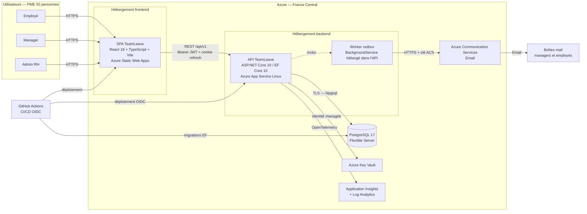
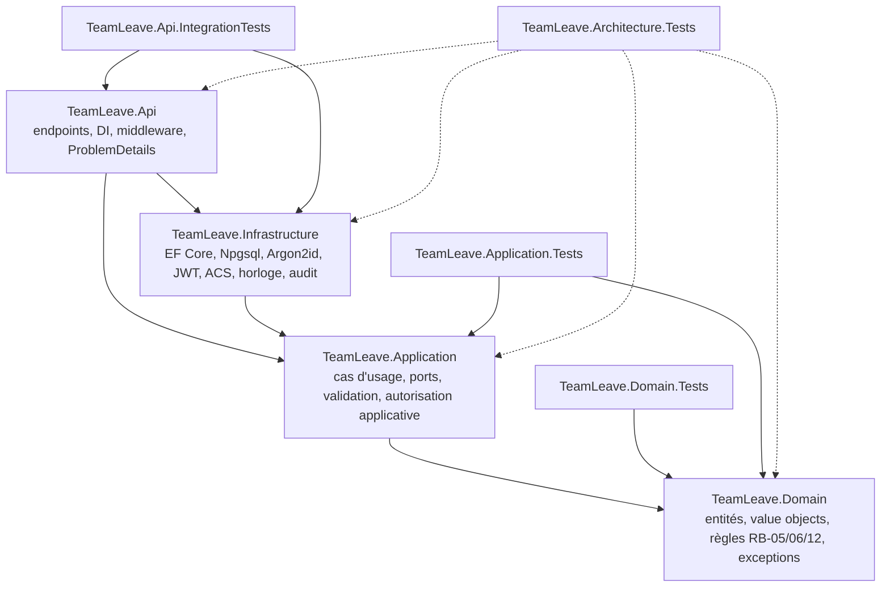
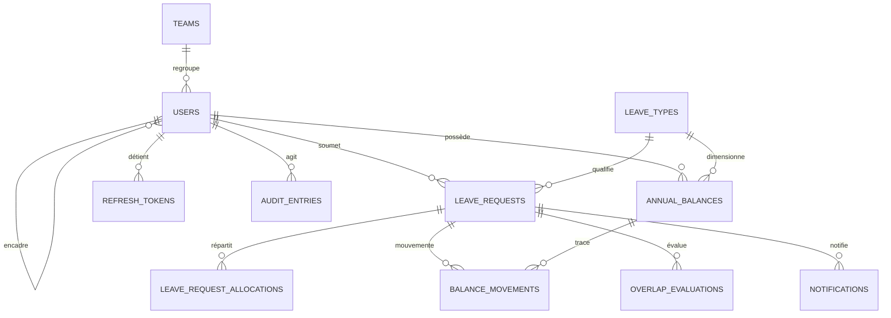
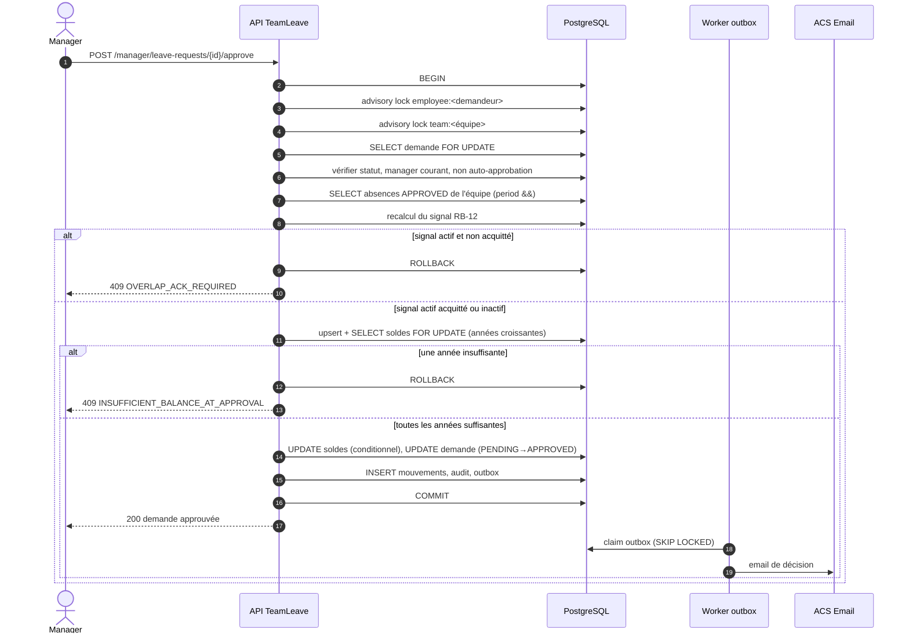
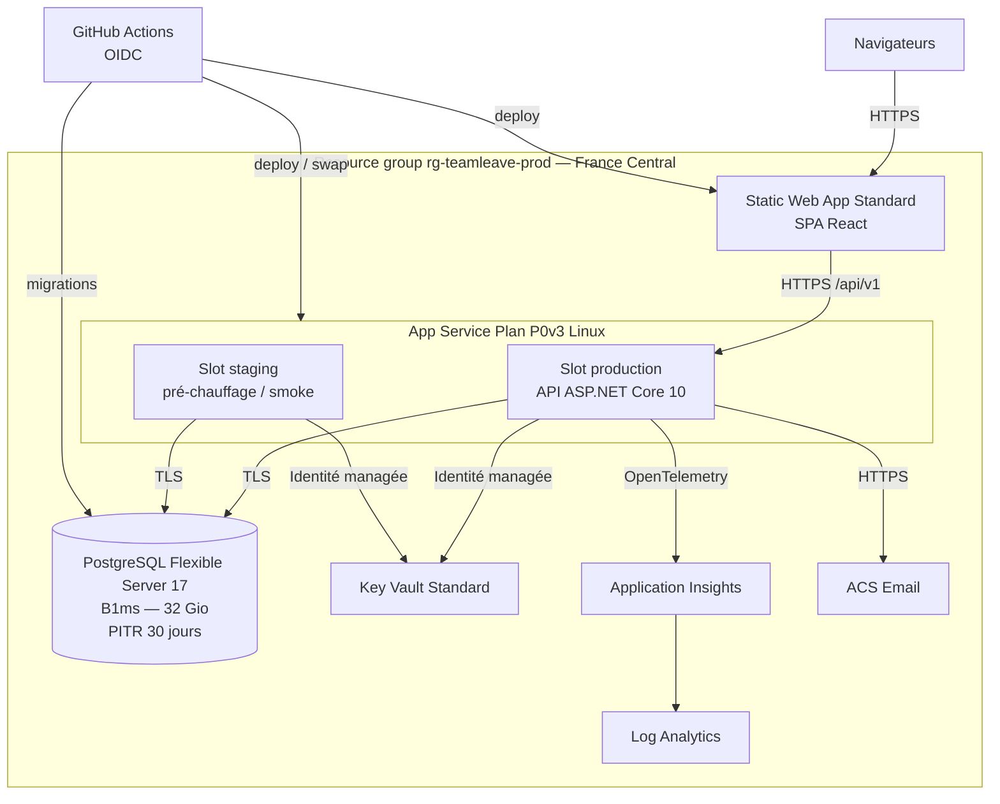

# TeamLeave — Dossier d'architecture et de conception système

| Élément | Valeur |
|---|---|
| Version | 1.0 |
| Étape | 2 — Architecture et conception système |
| Sources | `00_brief.md`, `step1_spec.md` (v1.0) |
| Statut | Proposition à valider par le commanditaire (points ouverts en annexe A) |
| Périmètre | Conception système uniquement : aucun code applicatif, aucun projet créé |
| Destinataires | Équipe de développement, exploitation, DPO, commanditaire |

> **Conventions de lecture.**
> - `RB-xx` désigne une règle métier de `step1_spec.md` §5 ; `CA-xx.y` un critère d'acceptation ; `H-xx` une hypothèse ; `PO-xx` un point ouvert.
> - `ENF-7.x` désigne une exigence non fonctionnelle de `step1_spec.md` §7 (7.1 performance, 7.2 sécurité, 7.3 disponibilité, 7.4 accessibilité, 7.5 RGPD).
> - Toute décision non triviale cite la règle ou l'exigence qui la motive. Les points où la spécification est muette, ambiguë ou contradictoire sont signalés dans le texte par un encadré **« Écart / décision »** et récapitulés en **annexe A**.
> - Les identifiants, montants et exemples de payloads sont illustratifs. Les prix Azure sont des ordres de grandeur à vérifier au moment de l'achat.

## Sommaire

1. [Vue d'ensemble — C4 niveau conteneurs](#1-vue-densemble--c4-niveau-conteneurs)
2. [Choix technologiques et arbitrages](#2-choix-technologiques-et-arbitrages)
3. [Architecture logicielle du backend](#3-architecture-logicielle-du-backend)
4. [Schéma de base de données](#4-schéma-de-base-de-données)
5. [Contrat d'API](#5-contrat-dapi)
6. [Concurrence et cohérence](#6-concurrence-et-cohérence)
7. [Sécurité](#7-sécurité)
8. [Stratégie de tests](#8-stratégie-de-tests)
9. [Déploiement Azure minimal](#9-déploiement-azure-minimal)
10. [Architecture Decision Records](#10-architecture-decision-records)
- [Annexe A — Insuffisances de la spécification et décisions](#annexe-a--insuffisances-de-la-spécification-et-décisions)
- [Annexe B — Traçabilité règles / composants / tests](#annexe-b--traçabilité-règles--composants--tests)

---

## 0. Décisions structurantes en une page

| # | Décision | Arbitrage principal | Motif | Détail |
|---|---|---|---|---|
| D1 | ASP.NET Core 10 LTS + EF Core 10 | Dernière LTS, support jusqu'en novembre 2028 | Brief « dernière LTS » ; ENF-7.3 | §2.2 |
| D2 | PostgreSQL 17 managé | Contraintes d'exclusion, coût, conformité UE | RB-08, RB-22, ENF-7.5 | §2.3, ADR-001 |
| D3 | Architecture en 4 projets (Domain, Application, Infrastructure, Api) | Isolation du domaine et testabilité | ENF-7.1, maintenabilité | §3 |
| D4 | JWT courts + refresh opaque rotatif en base | Révocation et rotation vérifiables | RB-01, ENF-7.2 | §7, ADR-003 |
| D5 | Durées stockées en demi-journées entières | Supprime les erreurs d'arrondi et rend les CHECK exacts | RB-05, RB-06 | §4 |
| D6 | Non-chevauchement personnel garanti par contrainte GiST | Invariant infalsifiable même en concurrence | RB-08, RB-22 | §4, ADR-001 |
| D7 | Décrément de solde par verrou de ligne + `UPDATE` conditionnel + CHECK | Aucun solde négatif possible | RB-05, RB-22 | §6, ADR-002 |
| D8 | Notifications par outbox transactionnel + worker | Décision jamais annulée par un échec email | RB-16, RB-22 | §6.10 |
| D9 | Frontend React 19 + Vite, hébergé sur Static Web Apps | Déploiement indépendant, TLS et CDN managés | Brief, ENF-7.4 | §2.6 |
| D10 | Azure App Service + PostgreSQL Flexible Server + Key Vault + ACS Email | Coût minimal, exploitation réduite | ENF-7.3, ENF-7.5 | §9 |

---

## 1. Vue d'ensemble — C4 niveau conteneurs

### 1.1 Portée du système

TeamLeave est un système interne mono-tenant pour une PME de 50 personnes (H-01). Il couvre le cycle de vie d'une demande de congé : soumission, contrôle, décision, mise à jour du solde, calendrier d'équipe et notifications email (RB-02 à RB-22). Le système ne dialogue avec aucun SI tiers en v1 : ni paie, ni annuaire, ni agenda externe (§2.2 de la spécification).

Trois catégories d'acteurs humains utilisent le système — employé, manager, Admin RH — et un acteur système exécute les calculs, les contrôles et les envois. Le système s'appuie sur quatre services d'infrastructure : une base relationnelle, un fournisseur d'email, un coffre de secrets et une plateforme d'observabilité. Le navigateur est le seul client ; il n'y a ni application mobile ni API publique (exclusions de la v1).

### 1.2 Conteneurs

| Conteneur | Responsabilité | Technologie | Exposition | Données détenues |
|---|---|---|---|---|
| **SPA TeamLeave** | Interface employé / manager / Admin RH : authentification, demandes, soldes, calendrier, administration. | React 19, TypeScript 5, Vite 7, React Router, TanStack Query, React Hook Form + Zod, Tailwind CSS + Radix | HTTPS public, CDN Azure Static Web Apps | Aucune donnée métier persistée ; jeton d'accès en mémoire, jeton de rafraîchissement en cookie `HttpOnly` |
| **API TeamLeave** | Expose le contrat REST `/api/v1`, authentifie, autorise, applique toutes les règles métier, orchestre les transactions et écrit l'audit. | ASP.NET Core 10, EF Core 10, Npgsql, FluentValidation, JWT Bearer | HTTPS public, restriction d'origine et limitation de débit | Aucune donnée persistée hors base ; secrets lus dans Key Vault |
| **Worker de notifications** | Dépile l'outbox, envoie les emails, applique les tentatives et enregistre les échecs. Hébergé dans le processus API. | `BackgroundService` .NET, `PeriodicTimer`, Polly | Aucune exposition réseau entrante | État des notifications en base |
| **Base de données** | Persistance de toutes les données métier, des soldes, des mouvements, de l'audit, des jetons de rafraîchissement et de l'outbox. | PostgreSQL 17, Azure Database for PostgreSQL Flexible Server | TLS, pare-feu restreint, privé si durcissement | Toutes les données du système |
| **Service d'email** | Remise des emails de soumission et de décision aux destinataires. | Azure Communication Services — Email | HTTPS sortant | Adresses destinataires, contenu des emails (sans type ni commentaire) |
| **Coffre de secrets** | Stockage des clés JWT, chaînes de connexion, clé ACS. | Azure Key Vault | Identité managée uniquement | Secrets, jamais de données métier |
| **Observabilité** | Traces, métriques, logs applicatifs, alertes. | Application Insights + Log Analytics + OpenTelemetry | Aucune exposition publique | Télémétrie sans données de santé (ENF-7.5) |
| **Chaîne CI/CD** | Build, tests, migrations, déploiement des deux artefacts. | GitHub Actions, identité fédérée OIDC | Aucune exposition runtime | Artefacts, pas de données de production |

### 1.3 Diagramme de conteneurs (Mermaid)



**Lecture du diagramme.** Le navigateur ne parle qu'à la SPA et à l'API. La SPA ne détient aucune donnée métier durable. Toute décision d'autorisation et toute règle métier sont appliquées par l'API (RB-17, « toute vérification de permission est faite côté serveur »). Le worker partage le processus de l'API pour rester dans le plan d'hébergement minimal, mais il est isolé par son propre service et son propre cycle de vie ; il peut être extrait en WebJob ou Function sans changer le modèle de données (voir §6.10).

### 1.4 Flux runtime principaux

1. **Authentification.** La SPA appelle `POST /auth/login`. L'API vérifie l'empreinte Argon2id, délivre un jeton d'accès de 15 minutes (rôles inclus) et un jeton de rafraîchissement opaque de 7 jours, stocké haché en base et posé en cookie `HttpOnly` (RB-01, ENF-7.2).
2. **Soumission.** La SPA appelle `POST /me/leave-requests`. L'API valide les dates et le type, calcule les demi-journées, contrôle le solde et l'absence de chevauchement personnel, évalue le seuil de 50 %, écrit la demande, ses allocations annuelles, l'évaluation, l'audit et la notification de soumission dans **une seule transaction** (RB-07, RB-08, RB-10, RB-16).
3. **Décision.** Le manager appelle `POST /manager/leave-requests/{id}/approve` ou `/reject`. L'API vérifie l'autorité au moment de la décision, recalcule le signal, verrouille les soldes, décrémente ou refuse, écrit l'audit et planifie la notification (RB-09 à RB-13, RB-22).
4. **Notification.** Après commit, le worker réclame la ligne d'outbox, envoie l'email via ACS et marque la ligne `SENT`. Un échec ne remet jamais en cause la décision (RB-16).
5. **Consultation.** Les lectures passent par des projections dédiées, sans effet de bord ; le calendrier ne retourne que des absences `APPROVED` (RB-20).

### 1.5 Ce que le système n'est pas

Pas de microservices, pas de bus de messages, pas de cache distribué, pas de data warehouse, pas de SSO, pas d'API publique (périmètre exclu de la v1). Ces choix sont volontaires : à 50 utilisateurs et 5 requêtes/seconde en pointe (ENF-7.1), un monolithe modulaire correctement découpé et une base relationnelle suffisent. Ajouter une infrastructure distribuée augmenterait le coût et la surface d'exploitation sans bénéfice mesurable.

---

## 2. Choix technologiques et arbitrages

### 2.1 Synthèse

| Sujet | Choix retenu | Alternatives écartées | Raison de l'arbitrage | Motif |
|---|---|---|---|---|
| Runtime backend | **.NET 10 LTS** | .NET 8 LTS, .NET 9 STS | .NET 10 est la dernière LTS (support jusqu'en nov. 2028) ; .NET 8 sort du support en nov. 2026 ; .NET 9 est STS. Le SDK .NET 10 est disponible dans l'environnement de build. | Brief « dernière LTS », ENF-7.3 |
| Framework HTTP | **ASP.NET Core Minimal APIs** | MVC contrôleurs, FastEndpoints | Moins de cérémonie, résultats typés, filtres d'endpoint réutilisables, OpenAPI natif. Les contrôleurs restent une alternative acceptable si l'équipe les préfère. | ENF-7.1, maintenabilité |
| ORM | **EF Core 10** | Dapper seul, ADO.NET brut | Migrations versionnées, mapping explicite, LINQ sécurisé par paramétrage. Dapper serait plus rapide mais imposerait d'écrire et de maintenir tout le SQL ; à 10 000 demandes sur 5 ans, le gain est nul. | ENF-7.1 |
| Base de données | **PostgreSQL 17** | SQL Server 2022 / Azure SQL | Contraintes d'exclusion et index partiels pour garantir le non-chevauchement (RB-08) ; coût sans licence ; extension `citext` ; `jsonb` pour les détails de chevauchement ; hébergement UE. | RB-08, RB-22, ENF-7.5 |
| Authentification | **JWT locaux + refresh opaque rotatif** | Microsoft Entra ID, ASP.NET Core Identity + Duende, cookies | Le SSO/LDAP est explicitement exclu (PO-12) et Entra ID P1 (Conditional Access, MFA) coûterait environ 6 $/utilisateur/mois. Les JWT à rôles sont imposés par le brief. | RB-01, ENF-7.2 |
| Hachage des mots de passe | **Argon2id** | PBKDF2, bcrypt | Argon2id est recommandé par l'OWASP et accepté par la spec ; paramétrage mémoire 64 Mio, 3 itérations, parallélisme 4. | ENF-7.2 |
| Frontend | **React 19 + TypeScript 5 + Vite 7** | Next.js, Angular, Vue | Imposé par le brief pour React/TS/Vite. Next.js ajouterait un serveur Node et du SSR sans besoin (application interne sans SEO). | Brief, ENF-7.4 |
| État serveur | **TanStack Query v5** | Redux Toolkit + RTK Query, SWR | Cache, invalidation et états de chargement/erreur standardisés sans store global. Redux est surdimensionné pour un état serveur majoritairement en lecture. | ENF-7.1, ENF-7.4 |
| UI | **Tailwind CSS 4 + Radix UI** | Material UI, Ant Design | Radix fournit les primitives accessibles (dialog, menu, focus) conformes WCAG 2.1 AA ; Tailwind évite un thème lourd. MUI reste une alternative si l'équipe veut des composants clés en main. | ENF-7.4 |
| Emails | **Azure Communication Services Email** | SendGrid, SMTP Microsoft 365 | Service Azure natif, domaine managé, DPA Microsoft, pas de dépendance à un tiers ; SMTP AUTH Microsoft 365 est en voie de dépréciation. | RB-16, ENF-7.5 |
| Hébergement API | **Azure App Service Linux (P0v3)** | Azure Container Apps, AKS, VM | Slots de déploiement, TLS et certificats managés, identité managée, mise à l'échelle simple. Container Apps/AKS ajoutent de la complexité sans besoin à 20 utilisateurs simultanés. | ENF-7.3 |
| Hébergement frontend | **Azure Static Web Apps (Standard)** | Même App Service que l'API, Blob + CDN | Déploiement indépendant, CDN mondial, TLS managé, environnements de prévisualisation par PR. | ENF-7.3, ENF-7.4 |
| Secrets | **Azure Key Vault** | App Settings, variables d'environnement | Rotation, contrôle d'accès RBAC, audit ; aucune clé dans le code ou l'image. | ENF-7.2 |
| Observabilité | **Application Insights + OpenTelemetry** | ELK, Prometheus/Grafana | Intégration native Azure, corrélation des traces, alertes sans serveur supplémentaire. | ENF-7.3 |
| CI/CD | **GitHub Actions + OIDC** | Azure DevOps, déploiement manuel | Identité fédérée sans secret de déploiement, workflows versionnés. Si le dépôt est sur Azure DevOps, la transposition est directe. | ENF-7.3 |
| Tests backend | **xUnit v3 + Testcontainers + Respawn + NSubstitute** | MSTest, NUnit, Moq | xUnit est imposé par le brief ; Testcontainers permet de tester les contraintes PostgreSQL réelles ; NSubstitute évite les problèmes de licence de Moq. | Brief, ENF-7.1 |

### 2.2 Runtime et framework backend — ASP.NET Core 10 LTS

**Décision.** Cibler `net10.0`, ASP.NET Core 10 et EF Core 10.

**Alternatives.** .NET 8 LTS est la LTS précédente, mais son support se termine en novembre 2026, ce qui exposerait l'application à une migration forcée dès la première année d'exploitation. .NET 9 est une version STS (18 mois de support) et ne répond pas à l'exigence « dernière LTS ». .NET 11, disponible dans l'environnement, est une STS et ne doit pas être choisi pour un système interne stable.

**Conséquences.** Le parc de build et l'image App Service doivent fournir .NET 10. Si l'offre App Service Linux ne propose pas encore le runtime 10 au moment du déploiement, l'API sera déployée en image conteneur sur App Service (même plan, même modèle), ce qui ne change ni le code ni l'architecture. Les bibliothèques doivent être compatibles `net10.0` ; EF Core 10 et Npgsql 10 le sont.

**Motif.** Brief « ASP.NET Core (dernière LTS) » ; ENF-7.3 (disponibilité et maintenance).

### 2.3 Base de données — PostgreSQL 17 plutôt que SQL Server

**Décision.** Azure Database for PostgreSQL Flexible Server, version 17, avec les extensions `citext` et `btree_gist`.

**Alternatives et raisons de l'écartement.**

| Alternative | Avantages | Raisons de l'écartement |
|---|---|---|
| SQL Server 2022 / Azure SQL | Écosystème Microsoft, outillage SSMS, compétences potentielles | Coût de licence et de l'offre managée supérieur à volume égal ; la garantie de non-chevauchement exigerait un trigger ou une table d'occupation, moins déclarative qu'une contrainte d'exclusion ; aucun besoin spécifique T-SQL identifié. |
| MySQL / MariaDB | simplicité, coût | Pas de contrainte d'exclusion, `jsonb` moins riche, support EF Core moins mature pour les types avancés. |
| SQLite | aucun serveur | Inadapté à la concurrence multi-utilisateurs et à l'hébergement Azure. |

**Pourquoi PostgreSQL convient particulièrement à TeamLeave.**

- **Contrainte d'exclusion** `EXCLUDE USING gist (employee_id WITH =, period WITH &&) WHERE status IN ('PENDING','APPROVED')` : elle rend le chevauchement personnel (RB-08) **impossible au niveau de la base**, y compris entre deux transactions concurrentes. C'est la garantie la plus forte et la moins coûteuse à maintenir.
- **Index partiels** : la file du manager (`WHERE status='PENDING'`), les absences approuvées (`WHERE status='APPROVED'`) et les notifications dues sont indexés sans gonfler les index.
- **`jsonb`** : le détail du signal de chevauchement (équipe, N, taux, demi-journées en dépassement) est stocké sans figer un schéma qui peut évoluer (RB-12).
- **`citext`** : l'unicité des emails et des codes de type est insensible à la casse (RB-01, RB-03), sans lower() applicatif.
- **Coût** : l'offre Flexible Server Burstable B1ms couvre largement 50 utilisateurs et 5 req/s ; SQL Server impose des licences ou une offre Azure SQL plus chère.
- **Conformité** : hébergement France Central, chiffrement au repos et TLS natifs, DPA Microsoft (ENF-7.5).

**Conséquences.** La contrainte d'exclusion est spécifique à PostgreSQL ; si l'entreprise imposait SQL Server, il faudrait la remplacer par un trigger `INSTEAD OF`/`AFTER` avec verrou ou une table d'occupation par demi-journée. Cette dépendance est assumée et documentée (ADR-001). Les migrations EF devront ajouter la contrainte et les triggers en SQL brut, EF Core ne les modélisant pas nativement.

**Motif.** RB-08 (non-chevauchement), RB-22 (atomicité), ENF-7.5 (hébergement UE), ENF-7.1 (volume).

### 2.4 ORM et accès aux données — EF Core 10

**Décision.** EF Core 10 pour le mapping, les migrations et les écritures ; projections LINQ pour les lectures ; SQL brut paramétré uniquement dans l'infrastructure pour les verrous (`FOR UPDATE`), les agrégats et la contrainte d'exclusion.

**Alternatives.** Dapper seul offrirait un contrôle total du SQL mais imposerait d'écrire chaque requête et chaque migration à la main, avec un risque d'oubli d'un `WHERE` d'autorisation. Un mélange EF Core + Dapper est possible plus tard pour les rapports, mais n'est pas justifié à ce volume.

**Conséquences.** Les requêtes de liste utilisent `AsNoTracking()` et une projection vers un read model, jamais le graphe d'entités complet. Le `DbContext` a une durée de vie par requête HTTP. Aucune migration n'est appliquée automatiquement au démarrage en production (§9.4).

**Motif.** ENF-7.1 (p95 ≤ 300 ms en lecture), maintenabilité.

### 2.5 Authentification — JWT locaux avec refresh rotatif

**Décision.** JWT signés HS256, jeton d'accès de 15 minutes, jeton de rafraîchissement opaque de 7 jours, stocké haché (SHA-256) en base, rotation à chaque usage, détection de réutilisation et révocation par famille. Argon2id pour les mots de passe. Aucun fournisseur d'identité externe en v1.

**Alternatives et raisons de l'écartement.**

| Alternative | Avantages | Raisons de l'écartement |
|---|---|---|
| Microsoft Entra ID (SSO) | MFA, Conditional Access, gestion du cycle de vie, moins de code d'authentification | Le SSO/LDAP est explicitement exclu de la v1 (PO-12) ; l'offre P1 nécessaire à Conditional Access coûte environ 6 $/utilisateur/mois, soit ≈ 300 $/mois pour 50 personnes, hors abonnement M365 ; migration et gouvernance à cadrer. C'est la cible recommandée en v2. |
| ASP.NET Core Identity + Duende IdentityServer | Cadre éprouvé, gestion des rôles et des mots de passe | IdentityServer ajoute un serveur d'autorisation et une complexité de configuration ; Identity seul apporte des tables et des conventions dont nous n'avons pas besoin (pas d'auto-inscription, pas de login externe). Le stockage custom reste simple. |
| Cookies d'authentification | Révocation immédiate, pas de jeton côté client | Le brief impose JWT ; une API stateless consommée par une SPA se prête mieux au Bearer + refresh. |
| JWT de rafraîchissement | Aucun stockage serveur | Impossible de révoquer un jeton de rafraîchissement avant expiration, ce qui contredit RB-01 (jetons invalidés à la désactivation) et ENF-7.2 (rotation). |

**Conséquences.** L'équipe doit implémenter et tester le cycle de vie des jetons (émission, rotation, réutilisation, révocation, horloge). La révocation d'un jeton d'accès reste bornée par sa durée de vie ; une vérification d'empreinte de sécurité (`security_stamp`) est ajoutée pour réduire cette fenêtre (§7.1). La migration vers Entra ID en v2 est isolée derrière une abstraction `IIdentityProvider` côté application.

**Motif.** RB-01 (comptes, jetons invalidés), ENF-7.2 (JWT courts, rotation, révocation), PO-12.

### 2.6 Frontend — React 19 + TypeScript + Vite

**Décision.** SPA React 19, TypeScript strict, Vite 7, React Router 7, TanStack Query 5, React Hook Form + Zod, Tailwind CSS 4, Radix UI, date-fns + date-fns-tz.

**Alternatives.** Next.js (SSR inutile, serveur Node supplémentaire) ; Angular (non demandé, courbe d'apprentissage) ; Redux (état serveur essentiellement asynchrone, TanStack Query suffit) ; Material UI (bundle et thème plus lourds, mais alternative acceptable) ; Moment.js (déprécié, mutable).

**Conséquences.** Toutes les validations Zod sont dupliquées côté serveur, qui reste seul juge (RB-17). Les dates sont manipulées en `Europe/Paris` à l'affichage et envoyées en `YYYY-MM-DD` ; aucun calcul de jours n'est fait dans le navigateur pour une décision métier, le serveur renvoie `totalDays` et les soldes. Le découpage par rôle utilise les rôles du jeton, mais chaque écran est doublé d'un contrôle serveur.

**Contraintes d'accessibilité et de langue (ENF-7.4).** Interface entièrement en français avec `lang="fr"`, navigation clavier et focus visible, contraste texte/fond ≥ 4,5:1, information jamais portée par la couleur seule (le statut et le signal ont un libellé), tableaux et calendrier avec en-têtes accessibles, zoom 200 % sans perte de contenu, responsive de 360 à 1 920 px, support des deux dernières versions de Chrome, Edge, Firefox et Safari. Les composants Radix fournissent le socle clavier/focus ; les tests `axe-core` et une revue manuelle vérifient le reste.

**Motif.** Brief (React + TypeScript + Vite), ENF-7.4 (WCAG 2.1 AA, responsive 360–1920 px), ENF-7.1 (premier affichage ≤ 2,5 s).

### 2.7 Notifications email — Azure Communication Services

**Décision.** ACS Email avec domaine managé Azure, appelé par le worker après commit, avec gabarits fixes en français et lien profond vers l'application.

**Alternatives.** SendGrid (offre gratuite intéressante mais sous-traitant tiers supplémentaire et résidence des données à vérifier) ; SMTP Microsoft 365 (dépréciation de l'authentification SMTP, dépendance à la configuration Exchange) ; Amazon SES (sortie du périmètre Azure).

**Conséquences.** Le contenu est minimal et ne contient ni type de congé, ni commentaire, ni donnée de santé (RB-16, RB-17). L'échec d'envoi est journalisé sans contenu sensible. La clé ACS est dans Key Vault ; si l'authentification par identité managée est disponible pour Email au moment de l'implémentation, elle est préférée à la clé.

**Motif.** RB-16 (deux notifications obligatoires, échec non bloquant), ENF-7.5 (sous-traitant et données).

### 2.8 Hébergement Azure — App Service + Static Web Apps + PostgreSQL Flexible Server

**Décision.** Une souscription, trois environnements logiques (local, recette, production). Production : App Service Linux P0v3 avec slot `staging`, PostgreSQL Flexible Server B1ms (32 Gio, sauvegardes 30 jours), Static Web Apps Standard, Key Vault Standard, Application Insights + Log Analytics, ACS Email. Recette : App Service B1, PostgreSQL B1ms, Static Web Apps Free. Détail et coûts en §9.

**Alternatives.** Azure Container Apps (bon pour des jobs et du scale-to-zero, mais plus de pièces mobiles) ; AKS (surdimensionné) ; VM (exploitation manuelle, patches, TLS) ; Azure SQL (voir §2.3) ; hébergement du frontend dans l'API (économie de 9 €/mois mais couplage des déploiements et perte du CDN).

**Conséquences.** Deux artefacts déployés indépendamment (API + SPA). Le CORS de l'API est restreint à l'origine de la SPA. Les migrations sont exécutées par un job séparé, pas au démarrage (§9.4). La haute disponibilité zonale n'est pas incluse dans le plan minimal ; elle est un durcissement optionnel (§9.7).

**Motif.** ENF-7.3 (99,5 % en heures ouvrées, RTO 4 h, RPO 24 h), ENF-7.5 (UE), contrainte de coût d'une PME.

### 2.9 Versions et dépendances de référence

| Composant | Version cible | Politique |
|---|---|---|
| .NET / ASP.NET Core | 10.0 (LTS) | Patchs mensuels ; montée de version mineure testée en recette |
| EF Core / Npgsql | 10.x | Aligné sur .NET ; verrouillage par `Directory.Packages.props` |
| PostgreSQL | 17.x | Mises à jour mineures managées par Azure |
| React | 19.x | Dernière mineure ; `package-lock.json` versionné |
| TypeScript | 5.9+ | Mode `strict`, `noUncheckedIndexedAccess` |
| Vite | 7.x | Build reproductible, lockfile |
| xUnit | 3.x | Tests backend |
| Node.js | 24 LTS | Build frontend et outillage |

> **Écart / décision E-01 — version exacte de la LTS.** La spécification ne fixe pas de version de .NET. Le brief exige « la dernière LTS ». La dernière LTS au moment de la rédaction est .NET 10 (support jusqu'en novembre 2028) ; c'est la version retenue. Si le commanditaire impose .NET 8 pour des raisons de parc, l'architecture reste valable mais la date de fin de support (novembre 2026) doit être acceptée comme risque. Voir annexe A.

---

## 3. Architecture logicielle du backend

### 3.1 Principes

Le backend est un **monolithe modulaire** organisé en couches selon le principe de dépendance vers l'intérieur : le domaine ne connaît ni la base, ni HTTP, ni l'email ; l'application orchestre les cas d'usage ; l'infrastructure fournit les adaptateurs ; l'API est la racine de composition et le point d'entrée HTTP. Ce découpage vise trois propriétés directement liées aux exigences :

1. **Testabilité des règles** : RB-05, RB-06 et RB-12 sont des calculs purs, testables sans base ni serveur (ENF-7.1, §8).
2. **Impossibilité de contourner les contrôles** : aucune règle métier dans un endpoint ou dans le frontend ; l'autorisation est appliquée côté serveur (RB-17).
3. **Réversibilité** : remplacer PostgreSQL, ACS ou le fournisseur d'identité ne doit toucher que l'infrastructure (ADR-001, ADR-003).

### 3.2 Projets et sens des dépendances



| Projet | Rôle | Peut référencer | Ne peut jamais référencer |
|---|---|---|---|
| `TeamLeave.Domain` | Modèle métier, invariants, calculs de jours et de chevauchement, machine à états | Rien (BCL uniquement) | Application, Infrastructure, Api, EF Core, ASP.NET Core, Npgsql, `HttpContext`, `ILogger` |
| `TeamLeave.Application` | Cas d'usage, ports (`I...Repository`, `IUnitOfWork`, `IClock`, `ITokenService`), DTO internes, validation, politiques d'accès | Domain | Infrastructure, EF Core, ASP.NET Core, Npgsql, `HttpContext`, `IConfiguration`, `DbContext` |
| `TeamLeave.Infrastructure` | Adaptateurs : `TeamLeaveDbContext`, configurations EF, migrations, repositories, requêtes SQL verrouillantes, hachage, JWT, ACS, horloge, audit, outbox | Application, Domain | Api |
| `TeamLeave.Api` | Endpoints, filtres, middleware, DI, OpenAPI, gestion des erreurs, configuration d'authentification | Application, Infrastructure | — (mais interdit d'utiliser directement `DbContext` ou de porter une règle métier) |
| `TeamLeave.*.Tests` | Tests unitaires, d'intégration, d'architecture | Projets testés | — |

### 3.3 Règles de dépendance et interdits

| Interdit | Pourquoi | Alternative imposée |
|---|---|---|
| Entité du domaine référençant EF Core, `Npgsql`, `HttpContext`, `ILogger`, `DateTime.Now` | Le domaine doit rester pur et déterministe | Value objects, `IClock` injecté dans l'application, attributs de mapping en `IEntityTypeConfiguration` |
| Handler applicatif référençant `DbContext`, `NpgsqlConnection`, `IHttpContextAccessor` | Fuite d'infrastructure et de transport dans l'orchestration | Ports définis dans Application, implémentés dans Infrastructure |
| Endpoint contenant une règle métier (calcul de jours, contrôle de solde, décision) | La règle serait dupliquée et non testée au bon niveau | Appeler un cas d'usage unique, qui délègue au domaine |
| Endpoint ou handler démarrant une transaction à la main | Frontières transactionnelles dispersées, oublis de commit | `IUnitOfWork.ExecuteInTransactionAsync(...)` |
| `DbContext` injecté dans un endpoint ou un contrôleur | Contournement des ports et des filtres de périmètre | Repository ou query service |
| Entité du domaine sérialisée directement en JSON | Fuite de champs (hash, stamps), couplage du contrat au modèle | DTO de réponse explicites |
| `DateTime.UtcNow`, `DateTime.Today`, `TimeZoneInfo.Local` dans le code métier | Tests non déterministes, bugs de fuseau (Europe/Paris) | `IClock` / `TimeProvider` injecté |
| Requête SQL construite par concaténation de chaînes | Injection SQL (OWASP A03) | LINQ paramétré ou SQL brut avec paramètres nommés |
| Accès en écriture à une table hors du repository de son agrégat | Contournement des invariants et de l'audit | Repository dédié, cas d'usage unique |
| `async void`, `.Result`, `.Wait()` | Interblocages et perte d'exceptions | `async`/`await` de bout en bout |
| Suppression physique d'une demande, d'un mouvement, d'un audit ou d'un utilisateur | RB-15, RB-18, RB-21 | Désactivation, annulation, écritures append-only |
| Dépendance de `Infrastructure` vers `Api` | Cycle et couplage inverse | Contrats définis dans Application |

**Application des règles.** Les références de projets sont la première barrière. La seconde est un test d'architecture (NetArchTest) exécuté en CI qui vérifie l'absence de types interdits par assembly et par namespace. La troisième est la revue de code : la checklist de PR reprend explicitement les lignes de ce tableau.

### 3.4 Organisation des dossiers

```text
src/
  TeamLeave.Domain/
    Entities/                 User, Team, LeaveType, LeaveRequest, AnnualBalance,
                              BalanceMovement, OverlapEvaluation, Notification, AuditEntry
    Enums/                    LeaveStatus, HalfDay, LeaveTypeCode, BalanceMovementNature,
                              NotificationType, NotificationStatus, Role
    ValueObjects/             LeavePeriod, HalfDayCount, LeaveYear, EmailAddress, PersonName
    Services/                 LeaveDurationCalculator, LeaveYearSplitter, OverlapAnalyzer,
                              BalancePolicy, DecisionPolicy, CancellationPolicy
    Exceptions/               DomainException, BusinessRuleViolation, InvalidStateTransition
  TeamLeave.Application/
    Abstractions/             ports repositories, IUnitOfWork, IClock, ICurrentUser,
                              ITokenService, IPasswordHasher, IEmailSender, IAuditWriter
    Abstractions/Queries/     read models et query services
    Auth/                     Login, Refresh, Logout, ChangePassword
    Me/                       SubmitLeaveRequest, CancelLeaveRequest, GetMyBalances, ...
    Manager/                  ListQueue, GetForDecision, Approve, Reject
    Calendar/                 GetTeamCalendar
    Admin/                    Types, Users, Teams, Balances, Audit, Notifications
    Common/                   Result, Error, PagedResult, validators
  TeamLeave.Infrastructure/
    Persistence/              TeamLeaveDbContext, Configurations/, Migrations/
    Persistence/Repositories/ repositories par agrégat
    Persistence/Queries/      projections et SQL de lecture
    Identity/                 Argon2PasswordHasher, JwtTokenService, RefreshTokenStore
    Notifications/            NotificationOutbox, AcsEmailSender, NotificationWorker
    Time/                     SystemClock
    Audit/                    AuditWriter
  TeamLeave.Api/
    Endpoints/                AuthEndpoints, MeEndpoints, ManagerEndpoints, CalendarEndpoints,
                              AdminEndpoints, HealthEndpoints
    Authorization/            policies et resource handlers
    Middleware/               correlation, security headers, exception mapping
    Contracts/                requêtes/réponses HTTP + validators FluentValidation
    Program.cs
tests/
  TeamLeave.Domain.Tests/
  TeamLeave.Application.Tests/
  TeamLeave.Api.IntegrationTests/
  TeamLeave.Architecture.Tests/
web/
  src/ (React)
```

### 3.5 Cas d'usage

Chaque cas d'usage est une classe unique avec une méthode `HandleAsync`, injectée dans l'endpoint. Un cas d'usage en écriture ouvre **une seule** transaction ; un cas d'usage en lecture n'ouvre aucune transaction explicite et utilise une projection.

| Cas d'usage | Endpoint | Transaction | Écritures | Règles |
|---|---|---|---|---|
| `Login` | `POST /auth/login` | Non (une écriture de trace + compteurs) | `last_login_at`, compteurs d'échec, jeton de rafraîchissement | RB-01, ENF-7.2 |
| `RefreshToken` | `POST /auth/refresh` | Oui | Rotation du jeton, révocation de l'ancien | RB-01, ENF-7.2 |
| `Logout` | `POST /auth/logout` | Oui | Révocation du jeton courant | RB-01 |
| `ChangePassword` | `PUT /me/password` | Oui | Hash, `security_stamp`, révocation de tous les refresh | RB-01, ENF-7.2 |
| `SubmitLeaveRequest` | `POST /me/leave-requests` | **Oui** | Demande, allocations, évaluation de chevauchement, audit, outbox | RB-02, RB-05 à RB-08, RB-12, RB-16 |
| `CancelLeaveRequest` | `POST /me/leave-requests/{id}/cancel` | **Oui** | Statut, mouvement de restitution si approuvée, audit | RB-14, RB-15, RB-22 |
| `ListMyRequests`, `GetMyRequest` | `GET /me/leave-requests...` | Non | — | RB-17 |
| `GetMyBalances` | `GET /me/balances` | Non | — | RB-05, RB-17 |
| `ListManagerQueue`, `GetRequestForDecision` | `GET /manager/leave-requests...` | Non (calcul du signal à la volée) | — | RB-09, RB-12, RB-17 |
| `ApproveLeaveRequest` | `POST /manager/leave-requests/{id}/approve` | **Oui** | Statut, soldes, mouvements, évaluation, audit, outbox | RB-05, RB-09, RB-10, RB-12, RB-13, RB-22 |
| `RejectLeaveRequest` | `POST /manager/leave-requests/{id}/reject` | **Oui** | Statut, commentaire, audit, outbox | RB-09, RB-11, RB-16 |
| `GetTeamCalendar` | `GET /teams/{teamId}/calendar` | Non | — | RB-17, RB-20 |
| `Create/UpdateLeaveType` | `POST/PATCH /admin/leave-types` | Oui | Type, audit | RB-03, RB-18 |
| `Create/UpdateUser`, `DeactivateUser`, `ResetPassword` | `/admin/users...` | Oui | Compte, rôles, rattachements, annulations, mouvements, audit | RB-01, RB-02, RB-18, RB-21, RB-22 |
| `Create/UpdateTeam` | `/admin/teams...` | Oui | Équipe, audit | RB-02, RB-18 |
| `AdjustBalance` | `POST /admin/users/{userId}/balance-adjustments` | **Oui** | Solde, mouvement, audit | RB-05, RB-19, RB-22 |
| `ListAdminRequests`, `ListNotifications`, `ListAudit` | `/admin/...` | Non | — | RB-17, RB-18 |
| `SendPendingNotifications` | Worker | Par lot, une transaction par notification | Outbox | RB-16, RB-22 |

> **Décision d'architecture — pas de bus de commandes.** MediatR n'est pas retenu : il ajoute une indirection et un scan d'assembly pour un bénéfice nul à cette taille. Les handlers sont des dépendances explicites, ce qui rend le graphe lisible et les tests directs. Une migration vers un bus reste possible sans changer le domaine.

### 3.6 Domaine — responsabilités et invariants

**Entités et agrégats.**

- `LeaveRequest` est la racine d'agrégat : dates, demi-journées, type, statut, décision, annulation, acquittement et ses `LeaveRequestAllocation`. Toute transition passe par les méthodes `Approve`, `Reject`, `Cancel` qui vérifient l'état courant (RB-09 à RB-15).
- `AnnualBalance` porte les compteurs `grantedHalfDays`, `consumedHalfDays` et la version ; ses méthodes `Consume` et `Restore` refusent tout passage sous zéro (RB-05).
- `BalanceMovement` est immuable : une correction est un nouveau mouvement de sens opposé (RB-19).
- `User` porte les rôles, l'équipe, le manager direct, l'état actif et l'empreinte de sécurité ; les règles « manager ≠ soi-même », « dernier Admin RH actif » et « employé de base » sont vérifiées dans le domaine et doublées en base.
- `Notification` est une ligne d'outbox, pas un email : elle décrit l'événement, la clé de déduplication et l'état d'envoi (RB-16).

**Services de domaine (calculs purs, sans I/O).**

| Service | Entrée | Sortie | Règle |
|---|---|---|---|
| `LeaveDurationCalculator` | `LeavePeriod` (dates + demi-journées) | nombre de demi-journées | RB-06 : week-ends exclus, AM/PM, début/fin ouvré |
| `LeaveYearSplitter` | `LeavePeriod`, `LeaveYear` | répartition par année civile | RB-04, RB-06 : demande à cheval sur deux années |
| `OverlapAnalyzer` | équipe (N membres actifs), période demandée, absences approuvées des autres, demandeur | `OverlapEvaluation` (applicable, actif, taux max, demi-journées en dépassement) | RB-12 : `(A(h)+1)/N > 0,50`, seuil strict, N ≥ 2 |
| `BalancePolicy` | solde disponible, jours demandés, sens de l'ajustement | décision autorisé/refusé avec motif | RB-05, RB-19 : jamais négatif, précision 0,5 |
| `DecisionPolicy` | statut, demandeur, décideur courant, commentaire, signal, acquittement | décision ou erreur métier | RB-09 à RB-13 |
| `CancellationPolicy` | statut, date de début, date du jour (Europe/Paris), acteur | annulation autorisée ou erreur | RB-14, RB-21 |

`OverlapAnalyzer` reçoit une liste d'absences déjà approuvées, jamais une requête SQL : il est testable avec les sept exemples de RB-12, y compris le seuil exact à 50 % et l'équipe d'un seul membre. La requête SQL qui alimente cet analyseur est un détail d'infrastructure (§4.6).

**Machine à états.** `PENDING → APPROVED`, `PENDING → REJECTED`, `PENDING → CANCELLED`, `APPROVED → CANCELLED` (RB-15). Toute autre transition est une erreur `INVALID_STATE` ; les états `REJECTED` et `CANCELLED` sont terminaux. La base applique la même table de transitions par trigger (§4.6), ce qui rend une régression applicative détectable immédiatement.

### 3.7 Accès aux données

- **Un `DbContext` par requête HTTP**, configuré sans `LazyLoadingEnabled`, avec `QueryTrackingBehavior.NoTracking` par défaut pour les lectures ; les écritures attachent explicitement les agrégats.
- **Configurations EF explicites** (`IEntityTypeConfiguration`) : noms de tables et de colonnes en `snake_case`, types PostgreSQL, contraintes, index, colonnes générées. Aucune convention magique pour les noms.
- **Repositories par agrégat** : `ILeaveRequestRepository`, `IAnnualBalanceRepository`, `IUserRepository`, `ITeamRepository`, `ILeaveTypeRepository`, `INotificationRepository`, `IRefreshTokenRepository`. Pas de repository générique.
- **Query services dédiés** pour les lectures : `ILeaveRequestQueries`, `ICalendarQueries`, `IAdminQueries`, `IAuditQueries`. Ils projettent directement vers des read models et ne retournent jamais d'entités suivies.
- **SQL verrouillant dans l'infrastructure uniquement** : `SELECT ... FOR UPDATE` sur la demande et les soldes, verrou consultatif d'équipe, mise à jour conditionnelle des compteurs. Ces requêtes sont nommées, commentées et couvertes par les tests d'intégration (§6).
- **`IUnitOfWork`** expose `ExecuteInTransactionAsync(IsolationLevel, Func<CancellationToken, Task<T>>)` ; le handler ne voit ni `BeginTransaction` ni `Commit`.
- **Audit** : `IAuditWriter.WriteAsync(...)` ajoute la ligne dans la transaction courante ; aucune écriture d'audit hors transaction métier, sinon une action pourrait être auditée sans être appliquée (ou l'inverse).
- **Outbox** : `INotificationRepository.EnqueueAsync(...)` ajoute la ligne dans la même transaction ; l'envoi est fait après commit par le worker (§6.10).

**Volumétrie et performance.** À 10 000 demandes sur cinq ans et 50 utilisateurs (ENF-7.1), toutes les listes sont paginées (50 par défaut, 100 maximum) et filtrables. Les index sont dimensionnés pour les trois lectures chaudes : file du manager (`status='PENDING'`), calendrier d'équipe (`period` + `status='APPROVED'`), soldes d'un employé (`employee_id, year`). Aucune vue matérialisée ni cache distribué n'est nécessaire.

### 3.8 Pipeline de requête HTTP

Ordre des middlewares (du plus externe au plus interne) :

1. **Corrélation** : lit ou génère `X-Correlation-Id`, l'ajoute aux logs et aux `ProblemDetails` (`traceId`).
2. **Forwarded headers** : respecte le terminateur TLS d'App Service.
3. **Gestion d'exceptions** : convertit toute exception en `application/problem+json` sans détail sensible ; journalise avec la corrélation.
4. **HSTS et redirection HTTPS** : ENF-7.2.
5. **En-têtes de sécurité** : CSP, `X-Content-Type-Options`, `Referrer-Policy`, `Permissions-Policy`, `frame-ancestors`.
6. **CORS** : origine unique de la SPA, `Authorization` et `Content-Type` autorisés, `AllowCredentials` pour le cookie de rafraîchissement.
7. **Authentification JWT** : validation signature, `iss`, `aud`, expiration, `kid`, `security_stamp`.
8. **Limitation de débit** : politique spécifique sur `/auth/login` et `/auth/refresh` (ENF-7.2).
9. **Autorisation** : politique par endpoint, `FallbackPolicy = RequireAuthenticatedUser`, refus par défaut.
10. **Endpoint** : validation FluentValidation, appel du cas d'usage, mapping du `Result` vers `TypedResults`.

Les endpoints de santé (`/health/live`, `/health/ready`) sont anonymes, sans rate limiting et sans passage par l'authentification JWT.

### 3.9 Erreurs et mapping HTTP

Les cas d'usage retournent un `Result<T>` portant un `Error` (`code`, `message`, `httpStatus`, extensions). Les exceptions de domaine ne servent qu'aux invariants impossibles à exprimer par un `Result` (état corrompu) et sont converties en `500` après journalisation. Les exceptions PostgreSQL sont traduites dans l'infrastructure :

| Origine | SQLSTATE / condition | Mapping |
|---|---|---|
| Contrainte d'exclusion de chevauchement | `23P01` sur `ex_leave_requests_personal_overlap` | `409 PERSONAL_OVERLAP` |
| Unicité (email, code de type, clé d'événement) | `23505` | `409` avec le code métier correspondant |
| CHECK « solde non négatif » | `23514` sur `ck_balances_available` | `409 INSUFFICIENT_BALANCE_AT_APPROVAL` (ou `422` à la soumission) |
| Trigger de transition | `23514` sur `trg_leave_requests_guard` | `409 INVALID_STATE` |
| Deadlock / sérialisation | `40P01`, `40001` | Retry borné puis `409` ou `503` |
| Timeout | `57014` | `503` avec `Retry-After` |
| Tout le reste | — | `500` générique, sans message interne |

Les `ProblemDetails` respectent la spécification §8.1 : `type`, `title`, `status`, `detail`, `code`, `traceId` et, pour les validations, `errors`. Aucun message ne contient de SQL, de nom de table, de hash ou de donnée de santé.

### 3.10 Frontières transactionnelles

| Opération | Frontière | Isolation | Points de reprise |
|---|---|---|---|
| Soumission | Demande + allocations + évaluation + audit + outbox | `ReadCommitted` | Aucun retry applicatif ; conflit d'exclusion = `409` |
| Approbation | Demande + soldes + mouvements + évaluation + audit + outbox | `ReadCommitted` + verrous explicites | Retry sur deadlock uniquement |
| Refus | Demande + audit + outbox | `ReadCommitted` | Retry sur deadlock |
| Annulation | Demande + soldes (si approuvée) + mouvements + audit | `ReadCommitted` | Retry sur deadlock |
| Ajustement | Solde + mouvement + audit | `ReadCommitted` | Retry sur deadlock |
| Désactivation | Utilisateur + demandes annulées + soldes restaurés + audit | `ReadCommitted` | Retry sur deadlock |
| Rotation de jeton | Ancien jeton + nouveau jeton | `ReadCommitted` | Aucun |
| Envoi d'email | Ligne d'outbox uniquement | Autocommit par ligne | Retry planifié |

Le niveau `ReadCommitted` de PostgreSQL suffit **parce que** les invariants critiques sont protégés par des verrous de ligne, des contraintes de base et un verrou consultatif par équipe (§6). Le niveau `Serializable` global a été écarté : il imposerait des retries sur toutes les écritures, y compris les simples mises à jour d'utilisateur, pour un gain nul sur les invariants déjà garantis par les contraintes.

> **Écart / décision E-02 — `EnableRetryOnFailure` et transactions.** La stratégie de retry Npgsql ne réessaie pas automatiquement une transaction ouverte par l'application. Les cas d'usage en écriture enveloppent donc la transaction complète dans `IExecutionStrategy.ExecuteAsync`, et ne réessaient que les erreurs transitoires (`40001`, `40P01`, coupure réseau). Les autres erreurs ne sont jamais rejouées, pour éviter un double débit. Voir §6.11.

### 3.11 Ce qui est explicitement interdit entre les couches

En complément du tableau §3.3 :

- Aucun endpoint ne calcule un nombre de jours, un solde, un taux de chevauchement ou une transition de statut. Ces calculs sont dans le domaine.
- Aucun handler ne connaît le format HTTP (status code, header, cookie). Il retourne un `Result` ; l'endpoint traduit.
- Aucun repository ne décide d'une autorisation. Le périmètre est passé en paramètre par le handler (`managerId`, `teamId`, `isHrAdmin`) et vérifié avant l'appel, puis doublé par le filtre SQL.
- Aucune entité EF n'est retournée par un endpoint. Les DTO de contrat sont distincts des read models, eux-mêmes distincts des entités.
- Aucune écriture d'audit ou d'outbox hors de la transaction métier.
- Aucun secret, aucune chaîne de connexion, aucun paramètre Argon2id dans le code source. Tout passe par Key Vault ou `IOptions<...>` validé au démarrage.
- Aucun `DateTime.Now`, `TimeZoneInfo.Local` ou `new Random()` dans le code métier : `TimeProvider` et générateurs injectés.

---

## 4. Schéma de base de données

### 4.1 Principes de conception physique

| Sujet | Décision | Motif |
|---|---|---|
| Identifiants | `uuid` générés en UUIDv7 (ordre temporel, localité d'index) | Identifiants opaques, non énumérables ; UUIDv7 évite la fragmentation de l'index des UUIDv4. |
| Durées | **entiers de demi-journées** (`half_days`) dans toute la base ; conversion en jours décimaux à la frontière API | RB-05/06 : précision exacte à 0,5, aucun flottant, `CHECK` arithmétiques fiables. |
| Dates civiles | `date` (sans heure) ; « aujourd'hui » calculé en `Europe/Paris` par l'application | RB-06, RB-14 : une journée est une date civile, pas un instant. |
| Horodatages | `timestamptz`, toujours UTC côté serveur | Affichage `Europe/Paris` côté client ; pas d'ambiguïté DST. |
| Statuts | `varchar` + `CHECK`, pas de type ENUM PostgreSQL | Ajout d'un statut sans migration bloquante ; contrainte explicite. |
| Suppression | `ON DELETE RESTRICT` partout, aucun `CASCADE` métier | RB-15/18/21 : conservation de l'historique, aucune suppression via l'application. |
| Emails et codes | `citext` + index unique | RB-01/03 : unicité insensible à la casse. |
| Audit et mouvements | tables append-only protégées par trigger et privilèges | RB-18/19 : ni modification ni suppression. |
| Détail de chevauchement | `jsonb` | RB-12 : structure évolutive (demi-journées, taux, N), interrogeable. |
| Contrainte de non-chevauchement | `int4range` généré + `EXCLUDE USING gist` partiel | RB-08/22 : garanti par la base, y compris en concurrence. |

### 4.2 Modèle relationnel



### 4.3 Dictionnaire synthétique

| Table | Clé primaire | Clés étrangères / unicité | Rôle |
|---|---|---|---|
| `teams` | `id` | `name` unique | Équipes ; une équipe inactive reste consultable (RB-02). |
| `users` | `id` | `email` unique ; `team_id → teams` ; `manager_id → users` (≠ soi) | Comptes, rôles, rattachements, verrouillage de connexion (RB-01/02). |
| `leave_types` | `id` | `code` unique et immuable | Types CP, RTT, Maladie, Autre + types personnalisés (RB-03). |
| `annual_balances` | `(employee_id, leave_type_id, year)` | `employee_id → users`, `leave_type_id → leave_types` | Compteurs octroyés/consommés ; `consumed ≤ granted` (RB-05). |
| `leave_requests` | `id` | `employee_id`, `leave_type_id` ; contrainte d'exclusion `(employee_id, period)` | Demande, statut, décision, annulation, acquittement (RB-07 à RB-15). |
| `leave_request_allocations` | `(leave_request_id, year)` | `leave_request_id → leave_requests` | Répartition annuelle d'une demande multi-années (RB-04/06). |
| `balance_movements` | `id` | FK composite vers `annual_balances` ; unicité `(request, nature, year)` | Journal immuable des variations ; reconstructibilité des soldes (RB-19). |
| `overlap_evaluations` | `id` (identity) | `leave_request_id`, `team_id` | Historique des évaluations du seuil de 50 % (RB-12/13). |
| `notifications` | `id` | `event_key` unique ; `leave_request_id` | Outbox des deux emails obligatoires (RB-16). |
| `refresh_tokens` | `id` | `token_hash` unique ; `user_id` | Rotation, révocation, détection de réutilisation (RB-01). |
| `audit_entries` | `id` (identity) | `actor_id` | Journal append-only des actions sensibles (RB-18). |

**Colonnes clés de `leave_requests`.** `start_date`, `start_half_day`, `end_date`, `end_half_day`, `total_half_days`, `status`, `comment`, `submitted_at`, `decided_by_id`, `decided_at`, `decision_comment`, `overlap_flagged`, `overlap_evaluated_at`, `acknowledged_by_id`, `acknowledged_at`, `cancelled_by_id`, `cancelled_at`, `cancellation_reason`, `version`, et la colonne générée `period int4range`.

**Colonnes clés de `annual_balances`.** `granted_half_days` (somme de l'octroi initial et des ajustements), `consumed_half_days` (somme des consommations non annulées), `version` (incrémentée à chaque écriture), `CHECK (consumed_half_days <= granted_half_days)`.

### 4.4 Index

| Index | Table | Colonnes / prédicat | Usage |
|---|---|---|---|
| `uq_users_email` | `users` | `email` (citext) | Connexion, unicité |
| `ix_users_team` | `users` | `team_id` | Calendrier, effectif d'équipe |
| `ix_users_manager` | `users` | `manager_id` partiel | File du manager, périmètre |
| `ix_balances_employee_year` | `annual_balances` | `(employee_id, year)` | Soldes d'un employé |
| `ix_requests_employee_status` | `leave_requests` | `(employee_id, status, submitted_at DESC)` | Historique et file |
| `ix_requests_pending` | `leave_requests` | `(submitted_at) WHERE status='PENDING'` | File manager globale (Admin RH) |
| `ix_requests_approved_period` | `leave_requests` | GiST `(period) WHERE status='APPROVED'` | Calendrier et chevauchement d'équipe |
| `ex_leave_requests_personal_overlap` | `leave_requests` | GiST `(employee_id, period) WHERE status IN ('PENDING','APPROVED')` | Invariant RB-08 |
| `ux_movements_request_nature_year` | `balance_movements` | `(leave_request_id, nature, year)` partiel | Anti-double débit |
| `ix_notifications_due` | `notifications` | `(next_attempt_at) WHERE status='PENDING'` | Worker outbox |
| `ix_audit_occurred` | `audit_entries` | `(occurred_at DESC)` | Consultation audit |

### 4.5 SQL de création

> Ce script est la **référence physique**. En implémentation, la migration EF Core `0001_InitialSchema` doit produire un schéma équivalent ; les objets non modélisables par EF (contrainte d'exclusion, triggers, contraintes différées) sont ajoutés par `migrationBuilder.Sql(...)` dans la même migration. Le script suppose PostgreSQL 17 et un schéma `public` dédié à l'application.

```sql
-- ============================================================================
-- TeamLeave — schéma physique de référence (PostgreSQL 17)
-- Sources : step1_spec.md §6 ; règles RB-01 à RB-22
-- ============================================================================

CREATE EXTENSION IF NOT EXISTS citext;
CREATE EXTENSION IF NOT EXISTS btree_gist;

-- ----------------------------------------------------------------------------
-- 1. Équipes
-- ----------------------------------------------------------------------------
CREATE TABLE teams (
    id          uuid        PRIMARY KEY DEFAULT gen_random_uuid(),
    name        citext      NOT NULL,
    is_active   boolean     NOT NULL DEFAULT true,
    created_at  timestamptz NOT NULL DEFAULT now(),
    updated_at  timestamptz NOT NULL DEFAULT now(),
    CONSTRAINT uq_teams_name UNIQUE (name),
    CONSTRAINT ck_teams_name CHECK (btrim(name::text) <> '')
);

-- ----------------------------------------------------------------------------
-- 2. Utilisateurs (rôles additifs, manager réflexif, verrouillage de connexion)
-- ----------------------------------------------------------------------------
CREATE TABLE users (
    id                   uuid        PRIMARY KEY DEFAULT gen_random_uuid(),
    email                citext      NOT NULL,
    first_name           text        NOT NULL,
    last_name            text        NOT NULL,
    password_hash        text        NOT NULL,
    roles                text[]      NOT NULL DEFAULT ARRAY['EMPLOYE']::text[],
    team_id              uuid        NOT NULL REFERENCES teams(id) ON DELETE RESTRICT,
    manager_id           uuid        NULL REFERENCES users(id) ON DELETE RESTRICT,
    is_active            boolean     NOT NULL DEFAULT true,
    must_change_password boolean     NOT NULL DEFAULT true,
    security_stamp       uuid        NOT NULL DEFAULT gen_random_uuid(),
    failed_login_count   integer     NOT NULL DEFAULT 0,
    lockout_until        timestamptz NULL,
    last_login_at        timestamptz NULL,
    created_at           timestamptz NOT NULL DEFAULT now(),
    updated_at           timestamptz NOT NULL DEFAULT now(),
    CONSTRAINT uq_users_email UNIQUE (email),
    CONSTRAINT ck_users_roles CHECK (
        cardinality(roles) >= 1
        AND roles <@ ARRAY['EMPLOYE','MANAGER','ADMIN_RH']::text[]
        AND 'EMPLOYE' = ANY (roles)
    ),
    CONSTRAINT ck_users_manager_not_self CHECK (manager_id IS NULL OR manager_id <> id),
    CONSTRAINT ck_users_names CHECK (btrim(first_name) <> '' AND btrim(last_name) <> ''),
    CONSTRAINT ck_users_failed_logins CHECK (failed_login_count >= 0)
);

-- ----------------------------------------------------------------------------
-- 3. Types de congés (code unique, immuable, insensible à la casse)
-- ----------------------------------------------------------------------------
CREATE TABLE leave_types (
    id          uuid        PRIMARY KEY DEFAULT gen_random_uuid(),
    code        citext      NOT NULL,
    label       text        NOT NULL,
    color       varchar(7)  NOT NULL,
    is_active   boolean     NOT NULL DEFAULT true,
    is_system   boolean     NOT NULL DEFAULT false,
    created_at  timestamptz NOT NULL DEFAULT now(),
    updated_at  timestamptz NOT NULL DEFAULT now(),
    CONSTRAINT uq_leave_types_code UNIQUE (code),
    CONSTRAINT ck_leave_types_code CHECK (
        code::text = upper(code::text)
        AND code::text ~ '^[A-Z][A-Z0-9_]{1,31}$'
    ),
    CONSTRAINT ck_leave_types_label CHECK (btrim(label) <> '' AND char_length(label) <= 100),
    CONSTRAINT ck_leave_types_color CHECK (color ~ '^#[0-9A-Fa-f]{6}$')
);

-- ----------------------------------------------------------------------------
-- 4. Soldes annuels : compteurs en demi-journées, jamais négatifs
-- ----------------------------------------------------------------------------
CREATE TABLE annual_balances (
    employee_id        uuid        NOT NULL REFERENCES users(id) ON DELETE RESTRICT,
    leave_type_id      uuid        NOT NULL REFERENCES leave_types(id) ON DELETE RESTRICT,
    year               smallint    NOT NULL,
    granted_half_days  integer     NOT NULL DEFAULT 0,
    consumed_half_days integer     NOT NULL DEFAULT 0,
    version            bigint      NOT NULL DEFAULT 0,
    created_at         timestamptz NOT NULL DEFAULT now(),
    updated_at         timestamptz NOT NULL DEFAULT now(),
    CONSTRAINT pk_annual_balances PRIMARY KEY (employee_id, leave_type_id, year),
    CONSTRAINT ck_balances_granted CHECK (granted_half_days >= 0),
    CONSTRAINT ck_balances_consumed CHECK (consumed_half_days >= 0),
    CONSTRAINT ck_balances_available CHECK (consumed_half_days <= granted_half_days),
    CONSTRAINT ck_balances_year CHECK (year BETWEEN 2000 AND 2100)
);

-- ----------------------------------------------------------------------------
-- 5. Demandes de congé
--    period encode chaque demi-journée comme un ordinal :
--      ordinal = 2 * (date - 2000-01-01) + (AM = 0, PM = 1)
--    L'intervalle est [début, fin) : lundi AM → lundi PM = [0, 2).
--    La contrainte d'exclusion garantit RB-08 au niveau base.
-- ----------------------------------------------------------------------------
CREATE TABLE leave_requests (
    id                   uuid        PRIMARY KEY DEFAULT gen_random_uuid(),
    employee_id          uuid        NOT NULL REFERENCES users(id) ON DELETE RESTRICT,
    leave_type_id        uuid        NOT NULL REFERENCES leave_types(id) ON DELETE RESTRICT,
    start_date           date        NOT NULL,
    start_half_day       varchar(2)  NOT NULL,
    end_date             date        NOT NULL,
    end_half_day         varchar(2)  NOT NULL,
    total_half_days      integer     NOT NULL,
    status               varchar(16) NOT NULL DEFAULT 'PENDING',
    comment              text        NULL,
    submitted_at         timestamptz NOT NULL DEFAULT now(),
    decided_by_id        uuid        NULL REFERENCES users(id) ON DELETE RESTRICT,
    decided_at           timestamptz NULL,
    decision_comment     text        NULL,
    overlap_flagged      boolean     NOT NULL DEFAULT false,
    overlap_evaluated_at timestamptz NULL,
    acknowledged_by_id   uuid        NULL REFERENCES users(id) ON DELETE RESTRICT,
    acknowledged_at      timestamptz NULL,
    cancelled_by_id      uuid        NULL REFERENCES users(id) ON DELETE RESTRICT,
    cancelled_at         timestamptz NULL,
    cancellation_reason  text        NULL,
    version              bigint      NOT NULL DEFAULT 0,
    created_at           timestamptz NOT NULL DEFAULT now(),
    updated_at           timestamptz NOT NULL DEFAULT now(),
    period int4range GENERATED ALWAYS AS (
        int4range(
            2 * (start_date - DATE '2000-01-01')
                + CASE start_half_day WHEN 'AM' THEN 0 ELSE 1 END,
            2 * (end_date - DATE '2000-01-01')
                + CASE end_half_day WHEN 'AM' THEN 1 ELSE 2 END
        )
    ) STORED,
    CONSTRAINT ck_requests_half_days CHECK (
        start_half_day IN ('AM','PM') AND end_half_day IN ('AM','PM')
    ),
    CONSTRAINT ck_requests_weekdays CHECK (
        EXTRACT(ISODOW FROM start_date) <= 5
        AND EXTRACT(ISODOW FROM end_date) <= 5
    ),
    CONSTRAINT ck_requests_period CHECK (NOT isempty(period)),
    CONSTRAINT ck_requests_total CHECK (total_half_days > 0),
    CONSTRAINT ck_requests_comment CHECK (comment IS NULL OR char_length(comment) <= 1000),
    CONSTRAINT ck_requests_decision_comment CHECK (
        decision_comment IS NULL OR char_length(decision_comment) <= 1000
    ),
    CONSTRAINT ck_requests_status CHECK (
        status IN ('PENDING','APPROVED','REJECTED','CANCELLED')
    ),
    CONSTRAINT ck_requests_decided CHECK (
        status NOT IN ('APPROVED','REJECTED')
        OR (decided_by_id IS NOT NULL AND decided_at IS NOT NULL)
    ),
    CONSTRAINT ck_requests_rejected_comment CHECK (
        status <> 'REJECTED'
        OR (decision_comment IS NOT NULL AND btrim(decision_comment) <> '')
    ),
    CONSTRAINT ck_requests_cancelled CHECK (
        status <> 'CANCELLED'
        OR (cancelled_at IS NOT NULL AND cancelled_by_id IS NOT NULL)
    ),
    CONSTRAINT ck_requests_ack_pair CHECK (
        (acknowledged_by_id IS NULL) = (acknowledged_at IS NULL)
    ),
    CONSTRAINT ck_requests_overlap_ack CHECK (
        status <> 'APPROVED' OR NOT overlap_flagged OR acknowledged_by_id IS NOT NULL
    ),
    CONSTRAINT ck_requests_cancel_pair CHECK (
        (cancelled_at IS NULL) = (cancelled_by_id IS NULL)
    )
);

-- Invariant RB-08 : aucune demande active ne chevauche une autre, même demi-journée.
ALTER TABLE leave_requests
    ADD CONSTRAINT ex_leave_requests_personal_overlap
    EXCLUDE USING gist (employee_id WITH =, period WITH &&)
    WHERE (status IN ('PENDING','APPROVED'));

-- ----------------------------------------------------------------------------
-- 6. Répartition par année de congé (demandes à cheval sur deux années)
-- ----------------------------------------------------------------------------
CREATE TABLE leave_request_allocations (
    leave_request_id uuid     NOT NULL REFERENCES leave_requests(id) ON DELETE RESTRICT,
    year             smallint NOT NULL,
    half_days        integer  NOT NULL,
    CONSTRAINT pk_leave_request_allocations PRIMARY KEY (leave_request_id, year),
    CONSTRAINT ck_allocations_half_days CHECK (half_days > 0),
    CONSTRAINT ck_allocations_year CHECK (year BETWEEN 2000 AND 2100)
);

-- ----------------------------------------------------------------------------
-- 7. Mouvements de solde : journal immuable, source de reconstruction
-- ----------------------------------------------------------------------------
CREATE TABLE balance_movements (
    id               uuid        PRIMARY KEY DEFAULT gen_random_uuid(),
    employee_id      uuid        NOT NULL,
    leave_type_id    uuid        NOT NULL,
    year             smallint    NOT NULL,
    delta_half_days  integer     NOT NULL,
    nature           varchar(32) NOT NULL,
    leave_request_id uuid        NULL REFERENCES leave_requests(id) ON DELETE RESTRICT,
    reason           text        NULL,
    actor_id         uuid        NULL REFERENCES users(id) ON DELETE RESTRICT,
    occurred_at      timestamptz NOT NULL DEFAULT now(),
    CONSTRAINT fk_movements_balance FOREIGN KEY (employee_id, leave_type_id, year)
        REFERENCES annual_balances (employee_id, leave_type_id, year) ON DELETE RESTRICT,
    CONSTRAINT ck_movements_delta CHECK (delta_half_days <> 0),
    CONSTRAINT ck_movements_nature CHECK (
        nature IN ('OCTROI_INITIAL','AJUSTEMENT','CONSOMMATION_APPROBATION','RESTITUTION_ANNULATION')
    ),
    CONSTRAINT ck_movements_sign CHECK (
        (nature = 'OCTROI_INITIAL'          AND delta_half_days > 0)
     OR (nature = 'CONSOMMATION_APPROBATION' AND delta_half_days < 0)
     OR (nature = 'RESTITUTION_ANNULATION'   AND delta_half_days > 0)
     OR (nature = 'AJUSTEMENT')
    ),
    CONSTRAINT ck_movements_reason CHECK (
        nature <> 'AJUSTEMENT' OR (reason IS NOT NULL AND btrim(reason) <> '')
    ),
    CONSTRAINT ck_movements_request CHECK (
        (nature IN ('CONSOMMATION_APPROBATION','RESTITUTION_ANNULATION') AND leave_request_id IS NOT NULL)
     OR (nature IN ('OCTROI_INITIAL','AJUSTEMENT') AND leave_request_id IS NULL)
    )
);

-- Un même événement ne peut produire deux mouvements pour la même année.
CREATE UNIQUE INDEX ux_movements_request_nature_year
    ON balance_movements (leave_request_id, nature, year)
    WHERE leave_request_id IS NOT NULL;

-- ----------------------------------------------------------------------------
-- 8. Évaluations du signal de chevauchement à 50 %
-- ----------------------------------------------------------------------------
CREATE TABLE overlap_evaluations (
    id                  bigint GENERATED ALWAYS AS IDENTITY PRIMARY KEY,
    leave_request_id    uuid        NOT NULL REFERENCES leave_requests(id) ON DELETE RESTRICT,
    team_id             uuid        NOT NULL REFERENCES teams(id) ON DELETE RESTRICT,
    team_size           integer     NOT NULL,
    max_rate            numeric(5,4) NOT NULL,
    breaching_half_days jsonb       NOT NULL DEFAULT '[]'::jsonb,
    trigger_kind        varchar(16) NOT NULL,
    evaluated_by_id     uuid        NULL REFERENCES users(id) ON DELETE RESTRICT,
    evaluated_at        timestamptz NOT NULL DEFAULT now(),
    CONSTRAINT ck_overlap_team_size CHECK (team_size >= 1),
    CONSTRAINT ck_overlap_rate CHECK (max_rate >= 0 AND max_rate <= 1),
    CONSTRAINT ck_overlap_trigger CHECK (
        trigger_kind IN ('SUBMISSION','CONSULTATION','DECISION')
    )
);

-- ----------------------------------------------------------------------------
-- 9. Outbox de notifications
-- ----------------------------------------------------------------------------
CREATE TABLE notifications (
    id                uuid        PRIMARY KEY DEFAULT gen_random_uuid(),
    event_key         text        NOT NULL,
    type              varchar(16) NOT NULL,
    leave_request_id  uuid        NOT NULL REFERENCES leave_requests(id) ON DELETE RESTRICT,
    recipient_user_id uuid        NULL REFERENCES users(id) ON DELETE RESTRICT,
    recipient_email   citext      NOT NULL,
    status            varchar(16) NOT NULL DEFAULT 'PENDING',
    attempts          smallint    NOT NULL DEFAULT 0,
    last_error        text        NULL,
    next_attempt_at   timestamptz NOT NULL DEFAULT now(),
    created_at        timestamptz NOT NULL DEFAULT now(),
    sent_at           timestamptz NULL,
    CONSTRAINT uq_notifications_event UNIQUE (event_key),
    CONSTRAINT ck_notifications_type CHECK (type IN ('SOUMISSION','DECISION')),
    CONSTRAINT ck_notifications_status CHECK (status IN ('PENDING','SENT','FAILED')),
    CONSTRAINT ck_notifications_attempts CHECK (attempts >= 0),
    CONSTRAINT ck_notifications_error CHECK (last_error IS NULL OR char_length(last_error) <= 1000),
    CONSTRAINT ck_notifications_sent CHECK (status <> 'SENT' OR sent_at IS NOT NULL)
);

-- ----------------------------------------------------------------------------
-- 10. Jetons de rafraîchissement (opaques, hachés, rotatifs)
-- ----------------------------------------------------------------------------
CREATE TABLE refresh_tokens (
    id             uuid        PRIMARY KEY DEFAULT gen_random_uuid(),
    user_id        uuid        NOT NULL REFERENCES users(id) ON DELETE RESTRICT,
    token_hash     bytea       NOT NULL,
    family_id      uuid        NOT NULL,
    expires_at     timestamptz NOT NULL,
    created_at     timestamptz NOT NULL DEFAULT now(),
    created_by_ip  inet        NULL,
    user_agent     text        NULL,
    revoked_at     timestamptz NULL,
    revoked_reason varchar(32) NULL,
    replaced_by_id uuid        NULL REFERENCES refresh_tokens(id) ON DELETE RESTRICT,
    CONSTRAINT uq_refresh_tokens_hash UNIQUE (token_hash),
    CONSTRAINT ck_refresh_revoked CHECK ((revoked_at IS NULL) = (revoked_reason IS NULL)),
    CONSTRAINT ck_refresh_reason CHECK (
        revoked_reason IS NULL OR revoked_reason IN (
            'LOGOUT','ROTATION','REUSE_DETECTED','PASSWORD_CHANGED','ROLE_CHANGED','DEACTIVATED'
        )
    )
);

-- ----------------------------------------------------------------------------
-- 11. Journal d'audit append-only
-- ----------------------------------------------------------------------------
CREATE TABLE audit_entries (
    id             bigint GENERATED ALWAYS AS IDENTITY PRIMARY KEY,
    actor_id       uuid        NULL REFERENCES users(id) ON DELETE RESTRICT,
    actor_type     varchar(8)  NOT NULL DEFAULT 'USER',
    action         varchar(64) NOT NULL,
    entity_type    varchar(32) NOT NULL,
    entity_id      uuid        NULL,
    occurred_at    timestamptz NOT NULL DEFAULT now(),
    before_summary jsonb       NULL,
    after_summary  jsonb       NULL,
    reason         text        NULL,
    correlation_id uuid        NULL,
    CONSTRAINT ck_audit_actor_type CHECK (actor_type IN ('USER','SYSTEM')),
    CONSTRAINT ck_audit_actor CHECK ((actor_type = 'USER') = (actor_id IS NOT NULL)),
    CONSTRAINT ck_audit_reason CHECK (reason IS NULL OR char_length(reason) <= 1000)
);

-- ----------------------------------------------------------------------------
-- 12. Index
-- ----------------------------------------------------------------------------
CREATE INDEX ix_users_team              ON users (team_id);
CREATE INDEX ix_users_manager           ON users (manager_id) WHERE manager_id IS NOT NULL;
CREATE INDEX ix_users_active            ON users (is_active) WHERE is_active;
CREATE INDEX ix_leave_types_active      ON leave_types (is_active) WHERE is_active;
CREATE INDEX ix_balances_employee_year  ON annual_balances (employee_id, year);

CREATE INDEX ix_requests_employee_submitted
    ON leave_requests (employee_id, submitted_at DESC);
CREATE INDEX ix_requests_employee_status
    ON leave_requests (employee_id, status, submitted_at DESC);
CREATE INDEX ix_requests_pending
    ON leave_requests (submitted_at) WHERE status = 'PENDING';
CREATE INDEX ix_requests_approved_period
    ON leave_requests USING gist (period) WHERE status = 'APPROVED';
CREATE INDEX ix_requests_type ON leave_requests (leave_type_id);
CREATE INDEX ix_requests_decided_by
    ON leave_requests (decided_by_id) WHERE decided_by_id IS NOT NULL;

CREATE INDEX ix_allocations_year
    ON leave_request_allocations (year);
CREATE INDEX ix_movements_balance
    ON balance_movements (employee_id, leave_type_id, year, occurred_at);
CREATE INDEX ix_movements_request
    ON balance_movements (leave_request_id) WHERE leave_request_id IS NOT NULL;

CREATE INDEX ix_overlap_request
    ON overlap_evaluations (leave_request_id, evaluated_at DESC);

CREATE INDEX ix_notifications_due
    ON notifications (next_attempt_at) WHERE status = 'PENDING';
CREATE INDEX ix_notifications_status
    ON notifications (status, created_at DESC);

CREATE INDEX ix_refresh_user
    ON refresh_tokens (user_id) WHERE revoked_at IS NULL;
CREATE INDEX ix_refresh_expires ON refresh_tokens (expires_at);

CREATE INDEX ix_audit_occurred ON audit_entries (occurred_at DESC);
CREATE INDEX ix_audit_entity ON audit_entries (entity_type, entity_id, occurred_at DESC);

-- ----------------------------------------------------------------------------
-- 13. Triggers : updated_at, immutabilité, transitions, cohérence des allocations
-- ----------------------------------------------------------------------------
CREATE OR REPLACE FUNCTION set_updated_at()
RETURNS trigger
LANGUAGE plpgsql
AS $$
BEGIN
    NEW.updated_at := now();
    RETURN NEW;
END;
$$;

CREATE TRIGGER trg_teams_updated
    BEFORE UPDATE ON teams FOR EACH ROW EXECUTE FUNCTION set_updated_at();
CREATE TRIGGER trg_users_updated
    BEFORE UPDATE ON users FOR EACH ROW EXECUTE FUNCTION set_updated_at();
CREATE TRIGGER trg_leave_types_updated
    BEFORE UPDATE ON leave_types FOR EACH ROW EXECUTE FUNCTION set_updated_at();
CREATE TRIGGER trg_balances_updated
    BEFORE UPDATE ON annual_balances FOR EACH ROW EXECUTE FUNCTION set_updated_at();
CREATE TRIGGER trg_leave_requests_updated
    BEFORE UPDATE ON leave_requests FOR EACH ROW EXECUTE FUNCTION set_updated_at();

-- RB-03 : le code d'un type est immuable après création.
CREATE OR REPLACE FUNCTION forbid_leave_type_code_change()
RETURNS trigger
LANGUAGE plpgsql
AS $$
BEGIN
    IF NEW.code IS DISTINCT FROM OLD.code THEN
        RAISE EXCEPTION 'leave type code is immutable' USING ERRCODE = '23514';
    END IF;
    RETURN NEW;
END;
$$;

CREATE TRIGGER trg_leave_types_code_immutable
    BEFORE UPDATE ON leave_types FOR EACH ROW EXECUTE FUNCTION forbid_leave_type_code_change();

-- RB-15 : transitions autorisées uniquement + champs structurants immuables.
CREATE OR REPLACE FUNCTION guard_leave_request_update()
RETURNS trigger
LANGUAGE plpgsql
AS $$
BEGIN
    IF OLD.status IN ('REJECTED','CANCELLED') THEN
        RAISE EXCEPTION 'leave request % is terminal', OLD.id USING ERRCODE = '23514';
    END IF;

    IF OLD.status = 'APPROVED' AND NEW.status = 'APPROVED' THEN
        RAISE EXCEPTION 'approved leave request % is immutable', OLD.id USING ERRCODE = '23514';
    END IF;

    IF NEW.status IS DISTINCT FROM OLD.status
       AND NOT (
            (OLD.status = 'PENDING'  AND NEW.status IN ('APPROVED','REJECTED','CANCELLED'))
         OR (OLD.status = 'APPROVED' AND NEW.status = 'CANCELLED')
       ) THEN
        RAISE EXCEPTION 'invalid leave request transition % -> %', OLD.status, NEW.status
            USING ERRCODE = '23514';
    END IF;

    IF NEW.employee_id          IS DISTINCT FROM OLD.employee_id
    OR NEW.leave_type_id        IS DISTINCT FROM OLD.leave_type_id
    OR NEW.start_date           IS DISTINCT FROM OLD.start_date
    OR NEW.start_half_day       IS DISTINCT FROM OLD.start_half_day
    OR NEW.end_date             IS DISTINCT FROM OLD.end_date
    OR NEW.end_half_day         IS DISTINCT FROM OLD.end_half_day
    OR NEW.total_half_days      IS DISTINCT FROM OLD.total_half_days
    OR NEW.comment              IS DISTINCT FROM OLD.comment
    OR NEW.submitted_at         IS DISTINCT FROM OLD.submitted_at THEN
        RAISE EXCEPTION 'immutable field of leave request %', OLD.id USING ERRCODE = '23514';
    END IF;

    RETURN NEW;
END;
$$;

CREATE TRIGGER trg_leave_requests_guard
    BEFORE UPDATE ON leave_requests FOR EACH ROW EXECUTE FUNCTION guard_leave_request_update();

-- RB-18/RB-19 : audit et mouvements strictement append-only.
CREATE OR REPLACE FUNCTION reject_mutation()
RETURNS trigger
LANGUAGE plpgsql
AS $$
BEGIN
    RAISE EXCEPTION '% is append-only', TG_TABLE_NAME USING ERRCODE = '23514';
END;
$$;

CREATE TRIGGER trg_audit_no_update_delete
    BEFORE UPDATE OR DELETE ON audit_entries
    FOR EACH ROW EXECUTE FUNCTION reject_mutation();
CREATE TRIGGER trg_audit_no_truncate
    BEFORE TRUNCATE ON audit_entries
    FOR EACH STATEMENT EXECUTE FUNCTION reject_mutation();
CREATE TRIGGER trg_movements_no_update_delete
    BEFORE UPDATE OR DELETE ON balance_movements
    FOR EACH ROW EXECUTE FUNCTION reject_mutation();
CREATE TRIGGER trg_movements_no_truncate
    BEFORE TRUNCATE ON balance_movements
    FOR EACH STATEMENT EXECUTE FUNCTION reject_mutation();

-- RB-04/RB-06 : la somme des allocations annuelles égale le total de la demande.
CREATE OR REPLACE FUNCTION assert_allocations_total(p_request_id uuid)
RETURNS void
LANGUAGE plpgsql
AS $$
DECLARE
    v_expected integer;
    v_sum      integer;
BEGIN
    SELECT total_half_days INTO v_expected
      FROM leave_requests WHERE id = p_request_id;

    IF v_expected IS NULL THEN
        RETURN;
    END IF;

    SELECT COALESCE(SUM(half_days), 0) INTO v_sum
      FROM leave_request_allocations WHERE leave_request_id = p_request_id;

    IF v_sum <> v_expected THEN
        RAISE EXCEPTION 'allocations (%) do not match request total (%) for %',
            v_sum, v_expected, p_request_id
            USING ERRCODE = '23514';
    END IF;
END;
$$;

CREATE OR REPLACE FUNCTION check_allocations_after_change()
RETURNS trigger
LANGUAGE plpgsql
AS $$
DECLARE
    v_request_id uuid;
BEGIN
    IF TG_OP = 'DELETE' THEN
        v_request_id := OLD.leave_request_id;
    ELSE
        v_request_id := NEW.leave_request_id;
    END IF;
    PERFORM assert_allocations_total(v_request_id);
    RETURN NULL;
END;
$$;

CREATE CONSTRAINT TRIGGER trg_allocations_consistency
    AFTER INSERT OR UPDATE OR DELETE ON leave_request_allocations
    DEFERRABLE INITIALLY DEFERRED
    FOR EACH ROW EXECUTE FUNCTION check_allocations_after_change();

CREATE OR REPLACE FUNCTION check_request_allocations_present()
RETURNS trigger
LANGUAGE plpgsql
AS $$
BEGIN
    PERFORM assert_allocations_total(NEW.id);
    RETURN NULL;
END;
$$;

CREATE CONSTRAINT TRIGGER trg_request_allocations_required
    AFTER INSERT ON leave_requests
    DEFERRABLE INITIALLY DEFERRED
    FOR EACH ROW EXECUTE FUNCTION check_request_allocations_present();
```

### 4.6 Requêtes de calcul du chevauchement

Le calcul RB-12 se fait en deux temps, dans l'infrastructure :

1. **Effectif de l'équipe** :
   ```sql
   SELECT count(*) AS team_size
     FROM users
    WHERE team_id = @team_id AND is_active;
   ```
2. **Absences approuvées des autres membres, sur la période** :
   ```sql
   SELECT lr.id,
          lr.employee_id,
          lr.start_date, lr.start_half_day,
          lr.end_date,   lr.end_half_day
     FROM leave_requests lr
     JOIN users u ON u.id = lr.employee_id
    WHERE u.team_id = @team_id
      AND u.is_active
      AND lr.employee_id <> @employee_id
      AND lr.status = 'APPROVED'
      AND lr.period && @requested_period;
   ```

`@requested_period` est un `int4range` calculé avec la même convention que la colonne générée. `OverlapAnalyzer` transforme ensuite chaque absence en ensemble de demi-journées, calcule `A(h)` par demi-journée ouvrée de la demande, puis `T(h) = (A(h)+1)/N`. L'index GiST `ix_requests_approved_period` rend la sélection bornée à la période, et le volume (≤ 20 membres, ≤ 120 demi-journées) reste très en dessous de la cible de 100 ms (ENF-7.1). Aucune agrégation SQL complexe n'est nécessaire ; le calcul reste dans le domaine et donc testable.

### 4.7 Données de référence et amorçage

```sql
-- Équipe par défaut permettant de créer le premier compte.
INSERT INTO teams (id, name)
VALUES ('00000000-0000-0000-0000-000000000001', 'Direction')
ON CONFLICT (id) DO NOTHING;

-- Types par défaut (RB-03) : non supprimables, désactivables.
INSERT INTO leave_types (id, code, label, color, is_active, is_system) VALUES
    ('00000000-0000-0000-0000-000000000101', 'CP',      'Congés payés', '#2563EB', true, true),
    ('00000000-0000-0000-0000-000000000102', 'RTT',     'RTT',           '#16A34A', true, true),
    ('00000000-0000-0000-0000-000000000103', 'MALADIE', 'Maladie',       '#DC2626', true, true),
    ('00000000-0000-0000-0000-000000000104', 'AUTRE',   'Autre',         '#6B7280', true, true)
ON CONFLICT (id) DO NOTHING;
```

**Compte initial.** Aucun mot de passe n'est inséré par SQL : un hash en clair dans un script de migration serait un secret permanent. L'amorçage se fait par une commande d'administration hors ligne (`create-admin`) qui lit l'email et le mot de passe initial dans des variables d'environnement éphémères, crée l'utilisateur avec `must_change_password = true`, rôle `ADMIN_RH` + `EMPLOYE`, et journalise l'opération. Le mot de passe doit être changé à la première connexion (RB-01).

### 4.8 Privilèges et exploitation

```sql
-- Rôles créés par l'administrateur de la base, hors migration applicative.
-- teamleave_migrator : propriétaire du schéma, utilisé uniquement par le job de migration.
-- teamleave_app      : rôle runtime, aucun DDL, aucun DELETE, aucun TRUNCATE.

GRANT USAGE ON SCHEMA public TO teamleave_app;
GRANT SELECT, INSERT, UPDATE ON ALL TABLES IN SCHEMA public TO teamleave_app;
GRANT USAGE, SELECT ON ALL SEQUENCES IN SCHEMA public TO teamleave_app;

-- Les journaux sont en insertion seule, même pour le rôle runtime.
REVOKE UPDATE ON audit_entries, balance_movements FROM teamleave_app;

-- Les futures tables créées par le migrateur conservent les mêmes droits.
ALTER DEFAULT PRIVILEGES IN SCHEMA public
    GRANT SELECT, INSERT, UPDATE ON TABLES TO teamleave_app;
```

Le rôle runtime ne peut donc pas supprimer une demande, modifier un mouvement ou réécrire l'audit, même en cas de faille applicative. La révocation de `UPDATE` sur les journaux complète les triggers.

**Reconstruction et réconciliation.** Les soldes sont dénormalisés pour la performance, mais restent reconstructibles :

```sql
SELECT employee_id, leave_type_id, year, sum(delta_half_days) AS net_half_days
  FROM balance_movements
 GROUP BY employee_id, leave_type_id, year;
```

Un job d'exploitation (hors API) compare chaque nuit `granted_half_days` et `consumed_half_days` aux sommes de mouvements et alerte en cas d'écart. Le `CHECK (consumed_half_days <= granted_half_days)` rend un solde négatif impossible, mais ne détecte pas une consommation manquante ; la réconciliation couvre ce cas.

**Purges de rétention.** Des jobs de maintenance disposant d'un rôle distinct (avec `DELETE`) suppriment les notifications et logs d'envoi au-delà de 12 mois, les jetons de rafraîchissement expirés depuis plus de 30 jours, et archivent les journaux techniques à 12 mois. Les données de congé, mouvements et audit ne sont jamais purgées par l'application : leur sort relève de la procédure DPO (ENF-7.5, H-37).

### 4.9 Mapping EF Core et migrations

| Élément PostgreSQL | Mapping EF Core |
|---|---|
| `uuid` UUIDv7 | `Guid` généré par `Guid.CreateVersion7()` dans la fabrique d'entité, pas par la base (la base garde `DEFAULT gen_random_uuid()` en secours). |
| `half_days` entiers | `int` ; conversion `Days` (decimal) ↔ `HalfDays` (int) dans le DTO, jamais dans le domaine. |
| `date` | `DateOnly`. |
| `timestamptz` | `DateTimeOffset` en UTC. |
| `citext` | `string` avec `HasColumnType("citext")` et index unique. |
| `text[]` des rôles | `List<string>` ou `string[]`, `HasColumnType("text[]")`. |
| `jsonb` | `JsonDocument` ou POCO sérialisé, `HasColumnType("jsonb")`. |
| `int4range` généré | `NpgsqlRange<int>` avec `HasComputedColumnSql(..., stored: true)` et `ValueGeneratedOnAddOrUpdate()`. |
| Contrainte d'exclusion | Non modélisée par EF ; `migrationBuilder.Sql` après la création de la table. |
| Triggers et contraintes différées | `migrationBuilder.Sql` dans la migration `0001`, avec un script de rollback explicite. |
| Noms `snake_case` | Convention de nommage EF (`EFCore.NamingConventions`) + configurations explicites pour les exceptions. |

**Règles de migration.** Une migration doit être rétrocompatible pendant au moins une version (expand/contract) pour permettre un rollback par échange de slot (§9.4). Les migrations destructives (suppression de colonne, changement de type) sont interdites dans la même version que le code qui cesse de l'utiliser. Le test d'intégration applique toutes les migrations sur une base PostgreSQL 17 vide (Testcontainers) et vérifie que le schéma correspond aux invariants attendus (contrainte d'exclusion, triggers, index).

> **Écart / décision E-03 — représentation des demi-journées.** La spécification parle de jours avec une précision de 0,5. Le stockage en `numeric` serait correct mais exposerait à des erreurs d'arrondi et à des comparaisons fragiles. La décision est de stocker des **entiers de demi-journées** et de convertir en jours décimaux uniquement dans le contrat d'API (`totalDays`, `availableDays`, etc.). Aucun `float` n'est utilisé, y compris côté TypeScript pour les calculs d'affichage. Voir annexe A.

> **Écart / décision E-04 — écart entre la contrainte d'exclusion et les week-ends.** La plage `period` couvre des demi-journées calendaires, y compris les week-ends ; elle sert uniquement à détecter un chevauchement entre demandes actives. Les week-ends ne peuvent pas être demandés (CHECK sur les dates), donc deux demandes valides ne peuvent se chevaucher que sur des jours ouvrés. Le nombre de jours (`total_half_days`) exclut les week-ends et est calculé par le domaine, pas par la plage.

---

## 5. Contrat d'API

### 5.1 Conventions

| Sujet | Convention | Motif |
|---|---|---|
| Base | `/api/v1` | Versionnement explicite (H-33) |
| Format | JSON UTF-8, propriétés `camelCase` | H-33 |
| Identifiants | UUID sous forme de chaîne | Identifiants opaques |
| Dates | `YYYY-MM-DD` (date civile) | RB-06 |
| Horodatages | ISO 8601 UTC avec suffixe `Z` | Affichage converti en `Europe/Paris` côté client |
| Demi-journées | `AM` ou `PM` | RB-06 |
| Durées | Nombre décimal de jours, multiple de 0,5 (`3.0`, `1.5`) | RB-05/06 ; stockage interne en demi-journées |
| Statuts de demande | `PENDING`, `APPROVED`, `REJECTED`, `CANCELLED` | H-33 |
| Authentification | `Authorization: Bearer <accessToken>` sauf login et refresh | Brief JWT |
| Rafraîchissement | Cookie `__Host-tl_rt` (`Secure`, `HttpOnly`, `SameSite=Strict`, `Path=/`) ou corps JSON pour les clients non navigateur | ENF-7.2 |
| Pagination | `page` (1-based), `pageSize` (50 par défaut, 100 maximum) | ENF-7.1 |
| Tri | Défini par endpoint, toujours stable (clé secondaire `id`) | Pagination déterministe |
| Erreurs | `application/problem+json` avec `type`, `title`, `status`, `detail`, `code`, `traceId` et extensions | H-33 |
| Corrélation | En-tête `X-Correlation-Id` accepté et retourné | Exploitation |
| Cache | `Cache-Control: no-store` sur toutes les réponses authentifiées | Données personnelles |
| Documentation | OpenAPI 3.1 généré, interface Scalar en recette uniquement | Reprise par l'équipe |

**Enveloppe de pagination.**

```json
{
  "items": [],
  "page": 1,
  "pageSize": 50,
  "totalItems": 0,
  "totalPages": 0
}
```

**Enveloppe d'erreur.**

```json
{
  "type": "https://api.teamleave.example/errors/personal-overlap",
  "title": "Chevauchement personnel",
  "status": 409,
  "detail": "Une demande active couvre déjà le 8 décembre 2026 (matin).",
  "code": "PERSONAL_OVERLAP",
  "traceId": "0af7651916cd43dd8448eb211c80319c",
  "conflict": { "date": "2026-12-08", "halfDay": "AM" }
}
```

Les extensions (`conflict`, `balanceShortages`, `errors`) sont autorisées par RFC 7807 et documentées dans OpenAPI. Aucune réponse d'erreur ne contient de trace technique, de SQL, de hash ou de donnée de santé.

**Règle de changement de mot de passe forcé.** Tant que `mustChangePassword` est vrai, seuls `GET /me`, `PUT /me/password`, `POST /auth/logout` et `POST /auth/refresh` sont autorisés ; les autres endpoints retournent `403 PASSWORD_CHANGE_REQUIRED`. Cette règle n'est pas explicitement décrite dans la spécification (voir E-09).

### 5.2 Catalogue des endpoints

| Méthode | Chemin | Rôle minimum | Succès | Erreurs principales |
|---|---|---|---|---|
| `POST` | `/auth/login` | Public | `200` | `400`, `401`, `429` |
| `POST` | `/auth/refresh` | Public (jeton de rafraîchissement) | `200` | `401`, `429` |
| `POST` | `/auth/logout` | Authentifié | `204` | `401` |
| `GET` | `/me` | Authentifié | `200` | `401`, `403` |
| `PUT` | `/me/password` | Authentifié | `204` | `401`, `422` |
| `GET` | `/me/balances?year=` | Authentifié | `200` | `401`, `422` |
| `GET` | `/me/leave-requests?status=&year=&page=&pageSize=` | Authentifié | `200` | `401`, `422` |
| `POST` | `/me/leave-requests` | Authentifié | `201` | `401`, `409`, `422` |
| `GET` | `/me/leave-requests/{id}` | Authentifié (titulaire) | `200` | `401`, `404` |
| `POST` | `/me/leave-requests/{id}/cancel` | Authentifié (titulaire) | `200` | `401`, `404`, `409` |
| `GET` | `/manager/leave-requests?status=&page=&pageSize=` | Manager | `200` | `401`, `403` |
| `GET` | `/manager/leave-requests/{id}` | Manager | `200` | `401`, `403`, `404` |
| `GET` | `/manager/reports?page=&pageSize=` | Manager | `200` | `401`, `403` |
| `GET` | `/manager/reports/{employeeId}/balances?year=` | Manager | `200` | `401`, `403`, `404` |
| `POST` | `/manager/leave-requests/{id}/approve` | Manager | `200` | `401`, `403`, `404`, `409` |
| `POST` | `/manager/leave-requests/{id}/reject` | Manager | `200` | `401`, `403`, `404`, `409`, `422` |
| `GET` | `/teams/{teamId}/calendar?from=&to=` | Membre, manager concerné, Admin RH | `200` | `401`, `403`, `404`, `422` |
| `GET` | `/leave-types?page=&pageSize=` | Authentifié | `200` | `401` |
| `GET` | `/admin/leave-types?includeInactive=&page=&pageSize=` | Admin RH | `200` | `401`, `403` |
| `POST` | `/admin/leave-types` | Admin RH | `201` | `401`, `403`, `409`, `422` |
| `PATCH` | `/admin/leave-types/{id}` | Admin RH | `200` | `401`, `403`, `404`, `422` |
| `GET` | `/admin/users?teamId=&active=&page=&pageSize=` | Admin RH | `200` | `401`, `403` |
| `POST` | `/admin/users` | Admin RH | `201` | `401`, `403`, `409`, `422` |
| `PATCH` | `/admin/users/{id}` | Admin RH | `200` | `401`, `403`, `404`, `409`, `422` |
| `POST` | `/admin/users/{id}/deactivate` | Admin RH | `200` | `401`, `403`, `404`, `409` |
| `POST` | `/admin/users/{id}/reset-password` | Admin RH | `200` | `401`, `403`, `404`, `422` |
| `GET` | `/admin/teams?active=&page=&pageSize=` | Admin RH | `200` | `401`, `403` |
| `POST` | `/admin/teams` | Admin RH | `201` | `401`, `403`, `409`, `422` |
| `PATCH` | `/admin/teams/{id}` | Admin RH | `200` | `401`, `403`, `404`, `409`, `422` |
| `GET` | `/admin/users/{userId}/balances?year=` | Admin RH | `200` | `401`, `403`, `404` |
| `GET` | `/admin/users/{userId}/balance-adjustments?year=&page=&pageSize=` | Admin RH | `200` | `401`, `403`, `404` |
| `POST` | `/admin/users/{userId}/balance-adjustments` | Admin RH | `201` | `401`, `403`, `404`, `422` |
| `GET` | `/admin/leave-requests?status=&teamId=&employeeId=&from=&to=&page=&pageSize=` | Admin RH | `200` | `401`, `403` |
| `GET` | `/admin/leave-requests/{id}` | Admin RH | `200` | `401`, `403`, `404` |
| `GET` | `/admin/notifications?status=&page=&pageSize=` | Admin RH | `200` | `401`, `403` |
| `GET` | `/admin/audit-entries?from=&to=&entityType=&page=&pageSize=` | Admin RH | `200` | `401`, `403` |
| `GET` | `/health/live` | Public | `200` | — |
| `GET` | `/health/ready` | Public | `200` / `503` | — |

**Absence volontaire de routes `DELETE`.** Aucune ressource métier n'est supprimable (RB-15, RB-18, RB-21). Une requête `DELETE` sur une ressource existante retourne `405 METHOD_NOT_ALLOWED` ; elle n'est pas routée vers un handler de suppression.

### 5.3 Authentification et profil

#### `POST /auth/login`

```http
POST /api/v1/auth/login
Content-Type: application/json

{
  "email": "alice.martin@pme.example",
  "password": "MotDePasse!2026"
}
```

`200 OK` — l'API pose également le cookie `__Host-tl_rt` :

```json
{
  "accessToken": "eyJhbGciOiJIUzI1NiIsImtpZCI6ImsxIiwidHlwIjoiSldUIn0...",
  "tokenType": "Bearer",
  "expiresIn": 900,
  "refreshToken": "rt_9f2c4b1e7a8d4c0e9b6a...",
  "refreshTokenExpiresAt": "2026-12-02T09:15:00Z",
  "user": {
    "id": "0192f3a4-5b6c-7d8e-9f01-23456789abcd",
    "email": "alice.martin@pme.example",
    "firstName": "Alice",
    "lastName": "Martin",
    "roles": ["EMPLOYE", "MANAGER"],
    "teamId": "0192f3a4-0000-7000-8000-000000000010",
    "mustChangePassword": false
  }
}
```

`401 Unauthorized` — message identique pour email inconnu, mot de passe faux ou compte désactivé (CA-01.2) :

```json
{
  "type": "https://api.teamleave.example/errors/authentication-failed",
  "title": "Authentification refusée",
  "status": 401,
  "detail": "Identifiants invalides.",
  "code": "INVALID_CREDENTIALS",
  "traceId": "6a1d2c3b4e5f60718293a4b5c6d7e8f9"
}
```

`429 Too Many Requests` avec `Retry-After: 900` après 5 échecs sur 15 minutes pour le couple compte/IP.

#### `POST /auth/refresh`

Le cookie est utilisé en priorité ; le corps permet aux clients non navigateur de fournir le jeton.

```json
{ "refreshToken": "rt_9f2c4b1e7a8d4c0e9b6a..." }
```

`200 OK` : nouveau jeton d'accès et **nouveau** jeton de rafraîchissement (rotation, RB-01/ENF-7.2). Le jeton présenté est révoqué avec le motif `ROTATION`. Si un jeton déjà révoqué est présenté, toute la famille est révoquée (`REUSE_DETECTED`) et la réponse est `401 INVALID_REFRESH_TOKEN`.

#### `POST /auth/logout`

`204 No Content`. Révoque le jeton de rafraîchissement courant (`LOGOUT`) et efface le cookie. Un logout sans jeton valide reste `204` (pas d'énumération).

#### `GET /me`

```json
{
  "id": "0192f3a4-5b6c-7d8e-9f01-23456789abcd",
  "email": "alice.martin@pme.example",
  "firstName": "Alice",
  "lastName": "Martin",
  "roles": ["EMPLOYE", "MANAGER"],
  "team": { "id": "0192f3a4-0000-7000-8000-000000000010", "name": "Produit" },
  "manager": { "id": "0192f3a4-0000-7000-8000-000000000011", "firstName": "Marc", "lastName": "Durand" },
  "mustChangePassword": false
}
```

#### `PUT /me/password`

```json
{ "currentPassword": "MotDePasse!2026", "newPassword": "NouveauSecret!2026" }
```

`204 No Content`. Règles : 12 caractères minimum, 128 maximum, aucune composition imposée (ENF-7.2) ; le hash Argon2id est recalculé, `security_stamp` est renouvelé, tous les jetons de rafraîchissement sont révoqués (`PASSWORD_CHANGED`) et `mustChangePassword` passe à `false`. `422 PASSWORD_POLICY` si la politique n'est pas respectée ; `401 INVALID_CREDENTIALS` si le mot de passe courant est faux.

### 5.4 Soldes et demandes de l'employé

#### `GET /me/balances?year=2026`

`year` est facultatif ; par défaut, l'année courante en `Europe/Paris`.

```json
{
  "year": 2026,
  "balances": [
    {
      "leaveTypeId": "00000000-0000-0000-0000-000000000101",
      "code": "CP",
      "label": "Congés payés",
      "color": "#2563EB",
      "grantedDays": 20.0,
      "consumedDays": 3.5,
      "availableDays": 16.5
    },
    {
      "leaveTypeId": "00000000-0000-0000-0000-000000000102",
      "code": "RTT",
      "label": "RTT",
      "color": "#16A34A",
      "grantedDays": 0.0,
      "consumedDays": 0.0,
      "availableDays": 0.0
    }
  ]
}
```

Un solde non attribué retourne `0.0` et non une erreur (CA-02.2). Les types inactifs sont inclus dès qu'ils portent un solde ou une consommation historique, afin que l'employé conserve la lecture de son historique (RB-03) ; les types actifs sans solde sont inclus à `0.0` pour permettre la sélection.

#### `GET /me/leave-requests?status=PENDING&year=2026&page=1&pageSize=50`

```json
{
  "items": [
    {
      "id": "0192f3a4-1111-7000-8000-000000000001",
      "leaveType": { "id": "00000000-0000-0000-0000-000000000101", "code": "CP", "label": "Congés payés" },
      "startDate": "2026-12-07",
      "startHalfDay": "AM",
      "endDate": "2026-12-09",
      "endHalfDay": "PM",
      "totalDays": 3.0,
      "status": "PENDING",
      "submittedAt": "2026-11-25T09:15:00Z"
    }
  ],
  "page": 1,
  "pageSize": 50,
  "totalItems": 1,
  "totalPages": 1
}
```

Tri par `submittedAt` décroissant puis `id` décroissant (CA-05.1). Un filtre `year` inconnu ou hors 2000–2100 retourne `422 VALIDATION_ERROR`.

#### `POST /me/leave-requests`

```http
POST /api/v1/me/leave-requests
Authorization: Bearer <accessToken>
Content-Type: application/json

{
  "leaveTypeId": "00000000-0000-0000-0000-000000000101",
  "startDate": "2026-12-07",
  "startHalfDay": "AM",
  "endDate": "2026-12-09",
  "endHalfDay": "PM",
  "comment": "Congé de fin d'année"
}
```

`201 Created`, `Location: /api/v1/me/leave-requests/0192f3a4-1111-7000-8000-000000000001` :

```json
{
  "id": "0192f3a4-1111-7000-8000-000000000001",
  "employee": { "id": "0192f3a4-5b6c-7d8e-9f01-23456789abcd", "firstName": "Alice", "lastName": "Martin" },
  "leaveType": { "id": "00000000-0000-0000-0000-000000000101", "code": "CP", "label": "Congés payés" },
  "startDate": "2026-12-07",
  "startHalfDay": "AM",
  "endDate": "2026-12-09",
  "endHalfDay": "PM",
  "totalDays": 3.0,
  "status": "PENDING",
  "comment": "Congé de fin d'année",
  "submittedAt": "2026-11-25T09:15:00Z",
  "decidedBy": null,
  "decidedAt": null,
  "decisionComment": null,
  "cancelledAt": null,
  "cancellationReason": null,
  "allocations": [{ "year": 2026, "days": 3.0 }],
  "timeline": [
    {
      "event": "SUBMITTED",
      "at": "2026-11-25T09:15:00Z",
      "by": { "id": "0192f3a4-5b6c-7d8e-9f01-23456789abcd", "firstName": "Alice", "lastName": "Martin" }
    }
  ]
}
```

**Aucun champ de chevauchement n'est exposé à l'employé** (RB-13 : le signal et son détail sont réservés au manager et à l'Admin RH). La réponse ne contient ni `overlap`, ni `overlapFlagged`.

Erreurs typiques :

```json
{
  "type": "https://api.teamleave.example/errors/insufficient-balance",
  "title": "Solde insuffisant",
  "status": 422,
  "detail": "Le solde disponible est insuffisant pour l'année 2026.",
  "code": "INSUFFICIENT_BALANCE",
  "traceId": "b3c4d5e6f708192a3b4c5d6e7f8091a2",
  "balanceShortages": [
    {
      "leaveTypeId": "00000000-0000-0000-0000-000000000101",
      "code": "CP",
      "year": 2026,
      "requestedDays": 3.0,
      "availableDays": 1.5,
      "missingDays": 1.5
    }
  ]
}
```

```json
{
  "type": "https://api.teamleave.example/errors/personal-overlap",
  "title": "Chevauchement personnel",
  "status": 409,
  "detail": "Une demande active couvre déjà le 8 décembre 2026 (matin).",
  "code": "PERSONAL_OVERLAP",
  "traceId": "c4d5e6f708192a3b4c5d6e7f8091a2b3",
  "conflict": { "date": "2026-12-08", "halfDay": "AM" }
}
```

```json
{
  "type": "https://api.teamleave.example/errors/no-approver",
  "title": "Aucun manager",
  "status": 409,
  "detail": "Aucun manager direct actif n'est désigné pour ce compte.",
  "code": "NO_APPROVER",
  "traceId": "d5e6f708192a3b4c5d6e7f8091a2b3c4"
}
```

Les autres cas : `422 INVALID_DATES` (date passée, week-end, fin avant début, même jour PM→AM), `422 INACTIVE_LEAVE_TYPE`, `422 VALIDATION_ERROR` (champ manquant, commentaire > 1 000), `409 PERSONAL_OVERLAP`, `409 NO_APPROVER`.

#### `GET /me/leave-requests/{id}`

Retourne la demande complète, ses allocations et sa chronologie. Un identifiant inexistant ou appartenant à un autre employé retourne `404` (CA-05.3, RB-17). La chronologie contient `SUBMITTED`, `APPROVED` ou `REJECTED`, `CANCELLED`, avec l'acteur et l'horodatage.

#### `POST /me/leave-requests/{id}/cancel`

Sans corps. `200 OK` avec la demande mise à jour :

```json
{
  "id": "0192f3a4-1111-7000-8000-000000000001",
  "status": "CANCELLED",
  "cancelledAt": "2026-11-25T10:04:00Z",
  "cancellationReason": "EMPLOYEE_CANCELLATION",
  "allocations": [{ "year": 2026, "days": 3.0 }]
}
```

- Demande `PENDING` : statut `CANCELLED`, aucun impact solde (RB-14).
- Demande `APPROVED` avec `startDate > aujourd'hui` (Europe/Paris) : statut `CANCELLED`, consommation annulée, mouvement de restitution par année (RB-14).
- Demande `APPROVED` déjà commencée, `REJECTED`, `CANCELLED` ou décidée entre-temps : `409 INVALID_STATE`, aucun débit (CA-10.2, CA-11.2, CA-11.3).
- Demande d'un autre employé : `404`.

### 5.5 Décision manager

#### `GET /manager/leave-requests?status=PENDING&page=1&pageSize=50`

Retourne uniquement les demandes des **managés directs actuels**, jamais la propre demande du manager (CA-06.1, CA-06.2). Chaque ligne contient un résumé du signal **enregistré à la soumission** (`overlapFlagged`), pas un recalcul : le recalcul est réservé au détail et à la décision (CA-06.3, RB-13).

#### `GET /manager/leave-requests/{id}`

Recalcule le signal au moment de la consultation, sans le persister (E-05), et expose le solde courant du demandeur :

```json
{
  "id": "0192f3a4-1111-7000-8000-000000000001",
  "employee": { "id": "0192f3a4-5b6c-7d8e-9f01-23456789abcd", "firstName": "Alice", "lastName": "Martin" },
  "leaveType": { "id": "00000000-0000-0000-0000-000000000101", "code": "CP", "label": "Congés payés" },
  "startDate": "2026-12-07",
  "startHalfDay": "AM",
  "endDate": "2026-12-09",
  "endHalfDay": "PM",
  "totalDays": 3.0,
  "status": "PENDING",
  "comment": "Congé de fin d'année",
  "submittedAt": "2026-11-25T09:15:00Z",
  "allocations": [{ "year": 2026, "days": 3.0 }],
  "employeeBalance": {
    "year": 2026,
    "leaveTypeId": "00000000-0000-0000-0000-000000000101",
    "grantedDays": 20.0,
    "consumedDays": 3.5,
    "availableDays": 16.5
  },
  "overlap": {
    "applicable": true,
    "active": true,
    "teamId": "0192f3a4-0000-7000-8000-000000000010",
    "teamSize": 6,
    "maxRate": 0.8333,
    "breachingHalfDays": [{ "date": "2026-12-08", "halfDay": "AM" }],
    "evaluatedAt": "2026-11-25T10:02:11Z",
    "acknowledgement": null
  }
}
```

- `applicable = false` lorsque `N = 1` (CA-04.6) ; `maxRate` vaut alors `null`.
- `active = true` si au moins une demi-journée dépasse strictement 50 % (RB-12).
- `breachingHalfDays` liste toutes les demi-journées en dépassement ; `maxRate` est le maximum.
- Un manager qui n'est pas le manager direct courant du demandeur reçoit `404` (CA-06.4), même s'il manage un autre membre de la même équipe.

#### `POST /manager/leave-requests/{id}/approve`

```http
POST /api/v1/manager/leave-requests/0192f3a4-1111-7000-8000-000000000001/approve
Authorization: Bearer <accessToken>
Content-Type: application/json

{
  "comment": "Bon congé",
  "overlapAcknowledged": true
}
```

`comment` est facultatif (0 à 1 000 caractères). `overlapAcknowledged` est obligatoire à `true` si le signal recalculé est actif ; sinon l'API retourne :

```json
{
  "type": "https://api.teamleave.example/errors/overlap-ack-required",
  "title": "Acquittement requis",
  "status": 409,
  "detail": "Le signal de chevauchement est actif ; l'approbation exige un acquittement explicite.",
  "code": "OVERLAP_ACK_REQUIRED",
  "traceId": "e6f708192a3b4c5d6e7f8091a2b3c4d5",
  "overlap": {
    "teamSize": 6,
    "maxRate": 0.8333,
    "breachingHalfDays": [{ "date": "2026-12-08", "halfDay": "AM" }]
  }
}
```

`200 OK` avec la demande approuvée, le décideur, la date, le commentaire et l'acquittement :

```json
{
  "id": "0192f3a4-1111-7000-8000-000000000001",
  "status": "APPROVED",
  "decidedBy": { "id": "0192f3a4-0000-7000-8000-000000000011", "firstName": "Marc", "lastName": "Durand" },
  "decidedAt": "2026-11-25T10:05:00Z",
  "decisionComment": "Bon congé",
  "overlap": {
    "applicable": true,
    "active": true,
    "maxRate": 0.8333,
    "evaluatedAt": "2026-11-25T10:05:00Z",
    "acknowledgement": {
      "by": { "id": "0192f3a4-0000-7000-8000-000000000011", "firstName": "Marc", "lastName": "Durand" },
      "at": "2026-11-25T10:05:00Z"
    }
  }
}
```

Autres erreurs : `409 INSUFFICIENT_BALANCE_AT_APPROVAL` (CA-07.2, aucune année débitée), `409 INVALID_STATE` (déjà décidée, CA-07.6), `403` si l'appelant n'a pas le rôle Manager ou tente d'approuver sa propre demande (CA-07.5, CA-07.8), `404` si la demande est hors périmètre.

#### `POST /manager/leave-requests/{id}/reject`

```json
{ "comment": "Pic d'activité sur cette semaine." }
```

`200 OK` avec `status = "REJECTED"`, `decidedBy`, `decidedAt`, `decisionComment`. Le solde est inchangé (RB-11). `422 COMMENT_REQUIRED` si le commentaire est absent, vide ou composé uniquement d'espaces (CA-08.1) ; `409 INVALID_STATE` si la demande n'est plus `PENDING` (CA-08.3).

### 5.6 Calendrier d'équipe

#### `GET /teams/{teamId}/calendar?from=2026-12-01&to=2026-12-31`

`from` et `to` sont facultatifs ; par défaut, le mois courant en `Europe/Paris`. La période ne peut pas dépasser 366 jours (`422 PERIOD_TOO_LONG`).

```json
{
  "teamId": "0192f3a4-0000-7000-8000-000000000010",
  "teamName": "Produit",
  "from": "2026-12-01",
  "to": "2026-12-31",
  "absences": [
    {
      "leaveRequestId": null,
      "employeeId": "0192f3a4-5b6c-7d8e-9f01-23456789abcd",
      "employeeDisplayName": "Alice Martin",
      "startDate": "2026-12-07",
      "startHalfDay": "AM",
      "endDate": "2026-12-09",
      "endHalfDay": "PM",
      "leaveType": null
    },
    {
      "leaveRequestId": "0192f3a4-2222-7000-8000-000000000002",
      "employeeId": "0192f3a4-0000-7000-8000-000000000012",
      "employeeDisplayName": "Samir Benali",
      "startDate": "2026-12-10",
      "startHalfDay": "PM",
      "endDate": "2026-12-10",
      "endHalfDay": "PM",
      "leaveType": { "id": "00000000-0000-0000-0000-000000000102", "code": "RTT", "label": "RTT", "color": "#16A34A" }
    }
  ]
}
```

**Visibilité du type (RB-17, RB-20, CA-09.6).** `leaveType` est renseigné si le lecteur est Admin RH, manager direct de l'employé concerné, ou l'employé concerné lui-même ; il est `null` pour un pair, y compris pour un manager qui manage un autre membre de l'équipe mais pas cet employé. `leaveRequestId` suit la même règle (null quand le type est masqué, pour éviter toute énumération). Seules les demandes `APPROVED` apparaissent (CA-09.1, CA-09.5). Un employé qui n'appartient pas à l'équipe et n'est ni manager d'un membre ni Admin RH reçoit `404` (CA-09.3).

### 5.7 Administration

#### Types de congés

`GET /leave-types` (tous rôles) : types **actifs** uniquement, triés par libellé, dans une enveloppe paginée. `GET /admin/leave-types?includeInactive=true` : tous les types.

`POST /admin/leave-types` :

```json
{
  "code": "PARENTAL",
  "label": "Congé parental",
  "color": "#7C3AED",
  "active": true
}
```

`201 Created` avec l'identifiant. `code` : 2 à 32 caractères, majuscules/chiffres/underscore, unique insensible à la casse (`409 DUPLICATE_CODE`, CA-12.2). `color` : `#RRGGBB` (`422 VALIDATION_ERROR`).

`PATCH /admin/leave-types/{id}` :

```json
{ "label": "Congé parental (mise à jour)", "color": "#8B5CF6", "active": false }
```

`200 OK`. Le code n'est pas modifiable : toute tentative de le fournir retourne `422 IMMUTABLE_FIELD`. La désactivation n'affecte ni les demandes existantes ni les soldes (CA-12.4). Aucune suppression n'est exposée (CA-12.5 ; `DELETE` → `405`).

#### Comptes

`POST /admin/users` :

```json
{
  "email": "samir.benali@pme.example",
  "firstName": "Samir",
  "lastName": "Benali",
  "teamId": "0192f3a4-0000-7000-8000-000000000010",
  "managerId": "0192f3a4-0000-7000-8000-000000000011",
  "roles": ["EMPLOYE", "MANAGER"]
}
```

`201 Created`, `Location: /api/v1/admin/users/{id}`. **Aucun secret n'est retourné** (spec §8.3). Le compte est créé avec `mustChangePassword = true` ; l'Admin RH appelle ensuite `POST /admin/users/{id}/reset-password` pour générer un mot de passe temporaire à transmettre hors application.

Erreurs : `409 EMAIL_ALREADY_USED` (CA-14.2), `422 INVALID_MANAGER` (manager inactif, inexistant ou soi-même, CA-14.3), `422 TEAM_INACTIVE`, `422 VALIDATION_ERROR` (rôle inconnu, `EMPLOYE` absent).

`PATCH /admin/users/{id}` — champs partiels : `email`, `firstName`, `lastName`, `teamId`, `managerId`, `roles`. Règles : impossible de se désigner soi-même manager, impossible de retirer le dernier Admin RH actif (`409 LAST_HR_ADMIN`, CA-14.6), impossible de modifier `isActive` par ce endpoint (la désactivation a son propre endpoint). Un changement de manager ou d'équipe s'applique immédiatement aux demandes en attente (CA-14.5, RB-02).

`POST /admin/users/{id}/deactivate` — sans corps. `200 OK` :

```json
{
  "userId": "0192f3a4-5b6c-7d8e-9f01-23456789abcd",
  "deactivatedAt": "2026-11-25T10:30:00Z",
  "cancelledPendingRequests": 1,
  "cancelledFutureApprovedRequests": 1,
  "restoredDays": 3.0
}
```

Effets dans une seule transaction : `is_active = false`, `security_stamp` renouvelé, jetons de rafraîchissement révoqués (`DEACTIVATED`), demandes `PENDING` annulées avec motif `ACCOUNT_DEACTIVATION`, demandes `APPROVED` futures annulées avec restitution des jours (RB-21, CA-14.4). Un compte déjà inactif retourne `409 INVALID_STATE`. Le dernier Admin RH actif ne peut pas être désactivé (`409 LAST_HR_ADMIN`).

> **Écart / décision E-07 — réactivation.** La spécification ne prévoit ni réactivation ni suppression. Aucun endpoint de réactivation n'est exposé en v1 ; une réactivation accidentelle nécessite une correction administrative encadrée (hors application) et est tracée. Voir annexe A.

`POST /admin/users/{id}/reset-password` — sans corps. `200 OK` :

```json
{
  "temporaryPassword": "Tmp-7Kx9Qm2Zp4Lw",
  "mustChangePassword": true,
  "refreshTokensRevoked": 2
}
```

Le mot de passe temporaire est généré aléatoirement (20 caractères, alphabet non ambigu), retourné **une seule fois**, jamais journalisé, et le compte doit le changer à la première connexion (RB-01). Un compte inactif retourne `422 USER_INACTIVE`.

#### Équipes

`POST /admin/teams` : `{ "name": "Support" }` → `201`. `PATCH /admin/teams/{id}` : `{ "name": "Support client", "active": false }` → `200`. Une équipe inactive n'accepte plus de nouveau membre (`422 TEAM_INACTIVE`), mais ses membres restent rattachés et consultables (RB-02). Aucune suppression.

#### Soldes et ajustements

`GET /admin/users/{userId}/balances?year=2026` : même structure que `/me/balances`, avec tous les types (y compris inactifs) et les valeurs de l'employé ciblé.

`POST /admin/users/{userId}/balance-adjustments` :

```json
{
  "leaveTypeId": "00000000-0000-0000-0000-000000000101",
  "year": 2026,
  "daysDelta": -1.0,
  "reason": "Régularisation du report 2025"
}
```

`201 Created` :

```json
{
  "movementId": "0192f3a4-3333-7000-8000-000000000003",
  "employeeId": "0192f3a4-5b6c-7d8e-9f01-23456789abcd",
  "leaveTypeId": "00000000-0000-0000-0000-000000000101",
  "year": 2026,
  "nature": "AJUSTEMENT",
  "daysDelta": -1.0,
  "reason": "Régularisation du report 2025",
  "grantedDays": 22.0,
  "consumedDays": 3.0,
  "availableDays": 19.0,
  "actorId": "0192f3a4-0000-7000-8000-000000000020",
  "occurredAt": "2026-11-25T11:00:00Z"
}
```

Règles : `daysDelta` non nul, multiple de 0,5 ; `reason` obligatoire (1 à 1 000 caractères) ; le disponible ne peut pas devenir négatif (`422 BALANCE_WOULD_BE_NEGATIVE`, CA-13.3) ; la nature est `OCTROI_INITIAL` si aucune ligne de solde n'existait et que le delta est positif, sinon `AJUSTEMENT`. Un ajustement sur un type inactif est autorisé (le type reste consultable et son historique doit pouvoir être corrigé). Aucune modification ni suppression d'un mouvement (RB-19).

#### Demandes, notifications et audit

- `GET /admin/leave-requests` : tous les filtres de la spec §8.2, tri par date de soumission décroissante.
- `GET /admin/leave-requests/{id}` : détail complet, y compris `overlap` et son historique d'évaluations. L'Admin RH ne peut pas décider.
- `GET /admin/notifications?status=FAILED` : `id`, `type`, `leaveRequestId`, `recipientEmail`, `status`, `attempts`, `lastError`, `createdAt`, `sentAt`, `nextAttemptAt`. Les statuts internes `PENDING`/`SENT`/`FAILED` normalisent les libellés `EN_ATTENTE`/`ENVOYEE`/`ECHEC` de la spécification (E-06).
- `GET /admin/audit-entries?from=&to=&entityType=` : `actor`, `action`, `entityType`, `entityId`, `occurredAt`, `beforeSummary`, `afterSummary`, `reason`. Les résumés ne contiennent ni commentaire libre ni libellé de type ; le type est référencé par identifiant (RB-18).

### 5.8 Codes d'erreur métier

| Code | HTTP | Signification | Endpoints concernés |
|---|---|---|---|
| `INVALID_CREDENTIALS` | `401` | Email inconnu, mot de passe faux ou compte désactivé (message générique) | login |
| `INVALID_REFRESH_TOKEN` | `401` | Jeton absent, expiré, révoqué ou inconnu | refresh |
| `TOKEN_REUSED` | `401` | Réutilisation d'un jeton rotaté ; famille révoquée | refresh |
| `UNAUTHENTICATED` | `401` | Jeton d'accès absent, invalide, expiré ou empreinte révoquée | tous sauf login/refresh/health |
| `PASSWORD_CHANGE_REQUIRED` | `403` | `mustChangePassword` vrai et endpoint métier (hors `/me`, `/me/password`, `/auth/logout`, `/auth/refresh`) | tous |
| `PASSWORD_POLICY` | `422` | Mot de passe trop court, trop long ou présent dans la liste interdite | changement/reset de mot de passe |
| `FORBIDDEN` | `403` | Rôle authentifié insuffisant, auto-approbation, dernière Admin RH | tous |
| `NOT_FOUND` | `404` | Ressource inexistante ou hors périmètre | tous |
| `VALIDATION_ERROR` | `422` | Champ manquant, format invalide, valeur hors bornes ; `errors` détaillé | tous |
| `INVALID_DATES` | `422` | Date passée, week-end, fin avant début, même jour PM→AM | soumission |
| `INACTIVE_LEAVE_TYPE` | `422` | Type désactivé pour une nouvelle demande | soumission |
| `INSUFFICIENT_BALANCE` | `422` | Solde insuffisant à la soumission ; `balanceShortages` | soumission |
| `COMMENT_REQUIRED` | `422` | Commentaire de refus absent ou vide | refus |
| `INVALID_DAYS_STEP` | `422` | `daysDelta` nul ou non multiple de 0,5 | ajustement |
| `REASON_REQUIRED` | `422` | Motif d'ajustement absent | ajustement |
| `BALANCE_WOULD_BE_NEGATIVE` | `422` | Ajustement rendant le disponible négatif | ajustement |
| `INVALID_PAGINATION` | `422` | `page < 1` ou `pageSize > 100` | listes |
| `PERIOD_TOO_LONG` | `422` | Calendrier sur plus de 366 jours | calendrier |
| `PERSONAL_OVERLAP` | `409` | Chevauchement avec une demande active | soumission |
| `NO_APPROVER` | `409` | Aucun manager direct actif | soumission |
| `INSUFFICIENT_BALANCE_AT_APPROVAL` | `409` | Solde insuffisant au moment de l'approbation ; aucun débit partiel | approbation |
| `OVERLAP_ACK_REQUIRED` | `409` | Signal actif sans acquittement | approbation |
| `INVALID_STATE` | `409` | Transition de statut impossible, double décision, annulation tardive, compte déjà inactif | décision, annulation, désactivation |
| `DUPLICATE_CODE` | `409` | Code de type déjà utilisé (casse ignorée) | création de type |
| `DUPLICATE_NAME` | `409` | Nom d'équipe déjà utilisé (casse ignorée) | création/modification d'équipe |
| `EMAIL_ALREADY_USED` | `409` | Email déjà utilisé (casse ignorée) | création/modification de compte |
| `LAST_HR_ADMIN` | `409` | Désactivation ou retrait du dernier Admin RH actif | comptes |
| `INVALID_MANAGER` | `422` | Manager inactif, inexistant ou soi-même | comptes |
| `TEAM_INACTIVE` | `422` | Affectation à une équipe inactive | comptes |
| `USER_INACTIVE` | `422` | Réinitialisation d'un compte inactif | comptes |
| `IMMUTABLE_FIELD` | `422` | Tentative de modification d'un champ immuable (code de type) | types |
| `METHOD_NOT_ALLOWED` | `405` | `DELETE` sur une ressource non supprimable | ressources métier |
| `RATE_LIMITED` | `429` | Limite de tentatives atteinte ; `Retry-After` | login, refresh |
| `SERVICE_UNAVAILABLE` | `503` | Base indisponible ou timeout, sans écriture partielle | tous |
| `INTERNAL_ERROR` | `500` | Erreur inattendue, message générique | tous |

### 5.9 Règles de statut HTTP et d'accès

L'ordre d'évaluation est normatif, car il détermine `403` vs `404` :

1. **Authentification** : jeton absent/invalide/expiré → `401`.
2. **Rôle** : l'appelant est authentifié mais n'a pas le rôle requis par l'endpoint → `403`. Exemple : un employé appelle `/manager/...` (CA-01.3, CA-07.5).
3. **Auto-décision** (endpoints de décision uniquement) : l'appelant est le demandeur → `403`, **avant** le contrôle de périmètre (CA-07.8).
4. **Périmètre** : la ressource n'existe pas ou n'est pas dans le périmètre de l'appelant → `404`. Exemple : un manager appelle une demande d'un non-managé (CA-06.4), un employé lit la demande d'un autre (CA-05.3).
5. **Autres interdictions métier explicites** : Admin RH qui n'est pas manager direct (`403`, CA-07.5) ; dernier Admin RH (`409`).
6. **Validation** : forme ou règle métier de la requête → `422` (dates, commentaire, solde à la soumission, ajustement).
7. **Conflit d'état** : la requête est valide mais l'état courant l'empêche → `409` (chevauchement, double décision, acquittement requis, solde insuffisant à l'approbation).

**Conséquence de l'ordre.** Sur un endpoint de décision, la demande est chargée par identifiant avant le filtre de périmètre, afin de distinguer l'auto-décision (`403`) d'une demande réellement hors périmètre (`404`). Sur les endpoints de lecture, le filtre de périmètre s'applique dès la requête : la propre demande d'un manager n'est pas dans sa file et retourne `404` sur `/manager/...`, mais reste accessible via `/me/...`.

**Exemples canoniques.**

| Situation | Réponse |
|---|---|
| Employé sans rôle Manager appelle `POST /manager/.../approve` | `403 FORBIDDEN` |
| Manager appelle une demande d'un employé hors de son périmètre | `404 NOT_FOUND` |
| Manager appelle sa propre demande | `403 FORBIDDEN` |
| Admin RH non manager appelle `approve` | `403 FORBIDDEN` |
| Admin RH également manager direct du demandeur | Autorisé, décision normale |
| Manager d'un membre de l'équipe mais pas du demandeur, calendrier d'équipe | `200`, type masqué pour cet employé |
| Employé d'une autre équipe, calendrier | `404 NOT_FOUND` |
| Demande déjà approuvée, seconde approbation | `409 INVALID_STATE`, aucun débit |

### 5.10 OpenAPI et contrat frontend

L'API expose OpenAPI 3.1 (`/openapi/v1.json`) généré à partir des endpoints et des DTO. Un test de contrat compare le document généré à un instantané versionné : toute évolution non intentionnelle du contrat casse la CI. Les types TypeScript du frontend sont générés depuis ce document (`openapi-typescript`) ; aucun type de payload n'est écrit à la main des deux côtés. L'interface Scalar n'est exposée qu'en recette, jamais en production (surface d'attaque et documentation interne). Les exemples de ce document sont vérifiés par des tests de contrat (statuts et formes), pas seulement relus.

---

## 6. Concurrence et cohérence

### 6.1 Objectifs et modèle

Les invariants à garantir en toutes circonstances sont :

1. **Aucun solde négatif** (RB-05, RB-22).
2. **Aucune double décision** ni double débit pour une même demande (RB-10, RB-22).
3. **Aucun chevauchement personnel** entre deux demandes actives (RB-08).
4. **Atomicité multi-années** : une demande du 31 décembre au 1er janvier débite les deux années ou aucune (CA-07.7, RB-10).
5. **Notification unique par événement** (RB-16, RB-22) — au mieux, voir §6.10 pour la limite réelle.
6. **Traçabilité** : toute transition et tout mouvement sont audités dans la même transaction (RB-18).

La stratégie combine quatre niveaux de défense :

| Niveau | Mécanisme | Ce qu'il garantit |
|---|---|---|
| Domaine | Services purs et machine à états | Refus des combinaisons invalides avant toute I/O |
| Application | Cas d'usage transactionnel, vérification du périmètre courant | Une opération = une unité de travail, pas de décision partielle |
| Verrous | Advisory locks + `SELECT ... FOR UPDATE` | Sérialisation des écritures concurrentes sur un même employé, une même équipe ou un même solde |
| Base de données | `CHECK`, contrainte d'exclusion, unicité, triggers | L'invariant tient même si le code applicatif régresse |

**Niveau d'isolation.** `ReadCommitted` (défaut PostgreSQL) pour toutes les transactions. Ce niveau suffit car les décisions de lecture-décision-écriture sont protégées par des verrous explicites, et les invariants structurels sont des contraintes de base. `Serializable` a été écarté : il imposerait des erreurs de sérialisation et des retries sur toutes les écritures, y compris les changements de profil, sans apporter de garantie supplémentaire sur des invariants déjà couverts par les contraintes. Voir ADR-002.

**Hiérarchie des verrous.** Tout cas d'usage en écriture acquiert les verrous dans cet ordre strict, sous peine de deadlock :

1. `pg_advisory_xact_lock(hashtextextended('admin-roles', 0))` — uniquement pour les opérations qui changent un rôle `ADMIN_RH` ou désactivent un compte.
2. `pg_advisory_xact_lock(hashtextextended('employee:' || employee_id, 0))` — pour toute écriture sur les demandes ou les soldes d'un employé.
3. `pg_advisory_xact_lock(hashtextextended('team:' || team_id, 0))` — uniquement pour une approbation, avant de calculer le signal.
4. `SELECT ... FROM leave_requests WHERE id = @id FOR UPDATE` — verrou de la demande.
5. `SELECT ... FROM annual_balances ... ORDER BY leave_type_id, year FOR UPDATE` — verrous des lignes de solde, toujours dans l'ordre `(type, année)` croissant.

Les changements de rôle, d'équipe ou de manager prennent aussi le verrou employé ; un changement de rôle `ADMIN_RH` prend en plus le verrou global `admin-roles`. Dans une désactivation, la ligne `users` est verrouillée après le verrou employé.

**Lecture des clés de verrouillage.** Un premier `SELECT` non verrouillant lit `employee_id` (immuable) et `team_id`. Après acquisition du verrou employé, `team_id` est relu : un changement d'équipe prend le même verrou employé, donc la valeur est stable jusqu'au commit. Le verrou d'équipe est alors acquis, puis la demande est relue `FOR UPDATE` pour vérifier le statut et les données. Cette séquence évite un TOCTOU entre le choix des verrous et la décision.

Les verrous consultatifs sont transactionnels (`xact`) : ils sont libérés au commit ou au rollback, jamais oubliés par une exception. Leur clé est un hash 64 bits ; une collision entre deux employés ou deux équipes est théoriquement possible mais négligeable (elle ne provoquerait qu'une sérialisation inutile, jamais une corruption).

**Pourquoi un verrou par employé plutôt qu'un verrou par solde seulement ?** Parce qu'une approbation, une annulation, un ajustement et une désactivation touchent plusieurs lignes (plusieurs années, plusieurs demandes) et doivent être sérialisés entre eux. Le verrou par employé donne un ordre total simple, sans cycle, pour toutes les écritures d'un même employé. À 50 utilisateurs, le coût de contention est nul.

**Pourquoi un verrou par équipe pour l'approbation ?** Parce que le signal RB-12 dépend des approbations des autres membres de l'équipe. Sans verrou d'équipe, deux managers pourraient approuver simultanément deux demandes et chacun calculerait un signal ignorant l'approbation non encore commitée de l'autre, sous-estimant le taux. Le verrou d'équipe sérialise les approbations d'une même équipe : chaque évaluation voit toutes les approbations antérieures commitées. Il ne bloque que les approbations, pas les lectures ni les autres équipes.

### 6.2 Défenses en profondeur

| Invariant | Domaine | Application | Base de données |
|---|---|---|---|
| Solde ≥ 0 | `AnnualBalance.Consume` refuse | Vérification avant mise à jour | `CHECK (consumed_half_days <= granted_half_days)` + `UPDATE ... WHERE available >= @d` |
| Pas de double débit | Machine à états | Verrou de demande + `WHERE status='PENDING'` | Index unique `(leave_request_id, nature, year)` |
| Pas de chevauchement personnel | `LeaveRequest` / `DecisionPolicy` | Pré-contrôle pour message clair | `EXCLUDE USING gist (employee_id, period) WHERE status IN ('PENDING','APPROVED')` |
| Une seule décision | `LeaveRequest.Approve/Reject` | `WHERE status='PENDING'` + verrou | Trigger de transition + `CHECK` de cohérence |
| Multi-années atomique | `LeaveYearSplitter` | Verrouille toutes les années avant tout débit | `CHECK` par ligne + transaction unique |
| Demande immuable | Méthodes dédiées | Pas d'endpoint de modification | Trigger `guard_leave_request_update` |
| Audit/mouvements immuables | Pas de méthode de modification | Aucune route | Trigger + `REVOKE UPDATE` |
| Un email par événement | — | Clé `event_key` | `UNIQUE (event_key)` |

Le principe est qu'aucune couche ne « fait confiance » à la précédente : si un handler oublie un contrôle, la base refuse ; si un trigger est contourné par une migration, le test d'intégration le détecte.

### 6.3 Approbation d'une demande — algorithme



**Étapes normatives.**

1. **Transaction** : `ReadCommitted`, wrappée dans `IExecutionStrategy` (retry transitoire uniquement).
2. **Verrou employé** : `employee_id` du demandeur, acquis avant toute lecture de son solde.
3. **Verrou équipe** : `team_id` courante du demandeur, acquis avant le calcul du signal.
4. **Verrou demande** :
   ```sql
   SELECT id, employee_id, leave_type_id, status, start_date, start_half_day,
          end_date, end_half_day, total_half_days, overlap_flagged
     FROM leave_requests
    WHERE id = @request_id
    FOR UPDATE;
   ```
5. **Contrôles d'autorité**, dans cet ordre : le statut doit être `PENDING` (sinon `409 INVALID_STATE`) ; si l'appelant est le demandeur, `403` (CA-07.8, testé **avant** le périmètre) ; si l'appelant n'est pas le manager direct courant du demandeur, `403` s'il n'a pas le rôle Manager (déjà filtré par la politique d'endpoint) ou `404` sinon. Le manager courant est lu **dans la transaction**, pas dans le jeton : RB-02 exige l'évaluation au moment de la décision.
6. **Calcul du signal** : effectif actif de l'équipe + absences `APPROVED` des autres membres sur la période (§4.6), puis `OverlapAnalyzer`. Le résultat n'est pas encore persisté.
7. **Acquittement** : si le signal est actif et que `overlapAcknowledged != true`, rollback et `409 OVERLAP_ACK_REQUIRED` (CA-07.3). Si le signal est actif et acquitté, l'acquittement (manager + horodatage) sera enregistré avec l'évaluation finale (CA-07.4).
8. **Préparation des soldes** : pour chaque année de `leave_request_allocations`, créer la ligne si absente, puis verrouiller toutes les lignes d'un coup :
   ```sql
   INSERT INTO annual_balances (employee_id, leave_type_id, year)
   SELECT @employee_id, @leave_type_id, y
     FROM unnest(@years::smallint[]) AS y
   ON CONFLICT (employee_id, leave_type_id, year) DO NOTHING;

   SELECT year, granted_half_days, consumed_half_days,
          granted_half_days - consumed_half_days AS available
     FROM annual_balances
    WHERE employee_id = @employee_id
      AND leave_type_id = @leave_type_id
      AND year = ANY (@years)
    ORDER BY leave_type_id, year
    FOR UPDATE;
   ```
9. **Contrôle global** : si une seule année a `available < requested_half_days`, rollback et `409 INSUFFICIENT_BALANCE_AT_APPROVAL` avec le détail des années manquantes. Aucune année n'est débitée avant que toutes soient validées (CA-07.7).
10. **Débit conditionnel** (ceinture et bretelles après le verrou et le CHECK) :
    ```sql
    UPDATE annual_balances
       SET consumed_half_days = consumed_half_days + @half_days,
           version = version + 1
     WHERE employee_id = @employee_id
       AND leave_type_id = @leave_type_id
       AND year = @year
       AND granted_half_days - consumed_half_days >= @half_days
    RETURNING year, granted_half_days, consumed_half_days;
    ```
    Si `0` ligne retournée, l'invariant a été violé : rollback et `409 INSUFFICIENT_BALANCE_AT_APPROVAL`.
11. **Transition de la demande** :
    ```sql
    UPDATE leave_requests
       SET status = 'APPROVED',
           decided_by_id = @manager_id,
           decided_at = now(),
           decision_comment = @comment,
           overlap_flagged = @overlap_active,
           overlap_evaluated_at = now(),
           acknowledged_by_id = CASE WHEN @overlap_active AND @acknowledged THEN @manager_id END,
           acknowledged_at    = CASE WHEN @overlap_active AND @acknowledged THEN now() END,
           version = version + 1
     WHERE id = @request_id
       AND status = 'PENDING'
    RETURNING id;
    ```
    `0` ligne signifie qu'une autre transaction a décidé la demande : `409 INVALID_STATE`, rollback.
12. **Traces dans la même transaction** :
    - un `balance_movements` de nature `CONSOMMATION_APPROBATION` et de delta négatif par année ;
    - une ligne `overlap_evaluations` avec `trigger_kind = 'DECISION'` (même si le signal est inactif, pour conserver la preuve du calcul) ;
    - une entrée d'audit `LEAVE_REQUEST_APPROVED` et, si le signal était actif et acquitté, une entrée `OVERLAP_ACKNOWLEDGED` avec le manager et l'horodatage (RB-18) ;
    - une ligne d'outbox `DECISION:{request_id}`.
13. **Commit**, puis réponse `200`. Le worker envoie l'email après commit ; un échec d'email ne défait pas la décision (RB-16).

**Pourquoi ce détail plutôt qu'un `UPDATE` unique ?** Parce que le contrôle doit produire des erreurs distinctes (`INSUFFICIENT_BALANCE_AT_APPROVAL`, `OVERLAP_ACK_REQUIRED`), parce que le signal doit être recalculé sous verrou d'équipe, et parce que plusieurs années doivent être débitées atomiquement. Un `UPDATE` unique serait compact mais ne permettrait pas de distinguer les causes ni de journaliser l'évaluation.

### 6.4 Refus d'une demande

1. Transaction, verrou employé, puis verrou de la demande (`FOR UPDATE`).
2. Vérifier le statut `PENDING`, l'autorité du manager courant, l'absence d'auto-décision.
3. Valider le commentaire : après `trim()`, longueur 1 à 1 000, sinon `422 COMMENT_REQUIRED` (CA-08.1, RB-09).
4. `UPDATE ... SET status='REJECTED', decided_by_id, decided_at, decision_comment WHERE id=@id AND status='PENDING' RETURNING id`.
5. Écrire l'audit `LEAVE_REQUEST_REJECTED` et l'outbox `DECISION:{request_id}`.
6. Commit. Aucun verrou de solde, aucun mouvement (RB-11).

Deux refus concurrents : le verrou employé sérialise ; le second trouve `REJECTED` et retourne `409 INVALID_STATE`. Un refus et une approbation concurrents : le premier commit gagne, le second échoue en `409`.

### 6.5 Annulation

1. Transaction, verrou employé, verrou de la demande.
2. Contrôles :
   - `PENDING` : annulation toujours autorisée par le titulaire, aucun impact solde (RB-14).
   - `APPROVED` : la date de début doit être **strictement postérieure** à la date du jour en `Europe/Paris` ; sinon `409 INVALID_STATE` (CA-11.2). L'employé ne peut annuler que sa propre demande ; l'Admin RH et le manager n'ont pas ce droit hors désactivation (RB-14).
   - `REJECTED`/`CANCELLED` : `409 INVALID_STATE` (CA-11.3).
3. Si `APPROVED`, verrouiller les lignes de solde des années concernées (ordre des années), décrémenter `consumed_half_days` du nombre de demi-journées de chaque allocation et écrire un mouvement `RESTITUTION_ANNULATION` par année.
4. `UPDATE ... SET status='CANCELLED', cancelled_by_id=@user, cancelled_at=now(), cancellation_reason='EMPLOYEE_CANCELLATION', version=version+1 WHERE id=@id AND status IN ('PENDING','APPROVED') RETURNING id`.
5. Audit `LEAVE_REQUEST_CANCELLED`. Aucun email obligatoire (RB-16, CA-15.5).
6. Commit.

Le `CHECK (consumed_half_days >= 0)` et le déclencheur de transition empêchent une restitution double ou négative. L'index unique `(leave_request_id, RESTITUTION_ANNULATION, year)` rend une seconde restitution impossible même si l'état était contourné.

### 6.6 Soumission

1. Transaction, verrou employé (`employee_id` = utilisateur courant). Ce verrou sérialise la soumission avec une désactivation concurrente et avec les autres soumissions du même employé.
2. Vérifications : compte actif, manager direct actif (`NO_APPROVER` sinon), type actif, dates valides (jours ouvrés, début ≥ aujourd'hui en `Europe/Paris`, fin ≥ début, pas de même jour PM→AM), commentaire ≤ 1 000.
3. Calcul des demi-journées (`LeaveDurationCalculator`) et de la répartition par année (`LeaveYearSplitter`).
4. Contrôle de solde **à la soumission** : pour chaque année, `available >= requested`. Les demandes `PENDING` ne réservent rien (RB-05, H-20) : deux demandes non chevauchantes peuvent donc passer avec le même solde, et l'approbation tranchera. Les manques sont tous retournés (`422 INSUFFICIENT_BALANCE`).
5. Pré-contrôle du chevauchement personnel pour produire un message utile ; la garantie finale reste la contrainte d'exclusion.
6. Évaluation du signal de chevauchement à la soumission (sans verrou d'équipe : le résultat est informatif et sera recalculé à la décision). Écriture d'une ligne `overlap_evaluations` avec `trigger_kind = 'SUBMISSION'`.
7. `INSERT` de la demande, des allocations, de l'audit `LEAVE_REQUEST_SUBMITTED` et de l'outbox `SUBMISSION:{request_id}` (destinataire = manager direct courant).
8. Commit. Si l'insertion viole la contrainte d'exclusion (deux soumissions concurrentes chevauchantes), PostgreSQL renvoie `23P01`, la transaction est annulée et l'API retourne `409 PERSONAL_OVERLAP`. Aucune autre écriture n'est conservée.
9. `201 Created`.

**Course avec la désactivation.** Grâce au verrou employé, la soumission et la désactivation du même compte ne peuvent pas s'entrelacer : soit la demande existe avant la désactivation et sera annulée, soit elle est refusée après la désactivation (compte inactif). Sans ce verrou, une demande `PENDING` pourrait être créée pour un compte déjà désactivé.

### 6.7 Ajustement de solde

1. Transaction, verrou employé.
2. Vérifier l'Admin RH, le type, l'année, le motif, le pas de 0,5 et le delta non nul.
3. `INSERT ... ON CONFLICT DO NOTHING` de la ligne de solde, puis `SELECT ... FOR UPDATE`.
4. Calculer `nouveauOctroyé = octroyé + delta`. Refuser si `nouveauOctroyé < 0` ou `nouveauOctroyé < consommé` (`422 BALANCE_WOULD_BE_NEGATIVE`, CA-13.3).
5. `UPDATE annual_balances SET granted_half_days = @nouveau, version = version + 1 WHERE ...`.
6. `INSERT balance_movements` avec `nature = 'OCTROI_INITIAL'` si la ligne vient d'être créée et `delta > 0`, sinon `AJUSTEMENT`, motif obligatoire (RB-19).
7. Audit `BALANCE_ADJUSTED` avec avant/après et motif.
8. Commit.

Deux ajustements concurrents sur le même solde sont sérialisés par le verrou employé ; le second voit la valeur du premier. Une approbation concurrente est sérialisée de la même manière. Aucun ajustement ne modifie le statut d'une demande (RB-19).

### 6.8 Désactivation d'un compte

1. Transaction.
2. Si le compte cible porte le rôle `ADMIN_RH` (ou si l'opération retire ce rôle), prendre d'abord le verrou global `admin-roles`, puis vérifier qu'il reste au moins un autre Admin RH actif ; sinon `409 LAST_HR_ADMIN` (CA-14.6). Ce verrou évite que deux Admin RH se désactivent mutuellement en même temps.
3. Verrou employé de la cible, puis verrou de la ligne `users` (`FOR UPDATE`). Vérifier que le compte est actif ; sinon `409 INVALID_STATE`.
4. Charger et verrouiller toutes les demandes de l'employé (`ORDER BY submitted_at, id FOR UPDATE`).
5. Pour chaque demande `PENDING`, ou `APPROVED` avec `start_date > aujourd'hui` (Europe/Paris) : passer à `CANCELLED`, motif `ACCOUNT_DEACTIVATION`, acteur = Admin RH. Les demandes passées restent intactes (RB-21).
6. Agréger les jours à restaurer par `(leave_type_id, year)`, verrouiller les soldes correspondants dans l'ordre `(leave_type_id, year)`, décrémenter `consumed_half_days`, écrire un mouvement `RESTITUTION_ANNULATION` par année et par demande annulée.
7. Renouveler `security_stamp`, révoquer tous les jetons de rafraîchissement (`DEACTIVATED`), passer `is_active = false`.
8. Audit `USER_DEACTIVATED` avec le nombre de demandes annulées et les jours restaurés.
9. Commit. Aucun email d'annulation (RB-21).

**Atomicité.** Si une seule restitution échoue, tout est annulé : le compte reste actif et aucune demande n'est annulée. L'opération est donc rejouable sans effet partiel. Un second appel après succès retourne `409 INVALID_STATE`.

### 6.9 Table des courses

| Course | Mécanisme de sérialisation | Résultat attendu |
|---|---|---|
| Deux approbations de la **même** demande | Verrou employé + verrou de demande + `WHERE status='PENDING'` | Un `200`, un `409 INVALID_STATE` ; un seul jeu de mouvements (unicité) |
| Deux approbations de demandes **différentes** du même employé, solde insuffisant pour les deux | Verrou employé + verrou de solde + `UPDATE` conditionnel | La première réussit, la seconde `409 INSUFFICIENT_BALANCE_AT_APPROVAL` ; jamais de solde négatif |
| Approbation et annulation de la même demande | Verrou employé + verrou de demande | La première transition valide gagne ; l'autre `409` |
| Deux soumissions chevauchantes du même employé | Contrainte d'exclusion GiST | Une `201`, une `409 PERSONAL_OVERLAP` |
| Approbation et ajustement du même solde | Verrou employé + verrou de ligne | Sérialisés ; l'ajustement voit la consommation ou inversement |
| Désactivation et approbation du même employé | Verrou employé | Sérialisés ; soit la demande est annulée, soit elle est approuvée avant la désactivation |
| Deux désactivations croisées de deux Admin RH | Verrou global `admin-roles` + comptage | La seconde voit un seul Admin RH restant et échoue en `409 LAST_HR_ADMIN` |
| Deux approbations dans la même équipe | Verrou d'équipe | Le signal de la seconde inclut l'approbation de la première |
| Deux rotations du même jeton de rafraîchissement | `SELECT ... FOR UPDATE` sur le jeton + `revoked_at` | Une rotation réussit ; la seconde détecte la réutilisation et révoque la famille (`401`) |
| Deux workers réclament la même notification | `FOR UPDATE SKIP LOCKED` + bail `next_attempt_at` | Un seul envoi simultané ; voir la limite de crash §6.10 |

### 6.10 Notifications — outbox transactionnel

**Principe.** La ligne d'outbox est écrite dans la transaction métier, avec une clé d'événement unique. L'email n'est **jamais** envoyé dans la transaction : un fournisseur lent ou indisponible ne doit pas bloquer une approbation (RB-16, ENF-7.3). Après commit, le worker dépile.

**Clés d'événement.** `SUBMISSION:{leaveRequestId}` et `DECISION:{leaveRequestId}`. Une demande ne peut avoir qu'une soumission et qu'une décision ; la contrainte `UNIQUE (event_key)` rend toute duplication impossible, même si un handler était rejoué.

**Bail de traitement.** Le worker réclame un lot en incrémentant `attempts` et en repoussant `next_attempt_at` de deux minutes, ce qui sert de bail sans ajouter un statut `SENDING` :

```sql
WITH claimed AS (
    SELECT id
      FROM notifications
     WHERE status = 'PENDING'
       AND attempts < @max_attempts
       AND next_attempt_at <= now()
     ORDER BY next_attempt_at, id
     LIMIT @batch
       FOR UPDATE SKIP LOCKED
)
UPDATE notifications n
   SET attempts = n.attempts + 1,
       next_attempt_at = now() + interval '2 minutes'
  FROM claimed c
 WHERE n.id = c.id
RETURNING n.id, n.event_key, n.type, n.leave_request_id,
          n.recipient_email, n.attempts;
```

Après commit du bail, le worker envoie l'email avec un timeout HTTP de 30 secondes (inférieur au bail). En cas de succès :

```sql
UPDATE notifications
   SET status = 'SENT', sent_at = now(), last_error = NULL
 WHERE id = @id AND status = 'PENDING';
```

En cas d'échec :

```sql
UPDATE notifications
   SET last_error = @safe_error,
       status = CASE WHEN attempts >= @max_attempts THEN 'FAILED' ELSE 'PENDING' END,
       next_attempt_at = now() + @backoff
 WHERE id = @id AND status = 'PENDING';
```

Backoff après échec : 1 min, 5 min, 15 min, 1 h. Cinq tentatives au total (au-delà du minimum de 3 exigé par RB-16) ; la cinquième est la dernière. Une ligne dont le worker est mort après réclamation garde `attempts` incrémenté : un balayage périodique passe en `FAILED` toute ligne `PENDING` avec `attempts >= @max_attempts`, ce qui évite une boucle infinie. Après la cinquième tentative, `FAILED` ; la ligne reste consultable par l'Admin RH, qui voit la dernière erreur (message générique, sans donnée sensible).

**Contenu.** Gabarit fixe en français, nom de l'employé, dates, nombre de jours, statut, lien profond vers l'application (`https://app.teamleave.example/requests/{id}`), sans type de congé, sans commentaire, sans détail médical, sans pièce jointe (RB-16, RB-17, ENF-7.5). L'email de soumission peut mentionner « une alerte de capacité existe » sans détail. Le lien exige une authentification : aucun jeton n'est placé dans l'URL.

**Limite assumée.** Une livraison exactement-une-fois n'est pas garantie par un fournisseur d'email sans idempotence côté fournisseur. Le scénario résiduel est : le worker envoie, le fournisseur accepte, le worker meurt avant de marquer `SENT`, le bail expire, le worker réessaie → doublon possible. La clé d'événement est ajoutée en en-tête `Message-Id` lorsque ACS le permet, ce qui aide le destinataire à dédupliquer, mais ne le garantit pas. Ce point est signalé en annexe A (E-11) ; il ne remet pas en cause RB-16 (un échec ne bloque pas la décision) mais nuance CA-15.4. Un passage à une file avec accusé de réception idempotent (Service Bus) serait la parade en v2.

### 6.11 Retries, deadlocks et erreurs transitoires

| Situation | Comportement |
|---|---|
| Deadlock PostgreSQL (`40P01`) | La transaction est annulée par PostgreSQL ; l'`IExecutionStrategy` la rejoue en entier (max 3 tentatives, jitter 50–200 ms). Aucune écriture partielle n'a été commitée. |
| Échec de sérialisation (`40001`) | Même politique, bien que `ReadCommitted` ne le produise pas en pratique. |
| Timeout (`57014`) | Rollback, `503 SERVICE_UNAVAILABLE` avec `Retry-After: 5`. Aucun retry automatique côté API pour une écriture, afin d'éviter un doublon si le commit a eu lieu mais que la réponse est perdue. |
| Coupure réseau après commit | Le client reçoit une erreur ; un nouvel appel d'approbation retourne `409 INVALID_STATE` (pas de double débit). Un nouvel appel de soumission sur les mêmes dates retourne `409 PERSONAL_OVERLAP` tant que la première est active. |
| Contrainte d'exclusion (`23P01`) | Pas de retry : `409 PERSONAL_OVERLAP`. |
| Unicité (`23505`) | Pas de retry : `409` avec le code métier correspondant. |
| Email en échec | Retry planifié par le worker ; la décision n'est jamais annulée. |
| Base indisponible | `503`, aucune écriture partielle, alerte (ENF-7.3). |

**Pas de clé d'idempotence générique.** La spécification RB-22 parle d'opérations « idempotentes du point de vue métier », pas d'un en-tête `Idempotency-Key`. Les décisions et annulations sont protégées par la machine à états : un rejeu ne produit aucun double effet. Les créations sont protégées par la contrainte de chevauchement pour un même payload. Un rejeu de soumission après annulation de la première demande pourrait recréer une demande, mais il s'agit alors d'une intention utilisateur distincte, pas d'un doublon technique. Ce point est documenté en annexe A (E-10).

### 6.12 Limites assumées et vérifications

- **Contention** : un verrou par employé et un par équipe. À 5 requêtes/seconde et 50 utilisateurs, les temps d'attente sont négligeables ; les tests de concurrence vérifient qu'aucune requête ne dépasse le p95 (ENF-7.1).
- **Signal consultatif** : RB-12/RB-13 n'en font pas un blocage. Une approbation postérieure à la nôtre peut encore faire dépasser 50 %, même si chaque décision a vu un signal correct. C'est le comportement voulu : le manager peut acquitter.
- **Demandes en attente non réservées** : deux demandes valides à la soumission peuvent dépasser le solde ; la seconde échoue à l'approbation (R-02, H-20). L'interface affiche le solde courant au manager pour qu'il décide en connaissance de cause.
- **Changement d'équipe, de manager ou désactivation** : l'autorité et le périmètre sont lus dans la transaction de décision (RB-02, H-24). Un changement d'équipe ou une désactivation d'un **autre** employé, concurrent d'une approbation, peut modifier l'effectif N de l'équipe pendant le calcul ; le signal est recalculé à la décision suivante. L'impact est une variation transitoire d'un indicateur consultatif, pas une corruption de données.
- **Réconciliation** : un job quotidien compare les compteurs aux mouvements (§4.8) et alerte en cas d'écart. Il ne corrige jamais automatiquement : une correction est un ajustement motivé.
- **Tests obligatoires** : les scénarios de §6.9 sont exécutés contre un vrai PostgreSQL (Testcontainers), avec des connexions distinctes et `Task.WhenAll`, et vérifient à la fois les codes HTTP, l'état final et le nombre de mouvements (§8.5).

---

## 7. Sécurité

### 7.1 Authentification et gestion des jetons

#### 7.1.1 Jeton d'accès JWT

| Caractéristique | Valeur | Motif |
|---|---|---|
| Algorithme | HS256 (HMAC-SHA-256), clé de 512 bits | Un seul émetteur et un seul vérificateur ; pas de partie tierce à qui distribuer une clé publique. La clé reste dans Key Vault. |
| En-tête | `alg`, `typ`, `kid` | Rotation de clé sans invalidation brutale |
| Durée de vie | 15 minutes | ENF-7.2 |
| Claims | `iss`, `aud`, `sub`, `email`, `roles`, `sv`, `jti`, `iat`, `nbf`, `exp`, `ver` | Minimalité ; aucune donnée de santé |
| `aud` | `teamleave-api` | Empêche la réutilisation auprès d'une autre API |
| `iss` | `https://api.teamleave.example` | Validation stricte |
| `sv` | `security_stamp` de l'utilisateur | Révocation des jetons en cours |
| Stockage côté SPA | Mémoire JavaScript uniquement | Pas de `localStorage` (XSS) ; perte au rechargement, reconstruit par refresh |

`ver` est la version du format du jeton (1) ; `sv` est l'empreinte de sécurité ; `jti` est l'identifiant unique du jeton, utilisé pour la corrélation et la détection de rejeu.

**Rotation de clé.** Deux clés coexistent dans Key Vault : `current` (signature) et `previous` (validation). Une rotation consiste à promouvoir l'ancienne `current` en `previous`, générer une nouvelle `current`, puis attendre 15 minutes (durée de vie maximale d'un jeton) avant de retirer l'ancienne. Le `kid` de l'en-tête sélectionne la clé. Aucun redémarrage n'est nécessaire.

**Révocation.** Un JWT est autoporteur : on ne peut pas le retirer individuellement sans état serveur. La parade est l'empreinte `sv` :

- chaque requête authentifiée compare le `sv` du jeton à l'empreinte courante de l'utilisateur ;
- la comparaison utilise un cache mémoire par instance (`IMemoryCache`, TTL 30 secondes) alimenté par une requête indexée sur la clé primaire ; le coût est négligeable à 5 req/s ;
- le changement de mot de passe, de rôle, la désactivation, la réinitialisation et la déconnexion renouvellent l'empreinte et révoquent les jetons de rafraîchissement ;
- la fenêtre résiduelle est donc **≤ 30 secondes** sur les autres instances, et immédiate sur l'instance qui a effectué le changement. Cette limite est documentée (E-14).

Sans ce mécanisme, un jeton d'accès resterait valide jusqu'à 15 minutes après une désactivation, ce qui contredirait RB-01 (« ses jetons en cours sont invalidés »). La fenêtre de 30 secondes est un compromis explicite entre statelessness et révocation.

#### 7.1.2 Jeton de rafraîchissement

| Caractéristique | Valeur |
|---|---|
| Format | 32 octets aléatoires (CSPRNG), encodés en base64url, préfixés `rt_` |
| Stockage serveur | SHA-256 du jeton uniquement (`bytea`), jamais le clair |
| Durée | 7 jours absolus, pas de prolongation glissante |
| Rotation | À chaque rafraîchissement : nouveau jeton, ancien marqué `revoked_at`, `revoked_reason='ROTATION'`, `replaced_by_id` renseigné |
| Famille | `family_id` commun à une chaîne de rotations |
| Réutilisation | Si un jeton révoqué (hors rotation légitime) est présenté : révocation de toute la famille (`REUSE_DETECTED`), `401`, alerte de sécurité |
| Révocation | Logout, changement/reset de mot de passe, changement de rôle, désactivation |
| Transport | Cookie `__Host-tl_rt` (`Secure`, `HttpOnly`, `SameSite=Strict`, `Path=/`) et corps JSON pour les clients non navigateur |
| Nettoyage | Job de maintenance avec un rôle séparé (le rôle runtime n'a pas `DELETE`) ; purge des jetons expirés depuis plus de 30 jours |

**Pourquoi un cookie `HttpOnly` en plus du corps ?** La spécification CA-01.1 exige que la réponse de login contienne un jeton de rafraîchissement. Le contrat le retourne donc. Pour la SPA, le cookie `HttpOnly` évite qu'un XSS puisse lire le jeton durable ; la SPA ignore le jeton du corps et s'appuie sur le cookie. Les clients non navigateur (tests, outillage) utilisent le corps. Ce double transport est un choix explicite (E-08) ; il ne crée pas de surface supplémentaire tant que le corps n'est pas persisté par le navigateur. La SPA appelle `/auth/refresh` et `/auth/logout` avec `credentials: 'include'` et ne stocke jamais le refresh token dans `localStorage`.

**CSRF.** Le jeton d'accès est envoyé dans l'en-tête `Authorization`, donc jamais automatiquement par le navigateur : le CSRF classique ne s'applique pas aux endpoints métier. Les deux endpoints qui utilisent le cookie (`/auth/refresh`, `/auth/logout`) vérifient en plus que l'en-tête `Origin` correspond exactement à l'origine de la SPA ; `SameSite=Strict` bloque déjà les requêtes inter-sites. Aucun jeton CSRF supplémentaire n'est nécessaire.

#### 7.1.3 Mots de passe

- **Argon2id** : mémoire 64 Mio, 3 itérations, parallélisme 4, sel de 16 octets, sortie de 32 octets. Les paramètres sont versionnés ; un hash est recalculé à la connexion si les paramètres ont changé (migration transparente).
- Longueur 12 à 128 caractères, aucune composition imposée, aucune troncature ; les espaces sont autorisés. Une petite liste de mots de passe interdisons (dictionnaire local) est appliquée ; aucun appel à un service externe de vérification de fuite n'est fait en v1, pour ne pas transmettre de secret à un tiers (décision documentée).
- Pour un email inconnu, le serveur vérifie quand même un hash factice afin de réduire l'écart de temps de réponse (énumération par timing).
- Aucun mot de passe temporaire n'est journalisé ; il est retourné une seule fois à l'Admin RH et doit être changé à la première connexion (RB-01).
- Le compte initial est créé par la commande d'amorçage avec `must_change_password = true` ; aucun compte par défaut avec mot de passe connu ne subsiste.

#### 7.1.4 Verrouillage et limitation de débit

| Contrôle | Règle | Réponse |
|---|---|---|
| Échecs par compte | 5 échecs sur 15 minutes → verrouillage 15 minutes (`lockout_until`) | `401` générique, sans révéler le verrouillage |
| Débit par IP | 20 tentatives de login sur 15 minutes | `429` + `Retry-After` |
| Rafraîchissement | 30 requêtes / 15 minutes / utilisateur | `429` |
| Réinitialisation | 10 / heure / Admin RH | `429` |
| Compteur | `failed_login_count` et `lockout_until` en base (partagés entre instances) ; limiteur IP en mémoire par instance (approximation assumée, E-12) | — |

Le verrouillage est remis à zéro à la première connexion réussie. Les messages restent génériques (CA-01.2) ; un compte verrouillé, inconnu ou désactivé produit la même réponse.

> **Écart / décision E-12 — seuil de limitation par IP.** La spécification mentionne « 5 tentatives par 15 minutes et par compte/IP ». Appliquer 5/15 à l'adresse IP bloquerait tous les utilisateurs d'une PME derrière une NAT unique après cinq erreurs cumulées. La limite de 5/15 est donc appliquée **au compte**, et une limite plus large de 20/15 à l'IP. Le compteur de compte est partagé en base ; le compteur IP est en mémoire par instance, ce qui reste une approximation en cas de scale-out (voir annexe A).

### 7.2 Autorisation et rôles

#### 7.2.1 Rôles et politiques

| Rôle | Attribution | Droits | Contraintes |
|---|---|---|---|
| `EMPLOYE` | Toujours présent | Ses demandes, ses soldes, son profil, calendrier de son équipe | Ne voit jamais les données d'un autre employé hors calendrier |
| `MANAGER` | Additif, au moins un managé actif pour décider | Demandes et soldes de ses managés directs, décisions, calendrier des équipes dont il manage un membre | Jamais sa propre demande ; périmètre limité aux managés directs |
| `ADMIN_RH` | Additif | Paramétrage types, comptes, équipes, soldes, audit, consultation globale | Ne décide pas au titre de son rôle RH ; ne peut pas se retirer s'il est le dernier ; ne modifie pas une demande |

**Politiques d'endpoint.**

| Politique | Effet |
|---|---|
| `RequireAuthenticatedUser` (fallback) | Toute route sans politique explicite exige un jeton valide et un compte actif |
| `EmployeePolicy` | Jeton valide + rôle `EMPLOYE` |
| `ManagerPolicy` | Jeton valide + rôle `MANAGER` |
| `HrAdminPolicy` | Jeton valide + rôle `ADMIN_RH` |
| `CanViewLeaveRequest` | Titulaire, manager direct courant, ou Admin RH (lecture seule pour ce dernier) |
| `CanDecideLeaveRequest` | Manager direct courant, non demandeur ; Admin RH uniquement s'il est ce manager |
| `CanViewBalance` | Soi-même, manager direct, ou Admin RH |
| `CanViewCalendar` | Membre de l'équipe, manager d'au moins un membre, ou Admin RH |

Les politiques de ressource sont implémentées avec `IAuthorizationHandler` et reçoivent l'entité chargée. Pour les lectures (listes, détails, soldes, calendrier), le filtre de périmètre est appliqué dans la requête SQL avant l'autorisation. Pour les **décisions**, la demande est chargée par identifiant, l'auto-décision est contrôlée en premier (`403`), puis le périmètre (`404`) : c'est la seule façon de respecter CA-07.8 sans transformer une auto-approbation en `404`. Un manager ne peut donc jamais obtenir ni décider un objet hors périmètre, même par ID.

#### 7.2.2 Décision et conflits de rôles

- Un utilisateur cumulant Manager et Admin RH décide uniquement s'il est le manager direct courant du demandeur.
- Un Admin RH non manager reçoit `403` sur une décision ; il peut consulter la demande.
- Un manager ne décide jamais de sa propre demande, même si `manager_id` le désignait par erreur (la base interdit l'auto-référence, et l'application revérifie) → `403` (CA-07.8).
- Le rôle `MANAGER` ne donne aucun droit sur les membres de l'équipe qui ne sont pas ses managés directs (RB-02, CA-06.4).
- Un rôle retiré invalide les jetons (empreinte changée) ; un jeton portant encore l'ancien rôle est rejeté au plus tard après 30 secondes.

#### 7.2.3 Défense contre l'IDOR et l'escalade

- Aucun endpoint n'accepte un `employeeId` pour agir « pour autrui » : la soumission et l'annulation utilisent l'identité du jeton, jamais un paramètre.
- Les endpoints Admin RH sont isolés sous `/admin`, avec une politique dédiée ; aucun endpoint Admin n'est accessible en lecture à un Manager ou un Employé (spec §8.5).
- Les DTO de requête sont des `record` explicites ; aucun `Bind` automatique de l'entité, aucune propriété `roles` ou `isActive` acceptée depuis un endpoint non admin.
- Le frontend masque les actions non autorisées, mais chaque appel est revérifié côté serveur (RB-17).
- Les tests d'intégration exercent la matrice rôle × endpoint et les tentatives d'accès par ID d'un autre employé (§8.3).

### 7.3 OWASP Top 10 2021 — trois risques les plus applicables

TeamLeave est une application interne, sans upload ni API publique, mais avec des données personnelles et un enjeu de santé. Les trois risques les plus applicables sont **A01 Broken Access Control**, **A03 Injection** et **A07 Identification and Authentication Failures**. A02 (Cryptographic Failures) et A05 (Security Misconfiguration) sont traités transversalement ci-dessous.

#### A01 — Broken Access Control

**Risque dans TeamLeave.** Un employé consulte la demande d'un collègue par ID ; un manager décide hors de son périmètre ; un Admin RH s'octroie une décision ; un pair voit le type « Maladie » dans le calendrier ; un endpoint Admin est oublié dans une politique.

**Contrôles.**

- Refus par défaut : toute route sans politique explicite exige déjà un utilisateur authentifié ; les routes sensibles ajoutent leur politique.
- Autorisation basée sur la ressource, pas seulement sur le rôle : le handler vérifie la relation courante (manager direct, équipe, titulaire) dans la transaction.
- Requêtes de lecture filtrées par périmètre avant chargement ; un objet hors périmètre est indiscernable d'un objet inexistant (`404`).
- Séparation stricte `403` (rôle insuffisant) / `404` (périmètre) et tests dédiés.
- Aucun identifiant d'action « pour autrui » dans les endpoints employé.
- Le type de congé n'est inclus dans le calendrier que pour l'Admin RH et le manager direct de l'employé concerné (RB-17, CA-09.6).
- Les rôles sont signés dans le JWT, mais la décision métier lit le manager courant en base ; un jeton forgé ne passe pas la signature, et un rôle obsolète est invalidé par `security_stamp`.
- Tests : matrice complète des rôles, IDOR, calendrier, décisions, endpoints Admin.

#### A03 — Injection

**Risque dans TeamLeave.** Injection SQL via un filtre de liste ou un tri ; XSS stocké dans le commentaire d'une demande ; injection d'en-tête dans un email ; injection de logs.

**Contrôles.**

- EF Core et Npgsql paramètrent toutes les valeurs. Le SQL brut (verrous, agrégats) utilise uniquement des paramètres nommés ; aucune concaténation de valeur utilisateur.
- Les colonnes de tri et les filtres sont choisis dans une liste blanche (`submittedAt`, `startDate`, `status`) ; aucun nom de colonne fourni par le client n'est concaténé.
- Les commentaires sont stockés en texte brut, limités à 1 000 caractères, et rendus par React (échappement automatique). Interdiction de `dangerouslySetInnerHTML` ; CSP restrictive en défense supplémentaire.
- Les emails utilisent des gabarits fixes ; l'adresse du destinataire provient de la base, jamais d'un champ libre ; aucun en-tête construit avec une entrée utilisateur.
- Les logs sont structurés (Serilog) et n'incluent ni commentaire, ni type, ni jeton, ni mot de passe ; les retours à la ligne des valeurs journalisées sont neutralisés.
- Les `ProblemDetails` ne renvoient jamais de SQL ni de nom de contrainte.
- Tests : charges XSS dans les commentaires, tentatives d'injection dans les filtres, revue des requêtes SQL brutes.

#### A07 — Identification and Authentication Failures

**Risque dans TeamLeave.** Bourrage d'identifiants, force brute, vol de jeton, rejeu d'un refresh, mot de passe faible, absence de MFA, fixation de session.

**Contrôles.**

- Argon2id avec sel et paramètres forts ; politique de 12 caractères ; aucun mot de passe par défaut.
- Verrouillage par compte et limitation par IP ; messages génériques ; délai constant.
- JWT de 15 minutes, refresh opaque rotatif avec détection de réutilisation et révocation de famille.
- Cookie `HttpOnly`/`Secure`/`SameSite=Strict` ; jeton d'accès en mémoire, jamais en `localStorage`.
- Révocation par empreinte de sécurité à chaque requête (cache 30 s).
- Aucune auto-inscription, aucun « mot de passe oublié » par email (PO-12) : la réinitialisation passe par l'Admin RH.
- Aucune fixation de session possible : le refresh est un secret aléatoire, pas un identifiant de session prévisible.
- **MFA absente en v1** : risque résiduel accepté pour une application interne à 50 comptes, compensé par le verrouillage, la limitation et la supervision. La cible v2 est Entra ID avec MFA/Conditional Access (ADR-003). Voir §7.7.

#### A02 et A05 — traités transversalement

- **A02** : TLS 1.2 minimum (1.3 recommandé), HSTS, chiffrement au repos Azure, Argon2id, SHA-256 pour les jetons, secrets dans Key Vault, aucune donnée sensible dans les URL ou les logs.
- **A05** : en-têtes de sécurité, erreurs génériques, mode debug désactivé en production, OpenAPI/Scalar non exposés en production, comptes et rôles par moindre privilège, `DELETE` interdit au rôle runtime, mises à jour de dépendances automatisées.

### 7.4 En-têtes, CORS, secrets et dépendances

**En-têtes HTTP.**

| En-tête | Valeur | Portée |
|---|---|---|
| `Strict-Transport-Security` | `max-age=31536000; includeSubDomains; preload` | API et SPA |
| `Content-Security-Policy` | API : `default-src 'none'; frame-ancestors 'none'; base-uri 'none'` — SPA : `default-src 'self'; script-src 'self'; style-src 'self' 'unsafe-inline'; img-src 'self' data:; font-src 'self'; connect-src 'self' https://api.teamleave.example; frame-ancestors 'none'; base-uri 'self'; form-action 'self'; object-src 'none'` | Toutes les réponses |
| `X-Content-Type-Options` | `nosniff` | Toutes |
| `Referrer-Policy` | `no-referrer` | Toutes |
| `Permissions-Policy` | `camera=(), microphone=(), geolocation=(), payment=()` | SPA |
| `X-Frame-Options` | `DENY` (compatibilité) | Toutes |
| `Cross-Origin-Opener-Policy` | `same-origin` | SPA |
| `Cross-Origin-Resource-Policy` | `same-origin` | API |
| `Cache-Control` | `no-store` | Réponses authentifiées |

Le `style-src 'unsafe-inline'` est nécessaire aux styles injectés par Radix/Tailwind ; il ne permet pas d'exécuter du script. Une nonce CSP pourra le supprimer en v2.

**CORS.** Origine unique `https://app.teamleave.example`, `AllowCredentials = true` (cookie de refresh), en-têtes `Authorization`, `Content-Type`, `X-Correlation-Id`, méthodes `GET`, `POST`, `PUT`, `PATCH`, préflight mis en cache 10 minutes. Aucun `*`.

**Secrets.** Tous les secrets (clé JWT, chaîne PostgreSQL, clé ACS) sont dans Key Vault, référencés par l'App Service via son identité managée. Aucun secret dans `appsettings.json`, dans l'image ou dans les logs. En local, `dotnet user-secrets`. Rotation documentée ; une clé compromise est remplacée et les jetons signés avec l'ancienne clé sont refusés après la fenêtre de 15 minutes.

**Dépendances.** Versions verrouillées (`Directory.Packages.props`, `package-lock.json`), Dependabot/Renovate, `dotnet list package --vulnerable`, `npm audit` en CI, SBOM généré à chaque build. Une vulnérabilité critique bloque la mise en production.

**Journalisation.** Serilog JSON vers la console/Application Insights, enrichi par la corrélation. Les propriétés sensibles (`Authorization`, `Set-Cookie`, `password`, `comment`, `leaveType`) sont exclues par un destructurer/redactor. Les logs techniques sont conservés 12 mois maximum (ENF-7.5), avec 90 jours chauds et archivage.

### 7.5 Données de santé, RGPD et confidentialité

| Catégorie | Données | Accès | Traitement |
|---|---|---|---|
| Identité professionnelle | Nom, prénom, email, équipe, manager, rôles | Soi, manager, Admin RH | Nécessaire au service |
| Congés | Dates, demi-journées, type, commentaire, statut, décision | Soi, manager du périmètre, Admin RH | Base contractuelle ; commentaires masqués aux pairs |
| **Santé (sensible)** | Type `MALADIE` (et tout type personnalisé équivalent) | Admin RH, manager direct du demandeur uniquement | Article 9.2 RGPD à documenter avec le DPO (PO-16) ; aucun justificatif, aucun détail |
| Soldes et mouvements | Octrois, ajustements, consommation | Soi, manager (lecture), Admin RH | Nécessaire à la paie interne et à la preuve |
| Notifications | Email, type d'événement, statut, erreur | Admin RH | 12 mois |
| Audit | Acteur, action, entité, avant/après non sensible | Admin RH | 5 ans |
| Jetons | Hash, famille, dates | Aucun utilisateur ; sécurité | Purge après expiration |

**Règles de minimisation.**

- Aucun type de congé dans les emails, le calendrier des pairs, les logs techniques, le résumé d'audit ou les erreurs. L'audit référence le type par identifiant, jamais par le libellé « Maladie » (RB-18).
- Aucun commentaire libre dans les logs ou l'audit ; il est visible du demandeur, du manager décideur et de l'Admin RH (RB-17).
- Aucune pièce jointe, aucun justificatif, aucun champ médical détaillé (périmètre exclu).
- L'Admin RH voit tout, y compris le type, par nécessité de gestion ; cet accès est nominatif et audité pour les actions, pas pour les lectures (décision E-13 : pas d'audit des lectures en v1, à réévaluer avec le DPO).

**Hébergement et sous-traitants.** France Central, chiffrement au repos et en transit, DPA Microsoft, liste des sous-traitants tenue par le DPO. Aucun transfert hors UE sans garantie. Les sauvegardes sont chiffrées et conservées 30 jours (ENF-7.3), la durée de conservation des données métier est de 5 ans après la fin de l'année concernée (ENF-7.5, PO-05 à valider).

**Revue des accès.** L'Admin RH effectue une revue trimestrielle des comptes actifs, des rôles, des équipes et des lignes de management, et désactive les comptes sortants. Aucun compte partagé, aucune authentification commune. Les accès Azure sont revus par l'équipe d'exploitation (RBAC, PIM).

**Droits des personnes.** Accès, rectification, effacement et limitation via l'Admin RH/DPO. L'effacement est borné par les obligations de conservation ; l'anonymisation des comptes désactivés relève d'une procédure administrative (RB-21, H-37). Aucune décision automatisée : le signal de chevauchement est une aide, la décision reste humaine (RB-12).

**DPIA.** Le traitement du type « Maladie » à grande échelle n'est pas atteint (50 personnes), mais la sensibilité justifie une analyse d'impact légère et une validation DPO avant production (PO-16). Cette validation est un prérequis de mise en production, pas un choix d'architecture.

### 7.6 Supervision de la sécurité

| Événement | Alerte | Rétention |
|---|---|---|
| Pic d'échecs de connexion (> 20 en 5 min) | Oui, équipe IT | 12 mois |
| Réutilisation d'un jeton de rafraîchissement | Oui, critique | 12 mois |
| Changement de rôle / désactivation | Oui, information | 5 ans (audit) |
| Pic de `403`/`404` sur un compte | Oui, seuil | 12 mois |
| Échec d'écriture d'audit | Oui, critique (l'action doit échouer) | 12 mois |
| Notifications `FAILED` > 0 | Oui, quotidien | 12 mois |
| Certificat/TLS expirant | Oui, 30 jours avant | — |
| 5xx > 1 % ou p95 > 500 ms | Oui | 12 mois |

L'écriture d'audit fait partie de la transaction métier : si elle échoue, l'action échoue. Un audit manquant serait plus grave qu'une action refusée (RB-18).

### 7.7 Risques résiduels de sécurité

| Risque | Impact | Mitigation v1 | Évolution |
|---|---|---|---|
| Absence de MFA | Vol de mot de passe | Verrouillage, rate limiting, jetons courts, supervision | Entra ID + MFA en v2 |
| Fenêtre de révocation de 30 s | Jeton d'accès encore valide après désactivation | Cache court, révocation des refresh, alerte | Vérification DB à chaque requête si exigence stricte |
| HS256 et secret partagé | Compromission de la clé de signature | Key Vault, rotation, 512 bits, pas de distribution | RS256/ES256 si plusieurs vérificateurs |
| Pas de WAF / Front Door | Attaques volumétriques | Rate limiting applicatif, App Service, alertes | Front Door WAF si exposition accrue |
| Email au plus une fois non garanti | Doublon rare | Clé d'événement, `Message-Id`, alerte | File idempotente (Service Bus) |
| Admin RH voit les données de santé | Accès interne excessif | Rôle nominatif, audit des actions, politique RH | Audit des lectures, masquage par défaut |
| Pas d'audit des lectures | Traçabilité incomplète | Journalisation technique des accès Admin | Audit de consultation si le DPO l'exige |
| Dépendance à un seul région Azure | Indisponibilité régionale | PITR, restore, RTO 4 h | Geo-redundance (§9.7) |

---

## 8. Stratégie de tests

### 8.1 Pyramide et objectifs

| Niveau | Part | Volume cible | Outils | Temps d'exécution |
|---|---|---|---|---|
| Unitaires | ~65 % | 250–350 tests | xUnit v3, assertions intégrées, `TimeProvider` fake | < 2 min |
| Intégration | ~30 % | 80–120 tests | xUnit + `WebApplicationFactory` + Testcontainers PostgreSQL 17 + Respawn | < 10 min |
| End-to-end | ~5 % | 8–12 scénarios | Playwright + axe-core | < 10 min |
| Contrat | transversal | 1 suite | OpenAPI snapshot + génération TypeScript | < 1 min |
| Performance / sécurité | hors pyramide, nightly | 2 suites | NBomber/k6, OWASP ZAP baseline | nightly |

**Objectifs de couverture.** Domaine et application : ≥ 85 % de lignes et de branches. Ensemble du backend : ≥ 75 %. La couverture n'est pas une fin en soi : chaque règle RB doit avoir au moins un test qui échoue si la règle est retirée, ce qui est vérifié par revue et, pour le domaine, par une campagne de mutation testing trimestrielle (Stryker.NET) sur les services de calcul.

**Principe.** On teste la règle au niveau où elle vit : les calculs RB-05/06/12 en unitaire pur ; les transactions, contraintes et autorisations en intégration sur un vrai PostgreSQL ; les parcours utilisateur en E2E. Aucun test unitaire ne simule une contrainte PostgreSQL (il ne la testerait pas).

### 8.2 Tests unitaires

| Cible | Cas couverts | Règle |
|---|---|---|
| `LeaveDurationCalculator` | Les quatre exemples de RB-06 ; semaine complète ; week-end exclu ; vendredi PM → lundi AM = 1,0 ; même jour PM→AM invalide ; début/fin samedi ou dimanche invalide ; année bissextile (29/02/2028) ; demande de 60 jours ouvrés | RB-06 |
| `LeaveYearSplitter` | 31/12 → 01/01 ; somme des allocations = total ; plusieurs années ; aucune allocation à 0 | RB-04, RB-06, CA-07.7 |
| `OverlapAnalyzer` | Les 7 exemples de RB-12 ; seuil exact à 50 % non signalé ; N=1 non applicable ; demandes `PENDING` ignorées ; membres inactifs ignorés ; demandeur exclu de A(h) ; membre compté une fois par demi-journée ; maximum sur plusieurs demi-journées ; tous types comptés | RB-12, CA-04.1 à CA-04.6 |
| `BalancePolicy` | Solde exact, insuffisant, ajustement négatif, ajustement nul, disponible à 0, multi-années dont une insuffisante | RB-05, RB-19 |
| `DecisionPolicy` | Approbation/refus selon statut, auto-décision interdite, commentaire de refus obligatoire, acquittement requis | RB-09 à RB-13 |
| `CancellationPolicy` | PENDING, APPROVED futur, APPROVED aujourd'hui/passé, REJECTED, CANCELLED | RB-14 |
| Machine à états `LeaveRequest` | Toutes les transitions autorisées et interdites | RB-15 |
| Value objects | `HalfDay`, `LeavePeriod`, `HalfDayCount`, `EmailAddress`, `PersonName` (invariants) | RB-01, RB-06 |
| Validators FluentValidation | Dates, longueurs, rôles, couleur, code de type, pagination, motif | RB-03, RB-07, RB-19 |
| `JwtTokenService` | Claims, expiration, `kid`, signature invalide, audience, empreinte | ENF-7.2 |
| `Argon2PasswordHasher` | Vérification, rehash, sel unique | ENF-7.2 |

Les tests de temps utilisent `FakeTimeProvider` fixé au 25/11/2026 à 09:00 `Europe/Paris`, avec des variantes autour de minuit et du changement d'heure (mars/octobre) pour vérifier que « aujourd'hui » reste la date civile française.

### 8.3 Tests d'intégration (PostgreSQL réel)

**Infrastructure.** Chaque collection de tests démarre un conteneur `postgres:17-alpine`, applique les migrations EF, puis nettoie avec Respawn entre les tests. Aucun test n'utilise la base de développement. Les tests d'API utilisent `WebApplicationFactory` avec la vraie pile d'authentification (pas de handler de test qui contournerait les politiques) et des jetons signés avec une clé de test.

| Domaine | Ce qui est vérifié |
|---|---|
| Schéma | Application des migrations ; contrainte d'exclusion (insertion directe de deux demandes chevauchantes → `23P01`) ; `CHECK` solde négatif ; trigger de transition ; immutabilité d'un type ; audit/mouvements append-only ; cohérence différée des allocations |
| Authentification | Login valide/invalide/désactivé/verrouillé ; refresh, rotation, réutilisation, révocation ; expiration ; `mustChangePassword` ; changement de mot de passe ; empreinte |
| Autorisation | Matrice rôle × endpoint (200/403/404) ; IDOR demandes, soldes, calendrier ; auto-approbation ; Admin RH non manager ; manager hors périmètre |
| Soumission | CA-03.1 à CA-03.6 ; solde inchangé ; outbox et audit créés ; multi-années ; date passée/week-end ; type inactif ; `NO_APPROVER` |
| Approbation | CA-07.1 à CA-07.8 ; débit par année ; mouvements ; audit ; notification ; acquittement ; solde insuffisant sans débit partiel ; double décision |
| Refus | CA-08.1 à CA-08.4 ; commentaire obligatoire ; aucun débit ; notification |
| Annulation | CA-10.1 à CA-10.4 ; CA-11.1 à CA-11.4 ; restitution ; calendrier mis à jour |
| Calendrier | CA-09.1 à CA-09.6 ; type masqué aux pairs ; seules les absences approuvées ; période > 1 an refusée |
| Administration | Types (doublon, désactivation, code immuable) ; comptes (email, manager, dernier Admin RH) ; désactivation et annulations ; ajustements et audit |
| Notifications | Outbox après commit ; échec du fournisseur sans rollback ; retry ; `event_key` unique ; worker concurrent |
| Audit | Chaque action sensible produit une entrée ; aucune donnée de santé ou commentaire dans les résumés |
| Requêtes | Pagination, tri stable, filtres, `404` hors périmètre |

### 8.4 Tests de concurrence

Ces tests sont la partie la plus importante pour RB-22. Ils utilisent le vrai PostgreSQL, des connexions distinctes et des barrières pour provoquer les entrelacements.

| Scénario | Montage | Assertions |
|---|---|---|
| Double approbation de la même demande | 2 requêtes HTTP simultanées avec le même manager | Exactement un `200`, un `409` ; une seule ligne de mouvement par année ; solde débité une fois |
| Solde insuffisant sous concurrence | 10 demandes d'un jour, solde de 5 jours, 10 approbations simultanées | 5 `200`, 5 `409 INSUFFICIENT_BALANCE_AT_APPROVAL` ; `consumed = 5` ; aucun négatif |
| Deux soumissions chevauchantes | 2 `POST` simultanés sur la même demi-journée | Un `201`, un `409 PERSONAL_OVERLAP` ; une seule demande active |
| Approbation vs annulation | Approbation et annulation simultanées de la même demande | Un seul état final cohérent (`APPROVED` puis `CANCELLED`, ou `CANCELLED`) ; jamais de double mouvement |
| Approbation vs ajustement | Ajustement négatif et approbation simultanés | Sérialisés ; le disponible final ne dépend que de l'ordre ; jamais négatif |
| Désactivation vs approbation | Désactivation du demandeur et approbation simultanées | Soit la demande est annulée, soit elle est approuvée avant ; aucun état mixte |
| Deux désactivations d'Admin RH | Deux Admin RH se désactivent mutuellement | Un seul reste actif ; l'autre échoue en `409 LAST_HR_ADMIN` (ou `401` si son jeton est invalidé entre-temps) ; jamais zéro Admin RH |
| Rotation concurrente | Deux refresh avec le même jeton | Un `200`, un `401` ; famille révoquée ; aucun jeton réutilisable |
| Deux workers | Deux instances du worker sur la même outbox | Un seul envoi simultané par ligne (bail `SKIP LOCKED`) ; pas de doublon dans le scénario nominal |
| Équipe | Deux approbations simultanées dans la même équipe | Le second signal inclut la première approbation ; aucun taux sous-estimé |

Chaque scénario est répété (par exemple 20 itérations) pour détecter les interleavings rares. Les tests vérifient l'état final en SQL, pas seulement les codes HTTP.

### 8.5 Tests de contrat et frontend

- **OpenAPI** : instantané versionné, comparaison en CI ; les exemples du présent document sont validés contre les schémas (types, obligatoriété, énumérations).
- **Génération TypeScript** : `openapi-typescript` produit les types ; le build frontend échoue si un champ renommé casse un composant.
- **Composants React** : Vitest + React Testing Library pour les formulaires (dates, demi-journées, validation), le tableau des demandes, le calendrier et la boîte de dialogue d'acquittement.
- **MSW** : les handlers mockent le contrat OpenAPI, pas des formes inventées.
- **Accessibilité** : `axe-core` sur les pages clés ; navigation clavier ; contraste ; libellés persistants ; vérification manuelle WCAG 2.1 AA avant chaque release (ENF-7.4).

### 8.6 Tests end-to-end

1. **Parcours nominal** : connexion employé → soumission → déconnexion → connexion manager → approbation (sans signal) → solde décrémenté → calendrier mis à jour → email capturé.
2. **Refus** : commentaire vide bloqué (`422`), commentaire valide accepté, employé voit le motif.
3. **Signal de 50 %** : équipe de 6 avec 3 absences approuvées, soumission, manager voit le signal, approve sans acquittement → `409`, avec acquittement → `200`.
4. **Multi-années** : demande 31/12 → 01/01, soldes des deux années, approbation, vérification des deux mouvements.
5. **Annulation** : demande en attente, annulation, disparition de la file ; congé approuvé futur, annulation, restitution ; congé commencé refusé.
6. **Administration** : création d'utilisateur, réinitialisation, changement de manager, désactivation avec annulation et restitution.
7. **Sécurité** : accès direct à une demande d'un autre employé (`404`), endpoint Admin avec un compte employé (`403`).
8. **Accessibilité** : parcours clavier complet sur login, soumission et décision ; `axe` sans violation critique.

Les tests E2E tournent contre une API réelle et une base seedée, pas contre des mocks. Ils sont exécutés sur la recette à chaque merge sur `main`, et en local avant une release.

### 8.7 Tests de performance et de sécurité

- **Performance** (nightly, hors CI de PR) : NBomber ou k6, jeu de 10 000 demandes, 20 utilisateurs simultanés, 5 req/s. Seuils : lectures p95 ≤ 300 ms, écritures p95 ≤ 500 ms, calcul de chevauchement ≤ 100 ms pour 60 jours et 20 membres, calendrier ≤ 800 ms (ENF-7.1). Un dépassement ouvre un ticket, il ne bloque pas une PR.
- **Sécurité** : OWASP ZAP baseline contre la recette à chaque release ; tests d'autorisation et IDOR dans la suite d'intégration ; analyse des dépendances ; scan de secrets ; revue de sécurité et test d'intrusion léger avant la première mise en production (ENF-7.2).
- **Résilience** : test de coupure de l'ACS (les décisions passent, les notifications restent `PENDING`), test de restauration PostgreSQL (RTO/RPO, §9.5), test de redémarrage du worker.

### 8.8 Données de test, temps et isolation

- Builders explicites (`UserBuilder`, `LeaveRequestBuilder`) avec valeurs par défaut déterministes ; aucun jeu de données partagé entre tests.
- `FakeTimeProvider` pour toutes les règles dépendant de « aujourd'hui » ; aucun test ne dépend de la date d'exécution.
- Base unique par collection, Respawn entre tests, tests parallélisés par collection uniquement.
- Aucune donnée réelle en recette : identités et emails synthétiques ; le type « Maladie » est seedé mais aucun commentaire réaliste n'est utilisé.
- Email remplacé par un `FakeEmailSender` en intégration ; le worker est testé avec des erreurs programmées (timeout, 500, 429).
- Les tests de concurrence désactivent le parallélisme xUnit de la collection pour contrôler les entrelacements.

### 8.9 CI et critères de merge

| Étape | Contenu | Bloquant |
|---|---|---|
| `build` | Restore, compilation `-warnaserror`, analyseurs, format | Oui |
| `test-unit` | Domaine + application, couverture | Oui (seuil 85 % sur ces projets) |
| `test-integration` | PostgreSQL Testcontainers, API, concurrence | Oui |
| `test-architecture` | NetArchTest, absence de dépendances interdites | Oui |
| `test-contract` | OpenAPI snapshot, génération TS | Oui |
| `frontend` | Lint, typecheck, Vitest, build | Oui |
| `e2e` | Playwright sur recette (merge sur `main`) | Oui pour la mise en production |
| `security` | Dépendances, secrets, ZAP baseline | Oui (critique/haut) |
| `performance` | Nightly | Non bloquant, ticket obligatoire |

Aucun merge sans revue de code et sans que les tests couvrant la règle modifiée aient été adaptés. Un test instable est mis en quarantaine avec un ticket, jamais masqué par des retries silencieux.

**Definition of Done d'un cas d'usage.** Règle(s) RB couverte(s) par un test au bon niveau ; codes d'erreur et statuts HTTP conformes au §5 ; audit et outbox dans la transaction ; autorisation testée (403/404) ; migration si le schéma change ; documentation OpenAPI à jour ; accessibilité vérifiée pour l'écran associé.

---

## 9. Déploiement Azure minimal

### 9.1 Vue d'ensemble



### 9.2 Environnements

| Environnement | Usage | Données | Services | Déclencheur |
|---|---|---|---|---|
| **Local** | Développement | Synthétiques, réinitialisables | Docker Compose : PostgreSQL 17, Mailpit, API, Vite | Manuel |
| **Recette** | Validation fonctionnelle, E2E, ZAP | Synthétiques uniquement, aucun données réelles | App Service B1, PostgreSQL B1ms, Static Web Apps Free, Key Vault, Application Insights | Merge sur `main` |
| **Production** | Exploitation | Données réelles | App Service P0v3 + slot `staging`, PostgreSQL B1ms, Static Web Apps Standard, Key Vault, AI/Log Analytics, ACS | Release taguée + approbation manuelle |

**Pourquoi trois environnements et non deux.** La recette permet d'exécuter les tests E2E, les tests de sécurité et les migrations à blanc sans toucher aux données de production. Le slot `staging` de production sert uniquement au pré-chauffage et aux vérifications de santé avant l'échange ; il ne reçoit pas de données de test et n'est pas utilisé pour des essais fonctionnels.

**Cloisonnement.** Un abonnement Azure, un resource group par environnement, des identités managées distinctes, des Key Vault distincts, aucune clé partagée entre recette et production. Les administrateurs de production sont un sous-ensemble des administrateurs de recette.

**Nommage et cookies.** La SPA et l'API sont servies sous des sous-domaines du même domaine (`app.teamleave.example` et `api.teamleave.example`), en production comme en recette (`recette-app...` / `recette-api...`). C'est une condition du cookie de rafraîchissement `SameSite=Strict` : deux domaines Azure par défaut (`*.azurestaticapps.net` et `*.azurewebsites.net`) sont des sites différents et le navigateur ne transmettrait pas le cookie. À défaut de sous-domaines maîtrisés, la recette utilise un proxy same-origin ou, à titre exceptionnel, `SameSite=None` avec vérification stricte de l'origine.

### 9.3 Services et configuration

| Service | SKU / configuration | Rôle | Justification |
|---|---|---|---|
| App Service Plan | Linux P0v3 (1 instance, scale manuel à 2) | API + worker | CPU/mémoire suffisants pour 20 utilisateurs simultanés ; slots inclus |
| App Service — production | Runtime .NET 10 ou image conteneur ; `minTlsVersion=1.2`, `ftpsState=Disabled`, HTTP/2, debug distant désactivé | API | ENF-7.2/7.3 |
| App Service — staging slot | Même plan, configuration identique, `WEBSITE_SWAP_WARMUP_PING_PATH=/health/ready` | Pré-chauffage et smoke | Déploiement sans coupure |
| PostgreSQL Flexible Server | 17, Burstable B1ms, 1 vCore / 2 Gio, 32 Gio, PITR 30 jours, TLS requis | Données | Volume et charge faibles ; coût minimal |
| Static Web Apps | Standard | SPA, CDN, TLS, environnements de prévisualisation | ENF-7.3/7.4 |
| Key Vault | Standard, RBAC, soft delete + purge protection | Secrets | ENF-7.2 |
| Application Insights | Workspace-based, échantillonnage adaptatif | Traces, métriques, alertes | ENF-7.3 |
| Log Analytics | 90 jours chauds, archivage 12 mois | Logs techniques | ENF-7.5 |
| ACS Email | Domaine managé Azure, expéditeur `no-reply@...azurecomm.net` | Emails | RB-16 |
| Azure Monitor | Alertes + groupe d'action IT | Supervision | ENF-7.3 |

**Paramètres applicatifs (référencés Key Vault quand ils sont secrets).**

| Paramètre | Source | Note |
|---|---|---|
| `ConnectionStrings__TeamLeave` | Key Vault | Mot de passe du rôle `teamleave_app` |
| `Jwt__Issuer`, `Jwt__Audience` | App Settings | Non secrets |
| `Jwt__CurrentKid`, `Jwt__Keys__<kid>` | Key Vault | Deux clés pendant la rotation |
| `Acs__Endpoint`, `Acs__Sender`, `Acs__Key` | Key Vault | Clé ou identité managée si disponible |
| `Spa__AllowedOrigin` | App Settings | Origine exacte de la SPA |
| `Notifications__BatchSize`, `Notifications__MaxAttempts` | App Settings | 20 et 5 |
| `ASPNETCORE_ENVIRONMENT` | App Settings | `Production` |
| `APPLICATIONINSIGHTS_CONNECTION_STRING` | Key Vault | Télémétrie |

**Identité managée.** L'App Service reçoit une identité système, avec le rôle `Key Vault Secrets User` sur le coffre et `Monitoring Metrics Publisher` sur Application Insights. Aucun mot de passe de déploiement, aucun publish profile. L'authentification à PostgreSQL utilise pour l'instant un mot de passe dans Key Vault (TLS obligatoire, pare-feu restreint) ; l'authentification Entra ID vers PostgreSQL est un durcissement v2.

### 9.4 CI/CD et migrations

**Pipeline GitHub Actions.**

1. **Build et tests** (PR et `main`) : restore, compilation `-warnaserror`, tests unitaires, tests d'architecture, tests de contrat, tests d'intégration Testcontainers, frontend lint/typecheck/Vitest/build.
2. **Artefacts** : API publiée (`dotnet publish`), SPA construite, bundle de migration EF (`dotnet ef migrations bundle`), SBOM.
3. **Recette** (merge sur `main`) : déploiement API + SPA, migrations sur la base de recette, tests E2E Playwright, ZAP baseline.
4. **Production** (tag `v*` + approbation manuelle dans l'environnement GitHub) :
   - sauvegarde à la demande PostgreSQL et vérification de l'espace ;
   - application du bundle de migration avec le rôle `teamleave_migrator` ;
   - déploiement de l'API sur le slot `staging`, attente de `/health/ready`, smoke tests en lecture ;
   - déploiement de la SPA (artefact versionné) ;
   - échange des slots (`az webapp deployment slot swap`), vérification post-échange ;
   - smoke tests : `/health/ready`, login d'un compte de service, `GET /me`, `GET /leave-types` ;
   - en cas d'échec, échange inverse immédiat.

**Migrations.** Le bundle EF est exécuté par un job dédié, jamais au démarrage de l'API. Le rôle `teamleave_migrator` est distinct du rôle runtime. Pour joindre la base sans l'exposer durablement, le job ajoute une règle de pare-feu PostgreSQL limitée à l'IP du runner GitHub, l'applique, puis la retire dans un bloc `finally`. Un groupe de concurrence GitHub empêche deux migrations simultanées. Une sauvegarde à la demande précède toute migration destructive.

**Règle expand/contract.** Une release ne supprime jamais une colonne ou une table utilisée par la version précédente. Elle ajoute, déploie, puis supprime dans une release ultérieure. Cela garantit que l'échange de slot inverse reste possible sans restauration de base.

**Pourquoi ne pas migrer au démarrage.** Un démarrage d'instance ne doit pas pouvoir modifier le schéma de production, surtout avec plusieurs instances ; un échec de migration empêcherait l'application de démarrer et masquerait la vraie cause. Le job séparé est observable, rejouable et audité.

### 9.5 Exploitation, sauvegardes et reprise

| Exigence | Mise en œuvre | Preuve |
|---|---|---|
| Disponibilité 99,5 % en heures ouvrées | App Service SLA 99,95 %, PostgreSQL 99,9 %, SWA 99,9 % ; health checks et redémarrage automatique | Tableau de bord de disponibilité |
| RTO 4 h | Restauration PITR vers un nouveau serveur (≈ 1 h), redéploiement/échange de chaîne (≈ 1 h), vérifications (≈ 1 h) | Exercice de restauration annuel chronométré |
| RPO 24 h | PITR à la minute (≈ 5 min de perte maximale), bien meilleur que l'exigence | Rapport de restauration |
| Sauvegardes 30 jours | PITR 30 jours + sauvegarde à la demande avant migration | Console Azure, journal des opérations |
| Test de restauration | Au moins une fois par an, sur un serveur isolé, avec vérification de l'intégrité et des soldes | Compte rendu d'exercice |
| Maintenance | Annoncée 72 h avant, hors 8 h–19 h | Calendrier de maintenance |
| Supervision | Alertes 5xx, p95, CPU/mémoire, connexions PostgreSQL, espace disque, notifications `FAILED`, âge de la file, certificats | Azure Monitor |
| Journaux | 90 jours chauds + 12 mois d'archive ; audit en base 5 ans | Politique de rétention |

**Procédure d'incident.**

1. **Base indisponible** : l'API renvoie `503` sans écriture partielle ; alerte ; bascule sur le serveur restauré si nécessaire. Aucune tentative de réparation manuelle des soldes.
2. **Email indisponible** : les décisions continuent ; les notifications restent `PENDING` et sont réessayées ; alerte si la file dépasse 15 minutes.
3. **Clé JWT compromise** : rotation immédiate des clés, invalidation de tous les jetons de rafraîchissement, communication aux utilisateurs ; les jetons d'accès expirent en 15 minutes.
4. **Fuite de données suspectée** : gel des accès, conservation des preuves, procédure RGPD/CNIL sous 72 heures (ENF-7.5).
5. **Pic de charge** : montée à 2 instances P0v3 ; le worker est déjà compatible multi-instances (`SKIP LOCKED`).

### 9.6 Coût mensuel estimé

Prix indicatifs, France Central, pay-as-you-go, hors TVA, à vérifier sur le portail Azure au moment de l'achat (les tarifs varient avec le taux de change et les remises).

| Poste | SKU | Production (€/mois) | Recette (€/mois) |
|---|---|---|---|
| App Service Plan | P0v3 / B1 | 55–70 | 12–16 |
| PostgreSQL — compute | B1ms | 15–20 | 15–20 |
| PostgreSQL — stockage 32 Gio | SSD | 3–5 | 3–5 |
| PostgreSQL — sauvegardes 30 j | PITR | 2–4 | 2–4 |
| Static Web Apps | Standard / Free | 9 | 0 |
| Key Vault | Standard | 2–4 | 1–2 |
| Application Insights | 5–10 Gio | 10–20 | 3–5 |
| Log Analytics | 5 Gio + archive | 5–10 | 2–3 |
| ACS Email | ~1 000 emails/mois | 1–3 | 1 |
| Bande passante + alertes | — | 3–5 | 1–2 |
| **Total** | | **≈ 105–150** | **≈ 40–60** |

**Total des deux environnements : ≈ 145–210 €/mois.** Ce montant n'inclut pas les licences Microsoft 365, le nom de domaine, ni les éventuels frais de support Azure. Il est volontairement minimal : une PME de 50 personnes n'a pas besoin d'un cluster.

**Options de durcissement et leur coût.**

| Option | Coût mensuel indicatif | Bénéfice |
|---|---|---|
| VNet integration + NAT Gateway + private endpoint PostgreSQL | +30–40 € | Base non exposée à Internet |
| Zone-redundant PostgreSQL | +50–60 € | Disponibilité régionale renforcée |
| Azure Front Door + WAF | +35 € et plus | Protection volumétrique et WAF |
| Geo-redundant backup | +5–10 € | Reprise inter-région |
| Second instance App Service | +55–70 € | Haute disponibilité applicative |

Le plan minimal retient le premier niveau ; les options sont activables sans changement d'architecture (voir §9.7).

### 9.7 Durcissement réseau et sécurité de production

- **PostgreSQL** : accès public désactivé si l'option private endpoint est retenue ; sinon, pare-feu limité aux IP sortantes de l'App Service et à l'IP du job de migration, `require_secure_transport=on`, TLS 1.2 minimum. Aucune règle `0.0.0.0/0`.
- **Key Vault** : RBAC, private endpoint si disponible, purge protection, soft delete, journalisation des accès, rotation semestrielle des clés JWT et de la clé ACS.
- **App Service** : `httpsOnly`, TLS 1.2, FTP désactivé, debug distant désactivé, en-têtes de sécurité, identité managée, aucun secret en App Settings.
- **Static Web Apps** : HTTPS forcé, en-têtes de sécurité via `staticwebapp.config.json`, CSP, compression, cache des assets immuables, preview environments limités à l'équipe.
- **Comptes Azure** : MFA obligatoire pour les administrateurs, RBAC au moindre privilège, PIM pour les élévations, resource locks sur la production, Defender for Cloud, Azure Policy.
- **Sauvegardes** : chiffrées au repos, accès restreint, restauration testée. Les sauvegardes ne sont jamais téléchargées sur un poste de travail.
- **Journalisation** : diagnostic settings vers Log Analytics, rétention 90 jours + archive, alertes de sécurité (§7.6).
- **Séparation des rôles** : le rôle runtime ne peut pas modifier le schéma ; le rôle de migration ne sert qu'au job ; les administrateurs Azure ne sont pas administrateurs applicatifs par défaut.

**Point de vigilance.** L'API reste publiquement joignable en HTTPS car le navigateur des utilisateurs doit l'atteindre. Le rate limiting, l'authentification forte, la limitation de débit et la supervision sont donc la première ligne. Un WAF/Front Door est recommandé si l'application devient accessible hors du réseau d'entreprise.

### 9.8 Runbook de mise en production

1. Vérifier la fenêtre de maintenance (72 h de préavis si coupure) et l'absence de migration destructive non planifiée.
2. Geler les déploiements concurrents (groupe de concurrence GitHub) et prendre une sauvegarde à la demande.
3. Exécuter le bundle de migration ; vérifier `__EFMigrationsHistory` et la santé de la base.
4. Déployer l'API sur le slot `staging`, attendre `/health/ready`, exécuter les smoke tests en lecture.
5. Déployer la SPA versionnée.
6. Échanger les slots, vérifier `/health/ready`, le login de service, `GET /me`, `GET /leave-types` ; les smoke tests de production restent **en lecture seule** (aucune écriture métier de test).
7. Surveiller 30 minutes : 5xx, p95, erreurs de login, notifications en échec.
8. En cas d'anomalie : échange inverse, conservation des logs, ouverture d'un incident. La base reste compatible avec la version précédente (expand/contract).

---

## 10. Architecture Decision Records

### ADR-001 — PostgreSQL avec contrainte d'exclusion pour le non-chevauchement

| Champ | Valeur |
|---|---|
| Statut | Accepté |
| Date | 2026-11-25 |
| Décideurs | Architecte, lead backend, DBA |
| Règles concernées | RB-08, RB-22, ENF-7.1, ENF-7.5 |

**Contexte.** RB-08 interdit deux demandes actives (`PENDING` ou `APPROVED`) qui se chevauchent sur une même demi-journée. Un contrôle applicatif « lire puis insérer » est vulnérable à deux soumissions simultanées : les deux lisent « aucun chevauchement », les deux insèrent. Le brief autorise SQL Server ou PostgreSQL ; le choix doit garantir l'invariant, rester abordable pour une PME et ne pas reposer uniquement sur la discipline des développeurs.

**Décision.** Utiliser PostgreSQL 17 et exprimer la période d'une demande comme un `int4range` généré (ordinal de demi-journée), puis ajouter :

```sql
ALTER TABLE leave_requests
    ADD CONSTRAINT ex_leave_requests_personal_overlap
    EXCLUDE USING gist (employee_id WITH =, period WITH &&)
    WHERE (status IN ('PENDING','APPROVED'));
```

L'application effectue un pré-contrôle pour produire un message lisible, mais la garantie est la contrainte. Une violation `23P01` est traduite en `409 PERSONAL_OVERLAP`.

**Conséquences positives.**

- L'invariant est garanti par la base, y compris entre transactions concurrentes, sans verrou applicatif dédié.
- La même structure d'index GiST sert au calendrier et au calcul de chevauchement d'équipe.
- Le code applicatif reste simple : pas de table d'occupation à maintenir, pas de fenêtre de course.
- Le coût de PostgreSQL est inférieur à SQL Server à volume égal.

**Conséquences négatives.**

- La contrainte est spécifique à PostgreSQL ; un portage vers SQL Server exigerait un trigger ou une table d'occupation.
- EF Core ne modélise pas la contrainte : elle est ajoutée par SQL brut dans la migration, avec un test de schéma dédié.
- L'encodage ordinal (`2 × jours + AM/PM`) doit être identique partout ; il est centralisé dans une seule fonction et couvert par des tests.
- Un `int4range` invalide (fin avant début) lève une erreur PostgreSQL avant le `CHECK` ; l'application valide les dates en amont et traduit l'erreur en `422` si elle survient.

**Alternatives écartées.**

| Alternative | Pourquoi écartée |
|---|---|
| Contrôle applicatif seul | Course entre lecture et insertion ; ne satisfait pas RB-22. |
| Verrou consultatif par employé autour de l'insertion | Fonctionne, mais moins déclaratif et inefficace si une migration ou un script contourne l'application. |
| Niveau `Serializable` | Nécessite des retries et des prédicats verrouillés ; plus lourd pour un gain identique. |
| Table `occupations(employee_id, date, half_day)` avec clé unique | Correcte, mais duplique l'information, complique les annulations et gonfle le stockage. |
| SQL Server + trigger `INSTEAD OF` | Possible, mais coût de licence et moins lisible qu'une contrainte déclarative. |

**Risques et mitigations.**

- *Contrainte absente après migration* : test d'intégration qui insère deux demandes chevauchantes en SQL direct et attend `23P01`.
- *Mauvais encodage des demi-journées* : tests paramétrés sur AM/PM et sur la frontière vendredi/lundi.
- *Verrouillage excessif* : la contrainte n'utilise que l'index GiST ; à 10 000 demandes, l'impact est négligeable.
- *Évolution vers un autre SGBD* : documentée ; la logique métier reste dans le domaine, seule l'infrastructure change.

**Critères de révision.** Migration imposée vers SQL Server, ou volume dépassant plusieurs millions de demandes avec contention mesurée sur l'index GiST.

---

### ADR-002 — Décrément de solde par verrou de ligne et mise à jour conditionnelle

| Champ | Valeur |
|---|---|
| Statut | Accepté |
| Date | 2026-11-25 |
| Décideurs | Architecte, lead backend |
| Règles concernées | RB-05, RB-10, RB-19, RB-22 |

**Contexte.** Le solde disponible ne doit jamais devenir négatif (RB-05, H-08), l'approbation doit être atomique sur plusieurs années (CA-07.7) et deux approbations concurrentes ne doivent jamais produire deux débits (RB-22). La spécification interdit aussi de réserver du solde à la soumission (H-20). Le système doit rester simple à exploiter pour 50 utilisateurs, tout en résistant aux régressions applicatives.

**Décision.** Conserver des compteurs dénormalisés dans `annual_balances` (`granted_half_days`, `consumed_half_days`) et un journal immuable `balance_movements`. Toute écriture suit cet ordre :

1. verrou consultatif par employé (`pg_advisory_xact_lock`) ;
2. pour une approbation, verrou consultatif par équipe ;
3. verrou de la demande (`FOR UPDATE`) ;
4. verrou des lignes de solde de toutes les années, par année croissante (`FOR UPDATE`) ;
5. contrôle de chaque année ; si une seule est insuffisante, rollback sans débit ;
6. `UPDATE` conditionnel `WHERE granted_half_days - consumed_half_days >= @half_days` ;
7. mouvements, audit, outbox dans la même transaction ;
8. `CHECK (consumed_half_days <= granted_half_days)` et index unique `(request, nature, year)` en filet de sécurité.

**Conséquences positives.**

- Aucun solde négatif possible, même si un handler oublie un contrôle : la base refuse.
- L'atomicité multi-années est garantie par la transaction et le verrouillage préalable de toutes les années.
- Les compteurs restent rapides à lire ; le journal permet la reconstruction et la réconciliation.
- Le schéma reste portable (aucune fonction exotique), contrairement à ADR-001.
- Le comportement est explicite et testable : un test de concurrence vérifie les codes HTTP, l'état final et le nombre de mouvements.

**Conséquences négatives.**

- Les écritures d'un même employé sont sérialisées ; c'est acceptable à cette échelle mais limite le débit par employé.
- Un ordre de verrouillage incorrect dans un nouveau cas d'usage peut provoquer un deadlock ; la règle est documentée et revue en code.
- Les compteurs dénormalisés peuvent diverger du journal en cas de bug ; un job de réconciliation quotidien alerte.
- La stratégie de retry Npgsql doit envelopper la transaction complète, sinon elle ne réessaie pas.

**Alternatives écartées.**

| Alternative | Pourquoi écartée |
|---|---|
| `Serializable` global | Retries sur toutes les écritures, complexité et latence ; gain nul sur des invariants déjà couverts par les verrous et les CHECK. |
| Verrou optimiste avec `version` et retry | Fonctionne, mais impose une boucle de retry côté application et peut affamer une requête ; moins lisible qu'un verrou explicite. |
| Calcul du solde à partir des mouvements à chaque lecture | Correct mais plus lent ; ne dispense pas du verrouillage à l'écriture. |
| Réservation du solde à la soumission | Explicitement exclue par RB-05/H-20. |
| Verrou de table | Bloque toutes les approbations ; inutilement grossier. |

**Risques et mitigations.**

- *Deadlock* : ordre de verrouillage imposé (admin → employé → équipe → demande → soldes) et retry borné ; test de concurrence dédié.
- *Oubli d'un verrou* : revue de code, tests de concurrence, CHECK de base.
- *Contention future* : à 5 req/s, non mesurable ; si elle apparaît, découper par année ou passer à un verrou par solde avec ordre global.
- *Réconciliation* : job quotidien + alerte ; correction uniquement par ajustement motivé.

**Critères de révision.** p95 des approbations > 500 ms à cause des verrous, ou besoin de plusieurs instances d'écriture à fort débit (au-delà de la cible ENF-7.1).

---

### ADR-003 — Authentification JWT locale avec refresh rotatif plutôt qu'Entra ID

| Champ | Valeur |
|---|---|
| Statut | Accepté |
| Date | 2026-11-25 |
| Décideurs | Architecte, lead backend, RSSI |
| Règles concernées | RB-01, ENF-7.2, PO-12 |

**Contexte.** Le brief impose des JWT avec rôles. La spécification exclut le SSO/LDAP et l'auto-inscription, prévoit des comptes créés par l'Admin RH, une réinitialisation de mot de passe par l'Admin RH et une invalidation des jetons à la désactivation. La PME compte 50 personnes, probablement déjà sous Microsoft 365, mais aucun besoin SSO n'est exprimé en v1.

**Décision.** Implémenter l'authentification localement :

- Argon2id pour les mots de passe ;
- JWT HS256 de 15 minutes, avec `kid`, `security_stamp` et rôles ;
- jeton de rafraîchissement opaque de 7 jours, haché en base, rotatif, avec détection de réutilisation et révocation par famille ;
- cookie `HttpOnly`/`Secure`/`SameSite=Strict` pour la SPA, corps JSON pour les clients non navigateur ;
- verrouillage par compte, limitation par IP, messages génériques ;
- clés et secrets dans Key Vault.

**Conséquences positives.**

- Aucune dépendance à un fournisseur d'identité externe, aucun coût par utilisateur, aucun couplage à un tenant Microsoft.
- Le cycle de vie correspond exactement aux règles de la v1 (pas d'auto-inscription, réinitialisation RH, désactivation immédiate).
- La révocation est réelle pour les refresh tokens et bornée à 30 secondes pour les access tokens.
- Le code reste testable de bout en bout, sans mock d'un IdP.

**Conséquences négatives.**

- L'équipe porte la responsabilité du code d'authentification et de ses failles potentielles.
- **Pas de MFA** en v1 ; c'est le principal risque résiduel.
- La réinitialisation de mot de passe est manuelle (Admin RH), sans email automatique.
- Une migration vers Entra ID en v2 nécessitera de remplacer l'émission/validation des jetons et le stockage des comptes, mais l'API et les politiques d'autorisation peuvent rester stables si `IIdentityProvider` est isolé.

**Alternatives écartées.**

| Alternative | Avantages | Pourquoi écartée |
|---|---|---|
| Microsoft Entra ID (SSO) | MFA, Conditional Access, cycle de vie, moindre code | SSO exclu de la v1 (PO-12) ; Entra ID P1 ≈ 6 $/utilisateur/mois, soit ≈ 300 $/mois pour 50 comptes, hors complexité de migration et de gouvernance. Recommandé en v2. |
| ASP.NET Core Identity + Duende IdentityServer | Cadre éprouvé, serveur d'autorisation complet | Serveur supplémentaire, configuration et licence ; surdimensionné pour une API interne. |
| Cookies d'authentification | Révocation immédiate | Le brief impose JWT ; moins adapté à une SPA et à une future API. |
| JWT de rafraîchissement | Aucun stockage | Révocation impossible avant expiration, contraire à RB-01. |

**Risques et mitigations.**

- *Vol de mot de passe* : verrouillage, rate limiting, jetons courts, supervision ; MFA en v2.
- *Vol de refresh token* : `HttpOnly`, `SameSite=Strict`, rotation, détection de réutilisation, révocation de famille.
- *Faille dans le code d'authentification* : tests dédiés, revue de sécurité, test d'intrusion léger avant production (ENF-7.2).
- *Compromission de la clé de signature* : Key Vault, rotation à deux clés, procédure d'incident (§9.5).
- *Dépendance à un seul facteur* : risque accepté et documenté (§7.7) ; critère de révision si l'entreprise exige la MFA.

**Critères de révision.** Exigence de MFA/SSO, croissance au-delà de 100 utilisateurs, incident de sécurité lié à l'authentification, ou mutualisation avec d'autres applications internes.

---

## Annexe A — Insuffisances de la spécification et décisions

Cette annexe recense les points où `step1_spec.md` est muette, ambiguë ou impossible à satisfaire littéralement, et la décision prise à la place. Les points marqués **à valider** doivent être confirmés avant la mise en production ; aucun ne bloque l'implémentation des étapes 3 et 4.

| ID | Point de la spécification | Insuffisance / ambiguïté | Décision retenue | Statut |
|---|---|---|---|---|
| E-01 | Brief « dernière LTS » | Version non fixée | .NET 10 LTS (support nov. 2028) ; repli .NET 8 si le parc l'impose, avec fin de support 2026 assumée | À valider |
| E-02 | RB-22 / transactions | La spec ne dit pas comment retenter une transaction après deadlock | `IExecutionStrategy` autour de la transaction complète, 3 tentatives sur `40P01`/`40001` uniquement, jamais sur une erreur métier | Technique |
| E-03 | RB-05/06 | La spec parle de jours décimaux ; le stockage n'est pas défini | Entiers de demi-journées en base, conversion en jours décimaux dans l'API | Technique |
| E-04 | RB-08 / période | La spec ne définit pas la représentation de l'intervalle | `int4range` d'ordinaux de demi-journées, bornes `[début, fin)`, week-ends inclus dans la plage mais jamais demandés | Technique |
| E-05 | RB-12/RB-13 | « conserve à chaque évaluation » : persister chaque consultation rendrait les `GET` écrivants et bruyants | Évaluations persistées à la soumission et à la décision ; consultation recalculée à la volée, non persistée | À valider |
| E-06 | RB-16 / entité Notification | Statuts nommés `EN_ATTENTE`/`ENVOYEE`/`ECHEC` alors que le reste de l'API est en anglais | Normalisation en `PENDING`/`SENT`/`FAILED` dans la base et l'API | Technique |
| E-07 | RB-21 | Aucune réactivation de compte n'est prévue | Aucun endpoint de réactivation en v1 ; correction administrative hors application, tracée | À valider |
| E-08 | CA-01.1 / ENF-7.2 | La spec exige le refresh token dans la réponse, mais un stockage navigateur sécurisé n'est pas défini | Cookie `HttpOnly` pour la SPA + token dans le corps pour les clients non navigateur ; la SPA ignore le corps | À valider |
| E-09 | RB-01 | La spec ne définit pas les endpoints accessibles avant changement de mot de passe | Seuls `GET /me`, `PUT /me/password`, `POST /auth/logout` et `POST /auth/refresh` sont autorisés ; les autres renvoient `403 PASSWORD_CHANGE_REQUIRED` | Technique |
| E-10 | RB-22 | « idempotent » sans définir de clé d'idempotence HTTP | Machine à états pour les décisions/annulations ; contrainte de chevauchement pour les créations ; pas d'`Idempotency-Key` en v1 | À valider |
| E-11 | RB-16 / CA-15.4 | « un seul email même en cas de reprise » est impossible à garantir sans idempotence du fournisseur | Livraison au moins une fois ; clé d'événement et `Message-Id` ; doublon résiduel documenté | À valider |
| E-12 | ENF-7.2 | Limitation de débit « par compte/IP » en multi-instances et seuil IP | Compteur de compte en base (5/15 min, partagé) + limiteur IP en mémoire par instance (20/15 min, pour ne pas bloquer une NAT d'entreprise) | Écart assumé |
| E-13 | RB-17/18, ENF-7.5 | L'Admin RH voit toutes les données, y compris la santé ; aucun audit des lectures n'est exigé | Accès nominatif, audit des écritures ; pas d'audit des lectures en v1, à réévaluer avec le DPO | À valider |
| E-14 | RB-01 / ENF-7.2 | « jetons en cours invalidés » est incompatible avec un JWT totalement stateless | Empreinte `security_stamp` vérifiée à chaque requête, cache 30 s ; fenêtre résiduelle ≤ 30 s | À valider |
| E-15 | ENF-7.2 | Aucune MFA n'est mentionnée | Pas de MFA en v1 ; verrouillage/rate limiting ; cible Entra ID + MFA en v2 | À valider |
| E-16 | ENF-7.2 | Vérification de mot de passe compromis non spécifiée | Pas d'appel à un service externe (confidentialité) ; petite liste locale de mots de passe interdits | Technique |
| E-17 | ENF-7.1 | « toute liste est paginée » sans stratégie de pagination | Pagination offset (`page`/`pageSize`), tri stable ; suffisant pour 10 000 lignes | Technique |
| E-18 | RB-16 | Le destinataire de l'email de soumission n'est pas défini en cas de changement de manager | Destinataire figé au moment de la soumission (manager courant) ; les demandes suivent ensuite le nouveau manager pour la décision | À valider |
| E-19 | RB-16 | Aucun rejeu manuel d'une notification `FAILED` n'est prévu | Pas d'endpoint de rejeu en v1 ; consultation et alerte ; rejeu opérationnel encadré si nécessaire | À valider |
| E-20 | Spec §8.5 | L'exposition d'OpenAPI/Scalar n'est pas définie | OpenAPI accessible, Scalar uniquement en recette ; pas de documentation interactive en production | Technique |
| E-21 | CA-12.5 | La suppression est refusée mais le code HTTP n'est pas défini | Aucune route `DELETE` ; réponse `405 METHOD_NOT_ALLOWED` | Technique |
| E-22 | RB-01 | La modification de l'email (identifiant de connexion) n'est pas définie | Autorisée par `PATCH /admin/users/{id}`, avec unicité et audit ; les jetons restent valides | À valider |
| E-23 | RB-19 | La nature « octroi initial » et l'ajustement sur type inactif ne sont pas définis | `OCTROI_INITIAL` si la ligne de solde n'existait pas et delta > 0 ; ajustement autorisé sur type inactif | Technique |
| E-24 | RB-03 | Format du code, du libellé et de la couleur non défini | Code 2–32 caractères `[A-Z][A-Z0-9_]*`, libellé ≤ 100, couleur `#RRGGBB` | Technique |
| E-25 | Déploiement | La spec ne définit ni la stratégie de migration ni le moment d'application | Bundle EF par job séparé, rôle `teamleave_migrator`, expand/contract, jamais au démarrage | Technique |

**Points ouverts de la spécification restant bloquants pour la production** (indépendants de l'architecture) :

- **PO-01** : formule exacte du seuil de 50 %. L'architecture implémente H-18 (`(A+1)/N > 0,50`, par demi-journée), isolée dans `OverlapAnalyzer` pour être modifiable sans impact structurel.
- **PO-05** : durées de conservation (5 ans / 12 mois) à valider par le DPO.
- **PO-16** : base légale de la donnée de santé (article 9.2 RGPD) à documenter avec le DPO.
- **PO-12** : confirmation de l'absence de SSO en v1, qui conditionne ADR-003.
- **PO-09** : confirmation que l'approbation suit le manager direct et le calendrier l'équipe.

---

## Annexe B — Traçabilité règles / composants / tests

### B.1 Règles métier

| Règle | Composant principal | Tables | Endpoints | Tests |
|---|---|---|---|---|
| RB-01 Comptes, auth, rôles | Auth, Admin/Users, JWT | `users`, `refresh_tokens`, `audit_entries` | `/auth/*`, `/admin/users/*` | Unités jetons/hash ; intégration matrice auth ; E2E login |
| RB-02 Organisation, managers | Admin/Users, DecisionPolicy | `users`, `teams` | `/admin/users`, `/admin/teams` | Intégration manager courant, changement d'équipe |
| RB-03 Types | Admin/Types | `leave_types`, `audit_entries` | `/leave-types`, `/admin/leave-types` | Unités validation ; intégration doublon/désactivation |
| RB-04 Année et soldes | LeaveYearSplitter, Admin/Balances | `annual_balances`, `leave_request_allocations` | `/me/balances`, `/admin/.../balances` | Unités split ; intégration multi-années |
| RB-05 Solde disponible | BalancePolicy, Approve | `annual_balances`, `balance_movements` | soumission, approbation, balances | Unités ; intégration ; concurrence |
| RB-06 Décompte | LeaveDurationCalculator | `leave_requests` | soumission | Unités (tous les exemples) |
| RB-07 Soumission | SubmitLeaveRequest | `leave_requests`, `notifications`, `audit_entries` | `POST /me/leave-requests` | Intégration CA-03.1 à 03.6 |
| RB-08 Chevauchement personnel | Domaine + contrainte GiST | `leave_requests` | soumission | Contrainte SQL + concurrence |
| RB-09 Autorité de décision | DecisionPolicy, autorisation | `leave_requests`, `users` | approve/reject | Intégration 403/404, auto-approbation |
| RB-10 Effets approbation | ApproveLeaveRequest, BalancePolicy | `leave_requests`, `annual_balances`, `balance_movements` | approve | Intégration CA-07.1 à 07.8 ; concurrence |
| RB-11 Effets refus | RejectLeaveRequest | `leave_requests` | reject | Intégration CA-08.x |
| RB-12 Seuil 50 % | OverlapAnalyzer | `overlap_evaluations`, `leave_requests` | détail manager, approbation | Unités 7 exemples ; intégration |
| RB-13 Acquittement | DecisionPolicy, Approve | `leave_requests`, `overlap_evaluations` | approve | Intégration CA-07.3/07.4 |
| RB-14 Annulation | CancellationPolicy, Cancel | `leave_requests`, `balance_movements` | cancel | Intégration CA-10/11 ; concurrence |
| RB-15 Immutabilité | Domaine + trigger | `leave_requests` | aucune modification | Trigger SQL ; tests d'API |
| RB-16 Notifications | Outbox + worker | `notifications` | décisions, admin notifications | Intégration panne/retry/déduplication |
| RB-17 Visibilité | Autorisation + queries | toutes | tous | Matrice rôles, IDOR, calendrier |
| RB-18 Audit | AuditWriter + trigger | `audit_entries` | admin audit | Intégration chaque action ; append-only |
| RB-19 Ajustements | AdjustBalance, BalancePolicy | `annual_balances`, `balance_movements` | balance-adjustments | Intégration CA-13.x ; concurrence |
| RB-20 Calendrier | CalendarQueries | `leave_requests`, `users` | `/teams/{id}/calendar` | Intégration CA-09.x ; E2E |
| RB-21 Cycle de vie | DeactivateUser | `users`, `leave_requests`, `annual_balances` | deactivate | Intégration CA-14.4/14.6 ; concurrence |
| RB-22 Concurrence | Verrous + contraintes | toutes | écritures | Suite de concurrence §8.4 |

### B.2 Exigences non fonctionnelles

| Exigence | Décision / composant | Vérification |
|---|---|---|
| ENF-7.1 Performance | Index ciblés, pagination, projections, verrous courts | Tests de charge NBomber/k6 ; p95 |
| ENF-7.2 Sécurité | JWT courts, refresh rotatif, Argon2id, autorisation serveur, en-têtes, rate limiting | Tests d'intégration, ZAP, revue, test d'intrusion |
| ENF-7.3 Disponibilité | App Service + slot, PostgreSQL PITR, health checks, outbox | Alertes, exercice de restauration, RTO/RPO |
| ENF-7.4 Accessibilité | Radix, Tailwind, formulaires labellisés, axe-core | Tests Playwright + revue manuelle WCAG 2.1 AA |
| ENF-7.5 RGPD | Minimisation, type masqué, UE, chiffrement, rétention | Revue DPO, tests de non-fuite dans emails/logs/audit |

---

**Fin du document.** Les éléments d'implémentation backend et frontend sont traités aux étapes 3 et 4. Aucun fichier autre que ce document n'a été créé ou modifié.


