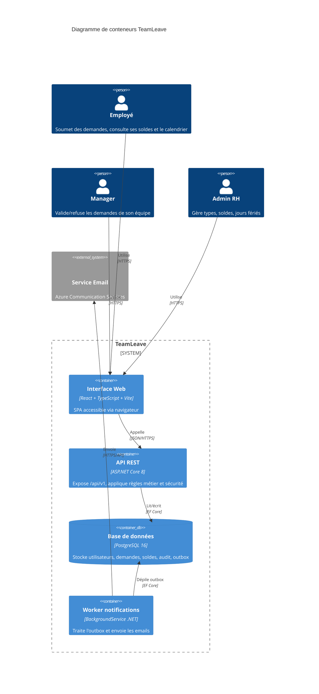

# Dossier d'architecture — TeamLeave

## 1. Vue d'ensemble : C4 niveau conteneurs

TeamLeave est une application web interne de gestion des congés pour une PME de 50 personnes. Les utilisateurs (employés, managers, admin RH) accèdent à une SPA React servie par un CDN. La SPA communique avec une API REST ASP.NET Core qui applique les règles métier et persiste les données dans une base PostgreSQL. Un worker de notifications, exécuté comme service d'arrière-plan au sein de l'API, traite une file d'attente persistante (outbox) pour envoyer les emails via un fournisseur externe. L'authentification est locale avec JWT.

Le système est découpé en conteneurs logiques suivants :

- **Interface Web (React + TypeScript + Vite)** : SPA accessible via navigateur, responsive, conforme WCAG 2.1 AA. Elle gère l'authentification, l'affichage des soldes, la soumission des demandes, les vues manager et admin RH.
- **API REST (ASP.NET Core 8)** : expose les endpoints `/api/v1`, applique les règles métier (RB-01 à RB-17), gère l'autorisation par rôles et périmètres, orchestre les transactions.
- **Base de données (PostgreSQL 16)** : stocke utilisateurs, équipes, types de congé, soldes, demandes, jours fériés, audit et file d'emails.
- **Worker de notifications (BackgroundService .NET)** : dépile la table `EmailOutbox`, envoie les emails via Azure Communication Services, retente jusqu'à 3 fois, journalise les échecs.
- **Service Email externe (Azure Communication Services)** : envoi des notifications à la soumission et à la décision.



*Note : pour le MVP, le worker est hébergé dans le même processus que l’API (`IHostedService`). Le diagramme le représente séparément pour clarifier la responsabilité.*

---

## 2. Choix technologiques justifiés

| Domaine | Choix retenu | Alternatives écartées | Justification et exigences |
|---------|--------------|----------------------|----------------------------|
| Framework backend | **ASP.NET Core 8 (LTS)** | ASP.NET Core 6 (LTS précédente), Node.js/NestJS | Imposé par le brief. Dernière LTS au moment de la conception, support jusqu’en nov. 2026. Écosystème mature pour JWT, EF Core, background services, tests xUnit. |
| Base de données | **PostgreSQL 16** | SQL Server 2022 | Open-source, sans coût de licence, pleinement supporté par EF Core via Npgsql. Azure Database for PostgreSQL Flexible Server offre sauvegardes automatiques et PITR, satisfaisant RPO 24 h / RTO 4 h (ENF Disponibilité). SQL Server aurait nécessité une licence ou une instance Azure plus coûteuse. PostgreSQL supporte la concurrence optimiste via `xmin` (EF Core `UseXminAsConcurrencyToken`) et JSONB pour l’audit (RB-15, ENF Performance). |
| Frontend | **React 18 + TypeScript + Vite** | Angular, Vue.js | Imposé par le brief. Vite offre un build rapide et une DX moderne. TypeScript renforce la sécurité de typage. |
| Authentification | **JWT signé HS256 + ASP.NET Core Identity `PasswordHasher`** | Sessions serveur, OAuth2/OpenID Connect externe | Le brief impose JWT (RB-14). Pas de SSO/MFA dans le MVP (H-10). JWT stocké en mémoire côté client, expiration 60 min, renouvellement par re-login. Hachage mot de passe : PBKDF2-HMAC-SHA512, 100 000 itérations, sel aléatoire. |
| Hébergement | **Azure App Service (Linux)**, **Azure Static Web Apps**, **Azure Database for PostgreSQL Flexible Server**, **Azure Communication Services Email**, **Azure Key Vault**, **Azure Monitor/Application Insights** | AKS (trop complexe pour 50 utilisateurs), VM IaaS (maintenance), Azure Container Apps (possible mais App Service plus simple) | Plateforme managée réduisant l’exploitation. App Service offre autoscaling, slots de déploiement, intégration Key Vault. Static Web Apps héberge le frontend avec CDN. Communication Services Email est managé avec suivi de délivrabilité. ENF Disponibilité 99,5 %, coût maîtrisé. |
| Tests | **xUnit + Moq + FluentAssertions + Testcontainers (PostgreSQL)** | NUnit, MSTest | Imposé par le brief pour xUnit. Testcontainers permet des tests d’intégration réalistes avec PostgreSQL. |
| Messagerie/email | **Outbox pattern + BackgroundService + Azure Communication Services Email** | Envoi synchrone, Hangfire, RabbitMQ | RB-09/ENF : emails asynchrones, échec non bloquant, 3 tentatives. L’outbox garantit la persistance et la reprise. Pas besoin de broker externe pour 50 utilisateurs. |
| Journalisation | **Serilog + Azure Application Insights** | Logs fichiers, ELK | Logs structurés, corrélation, alertes. |

**Points insuffisants dans la spécification et décisions :**
- Durée d’expiration du JWT non précisée : nous fixons 60 minutes, sans refresh token (H-10). À valider.
- Algorithme de hachage non précisé : nous utilisons PBKDF2 via ASP.NET Core Identity.
- Fournisseur email non précisé : nous choisissons Azure Communication Services Email pour l’intégration Azure.
- Stratégie de versioning de l’API : nous utilisons `/api/v1` avec versioning par URL.

---

## 3. Architecture logicielle du backend

Le backend suit une architecture en couches *Clean Architecture* (ou *Onion*) afin d’isoler le domaine métier et de respecter le principe d’inversion de dépendance.

**Couches (de l’intérieur vers l’extérieur) :**

1. **Domain** : entités métier, objets valeur, énumérations, règles métier pures (ex. calcul de jours ouvrés, ratio de chevauchement). Aucune dépendance externe.
2. **Application** : cas d’usage (services applicatifs), interfaces de repositories, DTOs, validations, orchestration des transactions. Dépend uniquement de Domain.
3. **Infrastructure** : implémentations EF Core (DbContext, configurations, migrations), repositories, services d’email, génération JWT, horloge système, audit. Dépend de Application et Domain.
4. **API** : contrôleurs ASP.NET Core, middlewares, filtres d’autorisation, configuration Swagger, injection de dépendances. Dépend de Application et Infrastructure (uniquement pour l’enregistrement DI). Ne contient pas de logique métier.

**Règles de dépendance interdites :**
- Domain ne doit référencer aucune autre couche (pas de `using Microsoft.EntityFrameworkCore`, pas de `using Microsoft.AspNetCore`).
- Application ne doit pas référencer Infrastructure ni API. Elle définit des interfaces (ex. `ILeaveRequestRepository`) implémentées par Infrastructure.
- API ne doit pas accéder directement au `DbContext` ni aux entités EF Core ; elle manipule des DTOs et appelle des services applicatifs.
- Les contrôleurs ne contiennent pas de règles métier ; ils délèguent aux services applicatifs.
- Les repositories ne contiennent pas de logique métier ; ils ne font que la persistance.

**Structure des projets :**
```
TeamLeave.sln
├── src/
│   ├── TeamLeave.Domain/
│   ├── TeamLeave.Application/
│   ├── TeamLeave.Infrastructure/
│   └── TeamLeave.Api/
└── tests/
    ├── TeamLeave.Domain.Tests/
    ├── TeamLeave.Application.Tests/
    └── TeamLeave.Api.Tests/
```

**Exemple de flux :** `POST /api/v1/leave-requests` → `LeaveRequestsController` → `CreateLeaveRequestHandler` (Application) → validation via `WorkingDaysCalculator` (Domain) + `ILeaveRequestRepository` (Application interface) → `LeaveRequestRepository` (Infrastructure) → EF Core → PostgreSQL.

---

## 4. Schéma de base de données

**Tables principales :**

- `Users` : utilisateurs (id, email, nom, prénom, hash mot de passe, actif, équipe id, dates).
- `Roles` : rôles (EMPLOYE, MANAGER, ADMIN_RH).
- `UserRoles` : association N-N.
- `Teams` : équipes (id, nom, manager id, active).
- `LeaveTypes` : types de congé (id, code, libellé, actif, suivi solde, ordre).
- `LeaveBalances` : soldes (id, user id, leave type id, année, jours acquis, ajustements, jours utilisés, rowversion).
- `LeaveRequests` : demandes (id, employé id, équipe id, type id, date début, date fin, jours ouvrés, statut, commentaire employé, date soumission, décideur id, date décision, commentaire manager, indicateur chevauchement, ratio chevauchement, acquittement user id, date acquittement, rowversion).
- `Holidays` : jours fériés (id, date, libellé, actif).
- `AuditLogs` : journal d’audit (id, acteur id, action, entité type, entité id, date, détails JSON, motif).
- `EmailOutbox` : file d’emails (id, destinataire, template, données JSON, statut, tentatives, date création, date dernier envoi, message erreur).

**Clés et index :**
- `Users.Email` : unique.
- `LeaveTypes.Code` : unique.
- `LeaveBalances` : unique (UserId, LeaveTypeId, Year) ; index sur (UserId, Year).
- `LeaveRequests` : index sur (Status, TeamId), sur (EmployeeId, Status), sur (StartDate, EndDate) pour le calendrier.
- `Holidays` : unique sur Date ; index sur (Active, Date).
- `EmailOutbox` : index sur (Status, CreatedAt).

**SQL de création (PostgreSQL 16) :**

```sql
CREATE TABLE "Teams" (
    "Id" UUID PRIMARY KEY,
    "Name" VARCHAR(200) NOT NULL,
    "ManagerId" UUID NOT NULL,
    "IsActive" BOOLEAN NOT NULL DEFAULT TRUE
);

CREATE TABLE "Users" (
    "Id" UUID PRIMARY KEY,
    "Email" VARCHAR(256) NOT NULL UNIQUE,
    "FirstName" VARCHAR(100) NOT NULL,
    "LastName" VARCHAR(100) NOT NULL,
    "PasswordHash" TEXT NOT NULL,
    "IsActive" BOOLEAN NOT NULL DEFAULT TRUE,
    "TeamId" UUID NULL REFERENCES "Teams"("Id"),
    "CreatedAt" TIMESTAMPTZ NOT NULL DEFAULT NOW(),
    "UpdatedAt" TIMESTAMPTZ NOT NULL DEFAULT NOW()
);

ALTER TABLE "Teams" ADD CONSTRAINT "FK_Teams_Manager" FOREIGN KEY ("ManagerId") REFERENCES "Users"("Id");

CREATE TABLE "Roles" (
    "Id" INT PRIMARY KEY,
    "Name" VARCHAR(50) NOT NULL UNIQUE
);

CREATE TABLE "UserRoles" (
    "UserId" UUID NOT NULL REFERENCES "Users"("Id") ON DELETE CASCADE,
    "RoleId" INT NOT NULL REFERENCES "Roles"("Id") ON DELETE CASCADE,
    PRIMARY KEY ("UserId", "RoleId")
);

CREATE TABLE "LeaveTypes" (
    "Id" UUID PRIMARY KEY,
    "Code" VARCHAR(20) NOT NULL UNIQUE,
    "Label" VARCHAR(200) NOT NULL,
    "IsActive" BOOLEAN NOT NULL DEFAULT TRUE,
    "TrackBalance" BOOLEAN NOT NULL DEFAULT TRUE,
    "DisplayOrder" INT NOT NULL DEFAULT 0,
    "CreatedAt" TIMESTAMPTZ NOT NULL DEFAULT NOW(),
    "UpdatedAt" TIMESTAMPTZ NOT NULL DEFAULT NOW()
);

CREATE TABLE "LeaveBalances" (
    "Id" UUID PRIMARY KEY,
    "UserId" UUID NOT NULL REFERENCES "Users"("Id"),
    "LeaveTypeId" UUID NOT NULL REFERENCES "LeaveTypes"("Id"),
    "Year" INT NOT NULL,
    "AcquiredDays" NUMERIC(5,2) NOT NULL DEFAULT 0,
    "AdjustmentDays" NUMERIC(5,2) NOT NULL DEFAULT 0,
    "UsedDays" NUMERIC(5,2) NOT NULL DEFAULT 0,
    "Version" BYTEA NOT NULL,
    CONSTRAINT "UQ_LeaveBalances_User_Type_Year" UNIQUE ("UserId", "LeaveTypeId", "Year"),
    CONSTRAINT "CK_LeaveBalances_NonNegative" CHECK ("AcquiredDays" + "AdjustmentDays" - "UsedDays" >= 0)
);

CREATE TABLE "LeaveRequests" (
    "Id" UUID PRIMARY KEY,
    "EmployeeId" UUID NOT NULL REFERENCES "Users"("Id"),
    "TeamId" UUID NOT NULL REFERENCES "Teams"("Id"),
    "LeaveTypeId" UUID NOT NULL REFERENCES "LeaveTypes"("Id"),
    "StartDate" DATE NOT NULL,
    "EndDate" DATE NOT NULL,
    "WorkingDays" INT NOT NULL,
    "Status" VARCHAR(20) NOT NULL CHECK ("Status" IN ('PENDING','APPROVED','REJECTED')),
    "EmployeeComment" TEXT NULL,
    "SubmittedAt" TIMESTAMPTZ NOT NULL DEFAULT NOW(),
    "DeciderId" UUID NULL REFERENCES "Users"("Id"),
    "DecidedAt" TIMESTAMPTZ NULL,
    "ManagerComment" TEXT NULL,
    "HasOverlapWarning" BOOLEAN NOT NULL DEFAULT FALSE,
    "OverlapRatio" NUMERIC(5,4) NULL,
    "AcknowledgedOverlapBy" UUID NULL REFERENCES "Users"("Id"),
    "AcknowledgedOverlapAt" TIMESTAMPTZ NULL,
    "Version" BYTEA NOT NULL,
    CONSTRAINT "CK_LeaveRequests_Dates" CHECK ("StartDate" <= "EndDate"),
    CONSTRAINT "CK_LeaveRequests_SameYear" CHECK (EXTRACT(YEAR FROM "StartDate") = EXTRACT(YEAR FROM "EndDate")),
    CONSTRAINT "CK_LeaveRequests_WorkingDays" CHECK ("WorkingDays" > 0)
);

CREATE INDEX "IX_LeaveRequests_Team_Status" ON "LeaveRequests" ("TeamId", "Status");
CREATE INDEX "IX_LeaveRequests_Employee_Status" ON "LeaveRequests" ("EmployeeId", "Status");
CREATE INDEX "IX_LeaveRequests_Dates" ON "LeaveRequests" ("StartDate", "EndDate") WHERE "Status" = 'APPROVED';

CREATE TABLE "Holidays" (
    "Id" UUID PRIMARY KEY,
    "Date" DATE NOT NULL UNIQUE,
    "Label" VARCHAR(200) NOT NULL,
    "IsActive" BOOLEAN NOT NULL DEFAULT TRUE,
    "CreatedAt" TIMESTAMPTZ NOT NULL DEFAULT NOW(),
    "UpdatedAt" TIMESTAMPTZ NOT NULL DEFAULT NOW()
);

CREATE TABLE "AuditLogs" (
    "Id" BIGSERIAL PRIMARY KEY,
    "ActorId" UUID NULL REFERENCES "Users"("Id"),
    "Action" VARCHAR(100) NOT NULL,
    "EntityType" VARCHAR(100) NOT NULL,
    "EntityId" UUID NULL,
    "OccurredAt" TIMESTAMPTZ NOT NULL DEFAULT NOW(),
    "Details" JSONB NULL,
    "Reason" TEXT NULL
);

CREATE INDEX "IX_AuditLogs_Entity" ON "AuditLogs" ("EntityType", "EntityId");
CREATE INDEX "IX_AuditLogs_OccurredAt" ON "AuditLogs" ("OccurredAt");

CREATE TABLE "EmailOutbox" (
    "Id" UUID PRIMARY KEY,
    "Recipient" VARCHAR(256) NOT NULL,
    "Template" VARCHAR(100) NOT NULL,
    "Payload" JSONB NOT NULL,
    "Status" VARCHAR(20) NOT NULL CHECK ("Status" IN ('PENDING','SENT','FAILED')),
    "Attempts" INT NOT NULL DEFAULT 0,
    "CreatedAt" TIMESTAMPTZ NOT NULL DEFAULT NOW(),
    "LastAttemptAt" TIMESTAMPTZ NULL,
    "ErrorMessage" TEXT NULL
);

CREATE INDEX "IX_EmailOutbox_Status_CreatedAt" ON "EmailOutbox" ("Status", "CreatedAt");
```

**Notes :**
- Les types `NUMERIC(5,2)` pour les jours permettent des demi-journées futures, mais le MVP n’utilise que des entiers. Le brief exclut les demi-journées, mais cette tolérance évite une migration. À valider.
- `Version` en `BYTEA` : avec PostgreSQL, EF Core peut utiliser `xmin` directement. En pratique, on configurera `UseXminAsConcurrencyToken()`.
- Contraintes métier supplémentaires (ex. année de solde = année de date début) sont appliquées dans le code applicatif.

---

## 5. Contrat d'API détaillé

L’API est REST, versionnée `/api/v1`, JSON, authentification Bearer JWT.

**Codes d’erreur généraux (RFC 7807 Problem Details) :**

```json
{
  "type": "https://tools.ietf.org/html/rfc7231#section-6.5.4",
  "title": "Unprocessable Entity",
  "status": 422,
  "detail": "La durée demandée (6 jours) dépasse le solde disponible (5 jours).",
  "instance": "/api/v1/leave-requests",
  "code": "INSUFFICIENT_BALANCE",
  "errors": { "balance": ["Solde insuffisant"] }
}
```

- `400 Bad Request` : payload mal formé, champs manquants, validation de format.
- `401 Unauthorized` : JWT absent, invalide ou expiré.
- `403 Forbidden` : authentifié mais pas autorisé (rôle ou périmètre).
- `404 Not Found` : ressource inexistante.
- `409 Conflict` : conflit métier (solde insuffisant à l’approbation, chevauchement non acquitté, décision sur demande déjà traitée, conflit de concurrence).
- `422 Unprocessable Entity` : règle métier de validation non satisfaite (ex. durée > solde à la soumission, type inactif, dates invalides).
- `500 Internal Server Error` : erreur non gérée.

### 5.1 Authentification

**POST /api/v1/auth/login**

Request :
```json
{
  "email": "jean.dupont@example.com",
  "password": "P@ssw0rd!"
}
```

Response 200 :
```json
{
  "accessToken": "eyJhbGciOiJIUzI1NiIsInR5cCI6IkpXVCJ9...",
  "tokenType": "Bearer",
  "expiresIn": 3600,
  "user": {
    "id": "3fa85f64-5717-4562-b3fc-2c963f66afa6",
    "email": "jean.dupont@example.com",
    "firstName": "Jean",
    "lastName": "Dupont",
    "roles": ["EMPLOYE", "MANAGER"],
    "teamId": "a1b2c3d4-..."
  }
}
```

Erreurs : `401` identifiants invalides, `400` payload invalide.

### 5.2 Profil et soldes

**GET /api/v1/me**

Response 200 :
```json
{
  "id": "3fa85f64-...",
  "email": "jean.dupont@example.com",
  "firstName": "Jean",
  "lastName": "Dupont",
  "roles": ["EMPLOYE"],
  "team": { "id": "a1b2c3d4-...", "name": "Équipe Développement" }
}
```

**GET /api/v1/me/balances?year=2025**

Response 200 :
```json
[
  {
    "leaveTypeId": "c1d2e3f4-...",
    "leaveTypeCode": "CP",
    "leaveTypeLabel": "Congés payés",
    "year": 2025,
    "acquiredDays": 25.0,
    "adjustmentDays": 2.5,
    "usedDays": 10.0,
    "availableDays": 17.5
  }
]
```

Erreurs : `400` année invalide, `401`.

### 5.3 Demandes de congé (employé)

**POST /api/v1/leave-requests**

Request :
```json
{
  "leaveTypeId": "c1d2e3f4-...",
  "startDate": "2025-07-01",
  "endDate": "2025-07-10",
  "comment": "Vacances d'été"
}
```

Response 201 :
```json
{
  "id": "e5f6a7b8-...",
  "employeeId": "3fa85f64-...",
  "teamId": "a1b2c3d4-...",
  "leaveType": { "id": "c1d2e3f4-...", "code": "CP", "label": "Congés payés" },
  "startDate": "2025-07-01",
  "endDate": "2025-07-10",
  "workingDays": 8,
  "status": "PENDING",
  "employeeComment": "Vacances d'été",
  "submittedAt": "2025-06-01T10:00:00Z",
  "hasOverlapWarning": true,
  "overlapRatio": 0.625,
  "overlapDetails": [
    { "date": "2025-07-03", "absentEmployees": ["Marie Curie"] },
    { "date": "2025-07-04", "absentEmployees": ["Marie Curie"] },
    { "date": "2025-07-07", "absentEmployees": ["Marie Curie"] },
    { "date": "2025-07-08", "absentEmployees": ["Marie Curie"] },
    { "date": "2025-07-09", "absentEmployees": ["Marie Curie"] }
  ]
}
```

Erreurs :
- `400` : dates invalides (début > fin, années différentes), type inactif, payload mal formé.
- `422` : durée > solde disponible (`INSUFFICIENT_BALANCE`), durée = 0 (`NO_WORKING_DAYS`), utilisateur sans équipe/manager (`NO_TEAM_MANAGER`).
- `401`.

**GET /api/v1/me/leave-requests?status=PENDING&from=2025-01-01&to=2025-12-31**

Response 200 : liste paginée (même format que ci-dessus).

**GET /api/v1/leave-requests/{id}**

Response 200 : détail si l’utilisateur est le demandeur, le manager de l’équipe, ou admin RH (lecture seule). Sinon `403` ou `404` (pour ne pas divulguer l’existence).

### 5.4 Manager : décisions et calendrier

**GET /api/v1/teams/{teamId}/leave-requests?status=PENDING**

Response 200 : liste des demandes PENDING de l’équipe. Le manager doit être le manager de l’équipe, sinon `403`.

Chaque demande inclut `hasOverlapWarning`, `overlapRatio`, `overlapDetails`.

**POST /api/v1/leave-requests/{id}/decision**

Request :
```json
{
  "action": "APPROVE",
  "comment": "Bon pour accord",
  "acknowledgeOverlapWarning": true
}
```
ou
```json
{
  "action": "REJECT",
  "comment": "Période trop chargée",
  "acknowledgeOverlapWarning": false
}
```

Response 200 :
```json
{
  "id": "e5f6a7b8-...",
  "status": "APPROVED",
  "deciderId": "manager-uuid",
  "decidedAt": "2025-06-02T14:30:00Z",
  "managerComment": "Bon pour accord",
  "hasOverlapWarning": true,
  "overlapRatio": 0.625,
  "acknowledgedOverlapBy": "manager-uuid",
  "acknowledgedOverlapAt": "2025-06-02T14:30:00Z"
}
```

Erreurs :
- `400` : action invalide, commentaire manquant pour REJECT.
- `403` : manager non autorisé (pas manager de l’équipe, ou demande personnelle).
- `404` : demande introuvable.
- `409` : demande déjà décidée (`ALREADY_DECIDED`), solde insuffisant à l’approbation (`INSUFFICIENT_BALANCE_AT_APPROVAL`), chevauchement non acquitté (`OVERLAP_WARNING_NOT_ACKNOWLEDGED`), conflit de concurrence (`CONCURRENCY_CONFLICT`).
- `422` : règle métier non satisfaite.

**GET /api/v1/teams/{teamId}/calendar?from=2025-01-01&to=2025-12-31**

Response 200 :
```json
[
  {
    "leaveRequestId": "e5f6a7b8-...",
    "employeeId": "3fa85f64-...",
    "employeeFirstName": "Jean",
    "employeeLastName": "Dupont",
    "leaveTypeCode": "CP",
    "leaveTypeLabel": "Congés payés",
    "startDate": "2025-07-01",
    "endDate": "2025-07-10"
  }
]
```
Seules les absences APPROVED. L’employé voit son équipe, le manager ses équipes, l’admin RH toutes les équipes.

### 5.5 Admin RH

**GET /api/v1/leave-types** (tout utilisateur authentifié peut lister les types actifs ; admin RH voit tous)
**POST /api/v1/leave-types** (admin RH)
Request :
```json
{
  "code": "RECUP",
  "label": "Récupération",
  "isActive": true,
  "trackBalance": true,
  "displayOrder": 5
}
```
Response 201 : type créé.

**PUT /api/v1/leave-types/{id}** (admin RH)
Request : mêmes champs. Response 200.

**GET /api/v1/users/{userId}/balances?year=2025** (admin RH)
Response 200 : liste des soldes de l’utilisateur.

**POST /api/v1/users/{userId}/balances/{leaveTypeId}/adjustments** (admin RH)
Request :
```json
{
  "year": 2025,
  "adjustmentDays": 2.5,
  "reason": "Correction arriéré"
}
```
Response 201 : ajustement créé, audit.

**PUT /api/v1/users/{userId}/balances/{leaveTypeId}/{year}** (admin RH)
Request :
```json
{
  "acquiredDays": 25.0,
  "adjustmentDays": 0.0
}
```
Response 200 : solde mis à jour, audit.

**GET /api/v1/holidays?year=2025** (tout utilisateur authentifié en lecture, admin RH en écriture)
**POST /api/v1/holidays** (admin RH)
Request :
```json
{
  "date": "2025-12-25",
  "label": "Noël"
}
```
**PUT /api/v1/holidays/{id}** (admin RH)
Request :
```json
{
  "label": "Noël",
  "isActive": true
}
```

**GET /api/v1/audit?entityType=LeaveRequest&from=2025-01-01&to=2025-12-31&page=1&pageSize=50** (admin RH)
Response 200 : liste paginée des entrées d’audit.

---

## 6. Stratégie de concurrence et de cohérence

Les points critiques identifiés par RB-08, RB-15 et R-02 :
- Approbations simultanées sur la même demande.
- Approbations simultanées de demandes distinctes impactant le même solde.
- Ajustements de solde concurrents avec approbations.

**Mécanismes retenus :**

1. **Concurrence optimiste sur les demandes et les soldes.**
   - Chaque entité `LeaveRequest` et `LeaveBalance` possède un jeton de concurrence (`xmin` PostgreSQL via EF Core, ou colonne `RowVersion`).
   - Toute mise à jour inclut le jeton dans la clause `WHERE`. Si 0 ligne affectée → `DbUpdateConcurrencyException` → l’API retourne `409 Conflict` avec code `CONCURRENCY_CONFLICT`.
   - Exigence : RB-15.

2. **Verrouillage pessimiste ciblé lors de l’approbation.**
   - Pour l’approbation, nous utilisons une transaction avec niveau d’isolation `READ COMMITTED` et un verrouillage `SELECT ... FOR UPDATE` sur la ligne de demande et la ligne de solde concernée. Cela évite les courses entre approbations qui décrémentent le même solde.
   - Pseudo-code du handler `ApproveLeaveRequest` :
     ```csharp
     await using var tx = await _db.Database.BeginTransactionAsync();
     try {
         // 1. Verrouiller la demande
         var request = await _db.LeaveRequests
             .FromSqlRaw("SELECT * FROM \"LeaveRequests\" WHERE \"Id\" = {0} FOR UPDATE", requestId)
             .SingleOrDefaultAsync();
         if (request == null) return NotFound;
         if (request.Status != Pending) return Conflict("ALREADY_DECIDED");
         if (request.EmployeeId == managerId) return Forbidden("SELF_APPROVAL");

         // 2. Recalculer le chevauchement
         var overlap = _overlapCalculator.Calculate(request);
         if (overlap.HasWarning && !dto.AcknowledgeOverlapWarning)
             return Conflict("OVERLAP_WARNING_NOT_ACKNOWLEDGED");

         // 3. Verrouiller et charger le solde
         var balance = await _db.LeaveBalances
             .FromSqlRaw("SELECT * FROM \"LeaveBalances\" WHERE \"UserId\" = {0} AND \"LeaveTypeId\" = {1} AND \"Year\" = {2} FOR UPDATE", ...)
             .SingleOrDefaultAsync();
         if (balance == null || balance.AvailableDays < request.WorkingDays)
             return Conflict("INSUFFICIENT_BALANCE_AT_APPROVAL");

         // 4. Appliquer les modifications
         balance.UsedDays += request.WorkingDays;
         request.Status = Approved;
         request.DeciderId = managerId;
         request.DecidedAt = _clock.UtcNow;
         request.ManagerComment = dto.Comment;
         request.AcknowledgedOverlapBy = dto.AcknowledgeOverlapWarning ? managerId : null;
         request.AcknowledgedOverlapAt = dto.AcknowledgeOverlapWarning ? _clock.UtcNow : null;

         // 5. Audit et outbox email
         _db.AuditLogs.Add(...);
         _db.EmailOutbox.Add(...);

         await _db.SaveChangesAsync(); // contrôle de concurrence
         await tx.CommitAsync();
     } catch (DbUpdateConcurrencyException) {
         await tx.RollbackAsync();
         return Conflict("CONCURRENCY_CONFLICT");
     }
     ```
   - `FOR UPDATE` sur la demande et le solde garantit qu’aucune autre transaction ne peut les modifier entre la lecture et l’écriture. Le jeton de concurrence est une sécurité supplémentaire.

3. **Idempotence des décisions.**
   - Une décision sur une demande déjà `APPROVED` ou `REJECTED` retourne `409` avec le statut courant. Aucune nouvelle décrémentation. RB-15, US-13.

4. **Cohérence des soldes.**
   - Le solde utilisé n’est incrémenté qu’à l’approbation, dans la même transaction. RB-08.
   - Les demandes `PENDING` ne réservent pas de solde (H-03). Deux demandes `PENDING` peuvent donc être approuvées en séquence ; la deuxième échouera si le solde devient insuffisant. C’est conforme à RB-05.

5. **Ajustements de solde concurrents.**
   - L’admin RH utilise la même stratégie de verrouillage `FOR UPDATE` sur la ligne de solde. Si le solde devient négatif, la transaction est annulée et l’API retourne `409`. RB-12.

6. **Chevauchement recalculé avant décision.**
   - Avant de valider la décision, on recalcule le chevauchement à partir des absences `APPROVED` actuelles (RB-06). Si l’avertissement est actif et non acquitté → `409`. L’acquittement est enregistré dans la demande et audité.

**Point d’insuffisance :** La spécification ne précise pas la politique de retry en cas de conflit de concurrence. Nous décidons que le client reçoit `409` et doit recharger les données et réessayer manuellement. Pas de retry automatique côté API pour éviter les effets de bord silencieux.

---

## 7. Sécurité

**JWT et authentification :**
- Algorithme de signature : HS256 avec clé secrète stockée dans Azure Key Vault. **Décision :** HS256 suffit pour une application interne monolithique. RS256 serait utile si plusieurs services partageaient la clé publique, ce qui n’est pas le cas.
- Contenu du JWT : `sub` (userId), `email`, `roles` (tableau), `teamId`, `iat`, `exp`. Pas de données sensibles.
- Expiration : 60 minutes (H-10, RB-14). Pas de refresh token dans le MVP. Le client doit se reconnecter. À évaluer pour améliorer l’UX.
- Validation : signature, expiration, issuer, audience. Middleware `JwtBearer` standard.
- Mots de passe : hachés avec PBKDF2 (ASP.NET Core Identity `PasswordHasher`), sel unique, 100 000 itérations. Jamais stockés en clair, jamais loggés. RB-14.
- HTTPS obligatoire (redirection HTTP→HTTPS, HSTS). RB-14.

**Autorisation par rôles et périmètre :**
- Rôles cumulables : `EMPLOYE`, `MANAGER`, `ADMIN_RH`.
- Attributs `[Authorize(Roles = "...")]` sur les contrôleurs/actions.
- Vérifications de périmètre dans les handlers applicatifs : un manager ne peut décider que pour les équipes qu’il manage ; un employé ne voit que ses données ; l’admin RH ne décide pas sauf rôle manager. US-01, US-06, US-07, US-08, US-13.
- Interdiction d’auto-approbation : vérification explicite `request.EmployeeId == managerId` → `403`. RB-13.

**OWASP Top 3 applicables (2021) :**

1. **A01: Broken Access Control**
   - Risque : un utilisateur accède à des données d’un autre employé ou décide pour une équipe non managée.
   - Mitigation : contrôles systématiques côté API (pas seulement UI), filtres de données par `UserId`/`TeamId`, tests automatisés d’autorisation, principe du moindre privilège. RB-01, RB-14.

2. **A02: Cryptographic Failures**
   - Risque : fuite de mots de passe, JWT non signé, données en clair.
   - Mitigation : HTTPS obligatoire, hachage robuste des mots de passe, JWT signé avec clé secrète, secrets dans Key Vault, pas de données sensibles dans les logs/emails. RB-14.

3. **A03: Injection**
   - Risque : injection SQL via EF Core si requêtes brutes mal paramétrées, injection de commandes.
   - Mitigation : utilisation d’EF Core avec paramétrage automatique, requêtes brutes avec paramètres (`FromSqlRaw` avec placeholders), validation stricte des entrées (FluentValidation), pas de concaténation SQL. RB-14.

**Autres mesures :**
- Validation des entrées : FluentValidation dans la couche Application. Longueurs max, formats de date, enum.
- CORS : restreint au domaine du frontend (Static Web App).
- Rate limiting : middleware .NET 7+ sur `/auth/login` (ex. 5 tentatives/min/IP) pour contrer le brute force.
- Audit : toutes les actions sensibles tracées avec acteur, date, entité, valeurs avant/après. RB-16.
- Logs : Serilog, pas de PII inutile, pas de tokens, pas de mots de passe. Corrélation via `TraceId`.

---

## 8. Stratégie de tests

**Pyramide des tests :**

- **Tests unitaires (base, ~70%)** :
  - Domaine : calcul des jours ouvrés (RB-04, US-04) avec jours fériés, week-ends, chevauchement de mois/année. Calcul du chevauchement (RB-06, US-05) avec union de jours, seuil strict > 50 %, exclusion de l’employé lui-même, demandes non approuvées, autres équipes. Règles de solde (disponible = acquis + ajustements − utilisés, non négatif). Workflow de décision (transitions autorisées, commentaire obligatoire pour refus).
  - Application : handlers avec mocks de repositories, vérification des règles (ex. refus si solde insuffisant, auto-approbation interdite, acquittement requis).
  - Utilisation de xUnit + FluentAssertions + Moq.
  - Exemple : `WorkingDaysCalculatorTests` avec `[Theory]` et `[InlineData]`.

- **Tests d’intégration (milieu, ~20%)** :
  - Avec `WebApplicationFactory<Program>` et Testcontainers (PostgreSQL).
  - Tester les endpoints de bout en bout : login, soumission, décision, calendrier, admin.
  - Vérifier les codes HTTP, les effets en base, les transactions (rollback en cas d’erreur), la concurrence (deux appels simultanés d’approbation → un seul succès, l’autre 409, solde décrémenté une fois).
  - Tester les autorisations : un employé ne peut pas accéder aux demandes d’un autre, un manager ne peut pas décider hors équipe.
  - Tester l’outbox : après approbation, un enregistrement `EmailOutbox` est créé.

- **Tests d’UI (sommet, ~10%)** :
  - React Testing Library + Vitest. Tester les composants critiques : formulaire de demande, affichage des soldes, tableau des demandes en attente, avertissement de chevauchement, calendrier.
  - Tests E2E (Playwright) pour les parcours critiques (login, soumettre, approuver) sur l’environnement de staging. Optionnel pour le MVP.

**Ce qui est testé à quel niveau :**
- Règles métier pures → tests unitaires domaine.
- Orchestration et validation → tests unitaires application.
- Persistance, transactions, concurrence, sécurité → tests d’intégration API.
- Parcours utilisateur → tests E2E (optionnel MVP).

**Outils :**
- xUnit, Moq, FluentAssertions, Testcontainers, `Microsoft.AspNetCore.Mvc.Testing`.
- Couverture cible : > 80 % sur Domain et Application, > 60 % global.

---

## 9. Plan de déploiement Azure minimal

**Services Azure :**

| Service | Usage | SKU / Niveau | Coût mensuel estimé (USD) |
|---------|-------|--------------|---------------------------|
| Azure App Service (Linux) | Hébergement API ASP.NET Core | Plan B1 (1 vCPU, 1.75 GB) | ~13 |
| Azure Static Web Apps | Hébergement SPA React | Free | 0 |
| Azure Database for PostgreSQL Flexible Server | Base de données | Burstable B1ms (1 vCPU, 2 GB) + 32 GB stockage | ~15 |
| Azure Communication Services Email | Envoi emails | Pay-as-you-go (premiers 1000 emails/mois gratuits ?) | ~1-2 |
| Azure Key Vault | Secrets (JWT key, connection strings) | Standard | ~0.03 |
| Azure Monitor / Application Insights | Logs, métriques, alertes | Pay-as-you-go (5 GB/mois inclus) | ~2-5 |
| **Total estimé** | | | **~30-35 USD/mois** |

**Environnements :**
- **Développement** : local (Docker Compose pour PostgreSQL, MailHog pour emails).
- **Staging** : Azure App Service (slot de déploiement), base PostgreSQL séparée. Utilisé pour les tests d’intégration et la validation métier.
- **Production** : Azure App Service (slot production), base PostgreSQL avec sauvegardes automatiques (rétention 7 jours, PITR).

**CI/CD :**
- Azure DevOps ou GitHub Actions. Pipeline :
  1. Build backend + tests xUnit.
  2. Build frontend + tests.
  3. Analyse de sécurité (SonarQube, OWASP Dependency Check).
  4. Déploiement sur staging (slot).
  5. Tests E2E sur staging.
  6. Swap staging → production (zero-downtime).
- Migrations EF Core : appliquées automatiquement au démarrage en staging, et via script validé en production (ou `dotnet ef database update` depuis le pipeline).

**Sauvegarde et restauration :**
- Sauvegarde automatique quotidienne PostgreSQL, rétention 7 jours. RPO 24 h, RTO 4 h satisfaits (ENF Disponibilité). Pour améliorer RTO, activer PITR avec rétention 7 jours.
- Export des logs vers un compte de stockage (optionnel, 30 jours).

**Surveillance :**
- Application Insights : traces, exceptions, requêtes lentes, échecs d’email.
- Alertes : disponibilité < 99,5 %, taux d’erreur 5xx > 1 %, file d’emails en échec > 10.

**Points d’insuffisance :**
- La spécification ne précise pas la politique de rétention des données. Nous décidons : audit 2 ans, demandes 5 ans, logs 30 jours, emails 6 mois. À valider avec DPO/RH.
- Pas de budget explicite : l’estimation ci-dessus doit être validée.

---

## 10. Trois ADR (Architecture Decision Records)

### ADR-001 : Choix de PostgreSQL plutôt que SQL Server

**Contexte :** Le brief impose une base SQL (SQL Server ou PostgreSQL) pour EF Core. La PME de 50 personnes a un budget limité. L’application doit être déployée sur Azure. Les besoins en concurrence sont modérés mais critiques (RB-15).

**Décision :** Nous choisissons PostgreSQL 16 via Azure Database for PostgreSQL Flexible Server.

**Conséquences :**
- **Positives :** Pas de coût de licence. Azure Database for PostgreSQL offre des sauvegardes automatiques, PITR, et un SKU Burstable économique. EF Core supporte nativement PostgreSQL via Npgsql, y compris la concurrence optimiste avec `xmin`, les colonnes JSONB pour l’audit, et les types `DATE`/`TIMESTAMPTZ`. La communauté open-source est active.
- **Négatives :** L’équipe doit maîtriser PostgreSQL. Certains outils Microsoft (SSMS) ne sont pas utilisables ; on utilise pgAdmin ou Azure Data Studio. SQL Server aurait offert une intégration plus poussée avec Azure AD et des fonctionnalités de sécurité avancées (Row-Level Security) mais à un coût supérieur.
- **Risques :** Migration de compétences si l’équipe est historiquement SQL Server. Mitigation : formation courte, utilisation d’EF Core qui abstrait la plupart des différences.

### ADR-002 : Concurrence par verrouillage pessimiste (`FOR UPDATE`) sur les soldes et demandes

**Contexte :** RB-08 et RB-15 exigent que l’approbation d’une demande soit transactionnelle et qu’une décrémentation ne se produise qu’une seule fois, même en cas d’appels concurrents. La spécification mentionne « concurrence optimiste ou équivalente ». Le volume est faible (50 utilisateurs), mais les erreurs de solde sont critiques.

**Décision :** Utiliser une transaction par approbation avec verrouillage pessimiste (`SELECT ... FOR UPDATE`) sur la ligne de demande et la ligne de solde concernée, en complément d’un jeton de concurrence optimiste (`xmin`) pour les autres mises à jour. Niveau d’isolation `READ COMMITTED`.

**Conséquences :**
- **Positives :** Déterministe, simple à raisonner. Évite les boucles de retry et les conflits de sérialisation. Garantit qu’aucune autre transaction ne modifie le solde entre la vérification et l’incrément. Répond directement à RB-08/RB-15.
- **Négatives :** Les transactions concurrentes sur le même solde sont sérialisées ; un appel concurrent attend puis échoue si la condition n’est plus remplie (ou réussit si le solde est suffisant). Pour 50 utilisateurs, la contention est négligeable. Le code utilise du SQL brut pour `FOR UPDATE`, ce qui casse légèrement l’abstraction EF Core.
- **Alternatives écartées :** Concurrence optimiste seule avec retry (complexité de gestion des retries, risque de faux conflits) ; niveau `SERIALIZABLE` (plus de conflits, nécessite retry) ; verrouillage applicatif distribué (Redis) — surdimensionné.
- **Risques :** Deadlocks si l’ordre de verrouillage n’est pas constant. Mitigation : toujours verrouiller d’abord la demande, puis le solde, dans cet ordre. Tests de concurrence automatisés.

### ADR-003 : Outbox pattern pour les notifications email plutôt qu’un envoi synchrone ou un broker externe

**Contexte :** RB-09 exige que les emails soient envoyés de façon asynchrone après validation de la transaction métier, avec au plus 3 tentatives, et qu’un échec n’affecte pas le workflow. La spécification ne précise pas le mécanisme. Le volume est faible (quelques emails par jour).

**Décision :** Implémenter un pattern Outbox : lors de la transaction métier (soumission ou décision), insérer un enregistrement dans la table `EmailOutbox`. Un `BackgroundService` (IHostedService) s’exécute périodiquement (toutes les 30 secondes) pour dépiler les messages `PENDING`, envoyer via Azure Communication Services, et mettre à jour le statut (`SENT`/`FAILED`) avec incrément du nombre de tentatives. En cas d’échec, réessayer avec backoff exponentiel jusqu’à 3 tentatives, puis marquer `FAILED` et logger une alerte.

**Conséquences :**
- **Positives :** Garantit que l’email est enregistré dans la même transaction que la décision, donc aucune perte. Découple l’envoi du workflow. Pas de broker externe (RabbitMQ, Azure Service Bus) à administrer, ce qui réduit le coût et la complexité pour 50 utilisateurs. Répond à RB-09.
- **Négatives :** La table Outbox doit être pollée, ce qui introduit une latence (jusqu’à 30 s). Pour des emails de congés, c’est acceptable. Le worker s’exécute dans le processus de l’API ; si l’API est arrêtée, les emails sont traités au redémarrage. Pas de scalabilité horizontale du worker sans verrouillage (mais une seule instance d’API suffit pour 50 utilisateurs).
- **Alternatives écartées :** Envoi synchrone (bloque la transaction, ne satisfait pas RB-09 en cas d’échec) ; Hangfire (dépendance supplémentaire, stockage séparé) ; Azure Service Bus (coût et complexité inutiles pour ce volume) ; file en mémoire (perte au redémarrage).
- **Risques :** Si le volume d’emails augmente fortement, le polling devient inefficace. Mitigation : passer à un broker si nécessaire. Deadlock potentiel avec la transaction métier : l’insertion dans l’outbox fait partie de la transaction, donc pas de perte. Le worker doit utiliser une transaction séparée pour marquer comme `SENT` afin de ne pas bloquer les écritures métier.

---

Ce dossier d’architecture fournit une base solide pour l’implémentation backend et frontend. Les points d’insuffisance identifiés devront être validés avec le métier et le DPO avant la mise en production.