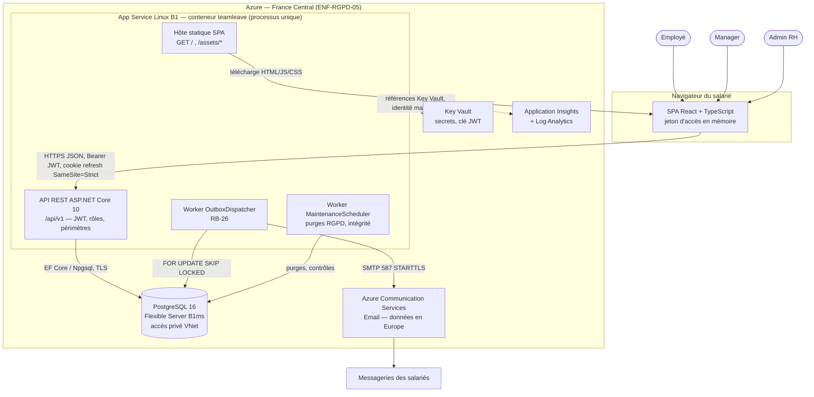
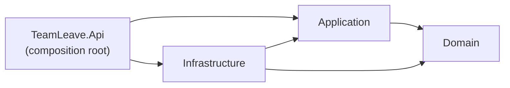
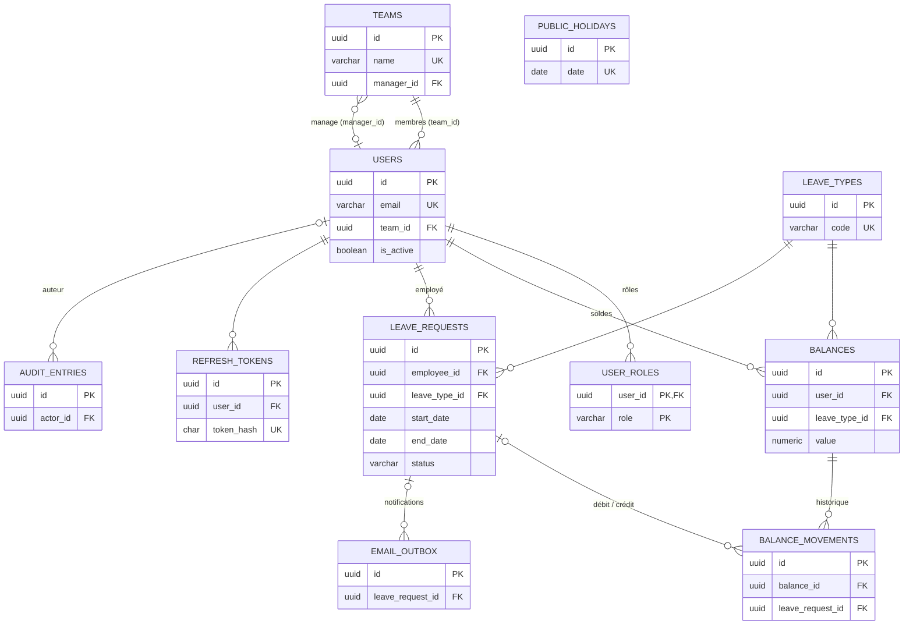

# TeamLeave — Dossier d'architecture et de conception système

**Version** : 1.0 (étape 2/4)
**Entrées** : brief produit, spécification technico-fonctionnelle v1.0 (étape 1).
**Destinataires** : développeurs backend (étape 3) et frontend (étape 4), QA, exploitation.

**Conventions**

| Préfixe | Objet |
|---|---|
| `D-xx` | Décision d'architecture (synthèse en §0.2) |
| `SI-xx` | **Spécification insuffisante** : manque, contradiction ou imprécision de l'étape 1, avec la décision prise. Le registre complet figure en Annexe A. |
| `ADR-xxx` | Architecture Decision Record (§10) |
| `RB-xx`, `ENF-xx`, `CA-xx.y`, `A-xx`, `R-xx`, `PO-xx` | Références de la spécification |

Les termes **DOIT**, **NE DOIT PAS** et **PEUT** sont normatifs pour les étapes 3 et 4. Dans le texte, la mention « ⚠️ SI-xx » signale chaque point où la spécification a dû être complétée ou arbitrée.

---

## 0. Synthèse

### 0.1 Résolution des points ouverts de la spécification

| PO | Décision | Section |
|---|---|---|
| PO-01 SQL Server ou PostgreSQL | **PostgreSQL 16**, Azure Database for PostgreSQL Flexible Server | §2.3, ADR-001 |
| PO-02 Hébergement | **Azure France Central**. Un conteneur unique sur App Service Linux héberge l'API, la SPA et les workers. | §2.5, §9 |
| PO-03 Fournisseur SMTP | **Azure Communication Services Email** (emplacement des données : Europe), via SMTP authentifié. En développement : Mailpit. | §2.6, §9 |
| PO-04 Signature JWT | **HS256**, clé aléatoire ≥ 256 bits conservée dans Key Vault, avec `kid` pour la rotation | §7.1, ADR-002 |
| PO-05 Futur SSO | Abstraction préparée : schéma d'authentification « Local » isolé, ajout d'un schéma OIDC sans refonte | ADR-002 |
| PO-06 Approbation automatique MALADIE | Non implémentée en V1. L'ajout futur d'un attribut `autoApprove` sur `leave_types` reste compatible avec le modèle. | §4 |
| PO-07 Demi-journées | Hors V1. Les soldes sont déjà en `numeric(7,2)`. | §4 |

### 0.2 Décisions structurantes

| ID | Décision | Motivation principale |
|---|---|---|
| D-01 | .NET 10 LTS, ASP.NET Core avec contrôleurs, EF Core 10 et Npgsql | Brief (« dernière LTS »), support jusqu'à novembre 2028 |
| D-02 | Monolithe modulaire en 4 couches : Domain, Application, Infrastructure, Api | ENF-MAINT-02 (domaine testable à ≥ 80 %) |
| D-03 | PostgreSQL avec invariants garantis en base : CHECK, contrainte d'exclusion, unicités partielles | RB-08, RB-11, RB-17, §6.3 de la spéc., R-05 |
| D-04 | Concurrence optimiste par `xmin`, verrous ciblés et isolation Read Committed | RB-19, CA-11.7 |
| D-05 | SPA servie par la même origine que l'API (`/` et `/api/v1`) | ENF-SEC-02 (cookie `SameSite=Strict`), ENF-SEC-07 |
| D-06 | Identité locale : PBKDF2 à 600 000 itérations, JWT de 30 min, jeton de rafraîchissement rotatif et opaque | US-01, ENF-SEC-02 à ENF-SEC-04, E-06 |
| D-07 | Outbox transactionnelle avec worker in-process (`SKIP LOCKED` et bail) | RB-26, O-3 |
| D-08 | Calcul du chevauchement en mémoire dans le domaine, alimenté par une requête unique | RB-20, ENF-PERF-03, ENF-MAINT-02 |
| D-09 | Journal d'audit et mouvements de solde protégés en ajout seul par les privilèges SQL | RB-31, RB-34 |
| D-10 | Tests : unitaires purs, intégration sur PostgreSQL réel (Testcontainers), API via `WebApplicationFactory` | ENF-MAINT-02, CA-11.7 |

---

## 1. Vue d'ensemble — C4 niveau conteneurs

### 1.1 Contexte (niveau 1, résumé)

- **Utilisateurs** : employés, managers et Admins RH (environ 50 personnes, ~20 sessions simultanées au pic). Ils accèdent à TeamLeave depuis un navigateur, sur le réseau de l'entreprise ou en mobilité.
- **Système externe sortant** : le service d'envoi d'emails, vers les messageries des salariés.
- **Aucun autre système intégré en V1** : pas de paie (E-05), pas d'agenda (E-11), pas de SSO (E-06).

### 1.2 Conteneurs (niveau 2)

| Conteneur | Technologie | Responsabilités | Exigences |
|---|---|---|---|
| **SPA TeamLeave** | React 19 + TypeScript (Vite), exécutée dans le navigateur | Interface, accessibilité, conservation du jeton d'accès **en mémoire**, appels `/api/v1` | ENF-ACC-*, ENF-SEC-02, ENF-PERF-04 |
| **Application web TeamLeave** | ASP.NET Core 10 dans un conteneur Linux sur Azure App Service. Processus unique. | (a) Sert les fichiers statiques de la SPA. (b) Expose l'API REST `/api/v1`. (c) Héberge deux workers : `OutboxDispatcher` (emails) et `MaintenanceScheduler` (purges RGPD, contrôle d'intégrité). | D-05, D-07 |
| **Base TeamLeave** | Azure Database for PostgreSQL Flexible Server 16 | Persistance, invariants (CHECK, exclusion), file d'emails (outbox), audit | RB-08, RB-11, RB-26, RB-34, ENF-DISP-02 |
| **Coffre à secrets** | Azure Key Vault | Clé de signature JWT, chaîne de connexion, identifiants SMTP, mot de passe du premier Admin RH | ENF-SEC-02 |
| **Télémétrie** | Application Insights et Log Analytics (OpenTelemetry) | Journaux structurés, traces, métriques, alertes | ENF-OBS-01 |
| **Service email** | Azure Communication Services Email (SMTP 587, STARTTLS) | Remise des notifications | RB-23 à RB-26, ENF-RGPD-05 |



### 1.3 Flux principaux

| Flux | Description | Règles |
|---|---|---|
| Connexion | SPA → `POST /api/v1/auth/login`. Le jeton d'accès est renvoyé dans le corps, le jeton de rafraîchissement dans un cookie `HttpOnly`. | US-01 |
| Rechargement de page | La SPA appelle `POST /auth/refresh` au démarrage : le jeton d'accès, conservé en mémoire seulement, est perdu au rechargement. | ENF-SEC-02 |
| Soumission | Une transaction unique crée la demande, met en file les emails (outbox) et écrit l'audit. Le worker envoie ensuite les emails. | RB-23, RB-26, RB-34 |
| Décision | Une transaction unique change le statut, débite le solde, crée le mouvement, met l'email en file et écrit l'audit. | RB-10, RB-24 |

---

## 2. Choix technologiques justifiés

Chaque ligne indique le choix, l'alternative écartée et la raison de l'arbitrage.

### 2.1 Plateforme backend

| Sujet | Choix | Alternative écartée | Raison de l'arbitrage |
|---|---|---|---|
| Runtime | **.NET 10 LTS** (C# 14), sortie en novembre 2025, support jusqu'en novembre 2028 | .NET 8 LTS | .NET 8 sort du support en novembre 2026, quelques mois après la mise en service. Le brief impose la « dernière LTS ». |
| Style d'API | **Contrôleurs `[ApiController]`** | Minimal APIs | Une quarantaine de points d'accès sont à organiser. Les contrôleurs apportent des conventions homogènes (filtres, `ProblemDetails`, attributs d'autorisation, exploration OpenAPI) et sont maîtrisés par toute équipe .NET. Le gain de performance des Minimal APIs est sans objet à 20 utilisateurs simultanés (ENF-PERF-01). |
| ORM | **EF Core 10** + `Npgsql.EntityFrameworkCore.PostgreSQL` 10, `EFCore.NamingConventions` (snake_case) | Dapper | Imposé par le brief. Le SQL brut est limité à 4 cas (verrous, contrainte d'exclusion, privilèges, purge), tous dans Infrastructure (§3). |
| Validation | **FluentValidation** (Apache-2.0), invoquée explicitement dans la couche Application | DataAnnotations | Les règles sont conditionnelles, par exemple « motif obligatoire si l'acteur est Admin RH » (RB-13). Les validateurs se testent unitairement. |
| Médiation et mappage | **Aucune bibliothèque** : handlers injectés directement, mappage manuel | MediatR, AutoMapper | Ces deux bibliothèques sont passées sous licence commerciale en 2025. Le mappage explicite rend visible l'exposition de chaque champ, ce qui sert RB-29 et ENF-RGPD-02 (non-fuite du type MALADIE). |
| Hachage des mots de passe | `PasswordHasher<T>` de `Microsoft.Extensions.Identity.Core` (PBKDF2-HMAC-SHA512), `IterationCount = 600_000` | ASP.NET Core Identity complet (UserManager, tables AspNet*) ; Argon2id via bibliothèque tierce | Seul le hacheur est utile ; le reste d'Identity imposerait un schéma inadapté (rôles, équipes, verrouillage spécifiques). PBKDF2 satisfait ENF-SEC-04 sans dépendance native. |
| Horloge | `TimeProvider` (.NET), `FakeTimeProvider` en test | Interface `IClock` maison | L'abstraction est standard. Elle sert RB-01, R-09 et ENF-MAINT-02 (horloge injectable). |
| Documentation d'API | `Microsoft.AspNetCore.OpenApi` (natif), interface Scalar en développement uniquement | Swashbuckle | Swashbuckle n'est plus inclus dans les modèles depuis .NET 9. Le document OpenAPI sert à générer les types TypeScript de l'étape 4. |
| Envoi SMTP | **MailKit** (MIT) | SDK `Azure.Communication.Email` | Avec SMTP, le code ne dépend pas du fournisseur : Mailpit en développement, ACS en production, relais d'entreprise possible (PO-03, R-02). |

### 2.2 Frontend (cadrage pour l'étape 4)

| Sujet | Choix | Alternative écartée | Raison |
|---|---|---|---|
| Hébergement de la SPA | Fichiers du build Vite copiés dans `wwwroot` de l'application web (même origine) | Azure Static Web Apps | Voir D-05 et ADR-002 : le cookie `SameSite=Strict` (ENF-SEC-02) ne serait pas envoyé entre `*.azurestaticapps.net` et `*.azurewebsites.net`. |
| Types d'API | Générés depuis OpenAPI (`openapi-typescript`) | Types écrits à la main | Évite la dérive du contrat entre étapes 3 et 4. |
| Styles | CSS Modules, sans CSS-in-JS injecté à l'exécution | styled-components / emotion | Permet une CSP stricte `style-src 'self'` (ENF-SEC-07, §7.5). |

### 2.3 Base de données — PostgreSQL 16 (PO-01)

| Critère PO-01 | PostgreSQL 16 (retenu) | SQL Server / Azure SQL (écarté) |
|---|---|---|
| Coût de licence | Aucun | Aucun en PaaS. Le coût est inclus dans le niveau de service. |
| Coût Azure compatible ENF-DISP-02 (rétention 30 jours) | B1ms ≈ 18 €/mois, stockage inclus, rétention configurable de 7 à 35 jours | Le niveau Basic plafonne la restauration à un instant donné à 7 jours. Il faut au moins Standard S0 (≈ 14 €/mois). Coûts équivalents. |
| Types `date` et `numeric` | `date` ↔ `DateOnly`, `numeric(p,s)` natifs | Équivalent |
| Concurrence optimiste | `xmin`, colonne système mise à jour par toute écriture et mappée par Npgsql via `IsRowVersion()` sur un `uint` | `rowversion`, équivalent |
| **Non-chevauchement personnel garanti en base (RB-08)** | **Contrainte d'exclusion** `EXCLUDE USING gist (employee_id WITH =, daterange(...) WITH &&) WHERE (status IN (...))` | **Pas d'équivalent déclaratif** : il faudrait un trigger ou un verrou applicatif seul. |
| Verrouillage fin | `SELECT … FOR NO KEY UPDATE`, `FOR SHARE`, `SKIP LOCKED`, verrous consultatifs (*advisory locks*) | `UPDLOCK`, `READPAST`, `sp_getapplock` : possibles mais plus verbeux et moins prévisibles |
| Documents structurés (audit, outbox) | `jsonb` indexable | `nvarchar(max)` + JSON |
| Maturité du fournisseur EF Core | Npgsql : mature, maintenu, utilisé par .NET Aspire | Fournisseur Microsoft de référence (avantage SQL Server) |
| Tests d'intégration | Image Docker légère (~150 Mo), multi-architecture (Apple Silicon inclus) | Image ~1,5 Go, x64 seulement |

**Arbitrage.** Les coûts et la maturité sont comparables. Le critère décisif est la capacité de PostgreSQL à **garantir en base** les invariants critiques : RB-08 par contrainte d'exclusion, et file outbox multi-instance par `SKIP LOCKED`. Ces garanties couvrent directement R-05 et RB-19. Le prix à payer est la perte de portabilité, détaillée dans ADR-001.

### 2.4 Authentification

| Choix | Alternative écartée | Raison |
|---|---|---|
| Comptes locaux, JWT HS256 de 30 min, jeton de rafraîchissement opaque rotatif de 7 jours en cookie | Microsoft Entra ID dès la V1 | Le SSO est exclu de la V1 (E-06, A-12) et le brief impose « JWT avec rôles » gérés par l'application. La migration est préparée (ADR-002, PO-05). |
| HS256 (symétrique) | RS256 / ES256 | Un seul service émet et vérifie les jetons (PO-04). L'asymétrique ajouterait la gestion d'une paire de clés sans bénéfice. |
| Jeton d'accès en mémoire côté SPA | `localStorage` | Interdit par ENF-SEC-02 : `localStorage` est exposé à toute attaque XSS. |

### 2.5 Hébergement Azure (PO-02)

| Choix | Alternative écartée | Raison |
|---|---|---|
| **App Service Linux B1** (Web App for Containers), *Always On* | Azure Container Apps (consommation) | Avec la mise à l'échelle à zéro, le worker outbox s'arrêterait et RB-26 (délai < 5 min) ne serait plus tenu. Garder une réplique minimale coûte autant qu'un B1, avec plus de configuration réseau. |
| | AKS | Disproportionné pour 50 utilisateurs : coût et compétences d'exploitation. |
| | App Service S1 (emplacements de déploiement) | Environ 5 fois plus cher. Les coupures de déploiement de 30 à 60 s sont acceptables hors plage de service (ENF-DISP-01 : lundi–vendredi, 7 h–20 h). |
| Région **France Central** | West Europe | Les deux sont dans l'UE (ENF-RGPD-05). France Central réduit la latence vers la PME et facilite les échanges avec le DPO. |

### 2.6 Email (PO-03)

| Choix | Alternative écartée | Raison |
|---|---|---|
| ACS Email avec domaine personnalisé `notifications.acme.fr` (SPF, DKIM) | Relais SMTP Microsoft 365 de l'entreprise | Microsoft restreint progressivement l'authentification SMTP de base sur Exchange Online, ce qui fragiliserait l'envoi. ACS est facturé à l'usage (centimes par mois). L'emplacement des données « Europe » est à confirmer par le DPO (ENF-RGPD-05). Le relais d'entreprise reste branchable sans code, car l'envoi passe par SMTP. |

### 2.7 Observabilité

| Choix | Alternative écartée | Raison |
|---|---|---|
| `Azure.Monitor.OpenTelemetry.AspNetCore`, journaux JSON (`AddJsonConsole`) | Serilog + puits App Insights | Standard OpenTelemetry. La propagation W3C `traceparent` de la SPA à l'API puis à l'outbox satisfait ENF-OBS-01 sans dépendance tierce. |

---

## 3. Architecture logicielle du backend

### 3.1 Structure de la solution

```
TeamLeave.sln
├── src/
│   ├── TeamLeave.Domain/            # Entités, objets valeur, services de domaine purs, erreurs métier
│   ├── TeamLeave.Application/       # Cas d'utilisation (handlers), DTO, validateurs, ports, contrôle de périmètre
│   ├── TeamLeave.Infrastructure/    # EF Core (DbContext, configurations, migrations), SQL spécifique,
│   │                                # JWT, hachage, SMTP, workers, seed
│   └── TeamLeave.Api/               # Composition root, contrôleurs, middlewares, auth, ProblemDetails, SPA
├── web/                             # Frontend React (étape 4), build copié dans Api/wwwroot
└── tests/
    ├── TeamLeave.Domain.UnitTests/
    ├── TeamLeave.IntegrationTests/  # Handlers + API sur PostgreSQL (Testcontainers)
    └── TeamLeave.ArchitectureTests/
```

### 3.2 Couches et dépendances autorisées



| Couche | Contenu | Dépendances autorisées |
|---|---|---|
| **Domain** | `LeaveRequest` (machine à états RB-12), `Balance` et `BalanceMovement` (RB-10, RB-11, RB-14, RB-31), `LeaveType`, `User`, `Team`, `WorkingDayCalculator` (RB-03), `SubmissionPolicy` (RB-04 à RB-08), `OverlapCalculator` (RB-20), `ApproverResolver` (RB-16, RB-17), `BusinessRuleException` et catalogue `ErrorCodes` | BCL .NET uniquement |
| **Application** | Un dossier par fonctionnalité (`LeaveRequests/Submit`, `Approvals/Approve`, `Admin/Users/Deactivate`…), contenant handler, commande ou requête, validateur et DTO. Ports : `IAppDbContext`, `ITransactionRunner`, `ILockService`, `ICurrentUser`, `IPasswordHasher`, `ITokenService`, `IAuditTrail`, `INotificationOutbox`, `IAccessScope`. | Domain ; `Microsoft.EntityFrameworkCore` (abstractions LINQ et `DbSet`, **sans fournisseur**) ; FluentValidation ; `Microsoft.Extensions.*.Abstractions` |
| **Infrastructure** | `TeamLeaveDbContext`, configurations Fluent, migrations, `PostgresLockService`, `OverlapDataQuery`, `JwtTokenService`, `SmtpEmailSender`, `OutboxDispatcher`, `MaintenanceScheduler`, `DatabaseSeeder` | Application, Domain, Npgsql, MailKit, JWT |
| **Api** | Contrôleurs, middlewares (corrélation, en-têtes de sécurité), `IExceptionHandler` → `ProblemDetails`, configuration de l'authentification, de l'autorisation et du *rate limiting*, hôte de la SPA | Application ; Infrastructure **uniquement dans `Program.cs`** et les extensions d'enregistrement DI |

**Arbitrage : pas de patron Repository.** Application consomme `IAppDbContext`, qui expose des `DbSet<T>`. L'alternative, des repositories par agrégat, a été écartée : elle dupliquerait EF sans bénéfice de testabilité, puisque les handlers sont de toute façon testés sur PostgreSQL réel (§8). En contrepartie, Application dépend des abstractions EF Core, mais d'aucun fournisseur. Toute requête spécifique à PostgreSQL passe par un port dédié (`ILockService`, `IOverlapDataQuery`).

### 3.3 Interdits entre couches

Chaque interdit est vérifié automatiquement par `TeamLeave.ArchitectureTests` (NetArchTest) et par `Microsoft.CodeAnalysis.BannedApiAnalyzers`, configuré en erreur de compilation.

| # | Interdit | Vérification | Motivation |
|---|---|---|---|
| I-01 | Domain NE DOIT référencer ni `Microsoft.EntityFrameworkCore*`, ni `Microsoft.AspNetCore*`, ni `Npgsql*`, ni `System.Net.Http` | ArchTest | ENF-MAINT-02 : domaine testable sans infrastructure |
| I-02 | Application NE DOIT référencer ni `Microsoft.AspNetCore*`, ni `Npgsql*`, ni `TeamLeave.Infrastructure` | ArchTest | Indépendance du transport et du fournisseur |
| I-03 | Les contrôleurs NE DOIVENT PAS injecter `IAppDbContext` ni `TeamLeaveDbContext` ; ils appellent uniquement des handlers | ArchTest (dépendances des types `*Controller`) | Aucune règle métier dans Api (ENF-SEC-05 : le périmètre est contrôlé en Application) |
| I-04 | Aucun code NE DOIT appeler `DateTime.Now`, `DateTime.UtcNow`, `DateTimeOffset.Now`, `DateTimeOffset.UtcNow` ou `DateOnly.FromDateTime(DateTime.Now)` | BannedApiAnalyzers | RB-01, R-09, ENF-MAINT-02 |
| I-05 | Aucun appel à `FromSqlRaw` ou `ExecuteSqlRaw` avec concaténation ; seuls `FromSql` et `ExecuteSql` interpolés (paramétrés) sont permis, **dans Infrastructure uniquement** | BannedApiAnalyzers + ArchTest | ENF-SEC-06, OWASP A03 |
| I-06 | Les entités du domaine NE DOIVENT JAMAIS être sérialisées en réponse HTTP ni liées depuis une requête (*model binding*) ; seuls les DTO d'Application le sont | ArchTest (types publics des contrôleurs) | Mass assignment (OWASP A01), RB-29 |
| I-07 | Domain NE DOIT PAS lever d'exception autre que `BusinessRuleException` et `ArgumentException` | Revue + test | Mappage déterministe vers 422 et 409 (§5.2) |
| I-08 | Infrastructure NE DOIT contenir aucune règle métier : pas de calcul de solde ni de décision d'autorisation | Revue de code | Une règle, un seul emplacement (§3.5) |
| I-09 | Aucun journal technique ne DOIT inclure de corps de requête, de jeton, de mot de passe ou de type d'absence associé à une personne | Revue + test de non-régression sur les journaux | ENF-SEC-08, ENF-RGPD-02 |

### 3.4 Modèle d'exécution d'un cas d'utilisation (commande)

```
Contrôleur
 └─ Handler.HandleAsync(cmd)
     1. Validation syntaxique (FluentValidation)                      → 400 VALIDATION_ERROR
     2. ITransactionRunner.ExecuteAsync(async () => {                 // stratégie d'exécution EF + transaction
          a. Verrous ciblés éventuels (ILockService)                  // §6
          b. Chargement et contrôle de périmètre (IAccessScope)       → 404 / 403
          c. Appel du domaine : entité.Méthode(...)                   → 409 / 422 (BusinessRuleException)
          d. INotificationOutbox.Enqueue(...)                         // ajoute des lignes email_outbox au DbContext
          e. IAuditTrail.Record(...)                                  // ajoute une ligne audit_entries au DbContext
          f. SaveChangesAsync()                                       → 409 si conflit xmin
        })
     3. Après le commit : IOutboxSignal.Notify() (réveil du worker, §ADR-003)
```

- Les notifications (RB-26) et l'audit (RB-34) sont écrits **dans la même transaction** que l'opération métier.
- Il n'y a pas de bus d'événements de domaine : l'appel explicite rend la séquence lisible et testable.

### 3.5 Emplacement de chaque règle métier

| Règle | Composant principal | Garde-fou en base |
|---|---|---|
| RB-01 | `TimeProvider` + extension `GetTodayInParis()` (Application) ; dates en `DateOnly` partout | colonnes `date` |
| RB-02 à RB-04 | `WorkingDayCalculator` (Domain, pur ; fériés passés en paramètre) | `ck_lr_working_days` |
| RB-05 à RB-07 | `SubmissionPolicy` (Domain) | — |
| RB-08 | `SubmissionPolicy` + verrou employé (§6) | `ex_lr_no_personal_overlap` |
| RB-09 | `BalanceAvailability` (Domain) + somme des demandes en attente (Application) | — |
| RB-10, RB-11, RB-14 | `Balance.DebitForApproval`, `Balance.CreditForCancellation` (Domain) | `ck_balances_value_non_negative`, unicités partielles des mouvements |
| RB-12, RB-13 | `LeaveRequest.Approve / Reject / Cancel` (machine à états) ; droits d'acteur dans `CancelLeaveRequestHandler` | `ck_lr_status`, `ck_lr_*_coherent` |
| RB-15, RB-32, RB-33 | Handlers `Admin/Teams`, `Admin/Users` (Application) | `ck_users_active_has_team`, FK |
| RB-16, RB-17 | `ApproverResolver` (Domain, pur) | `ck_lr_no_self_decision` |
| RB-18 | Validateurs FluentValidation | `ck_lr_rejection_comment`, tailles `varchar` |
| RB-19 | `xmin` (Infrastructure) + mappage de `DbUpdateConcurrencyException` (Application) | `xmin` |
| RB-20 à RB-22 | `OverlapCalculator` (Domain) + `IOverlapDataQuery` (Infrastructure) | — |
| RB-23 à RB-25 | `NotificationComposer` (Application) | `ck_outbox_*` |
| RB-26 | `OutboxDispatcher` (Infrastructure) | `ix_outbox_due` |
| RB-27, RB-30, RB-31 | Handlers `Admin/*` + entités | unicités |
| RB-28, RB-29 | `IAccessScope` (Application), `CalendarQueryHandler` | — |
| RB-34 | `IAuditTrail` | privilèges SQL (§4.5) |

### 3.6 Pipeline HTTP (ordre normatif dans `Program.cs`)

1. `UseForwardedHeaders` (X-Forwarded-For/Proto d'App Service) — nécessaire au *rate limiting* par IP (⚠️ SI-04).
2. `UseExceptionHandler` (`IExceptionHandler` → RFC 7807, ENF-SEC-10).
3. `UseHsts`, `UseHttpsRedirection` (ENF-SEC-01).
4. Middleware d'en-têtes de sécurité (§7.5).
5. Middleware de corrélation : lit ou émet `traceparent` et ajoute `X-Correlation-Id` à la réponse (ENF-OBS-01).
6. `UseStaticFiles` (SPA : `index.html` en `no-cache`, `/assets/*` en `immutable` pour un an).
7. `UseRouting`, `UseRateLimiter`, `UseAuthentication`, `UseAuthorization`.
8. `MapControllers` sous `/api/v1`, `MapHealthChecks` (`/health/live`, `/health/ready`).
9. `MapFallbackToFile("index.html")` **en excluant** `/api/*` et `/health/*`. Une route API inconnue renvoie 404 `ProblemDetails`, jamais le HTML de la SPA.

### 3.7 Configuration externalisée (ENF-MAINT-03)

Toutes les options sont validées au démarrage (`ValidateDataAnnotations().ValidateOnStart()`). Une valeur invalide empêche le démarrage.

| Clé | Défaut | Règle |
|---|---|---|
| `Leave:OverlapThreshold` | `0.50`, dans ]0;1[ | RB-20 |
| `Leave:RetroactiveDays` / `Leave:HorizonDays` | `30` / `365` | RB-05, RB-06 |
| `Calendar:MaxRangeDays` | `93` | RB-29 |
| `Jwt:Issuer`, `Jwt:Audience`, `Jwt:AccessTokenMinutes`, `Jwt:RefreshTokenDays`, `Jwt:SigningKeys[]` (`kid`, `key`) | `teamleave`, `teamleave-api`, `30`, `7`, — | ENF-SEC-02 |
| `Security:Lockout:MaxFailures` / `WindowMinutes` / `DurationMinutes` | `5` / `15` / `15` | ENF-SEC-03 |
| `Email:Smtp:*`, `Email:From`, `App:PublicBaseUrl` | — | RB-23 (lien profond) |
| `Outbox:PollSeconds` / `Outbox:RetryDelaysMinutes` | `30` / `[1,5,15,60,240]` | RB-26 |
| `Bootstrap:HrAdmin:Email` / `Password` | Key Vault | ⚠️ SI-27 |

Le fuseau `Europe/Paris` est résolu au démarrage par `TimeZoneInfo.FindSystemTimeZoneById("Europe/Paris")`. **L'échec de cette résolution DOIT empêcher le démarrage.** L'image de base DOIT être `mcr.microsoft.com/dotnet/aspnet:10.0` dans sa variante standard (non *chiseled*), qui embarque tzdata et ICU, nécessaires aussi au formatage `fr-FR` des emails (ENF-ACC-06, R-09).

---

## 4. Schéma de base de données

### 4.1 Conventions

- **Nommage** : `snake_case`, tables au pluriel, contraintes préfixées `pk_`, `fk_`, `uq_`, `ux_` (index unique), `ix_`, `ck_`, `ex_`.
- **Identifiants** : `uuid` générés côté application par `Guid.CreateVersion7()`. Les UUIDv7 sont ordonnés dans le temps, ce qui améliore la localité des index.
- **Instants** : `timestamptz`, toujours en UTC. **Dates calendaires** : `date` ↔ `DateOnly` (RB-01).
- **Concurrence** : colonne système `xmin`, mappée sur `uint Version` par `IsRowVersion()`. Elle **n'apparaît pas** dans le DDL (RB-19).
- **Énumérations** : `varchar` + `CHECK`, valeurs en anglais (⚠️ SI-01, table de correspondance en §4.6).
- **Normalisation à l'écriture** : emails en minuscules et codes de type en majuscules, imposés par `CHECK`. L'unicité devient ainsi insensible à la casse sans extension `citext` (RB-30, RB-32, ⚠️ SI-02).
- **Source de vérité** : les migrations EF Core de l'étape 3. Le script ci-dessous décrit l'état cible ; tout écart est un défaut. Les éléments non exprimables en Fluent API sont créés par `migrationBuilder.Sql(...)` : contrainte d'exclusion, index sur expression, fonction de purge.

### 4.2 Modèle relationnel



### 4.3 Écarts avec le modèle fonctionnel (§6 de la spécification)

| Écart | Raison |
|---|---|
| `users.team_id` est **nullable pour les comptes inactifs**, avec `CHECK (NOT is_active OR team_id IS NOT NULL)` | ⚠️ SI-10 : sinon, une équipe sans membre actif mais avec d'anciens membres ne pourrait pas être supprimée (RB-15). RB-15 reste garanti pour les actifs. |
| Ajout de `users.security_stamp` | ⚠️ SI-05 : invalidation des jetons d'accès |
| Ajout de `users.failed_login_window_start` | ⚠️ SI-03 : fenêtre de 15 min de CA-01.3 |
| Ajout de `users.deactivated_at` et `users.anonymized_at` | ⚠️ SI-14 : point de départ de la conservation (ENF-RGPD-03) |
| Rôles dans une table `user_roles` | Ensemble {Manager, HrAdmin} normalisé ; requête « dernier Admin RH » triviale (RB-32) |
| Ajout de `refresh_tokens.revocation_reason` et `created_by_ip` | Diagnostic de rejeu (CA-01.6) |
| Ajout de `email_outbox.correlation_id` et `audit_entries.correlation_id` | ENF-OBS-01 |

### 4.4 Script SQL de création (PostgreSQL 16)

```sql
-- =====================================================================
-- TeamLeave — schéma cible, PostgreSQL 16
-- Prérequis Azure : paramètre serveur azure.extensions incluant BTREE_GIST
-- =====================================================================

CREATE EXTENSION IF NOT EXISTS btree_gist;   -- RB-08 : contrainte d'exclusion (uuid WITH =)

-- ---------------------------------------------------------------------
-- Équipes (RB-15)
-- ---------------------------------------------------------------------
CREATE TABLE teams (
    id          uuid          PRIMARY KEY,
    name        varchar(100)  NOT NULL,
    manager_id  uuid          NULL,
    created_at  timestamptz   NOT NULL,
    updated_at  timestamptz   NOT NULL,
    CONSTRAINT ck_teams_name_not_blank CHECK (length(btrim(name)) > 0)
);
CREATE UNIQUE INDEX ux_teams_name_ci   ON teams (lower(name));
CREATE INDEX        ix_teams_manager_id ON teams (manager_id);

-- ---------------------------------------------------------------------
-- Utilisateurs (RB-15, RB-32, ENF-SEC-03)
-- ---------------------------------------------------------------------
CREATE TABLE users (
    id                         uuid          PRIMARY KEY,
    email                      varchar(254)  NOT NULL,
    first_name                 varchar(100)  NOT NULL,
    last_name                  varchar(100)  NOT NULL,
    password_hash              varchar(512)  NOT NULL,
    team_id                    uuid          NULL,
    is_active                  boolean       NOT NULL,
    security_stamp             uuid          NOT NULL,
    failed_login_count         integer       NOT NULL DEFAULT 0,
    failed_login_window_start  timestamptz   NULL,
    locked_until               timestamptz   NULL,
    last_login_at              timestamptz   NULL,
    deactivated_at             timestamptz   NULL,
    anonymized_at              timestamptz   NULL,
    created_at                 timestamptz   NOT NULL,
    updated_at                 timestamptz   NOT NULL,
    CONSTRAINT fk_users_team FOREIGN KEY (team_id) REFERENCES teams (id) ON DELETE RESTRICT,
    CONSTRAINT uq_users_email UNIQUE (email),
    CONSTRAINT ck_users_email_lowercase CHECK (email = lower(email)),
    CONSTRAINT ck_users_active_has_team CHECK (NOT is_active OR team_id IS NOT NULL),
    CONSTRAINT ck_users_deactivation_coherent CHECK (is_active = (deactivated_at IS NULL)),
    CONSTRAINT ck_users_failed_login_count CHECK (failed_login_count >= 0)
);
CREATE INDEX ix_users_team_active ON users (team_id) WHERE is_active;   -- RB-20, calendrier

ALTER TABLE teams
    ADD CONSTRAINT fk_teams_manager FOREIGN KEY (manager_id) REFERENCES users (id) ON DELETE RESTRICT;

CREATE TABLE user_roles (
    user_id  uuid         NOT NULL,
    role     varchar(16)  NOT NULL,
    CONSTRAINT pk_user_roles PRIMARY KEY (user_id, role),
    CONSTRAINT fk_user_roles_user FOREIGN KEY (user_id) REFERENCES users (id) ON DELETE CASCADE,
    CONSTRAINT ck_user_roles_role CHECK (role IN ('Manager', 'HrAdmin'))
);
CREATE INDEX ix_user_roles_role ON user_roles (role);

-- ---------------------------------------------------------------------
-- Types de congés (RB-30) — jamais supprimés
-- ---------------------------------------------------------------------
CREATE TABLE leave_types (
    id                  uuid         PRIMARY KEY,
    code                varchar(20)  NOT NULL,
    label               varchar(50)  NOT NULL,
    deducts_balance     boolean      NOT NULL,
    allows_retroactive  boolean      NOT NULL,
    color               char(7)      NOT NULL,
    display_order       integer      NOT NULL DEFAULT 0,
    is_active           boolean      NOT NULL DEFAULT true,
    created_at          timestamptz  NOT NULL,
    updated_at          timestamptz  NOT NULL,
    CONSTRAINT uq_leave_types_code UNIQUE (code),
    CONSTRAINT ck_leave_types_code_format  CHECK (code ~ '^[A-Z0-9_]{2,20}$'),
    CONSTRAINT ck_leave_types_color_format CHECK (color ~ '^#[0-9A-F]{6}$'),
    CONSTRAINT ck_leave_types_label_not_blank CHECK (length(btrim(label)) > 0)
);

-- ---------------------------------------------------------------------
-- Soldes (RB-09 à RB-11, RB-31)
-- ---------------------------------------------------------------------
CREATE TABLE balances (
    id             uuid          PRIMARY KEY,
    user_id        uuid          NOT NULL REFERENCES users (id),
    leave_type_id  uuid          NOT NULL REFERENCES leave_types (id),
    value          numeric(7,2)  NOT NULL DEFAULT 0,
    created_at     timestamptz   NOT NULL,
    updated_at     timestamptz   NOT NULL,
    CONSTRAINT uq_balances_user_type UNIQUE (user_id, leave_type_id),
    CONSTRAINT ck_balances_value_non_negative CHECK (value >= 0)          -- RB-11
);
CREATE INDEX ix_balances_leave_type_id ON balances (leave_type_id);

-- ---------------------------------------------------------------------
-- Demandes (RB-01 à RB-22)
-- ---------------------------------------------------------------------
CREATE TABLE leave_requests (
    id                      uuid           PRIMARY KEY,
    employee_id             uuid           NOT NULL REFERENCES users (id),
    leave_type_id           uuid           NOT NULL REFERENCES leave_types (id),
    start_date              date           NOT NULL,
    end_date                date           NOT NULL,
    working_days            smallint       NOT NULL,
    employee_comment        varchar(500)   NULL,
    status                  varchar(16)    NOT NULL,
    submitted_at            timestamptz    NOT NULL,
    flagged_at_submission   boolean        NOT NULL,
    max_rate_at_submission  numeric(5,4)   NOT NULL,
    decided_by_id           uuid           NULL REFERENCES users (id),
    decided_at              timestamptz    NULL,
    decision_comment        varchar(1000)  NULL,
    flagged_at_decision     boolean        NULL,
    max_rate_at_decision    numeric(5,4)   NULL,
    overlap_acknowledged    boolean        NULL,
    cancelled_by_id         uuid           NULL REFERENCES users (id),   -- NULL = système (RB-32)
    cancelled_at            timestamptz    NULL,
    cancellation_reason     varchar(500)   NULL,
    created_at              timestamptz    NOT NULL,
    updated_at              timestamptz    NOT NULL,
    CONSTRAINT ck_lr_dates          CHECK (start_date <= end_date),                       -- RB-01
    CONSTRAINT ck_lr_working_days   CHECK (working_days >= 1),                            -- RB-04
    CONSTRAINT ck_lr_status         CHECK (status IN ('Pending','Approved','Rejected','Cancelled')),
    CONSTRAINT ck_lr_rates CHECK (
        max_rate_at_submission BETWEEN 0 AND 1
        AND (max_rate_at_decision IS NULL OR max_rate_at_decision BETWEEN 0 AND 1)),
    CONSTRAINT ck_lr_decision_coherent CHECK (
        status NOT IN ('Approved','Rejected')
        OR (decided_by_id IS NOT NULL AND decided_at IS NOT NULL
            AND flagged_at_decision IS NOT NULL AND max_rate_at_decision IS NOT NULL)),
    CONSTRAINT ck_lr_rejection_comment CHECK (
        status <> 'Rejected' OR length(btrim(coalesce(decision_comment, ''))) > 0),       -- RB-18
    CONSTRAINT ck_lr_cancellation_coherent CHECK (status <> 'Cancelled' OR cancelled_at IS NOT NULL),
    CONSTRAINT ck_lr_no_self_decision CHECK (decided_by_id IS NULL OR decided_by_id <> employee_id), -- RB-17
    CONSTRAINT ex_lr_no_personal_overlap EXCLUDE USING gist (                              -- RB-08
        employee_id WITH =,
        daterange(start_date, end_date, '[]') WITH &&
    ) WHERE (status IN ('Pending','Approved'))
);
CREATE INDEX ix_lr_employee_status_dates ON leave_requests (employee_id, status, start_date, end_date); -- RB-08/09, US-05
CREATE INDEX ix_lr_approved_dates        ON leave_requests (start_date, end_date) WHERE status = 'Approved'; -- RB-20, calendrier
CREATE INDEX ix_lr_pending_start         ON leave_requests (start_date) WHERE status = 'Pending';            -- US-09
CREATE INDEX ix_lr_type_pending          ON leave_requests (leave_type_id) WHERE status = 'Pending';         -- CA-14.5

-- ---------------------------------------------------------------------
-- Mouvements de solde (RB-31) — ajout seul
-- ---------------------------------------------------------------------
CREATE TABLE balance_movements (
    id                uuid          PRIMARY KEY,
    balance_id        uuid          NOT NULL REFERENCES balances (id),
    kind              varchar(24)   NOT NULL,
    amount            numeric(7,2)  NOT NULL,
    balance_after     numeric(7,2)  NOT NULL,
    leave_request_id  uuid          NULL REFERENCES leave_requests (id),
    reason            varchar(500)  NULL,
    author_id         uuid          NULL REFERENCES users (id),             -- NULL = système
    occurred_at       timestamptz   NOT NULL,
    CONSTRAINT ck_bm_kind CHECK (kind IN ('Initialization','ApprovalDebit','CancellationCredit','HrAdjustment')),
    CONSTRAINT ck_bm_amount_non_zero CHECK (kind = 'Initialization' OR amount <> 0),
    CONSTRAINT ck_bm_sign CHECK ((kind <> 'ApprovalDebit' OR amount < 0)
                             AND (kind <> 'CancellationCredit' OR amount > 0)),
    CONSTRAINT ck_bm_balance_after CHECK (balance_after >= 0),
    CONSTRAINT ck_bm_request_link CHECK (kind NOT IN ('ApprovalDebit','CancellationCredit') OR leave_request_id IS NOT NULL),
    CONSTRAINT ck_bm_adjustment_reason CHECK (kind <> 'HrAdjustment' OR length(btrim(coalesce(reason, ''))) > 0)
);
CREATE INDEX ix_bm_balance_occurred ON balance_movements (balance_id, occurred_at DESC);    -- CA-03.4
-- Invariants §6.3 de la spécification : au plus 1 débit et 1 crédit par demande
CREATE UNIQUE INDEX ux_bm_one_debit_per_request  ON balance_movements (leave_request_id) WHERE kind = 'ApprovalDebit';
CREATE UNIQUE INDEX ux_bm_one_credit_per_request ON balance_movements (leave_request_id) WHERE kind = 'CancellationCredit';

-- ---------------------------------------------------------------------
-- Jours fériés (RB-27)
-- ---------------------------------------------------------------------
CREATE TABLE public_holidays (
    id          uuid          PRIMARY KEY,
    date        date          NOT NULL,
    label       varchar(100)  NOT NULL,
    created_at  timestamptz   NOT NULL,
    CONSTRAINT uq_public_holidays_date UNIQUE (date)
);

-- ---------------------------------------------------------------------
-- Outbox email (RB-26)
-- ---------------------------------------------------------------------
CREATE TABLE email_outbox (
    id                uuid           PRIMARY KEY,
    recipient         varchar(254)   NOT NULL,
    template          varchar(32)    NOT NULL,
    payload           jsonb          NOT NULL,
    leave_request_id  uuid           NULL REFERENCES leave_requests (id),
    status            varchar(8)     NOT NULL,
    attempts          smallint       NOT NULL DEFAULT 0,
    next_attempt_at   timestamptz    NULL,
    last_error        varchar(2000)  NULL,
    correlation_id    varchar(64)    NULL,
    created_at        timestamptz    NOT NULL,
    sent_at           timestamptz    NULL,
    CONSTRAINT ck_outbox_template CHECK (template IN
        ('Submission','Approval','Rejection','CancellationByEmployee','CancellationByHr')),
    CONSTRAINT ck_outbox_status CHECK (status IN ('Queued','Sent','Failed')),
    CONSTRAINT ck_outbox_attempts CHECK (attempts BETWEEN 0 AND 6),                      -- SI-20
    CONSTRAINT ck_outbox_queued_scheduled CHECK (status <> 'Queued' OR next_attempt_at IS NOT NULL),
    CONSTRAINT ck_outbox_sent_dated CHECK (status <> 'Sent' OR sent_at IS NOT NULL)
);
CREATE INDEX ix_outbox_due        ON email_outbox (next_attempt_at) WHERE status = 'Queued';
CREATE INDEX ix_outbox_created_at ON email_outbox (created_at);                         -- purge 90 jours

-- ---------------------------------------------------------------------
-- Jetons de rafraîchissement (CA-01.5 à CA-01.7)
-- ---------------------------------------------------------------------
CREATE TABLE refresh_tokens (
    id                 uuid         PRIMARY KEY,
    user_id            uuid         NOT NULL REFERENCES users (id),
    token_hash         char(64)     NOT NULL,                 -- SHA-256 hexadécimal ; jeton en clair jamais stocké
    created_at         timestamptz  NOT NULL,
    expires_at         timestamptz  NOT NULL,
    revoked_at         timestamptz  NULL,
    revocation_reason  varchar(32)  NULL,
    replaced_by_id     uuid         NULL REFERENCES refresh_tokens (id),
    created_by_ip      varchar(45)  NULL,
    CONSTRAINT uq_refresh_tokens_hash UNIQUE (token_hash),
    CONSTRAINT ck_rt_revocation_coherent CHECK ((revoked_at IS NULL) = (revocation_reason IS NULL)),
    CONSTRAINT ck_rt_reason CHECK (revocation_reason IS NULL OR revocation_reason IN
        ('Rotated','Logout','ReuseDetected','PasswordChanged','PasswordReset','Deactivated'))
);
CREATE INDEX ix_rt_user_active ON refresh_tokens (user_id) WHERE revoked_at IS NULL;
CREATE INDEX ix_rt_expires_at  ON refresh_tokens (expires_at);

-- ---------------------------------------------------------------------
-- Journal d'audit (RB-34) — ajout seul
-- ---------------------------------------------------------------------
CREATE TABLE audit_entries (
    id              uuid          PRIMARY KEY,
    occurred_at     timestamptz   NOT NULL,
    actor_id        uuid          NULL REFERENCES users (id),
    action          varchar(100)  NOT NULL,       -- ex. 'LeaveRequest.Approved', 'Auth.LoginFailed'
    entity_type     varchar(100)  NOT NULL,
    entity_id       varchar(100)  NULL,
    details         jsonb         NULL,           -- identifiants seulement, aucune donnée de santé ni secret
    ip_address      varchar(45)   NULL,
    correlation_id  varchar(64)   NULL
);
CREATE INDEX ix_audit_occurred       ON audit_entries (occurred_at DESC);
CREATE INDEX ix_audit_actor_occurred ON audit_entries (actor_id, occurred_at DESC);
CREATE INDEX ix_audit_entity         ON audit_entries (entity_type, entity_id);
```

### 4.5 Privilèges et purge (RB-31, RB-34, ENF-RGPD-03, ⚠️ SI-13)

Le script ci-dessous est exécuté une fois par l'administrateur de la base. Il ne fait pas partie des migrations EF.

- `teamleave_owner` possède le schéma et exécute les migrations (pipeline).
- `teamleave_app` est le compte de l'application, au moindre privilège.

```sql
CREATE ROLE teamleave_owner LOGIN;           -- mots de passe générés et stockés dans Key Vault
CREATE ROLE teamleave_app   LOGIN;

GRANT USAGE ON SCHEMA public TO teamleave_app;
GRANT SELECT, INSERT, UPDATE ON ALL TABLES IN SCHEMA public TO teamleave_app;

-- Suppressions physiques autorisées uniquement là où le métier l'exige
GRANT DELETE ON public_holidays, teams, user_roles, refresh_tokens, email_outbox TO teamleave_app;

-- Ajout seul : ni UPDATE ni DELETE (RB-31, RB-34)
REVOKE UPDATE, DELETE ON audit_entries, balance_movements FROM teamleave_app;

-- Purge de rétention de l'audit (ENF-RGPD-03) : seule voie de suppression.
-- Fonction sans paramètre, pour qu'aucune date ne puisse être injectée.
CREATE FUNCTION purge_expired_audit_entries() RETURNS integer
LANGUAGE sql SECURITY DEFINER SET search_path = public AS $$
    WITH deleted AS (
        DELETE FROM audit_entries
        WHERE (action LIKE 'Auth.%' AND occurred_at < now() - interval '1 year')
           OR (occurred_at < now() - interval '5 years')
        RETURNING 1)
    SELECT count(*)::integer FROM deleted;
$$;
ALTER FUNCTION purge_expired_audit_entries() OWNER TO teamleave_owner;
REVOKE ALL ON FUNCTION purge_expired_audit_entries() FROM PUBLIC;
GRANT EXECUTE ON FUNCTION purge_expired_audit_entries() TO teamleave_app;

ALTER DEFAULT PRIVILEGES FOR ROLE teamleave_owner IN SCHEMA public
    GRANT SELECT, INSERT, UPDATE ON TABLES TO teamleave_app;
```

L'immuabilité du code de type (RB-30) est garantie par l'API : le DTO de modification n'a pas de champ `code`, et un `code` présent dans le corps renvoie 400 (CA-14.4). Aucun trigger n'est ajouté.

### 4.6 Correspondance des valeurs (⚠️ SI-01)

| Spécification | Base et API | | Spécification | Base et API |
|---|---|---|---|---|
| EnAttente | `Pending` | | Initialisation | `Initialization` |
| Approuvée | `Approved` | | DébitApprobation | `ApprovalDebit` |
| Refusée | `Rejected` | | CréditAnnulation | `CancellationCredit` |
| Annulée | `Cancelled` | | AjustementRH | `HrAdjustment` |
| AdminRH | `HrAdmin` | | Soumission / Approbation / Refus | `Submission` / `Approval` / `Rejection` |
| Manager | `Manager` | | AnnulationEmployé / AnnulationRH | `CancellationByEmployee` / `CancellationByHr` |
| EnFile / Envoyé / Échec | `Queued` / `Sent` / `Failed` | | `acquittementChevauchement`, `nbJours`, `signalee` | `overlapAcknowledged`, `workingDays`, `flagged` |

Les libellés français affichés par la SPA proviennent d'un dictionnaire côté frontend (étape 4).

### 4.7 Données initiales (ENF-MAINT-01)

`DatabaseSeeder` s'exécute au démarrage. Il est idempotent : `INSERT … ON CONFLICT DO NOTHING` sur les clés naturelles. Il crée :

- **les types initiaux** (RB-30) :

  | Code | Libellé | Décompte | Rétroactif | Couleur | Ordre |
  |---|---|---|---|---|---|
  | `CP` | Congés payés | oui | non | `#2E7D32` | 1 |
  | `RTT` | RTT | oui | non | `#1565C0` | 2 |
  | `MALADIE` | Maladie | non | oui | `#6D4C41` | 3 |
  | `AUTRE` | Autre absence | non | non | `#616161` | 4 |

- **les fériés 2026–2027** de France métropolitaine (RB-27, A-07) :
  - 2026 : 01-01, 04-06, 05-01, 05-08, 05-14, 05-25, 07-14, 08-15, 11-01, 11-11, 12-25 ;
  - 2027 : 01-01, 03-29, 05-01, 05-08, 05-06, 05-17, 07-14, 08-15, 11-01, 11-11, 12-25.

  Le lundi de Pentecôte est inclus ; la RH peut le supprimer si l'entreprise y place sa journée de solidarité.

- **le premier Admin RH** : créé uniquement si aucun utilisateur actif ne possède le rôle `HrAdmin`, à partir de `Bootstrap:HrAdmin:*` (Key Vault). Une équipe « Direction » est créée si aucune équipe n'existe (⚠️ SI-27).

Les tests NE DOIVENT PAS dépendre de ce seed : ils construisent leur propre jeu de données (§4.0 de la spécification).

---

## 5. Contrat d'API détaillé

### 5.1 Conventions (complément de la spéc. §8.1)

- **Base** : `/api/v1`. Format JSON en camelCase. Énumérations sérialisées en chaînes (`JsonStringEnumConverter`).
- **Dates et nombres** :
  - `DateOnly` au format `"YYYY-MM-DD"` ;
  - instants en ISO 8601 UTC avec `Z` ;
  - décimaux en nombres JSON (soldes à 2 décimales, taux à 4 décimales au plus).
- **Concurrence** : `version` est un entier non signé (valeur de `xmin`). Il est **obligatoire** dans tous les corps `PUT` administratifs. S'il manque : 400. S'il diffère : 409 `CONCURRENCY_CONFLICT`. Les décisions (`approve`, `reject`, `cancel`) n'en exigent pas : le contrôle de statut fait foi (RB-19, ⚠️ SI-26).
- **En-têtes** :
  - en entrée, `traceparent` (propagé) ;
  - en sortie, `X-Correlation-Id` ;
  - `Location` sur les réponses 201 ;
  - `Retry-After` sur les réponses 429.
- **Points de santé** : `/health/live` et `/health/ready` sont **hors** `/api/v1` et sans authentification (⚠️ SI-24).

### 5.2 Format d'erreur et codes complémentaires

Toutes les erreurs suivent RFC 7807 (ENF-SEC-10). Le champ `type` vaut `urn:teamleave:error:<code-en-kebab-case>`.

```json
{
  "type": "urn:teamleave:error:insufficient-balance",
  "title": "Solde insuffisant",
  "status": 422,
  "detail": "La demande nécessite 4 jour(s) de RTT ; disponible : 3,00.",
  "code": "INSUFFICIENT_BALANCE",
  "traceId": "00-4bf92f3577b34da6a3ce929d0e0e4736-00f067aa0ba902b7-01",
  "instance": "/api/v1/leave-requests"
}
```

```json
{
  "type": "urn:teamleave:error:validation-error",
  "title": "Requête invalide",
  "status": 400,
  "code": "VALIDATION_ERROR",
  "traceId": "00-…-01",
  "errors": {
    "endDate": ["La date de fin doit être postérieure ou égale à la date de début."]
  }
}
```

Les codes de la spécification (§8.3) sont repris tels quels. Codes ajoutés (⚠️ SI-23) :

| Code | HTTP | Usage |
|---|---|---|
| `INVALID_CREDENTIALS` | 401 | Login refusé : mauvais mot de passe, compte inconnu, désactivé **ou verrouillé**. Message identique dans tous les cas (CA-01.2 à CA-01.4). |
| `INVALID_REFRESH_TOKEN` | 401 | Jeton de rafraîchissement absent, expiré, révoqué ou rejoué |
| `UNAUTHENTICATED` | 401 | Jeton d'accès absent, invalide, expiré ou dont le *security stamp* est périmé |
| `FORBIDDEN` | 403 | Rôle insuffisant (par exemple `/admin/*` sans HrAdmin) |
| `NOT_FOUND` | 404 | Ressource inexistante ou hors périmètre (RB-28) |
| `DUPLICATE_TEAM_NAME` | 409 | Nom d'équipe déjà utilisé, quelle que soit la casse |
| `RATE_LIMITED` | 429 | Limite de débit atteinte (ENF-SEC-03) |
| `INTERNAL_ERROR` | 500 | Erreur inattendue, sans trace de pile en production |

### 5.3 Ordre normatif d'évaluation (⚠️ SI-17)

Lorsqu'une requête viole plusieurs règles, **seule la première erreur rencontrée** est renvoyée, dans l'ordre ci-dessous. Cet ordre est testé.

| Opération | Ordre |
|---|---|
| **Soumission** `POST /leave-requests` | 400 (format ; `startDate > endDate` ; `leaveTypeId` inconnu) → `LEAVE_TYPE_INACTIVE` → `PAST_DATE_NOT_ALLOWED` → `DATE_BEYOND_HORIZON` → `NO_WORKING_DAYS` → `OVERLAPPING_OWN_REQUEST` → `INSUFFICIENT_BALANCE` → `NO_APPROVER_AVAILABLE` |
| **Approbation** | 400 → 404 (hors périmètre RB-28) → 403 `SELF_APPROVAL_FORBIDDEN` → 403 `NOT_APPROVER` → 409 `INVALID_STATUS_TRANSITION` → 422 `OVERLAP_ACK_REQUIRED` → 422 `INSUFFICIENT_BALANCE` → 409 `CONCURRENCY_CONFLICT` (au commit) |
| **Refus** | 400 (commentaire) → 404 → 403 `SELF_APPROVAL_FORBIDDEN` → 403 `NOT_APPROVER` → 409 |
| **Annulation** | 404 → 403 (ni propriétaire ni HrAdmin, par exemple CA-06.7) → 400 (motif manquant si l'acteur est HrAdmin et non propriétaire) → 409 `INVALID_STATUS_TRANSITION` → 422 `CANCELLATION_NOT_ALLOWED` |
| **Analyse de chevauchement** | 404 → 403 (ni valideur ni HrAdmin) |

### 5.4 Catalogue des points d'accès

#### 5.4.1 Authentification et profil

| Point d'accès | Accès | Entrée | Succès | Erreurs |
|---|---|---|---|---|
| `POST /auth/login` | Public, limité en débit | `{email, password}` | 200 `AuthResponse` + `Set-Cookie` | 400, 401 `INVALID_CREDENTIALS`, 429 |
| `POST /auth/refresh` | Cookie | — | 200 `AuthResponse` + nouveau cookie (rotation) | 401 `INVALID_REFRESH_TOKEN`, 429 |
| `POST /auth/logout` | Cookie seul : un jeton d'accès expiré est accepté (⚠️ SI-07) | — | 204 + suppression du cookie (idempotent) | — |
| `GET /me` | Authentifié | — | 200 `Me` | 401 |
| `POST /me/password` | Authentifié | `{currentPassword, newPassword}` | 200 `AuthResponse` : nouvelle session, toutes les autres révoquées (⚠️ SI-06) | 400, 422 `INVALID_CURRENT_PASSWORD` |
| `GET /me/balances` | Authentifié | — | 200 `Balance[]` (types décomptés uniquement, CA-03.2) | 401 |
| `GET /me/balances/{leaveTypeId}/movements` | Authentifié | `page`, `pageSize` | 200 `Page<Movement>` (tri : du plus récent au plus ancien) | 404 si aucun solde |
| `GET /me/leave-requests` | Authentifié | `status?`, `from?`, `to?` (chevauchement de période), `page`, `pageSize` | 200 `Page<LeaveRequestSummary>`, tri `startDate` décroissant | 400 |
| `GET /leave-types` | Authentifié | — | 200 `LeaveType[]` actifs, triés par `displayOrder` (⚠️ SI-16) | — |

#### 5.4.2 Demandes et validation

| Point d'accès | Accès | Entrée | Succès | Erreurs |
|---|---|---|---|---|
| `POST /leave-requests/preview` | Authentifié | `{leaveTypeId, startDate, endDate}` | 200 `Preview`. Les violations métier figurent dans `validationErrors` ; aucune écriture (⚠️ SI-19). | 400 |
| `POST /leave-requests` | Authentifié | `{leaveTypeId, startDate, endDate, comment?}` | 201 `LeaveRequest` + `Location` | 400, 422 (§5.3) |
| `GET /leave-requests/{id}` | Périmètre RB-28 | — | 200 `LeaveRequest` | 404 |
| `GET /leave-requests/{id}/overlap` | Valideur RB-16 ou HrAdmin | — | 200 `OverlapAnalysis` (recalculée, RB-22) | 403, 404 |
| `POST /leave-requests/{id}/approve` | Valideur | `{comment?, overlapAcknowledged?}` | 200 `LeaveRequest` | 400, 403, 404, 409, 422 |
| `POST /leave-requests/{id}/reject` | Valideur | `{comment}` (1 à 1 000 caractères, non vide après suppression des espaces) | 200 `LeaveRequest` | 400, 403, 404, 409 |
| `POST /leave-requests/{id}/cancel` | Propriétaire ou HrAdmin | `{reason?}` : obligatoire (1 à 500) si l'acteur est HrAdmin **et** non propriétaire (⚠️ SI-12) | 200 `LeaveRequest` | 400, 403, 404, 409, 422 |
| `GET /approvals/pending` | Authentifié | `page`, `pageSize` | 200 `Page<PendingApproval>`, tri `startDate` croissant. Liste vide si non valideur (⚠️ SI-18, CA-09.3). | — |
| `GET /users/{userId}/leave-requests` | Manager (membres des équipes managées) ou HrAdmin | `status?`, `from?`, `to?`, pagination | 200 `Page<LeaveRequestSummary>` | 404 |

#### 5.4.3 Calendrier

| Point d'accès | Accès | Entrée | Succès | Erreurs |
|---|---|---|---|---|
| `GET /teams/visible` | Authentifié | — | 200 `[{id, name, isOwnTeam, isManaged}]` | — |
| `GET /teams/{teamId}/calendar` | RB-29 | `from`, `to` (obligatoires, au plus 93 jours) | 200 `TeamCalendar` | 400 `VALIDATION_ERROR` / `RANGE_TOO_LARGE`, 403 (CA-07.5), 404 (équipe inexistante) |

#### 5.4.4 Administration

Toutes les routes `/admin/*` exigent la politique `HrAdmin`. Sans ce rôle, la réponse est 403 `FORBIDDEN`.

| Point d'accès | Entrée | Succès | Erreurs spécifiques |
|---|---|---|---|
| `GET /admin/leave-types` | — | 200, y compris les types inactifs | — |
| `POST /admin/leave-types` | `{code, label, deductsBalance, allowsRetroactive, color, displayOrder}`. `code` est normalisé en majuscules (⚠️ SI-02). | 201. Initialise les soldes si le type est décompté (RB-31). | 400, 409 `DUPLICATE_CODE` |
| `PUT /admin/leave-types/{id}` | `{label, deductsBalance, allowsRetroactive, color, displayOrder, isActive, version}`. Un champ `code` présent renvoie 400 (CA-14.4). | 200 | 409 `LEAVE_TYPE_IN_USE`, `CONCURRENCY_CONFLICT` |
| `GET /admin/users` | `teamId?`, `active?`, `role?`, `q?`, pagination | 200 `Page<AdminUser>` | — |
| `POST /admin/users` | `{email, firstName, lastName, teamId, roles[], initialPassword}` | 201 | 409 `DUPLICATE_EMAIL`, 400 |
| `GET /admin/users/{id}` | — | 200 `AdminUser` | 404 |
| `PUT /admin/users/{id}` | `{email, firstName, lastName, teamId, roles[], version}` : rectification RGPD (⚠️ SI-28) | 200 | 409 `DUPLICATE_EMAIL`, 422 `LAST_HR_ADMIN`, 409 `CONCURRENCY_CONFLICT` |
| `POST /admin/users/{id}/deactivate` | — | 200 `{cancelledRequestIds[], unassignedTeamIds[]}` | 422 `LAST_HR_ADMIN` |
| `POST /admin/users/{id}/reactivate` | `{teamId?}` : obligatoire si l'utilisateur n'a plus d'équipe (⚠️ SI-10) | 200 | 400 |
| `POST /admin/users/{id}/password` | `{newPassword}` | 204. Révoque les jetons et renouvelle le *security stamp*. | 400 |
| `GET /admin/users/{id}/export` | — | 200 `application/json` en pièce jointe (⚠️ SI-25) | 404 |
| `GET /admin/users/{id}/balances` | — | 200 `Balance[]` | 404 |
| `POST /admin/users/{id}/balances/{leaveTypeId}/adjustments` | `{amount, reason}` | 201 `{balance, movement}` | 400 (montant nul ou plus de 2 décimales), 403 `SELF_BALANCE_ADJUSTMENT_FORBIDDEN`, 422 `NEGATIVE_BALANCE`, 409 `CONCURRENCY_CONFLICT` |
| `GET /admin/users/{id}/balances/{leaveTypeId}/movements` | pagination | 200 | 404 |
| `GET /admin/teams` | — | 200 `[{id, name, manager, activeMemberCount, version}]` | — |
| `POST /admin/teams` | `{name, managerId?}` | 201 | 409 `DUPLICATE_TEAM_NAME`, 422 `MANAGER_ROLE_REQUIRED` |
| `PUT /admin/teams/{id}` | `{name, managerId?, version}` | 200 | idem + `CONCURRENCY_CONFLICT` |
| `DELETE /admin/teams/{id}` | — | 204 | 409 `TEAM_NOT_EMPTY` |
| `GET /admin/public-holidays` | `year?` | 200 | — |
| `POST /admin/public-holidays` | `{date, label}` | 201 | 409 `DUPLICATE_HOLIDAY` |
| `DELETE /admin/public-holidays/{id}` | — | 204 | 404 |
| `GET /admin/audit-logs` | `actorId?`, `entityType?`, `entityId?`, `from?`, `to?`, pagination | 200 `Page<AuditEntry>`, tri par date décroissante | 400 |

### 5.5 Exemples de payloads

Les exemples suivants s'appuient sur le jeu de référence de la spécification (§4.0) : aujourd'hui = 2026-03-02.

**`POST /auth/login`** (réponse 200)

```http
Set-Cookie: __Secure-tl_rt=Q2hhbmdlTWU…; Path=/api/v1/auth; HttpOnly; Secure; SameSite=Strict; Max-Age=604800
```
```json
{
  "accessToken": "eyJhbGciOiJIUzI1NiIsImtpZCI6ImsyMDI2LTAxIiwidHlwIjoiSldUIn0.…",
  "tokenType": "Bearer",
  "expiresIn": 1800,
  "user": {
    "id": "0195a3c2-7b10-7e3a-9d41-2c5e8f0a1b01",
    "email": "eric@acme.fr",
    "firstName": "Eric",
    "lastName": "Durand",
    "roles": [],
    "team": { "id": "0195a3c2-7b10-7e3a-9d41-2c5e8f0a2001", "name": "Produit" },
    "managedTeams": []
  }
}
```

**`GET /me/balances`** (CA-03.1, CA-03.3)

```json
[
  { "leaveType": { "id": "…cp", "code": "CP", "label": "Congés payés", "color": "#2E7D32" },
    "balance": 10.00, "pending": 2, "available": 8.00, "leaveTypeActive": true },
  { "leaveType": { "id": "…rtt", "code": "RTT", "label": "RTT", "color": "#1565C0" },
    "balance": 3.00, "pending": 0, "available": 3.00, "leaveTypeActive": true }
]
```

**`POST /leave-requests/preview`** (CA-04.3)

Requête :
```json
{ "leaveTypeId": "…cp", "startDate": "2026-04-27", "endDate": "2026-05-01" }
```

Réponse 200, cas valide :
```json
{
  "workingDays": 4,
  "balanceChecked": true,
  "available": 10.00,
  "sufficientBalance": true,
  "willBeFlagged": false,
  "validationErrors": []
}
```

Réponse 200, cas en violation (même période en RTT avec RTT = 3, CA-04.2) :
```json
{
  "workingDays": 4,
  "balanceChecked": true,
  "available": 3.00,
  "sufficientBalance": false,
  "willBeFlagged": false,
  "validationErrors": [
    { "code": "INSUFFICIENT_BALANCE", "message": "Solde RTT disponible insuffisant (3,00 pour 4 jours)." }
  ]
}
```

**`POST /leave-requests`** (CA-04.14) : la requête porte `{"leaveTypeId":"…cp","startDate":"2026-03-09","endDate":"2026-03-13","comment":"Vacances scolaires"}`. Réponse 201 :

```json
{
  "id": "0195a3d0-1111-7aaa-8bbb-000000000101",
  "employee": { "id": "…eric", "displayName": "Eric Durand", "team": { "id": "…produit", "name": "Produit" } },
  "leaveType": { "id": "…cp", "code": "CP", "label": "Congés payés", "color": "#2E7D32", "deductsBalance": true },
  "startDate": "2026-03-09",
  "endDate": "2026-03-13",
  "workingDays": 5,
  "status": "Pending",
  "employeeComment": "Vacances scolaires",
  "submittedAt": "2026-03-02T08:12:44Z",
  "submissionOverlap": { "flagged": true, "maxRate": 0.75 },
  "decision": null,
  "cancellation": null,
  "approvers": [ { "id": "…marie", "displayName": "Marie Petit" } ],
  "permissions": { "canApprove": false, "canReject": false, "canCancel": true, "canViewOverlap": false },
  "version": 784512
}
```

Le champ `permissions` est calculé par le serveur pour l'appelant. Il sert **uniquement** à l'affichage : le serveur revérifie tout à l'appel (ENF-SEC-05).

**`GET /leave-requests/{id}/overlap`** (CA-10.1, CA-10.3)

```json
{
  "flagged": true,
  "threshold": 0.50,
  "referenceHeadcount": 4,
  "maxRate": 0.75,
  "criticalDays": [
    { "date": "2026-03-10", "absentCount": 3, "rate": 0.75,
      "absentees": [
        { "userId": "…alice", "displayName": "Alice Martin" },
        { "userId": "…bruno", "displayName": "Bruno Leroy" },
        { "userId": "…chloe", "displayName": "Chloé Bernard" } ] }
  ],
  "computedAt": "2026-03-02T09:15:00Z",
  "atSubmission": { "flagged": true, "maxRate": 0.75 }
}
```

**`POST /leave-requests/{id}/approve`**

Requête :
```json
{ "comment": "Bonnes vacances", "overlapAcknowledged": true }
```

Réponse 200 : DTO `LeaveRequest` avec les champs suivants.
```json
{
  "status": "Approved",
  "decision": {
    "decision": "Approved",
    "decidedBy": { "id": "…marie", "displayName": "Marie Petit" },
    "decidedAt": "2026-03-02T09:16:03Z",
    "comment": "Bonnes vacances",
    "flagged": true,
    "maxRate": 0.75,
    "overlapAcknowledged": true
  },
  "remainingBalance": 5.00
}
```

Le champ `remainingBalance` n'est présent que si l'appelant est l'employé, l'Admin RH ou le valideur, et si le type est décompté (RB-24).

Réponse 422, approbation d'une demande signalée sans acquittement (CA-11.2) :
```json
{ "type": "urn:teamleave:error:overlap-ack-required", "title": "Acquittement requis", "status": 422,
  "detail": "La demande présente un chevauchement critique ; confirmez avec overlapAcknowledged = true.",
  "code": "OVERLAP_ACK_REQUIRED", "traceId": "00-…-01" }
```

**`POST /leave-requests/{id}/reject`** : requête `{"comment":"Période de clôture"}`. Réponse 200 avec `status: "Rejected"`.

**`POST /leave-requests/{id}/cancel`** (CA-06.5) : requête d'Hélène `{"reason":"Retour anticipé"}`.

```json
{
  "status": "Cancelled",
  "cancellation": {
    "cancelledBy": { "id": "…helene", "displayName": "Hélène Robert" },
    "cancelledAt": "2026-03-02T10:00:00Z",
    "reason": "Retour anticipé",
    "byHr": true
  }
}
```

**`GET /approvals/pending`**

```json
{
  "items": [
    { "id": "…0101",
      "employee": { "id": "…eric", "displayName": "Eric Durand" },
      "team": { "id": "…produit", "name": "Produit" },
      "leaveType": { "id": "…cp", "code": "CP", "label": "Congés payés", "color": "#2E7D32" },
      "startDate": "2026-03-09", "endDate": "2026-03-13", "workingDays": 5,
      "employeeComment": "Vacances scolaires",
      "submittedAt": "2026-03-02T08:12:44Z",
      "overlapFlagged": true,
      "flaggedAtSubmission": true,
      "viaHrFallback": false }
  ],
  "page": 1, "pageSize": 20, "totalCount": 3
}
```

**`GET /teams/{teamId}/calendar?from=2026-03-01&to=2026-03-31`**, appelé par Eric (CA-07.1)

```json
{
  "team": { "id": "…produit", "name": "Produit" },
  "from": "2026-03-01", "to": "2026-03-31",
  "members": [
    { "userId": "…alice", "displayName": "Alice Martin" },
    { "userId": "…eric",  "displayName": "Eric Durand" }
  ],
  "absences": [
    { "requestId": "…a1", "userId": "…alice", "displayName": "Alice Martin",
      "startDate": "2026-03-09", "endDate": "2026-03-10", "leaveType": null },
    { "requestId": "…e7", "userId": "…eric", "displayName": "Eric Durand",
      "startDate": "2026-03-23", "endDate": "2026-03-24",
      "leaveType": { "code": "RTT", "label": "RTT", "color": "#1565C0" } }
  ],
  "holidays": []
}
```

- `leaveType: null` signifie « Absent » (RB-29).
- Les absences débordant de la plage sont renvoyées avec leurs dates réelles ; la SPA les tronque à l'affichage.
- Seuls les membres **actifs** figurent dans `members` et `absences` (⚠️ SI-22).

**`POST /admin/users`**

Requête :
```json
{ "email": "Fanny.Leroy@acme.fr", "firstName": "Fanny", "lastName": "Leroy",
  "teamId": "…produit", "roles": [], "initialPassword": "correct-horse-battery-42" }
```

Réponse 201. L'email est normalisé en minuscules.
```json
{ "id": "…fanny", "email": "fanny.leroy@acme.fr", "firstName": "Fanny", "lastName": "Leroy",
  "team": { "id": "…produit", "name": "Produit" }, "roles": [], "isActive": true,
  "lastLoginAt": null, "version": 991204 }
```

**`POST /admin/users/{id}/balances/{leaveTypeId}/adjustments`** (CA-15.1)

Requête :
```json
{ "amount": 2.08, "reason": "Acquisition mars" }
```

Réponse 201 :
```json
{
  "balance": { "leaveTypeId": "…cp", "value": 12.08, "version": 991311 },
  "movement": { "id": "…m9", "kind": "HrAdjustment", "amount": 2.08, "balanceAfter": 12.08,
                "reason": "Acquisition mars", "author": { "id": "…helene", "displayName": "Hélène Robert" },
                "leaveRequestId": null, "occurredAt": "2026-03-02T10:30:00Z" }
}
```

**`GET /admin/audit-logs?actorId=…marie&from=2026-03-01&to=2026-03-31`**

```json
{
  "items": [
    { "id": "…au1", "occurredAt": "2026-03-02T09:16:03Z",
      "actor": { "id": "…marie", "displayName": "Marie Petit" },
      "action": "LeaveRequest.Approved", "entityType": "LeaveRequest", "entityId": "…0101",
      "details": { "before": { "status": "Pending" },
                   "after": { "status": "Approved", "overlapAcknowledged": true, "maxRateAtDecision": 0.75 } },
      "ipAddress": "10.0.4.17" }
  ],
  "page": 1, "pageSize": 20, "totalCount": 1
}
```

Les détails d'audit ne contiennent **jamais** le code du type d'absence lorsque celui-ci est `MALADIE`. Seul `leaveTypeId` y figure (ENF-SEC-08, ENF-RGPD-02).

---

## 6. Stratégie de concurrence et de cohérence

### 6.1 Principes

| Principe | Choix | Motivation |
|---|---|---|
| Isolation | **Read Committed**, la valeur par défaut de PostgreSQL | L'isolation Serializable a été écartée : elle provoque des échecs de sérialisation à gérer par des relances génériques, avec un comportement difficile à tester et un risque de boucles. |
| Conflits sur une même ligne | **Concurrence optimiste** via `xmin` sur `leave_requests`, `balances`, `users`, `teams` et `leave_types` | RB-19, CA-11.7 |
| Conflits entre lignes différentes (*write skew*) | **Verrous pessimistes ciblés et courts**, pris en début de transaction | RB-08, RB-09, RB-30, RB-32 |
| Dernier rempart | Contraintes CHECK, d'exclusion et d'unicité partielle (§4.4) | RB-08, RB-11, RB-17, §6.3 de la spéc. |
| Relance automatique | **Aucune** relance des conflits métier. Seules les erreurs **transitoires** de connexion sont relancées par la stratégie d'exécution Npgsql (3 essais), qui rejoue la transaction entière. | Une relance silencieuse masquerait une décision prise par un autre utilisateur. |

### 6.2 Matrice des scénarios concurrents

| # | Scénario | Risque | Mécanisme | Résultat attendu |
|---|---|---|---|---|
| C-01 | Deux approbations simultanées de la même demande (double clic, ou Hélène et Hugo en repli RH, A-22) | Double débit | `UPDATE leave_requests … WHERE id = @id AND xmin = @v`. La 2ᵉ transaction attend le verrou de ligne, réévalue la condition (`xmin` a changé) et met à jour 0 ligne, ce qui lève `DbUpdateConcurrencyException`. Rollback complet, y compris le débit du solde. | Une réussite. L'autre reçoit 409 `INVALID_STATUS_TRANSITION`, car la demande rechargée n'est plus `Pending` (CA-11.7). |
| C-02 | Approbation et refus, ou approbation et annulation par l'employé, simultanés | Deux transitions | Idem C-01 | Une seule transition. L'autre reçoit 409. |
| C-03 | Deux approbations de **demandes différentes** débitant le même solde | Solde négatif ou débit perdu | `xmin` sur `balances` + `CHECK (value >= 0)` | La 2ᵉ reçoit 409 `CONCURRENCY_CONFLICT`. Une nouvelle tentative réévalue RB-10 sur le solde à jour. |
| C-04 | Ajustement RH et débit d'approbation sur le même solde | Mise à jour perdue | `xmin` sur `balances` | 409 `CONCURRENCY_CONFLICT` pour la seconde opération |
| C-05 | Deux soumissions concurrentes du même employé (deux onglets, double clic) | Contournement de RB-08, ou de RB-09 si les périodes sont disjointes | **Verrou employé** : `SELECT 1 FROM users WHERE id = @me FOR NO KEY UPDATE` en début de transaction. Les soumissions d'un même employé sont sérialisées ; la seconde voit la première validée. Filet : `ex_lr_no_personal_overlap` (SQLSTATE `23P01`). | La 2ᵉ reçoit 422 `OVERLAPPING_OWN_REQUEST` ou `INSUFFICIENT_BALANCE` |
| C-06 | Soumission et désactivation simultanées de l'employé (RB-32) | Demande `Pending` créée pour un compte désactivé | La désactivation met à jour la ligne `users`, ce qui prend un verrou en conflit avec C-05. La soumission revérifie `is_active` **après** l'obtention du verrou. | La soumission reçoit 401 `UNAUTHENTICATED` (via le *stamp*), ou bien la demande est annulée par la désactivation. |
| C-07 | Soumission et modification du type (désactivation, bascule `deductsBalance`) | Demande `Pending` d'un type devenu non décompté (RB-30, CA-14.5) | La soumission lit le type avec `FOR SHARE`. La modification de type prend `FOR UPDATE` sur la ligne, **puis** compte les demandes `Pending`. | Exécution sérialisée. Soit 409 `LEAVE_TYPE_IN_USE`, soit une soumission évaluée sur le type à jour. |
| C-08 | Deux Admins RH se retirent mutuellement le rôle HrAdmin, ou se désactivent mutuellement | Plus aucun Admin RH (RB-32) | **Verrou d'organisation** : `pg_advisory_xact_lock(hashtext('teamleave:org'))`, pris par **toute** mutation de comptes, rôles ou équipes | Exécution sérialisée. La seconde reçoit 422 `LAST_HR_ADMIN`. |
| C-09 | Suppression d'équipe et affectation d'un utilisateur à cette équipe ; désignation d'un manager et retrait de son rôle | `TEAM_NOT_EMPTY` contourné, ou manager sans rôle (RB-15) | Verrou d'organisation (C-08) | Résultat cohérent |
| C-10 | Deux instances du worker outbox (montée en charge horizontale, ou chevauchement pendant un redémarrage) | Envoi en double | Réservation par `FOR UPDATE SKIP LOCKED` + bail (ADR-003) | Livraison au moins une fois. Un doublon n'est possible qu'en cas de crash entre l'envoi SMTP et le commit. |
| C-11 | Deux onglets rafraîchissent avec le même jeton | Faux positif de rejeu, donc déconnexion globale (CA-01.6) | Côté serveur, verrou de ligne sur `refresh_tokens` et application stricte de CA-01.6. Côté SPA, sérialisation **obligatoire** des rafraîchissements entre onglets via la Web Locks API (`navigator.locks.request('tl-refresh', …)`). | Pas de faux rejeu en usage normal (⚠️ SI-09) |
| C-12 | Échecs de connexion simultanés sur un même compte | Compteur sous-estimé, verrouillage tardif (ENF-SEC-03) | Incrément atomique en une instruction : `ExecuteUpdateAsync(u => u.SetProperty(x => x.FailedLoginCount, x => x.FailedLoginCount + 1))`, puis lecture du résultat | Compteur exact |

### 6.3 Séquence d'approbation (C-01)

```mermaid
sequenceDiagram
  autonumber
  participant H1 as Hélène (repli RH)
  participant H2 as Hugo (repli RH)
  participant API as API
  participant DB as PostgreSQL

  par
    H1->>API: POST /leave-requests/{id}/approve
    API->>DB: BEGIN ; SELECT demande (Pending, xmin=100), solde (xmin=40)
  and
    H2->>API: POST /leave-requests/{id}/approve
    API->>DB: BEGIN ; SELECT demande (Pending, xmin=100), solde (xmin=40)
  end
  API->>DB: [H1] UPDATE leave_requests SET status='Approved' WHERE id=… AND xmin=100 → 1 ligne
  API->>DB: [H1] UPDATE balances SET value=5 WHERE id=… AND xmin=40 → 1 ligne
  API->>DB: [H1] INSERT balance_movements, email_outbox, audit_entries ; COMMIT
  API-->>H1: 200 Approved
  API->>DB: [H2] UPDATE leave_requests … WHERE xmin=100 (attend le verrou, réévalue) → 0 ligne
  DB-->>API: DbUpdateConcurrencyException
  API->>DB: [H2] ROLLBACK ; relecture → statut Approved
  API-->>H2: 409 INVALID_STATUS_TRANSITION
```

### 6.4 Esquisse du handler d'approbation (contrat pour l'étape 3)

```csharp
public async Task<LeaveRequestDto> HandleAsync(ApproveLeaveRequest cmd, CancellationToken ct)
{
    await _validator.ValidateAndThrowAsync(cmd, ct);                              // 400 (RB-18)
    return await _tx.ExecuteAsync(async () =>
    {
        var request = await _db.LeaveRequests.Include(r => r.LeaveType)
                                .SingleOrDefaultAsync(r => r.Id == cmd.Id, ct);
        var ctx = await _approvalContext.LoadAsync(request, ct);                  // équipe, manager, Admins RH actifs
        _access.EnsureCanView(request, ctx);                                      // 404 (RB-28)
        ApproverResolver.EnsureCanDecide(ctx, _currentUser.Id);                   // 403 (RB-16, RB-17)

        var data    = await _overlapData.LoadAsync(request, ct);                  // 1 requête (ENF-PERF-03)
        var overlap = OverlapCalculator.Compute(data, _options.OverlapThreshold); // RB-20, recalcul RB-22

        var balance = request.LeaveType.DeductsBalance
            ? await _db.Balances.SingleAsync(b => b.UserId == request.EmployeeId
                                               && b.LeaveTypeId == request.LeaveTypeId, ct)
            : null;

        var now = _time.GetUtcNow();
        var movement = request.Approve(_currentUser.Id, now, cmd.Comment,         // 409 / 422 (RB-12, RB-21, RB-10)
                                       overlap, cmd.OverlapAcknowledged, balance);
        if (movement is not null) _db.BalanceMovements.Add(movement);

        _outbox.EnqueueDecision(request, balance);                                // RB-24
        _audit.Record(AuditActions.LeaveRequestApproved, request, now);           // RB-34
        await _db.SaveChangesAsync(ct);                                           // xmin → 409 (RB-19)
        return LeaveRequestMapper.ToDto(request, _currentUser, ctx);
    }, ct);
}
```

**Mappage des exceptions d'infrastructure** (fait par l'`IExceptionHandler` de l'Api, à partir de types levés par Infrastructure) :

| Exception | Réponse |
|---|---|
| `DbUpdateConcurrencyException` sur `LeaveRequest` | Relecture : 409 `INVALID_STATUS_TRANSITION` si le statut a changé, sinon 409 `CONCURRENCY_CONFLICT` |
| `DbUpdateConcurrencyException` sur une autre entité | 409 `CONCURRENCY_CONFLICT` |
| `23P01` sur `ex_lr_no_personal_overlap` | 422 `OVERLAPPING_OWN_REQUEST` |
| `23505` sur `uq_users_email` | 409 `DUPLICATE_EMAIL` |
| `23505` sur `uq_leave_types_code` | 409 `DUPLICATE_CODE` |
| `23505` sur `uq_public_holidays_date` | 409 `DUPLICATE_HOLIDAY` |
| `23505` sur `ux_teams_name_ci` | 409 `DUPLICATE_TEAM_NAME` |
| Toute autre violation de CHECK (`23514`) | 500 et alerte : elle signale un défaut applicatif, car le domaine aurait dû l'intercepter |

### 6.5 Calcul du chevauchement (RB-20, ENF-PERF-03)

Une **requête unique** renvoie la population de référence et les absences approuvées qui recoupent la période :

```sql
SELECT u.id AS user_id, u.first_name, u.last_name, lr.start_date, lr.end_date
FROM users u
LEFT JOIN leave_requests lr
       ON lr.employee_id = u.id
      AND lr.status = 'Approved'
      AND lr.start_date <= @end
      AND lr.end_date   >= @start
WHERE u.team_id = @teamId
  AND u.is_active
  AND u.id <> @employeeId;
```

`OverlapCalculator` (Domain, pur) calcule ensuite, pour chaque jour ouvré D de la demande :
- `absents(D)` = nombre d'identifiants **distincts** couvrant D ;
- `taux(D) = absents(D) / |P|`.

Un jour est **critique** si `taux(D) > seuil` (inégalité stricte). La demande est **signalée** si au moins un jour est critique. Si |P| = 0, la demande n'est pas signalée et `maxRate = 0` (⚠️ SI-15). Les taux sont arrondis à 4 décimales (`MidpointRounding.AwayFromZero`) **après** la comparaison : la comparaison se fait sur le rationnel exact `absents × 1 > seuil × |P|`, ce qui évite les erreurs d'arrondi (RB-20.5).

Pour la file `GET /approvals/pending` (CA-09.1), la même requête est exécutée **une fois par page** : `u.team_id = ANY(@teamIds)`, sur la plage [min(start) ; max(end)] des demandes de la page. Le calcul est ensuite réparti en mémoire, sans N+1.

### 6.6 Contrôles d'intégrité continus

`MaintenanceScheduler` exécute chaque nuit, à 02 h 00 Europe/Paris, un contrôle de l'invariant de la spécification §6.3 :

```sql
SELECT b.id
FROM balances b
LEFT JOIN balance_movements m ON m.balance_id = b.id
GROUP BY b.id, b.value
HAVING b.value <> coalesce(sum(m.amount), 0);
```

Toute ligne renvoyée produit une erreur journalisée et une alerte (§9.5). Le contrôle ne corrige rien : la correction relève de la RH, par ajustement tracé (R-05, O-2).

---

## 7. Sécurité

### 7.1 Authentification

**Jeton d'accès** (ENF-SEC-02, PO-04)

- JWT `HS256`, signé avec la première clé de `Jwt:SigningKeys`. La clé, aléatoire de 256 bits au moins, est stockée dans Key Vault. L'en-tête porte `kid`.
- Durée de vie : 30 min.
- Claims : `sub`, `email`, `name`, `role` (multi-valué : `Manager`, `HrAdmin`), `iss`, `aud`, `exp`, `iat`, `nbf`, `jti`, **`sst`** (*security stamp*, ⚠️ SI-05).

Paramètres de validation (normatifs) :

```csharp
options.MapInboundClaims = false;
options.TokenValidationParameters = new()
{
    ValidIssuer = jwt.Issuer, ValidAudience = jwt.Audience,
    ValidateIssuer = true, ValidateAudience = true, ValidateLifetime = true,
    ValidateIssuerSigningKey = true, RequireSignedTokens = true, RequireExpirationTime = true,
    ValidAlgorithms = [SecurityAlgorithms.HmacSha256],        // empêche la confusion d'algorithme et "none"
    IssuerSigningKeys = jwt.SigningKeys.Select(k => new SymmetricSecurityKey(k.Bytes) { KeyId = k.Kid }),
    ClockSkew = TimeSpan.FromSeconds(30),
    NameClaimType = "sub", RoleClaimType = "role"
};
options.Events = new() { OnTokenValidated = SecurityStampValidator.ValidateAsync };
```

**Rotation de la clé de signature.** Une nouvelle clé est ajoutée en tête de liste ; l'ancienne reste acceptée en vérification pendant 7 jours, puis est retirée.

**Security stamp** (⚠️ SI-05)

- `SecurityStampValidator` compare `sst` et l'état actif de l'utilisateur à un cache mémoire (TTL 60 s, invalidé localement à chaque modification). En cas d'écart, la requête reçoit 401.
- Le *stamp* est renouvelé lors de :
  - la désactivation ;
  - un changement de mot de passe, par l'utilisateur ou par la RH ;
  - une modification des rôles ;
  - la détection d'un rejeu.
- Effet : un compte désactivé ou un rôle retiré perd ses droits en 60 s au plus, au lieu de 30 min (CA-16.4, RB-32).

**Jeton de rafraîchissement** (CA-01.5 à CA-01.7)

- 256 bits aléatoires, encodés en base64url. Seule l'empreinte SHA-256 est stockée ; le sel est inutile vu l'entropie.
- Cookie `__Secure-tl_rt; Path=/api/v1/auth; HttpOnly; Secure; SameSite=Strict; Max-Age=604800`. Le préfixe `__Host-` est impossible, car il impose `Path=/`, contraire à ENF-SEC-02.
- **Rotation** : chaque refresh révoque le jeton présenté (`Rotated`), en émet un nouveau et les relie par `replaced_by_id`.
- **Rejeu** : la présentation d'un jeton déjà révoqué `Rotated` entraîne la révocation de **tous** les jetons actifs de l'utilisateur (`ReuseDetected`), le renouvellement du *stamp*, la journalisation `Auth.RefreshReuseDetected` et une réponse 401.

**Mot de passe** (ENF-SEC-04)

- PBKDF2-HMAC-SHA512 à 600 000 itérations (`PasswordHasherOptions.IterationCount`).
- Longueur de 12 à 128 caractères.
- Refus des 1 000 mots de passe les plus courants (liste embarquée en ressource, comparaison insensible à la casse).
- Si le hash stocké utilise moins d'itérations, `PasswordVerificationResult.SuccessRehashNeeded` déclenche un re-hachage transparent.

**Anti-énumération** (CA-01.2)

- Si l'email est inconnu, un hash factice est tout de même vérifié, pour un temps de réponse constant.
- Les comptes inconnus, désactivés et verrouillés reçoivent la **même** réponse 401 `INVALID_CREDENTIALS`.

**Verrouillage** (CA-01.3, ⚠️ SI-03)

1. À un échec, si `failed_login_window_start` est nul ou date de plus de 15 min, le compteur repart à 1 et la fenêtre démarre maintenant. Sinon, le compteur est incrémenté.
2. Au 5ᵉ échec, `locked_until = now + 15 min` et l'action `Auth.LockedOut` est journalisée.
3. Pendant le verrouillage, toute tentative, même correcte, reçoit 401. **Le verrouillage n'est pas prolongé** par ces tentatives.
4. Un succès remet le compteur à zéro.

**Limitation de débit** (ENF-SEC-03, ⚠️ SI-04)

- Elle utilise le *rate limiter* natif d'ASP.NET Core, avec l'IP client issue de `X-Forwarded-For` (`UseForwardedHeaders`, proxy App Service de confiance).
- Politique `auth-login` : fenêtre fixe de 10 requêtes par minute **par couple (IP, email normalisé)**, plus 100 requêtes par minute par IP. `POST /auth/refresh` : 100 requêtes par minute par IP.
- Dépassement : 429 `RATE_LIMITED` avec `Retry-After`.

**Performance** (⚠️ SI-08)

- Les points d'accès `login`, `me/password`, `admin/users` (POST) et `admin/users/{id}/password` sont **exclus** du budget p95 de 500 ms d'ENF-PERF-01. PBKDF2 à 600 000 itérations coûte à lui seul environ 300 à 500 ms sur 1 vCPU. La cible pour ces points est un p95 < 1 s.

### 7.2 Autorisation

ENF-SEC-05 impose un contrôle par rôle **et** par périmètre à chaque requête. Trois niveaux s'appliquent :

1. **Politique de repli** : `FallbackPolicy = RequireAuthenticatedUser()`. Seuls `login`, `refresh`, `logout` et `/health/*` portent `[AllowAnonymous]`. Un test d'architecture vérifie qu'aucun autre point d'accès n'est anonyme.
2. **Politiques de rôle** : `HrAdmin` (contrôleurs `/admin/*`). Le rôle `Manager` n'ouvre **aucune** route à lui seul : le périmètre manager est contrôlé au niveau 3.
3. **Périmètre (ressource)** : `IAccessScope`, dans Application, est appelé par chaque handler **avant** tout appel au domaine. Il s'appuie sur la base (équipes managées, valideurs RB-16), jamais sur des données envoyées par le client.

   | Méthode | Règle | Refus |
   |---|---|---|
   | `CanViewRequest` | RB-28 | 404 |
   | `CanViewTeamCalendar` | RB-29 | 403 |
   | `CanSeeLeaveType(viewer, absentee)` | RB-29 | type remplacé par `null` |
   | `IsApprover` | RB-16 | 403 `NOT_APPROVER` |
   | `CanViewOverlapDetails` | RB-21 (b) | 403 |
   | `CanAdjustBalance` | RB-31 | 403 `SELF_BALANCE_ADJUSTMENT_FORBIDDEN` |

### 7.3 OWASP Top 10 — trois catégories prioritaires

Référence : édition 2021, cohérente avec ASVS (ENF-SEC-09). Les trois premières catégories sont applicables à TeamLeave. A07, également critique en raison de l'identité locale, est traitée en complément.

#### A01 — Broken Access Control (risque n° 1 de TeamLeave)

| Menace concrète | Contre-mesure | Test |
|---|---|---|
| IDOR : `GET /leave-requests/{id}` sur la demande d'un collègue | `IAccessScope.CanViewRequest` → 404 (RB-28) | CA-05.3 |
| Fuite du type MALADIE dans le calendrier, la file, l'audit ou les journaux | Mappage explicite (I-06), `leaveType: null`, audit limité aux identifiants (ENF-SEC-08) | Tests dédiés de non-divulgation (R-04) : réponses JSON et journaux capturés |
| Auto-approbation, ou approbation hors périmètre | `ApproverResolver` (RB-16, RB-17) + `ck_lr_no_self_decision` en base | CA-11.8, CA-11.9 |
| Élévation de privilège par affectation de masse (`roles` dans un DTO non-admin) | DTO dédiés par cas d'utilisation, aucun binding sur les entités | Tests d'architecture |
| Auto-ajustement de solde par la RH | RB-31 | CA-15.4 |
| Droits conservés après révocation | *Security stamp* (§7.1) | CA-16.4 + test de délai |
| Énumération des points d'accès admin | Politique HrAdmin, 403 générique | Matrice P-01 à P-20 rejouée en tests d'API (§8) |

#### A02 — Cryptographic Failures

| Menace | Contre-mesure |
|---|---|
| Interception du trafic | HTTPS seul (« HTTPS Only » sur App Service), TLS 1.2 minimum, HSTS d'un an (ENF-SEC-01). Base : `require_secure_transport = on`, `SSL Mode=VerifyFull`. SMTP : STARTTLS obligatoire. |
| Vol de la base | Hachage PBKDF2 à 600 000 itérations ; jetons de rafraîchissement stockés en SHA-256 ; chiffrement au repos Azure (par défaut) ; sauvegardes chiffrées |
| Falsification de JWT | HS256 avec clé de 256 bits au moins issue d'un CSPRNG, `ValidAlgorithms` restreint, clé dans Key Vault et lue via l'identité managée, jamais versionnée (ENF-SEC-02) |
| Fuite de secrets | Aucun secret dans le dépôt (analyse *secret scanning* en CI) ; références Key Vault dans les paramètres d'App Service ; `appsettings.Development.json` sans valeur réelle |

#### A03 — Injection (SQL, XSS, en-têtes, CSV)

| Menace | Contre-mesure |
|---|---|
| Injection SQL | LINQ et `FromSql`/`ExecuteSql` interpolés et paramétrés exclusivement ; `FromSqlRaw` banni (I-05) |
| XSS dans la SPA | Échappement natif de React ; `dangerouslySetInnerHTML` interdit (règle ESLint, étape 4) ; CSP stricte (§7.5) |
| XSS dans les emails (commentaires) | Modèles d'email générés avec `HtmlEncoder.Default` pour toute donnée saisie ; partie texte brut en complément |
| Injection d'en-têtes SMTP | MailKit construit les en-têtes de façon sûre ; destinataires issus de la base uniquement |
| Injection de journaux | Journalisation structurée paramétrée (`{UserId}`) ; aucune concaténation |
| Injection de formules CSV | Export RGPD en JSON seulement en V1 (⚠️ SI-25). Si un CSV est ajouté plus tard, préfixer par `'` les cellules commençant par `= + - @`. |

#### A07 — Identification and Authentication Failures (complément)

Les mesures sont celles du §7.1 : verrouillage, limitation de débit, anti-énumération, rotation et rejeu des jetons de rafraîchissement, *stamp*. **Risque résiduel accepté** : un attaquant connaissant un email peut le verrouiller 15 min (déni de service ciblé). Il est acceptable pour un outil interne : l'événement est journalisé et la RH peut réinitialiser le mot de passe.

### 7.4 CSRF et CORS

- **CORS** : désactivé en production. La SPA et l'API partagent la même origine (D-05), donc aucune origine tierce n'est autorisée, ce qui satisfait ENF-SEC-07 (⚠️ SI-30). En développement, le proxy Vite (`/api` vers Kestrel) conserve la même origine.
- **CSRF** : le jeton d'accès voyage dans un en-tête, il n'est pas exposé au CSRF. Seuls `refresh` et `logout` reposent sur un cookie. Ils sont protégés par `SameSite=Strict` et par la vérification de l'en-tête `Origin`, qui doit égaler `App:PublicBaseUrl` (sinon 403).

### 7.5 En-têtes de sécurité (ENF-SEC-07)

```
Content-Security-Policy: default-src 'self'; script-src 'self'; style-src 'self'; img-src 'self' data:;
                         font-src 'self'; connect-src 'self'; object-src 'none'; base-uri 'self';
                         form-action 'self'; frame-ancestors 'none'
Strict-Transport-Security: max-age=31536000; includeSubDomains
X-Content-Type-Options: nosniff
X-Frame-Options: DENY
Referrer-Policy: strict-origin-when-cross-origin
Permissions-Policy: camera=(), microphone=(), geolocation=()
Cache-Control: no-store      (sur /api/*)
```

Contraintes en découlant pour l'étape 4 : aucun script inline, aucune bibliothèque qui injecte des balises `<style>` à l'exécution. Les styles appliqués par React via l'attribut `style` (CSSOM) restent compatibles avec cette CSP.

### 7.6 Journalisation et confidentialité

- Aucun corps de requête ni en-tête `Authorization` ou `Cookie` n'est journalisé (I-09).
- La télémétrie SQL d'EF capture le texte des requêtes sans les valeurs des paramètres (comportement par défaut, à conserver).
- Les emails mettent le type MALADIE à la disposition du **seul** valideur et de l'intéressé (ENF-RGPD-02).
- Le `payload` de l'outbox est purgé à 90 jours (ENF-RGPD-03).

---

## 8. Stratégie de tests

### 8.1 Pyramide

```
                 ┌──────────────┐
                 │  E2E (étape 4)│  Playwright : 5 parcours critiques, axe-core (ENF-ACC-01)
              ┌──┴──────────────┴──┐
              │  API (HTTP)         │  ~120 tests : contrat, codes, matrice P-01…P-20,
              │  WebApplicationFactory + PostgreSQL Testcontainers
           ┌──┴─────────────────────┴──┐
           │  Intégration Application   │  ~150 tests : handlers + EF + PostgreSQL réel,
           │  (transactions, contraintes, concurrence, outbox)
        ┌──┴────────────────────────────┴──┐
        │  Unitaires Domaine                │  ~300 tests : purs, < 2 s au total
        └───────────────────────────────────┘
        + Architecture (NetArchTest) + Performance (k6, hors pipeline bloquant)
```

### 8.2 Contenu par niveau

| Niveau | Projet | Outils | Ce qui y est testé | Ce qui n'y est **pas** testé |
|---|---|---|---|---|
| Unitaire domaine | `TeamLeave.Domain.UnitTests` | xUnit v3, `[Theory]` | RB-02 à RB-08 (`WorkingDayCalculator`, `SubmissionPolicy`) ; RB-10 à RB-14 (machine à états, `Balance`) ; RB-16 et RB-17 (`ApproverResolver`) ; RB-20 à RB-22 (`OverlapCalculator`, tous les exemples chiffrés de la spécification et les bornes : 0,50 non critique, \|P\| = 0, équipe de 2) ; RB-18 (validateurs) ; RB-31 (montants, 2 décimales) | Persistance, HTTP |
| Intégration | `TeamLeave.IntegrationTests/Application` | Testcontainers.PostgreSql (`postgres:16`), Respawn (remise à zéro entre tests), `FakeTimeProvider`, `FakeEmailSender` | Handlers complets avec base réelle : contraintes (`ex_lr_no_personal_overlap`, CHECK, unicités) ; **concurrence** C-01 à C-12 (deux `DbContext` en parallèle synchronisés par `Barrier`, assertion « un seul succès et un seul débit ») ; outbox (transactionnalité, relances 1-5-15-60-240 min avec horloge factice, `SKIP LOCKED` avec deux dispatchers) ; RB-32 (désactivation en cascade) ; RB-33 ; invariant §6.3 de la spéc. après chaque scénario ; privilèges SQL (une tentative d'`UPDATE audit_entries` avec le rôle app échoue) ; `pg_advisory` (C-08) | Sérialisation HTTP |
| API | `TeamLeave.IntegrationTests/Api` | `WebApplicationFactory<Program>`, `HttpClient`, conteneur partagé | Chaque CA formulé en HTTP (statuts, `code`, corps RFC 7807) ; **matrice des permissions P-01 à P-20** en tests paramétrés (rôle × point d'accès × périmètre) ; non-divulgation MALADIE (R-04) ; cookies (attributs, rotation, rejeu CA-01.6) ; *rate limiting* ; *security stamp* ; ordre d'évaluation §5.3 ; fallback SPA (404 JSON sur `/api/inconnu`) ; en-têtes de sécurité | Règles déjà couvertes en unitaire (pas de duplication combinatoire) |
| Architecture | `TeamLeave.ArchitectureTests` | NetArchTest.Rules | I-01 à I-06 ; « aucun contrôleur sans `[Authorize]` hérité ou explicite, sauf liste blanche » | — |
| Performance | `perf/` (scripts k6) | k6 sur l'environnement de recette, jeu de données de 5 ans généré (~5 000 demandes) | ENF-PERF-01 à ENF-PERF-03 : 20 utilisateurs virtuels, seuils p95 vérifiés | Exécuté avant chaque mise en production, non bloquant en CI |
| Frontend | étape 4 | Vitest + Testing Library, Playwright + axe | ENF-ACC-*, comportements d'interface | Règles métier (serveur) |

### 8.3 Traçabilité (ENF-MAINT-02)

- Chaque test porte au moins une référence, par exemple :
  ```csharp
  [Fact, Trait("Ref", "CA-11.7"), Trait("Ref", "RB-19")]
  public async Task CA11_7_Approbations_concurrentes_un_seul_debit() { … }
  ```
- Nommage : `<Réf>_<Comportement_attendu>`.
- Le script CI `tools/check-traceability` extrait les `Trait("Ref", …)` et échoue si une référence RB-01 à RB-34 ou CA-01.1 à CA-18.2 de la spécification n'est couverte par aucun test.
- Les tests d'intégration portent `[Trait("Category", "Integration")]`. En local sans Docker, `dotnet test --filter "Category!=Integration"` reste vert. En CI, Docker est disponible et **toute** la suite est obligatoire.

### 8.4 Barrières de qualité en CI

| Barrière | Seuil |
|---|---|
| Compilation | `TreatWarningsAsErrors` dans Domain et Application, analyseurs .NET et BannedApi activés |
| Tests | 100 % verts, toutes catégories |
| Couverture | Domaine ≥ 80 % de lignes et de branches (coverlet) ; Application ≥ 70 % (indicatif) |
| Traçabilité | Toutes les RB et tous les CA couverts |
| Dépendances | `dotnet list package --vulnerable --include-transitive` et `npm audit --audit-level=high` sans vulnérabilité haute ou critique ; Dependabot actif (ENF-SEC-09) |
| Secrets | Analyse de secrets sur le dépôt |
| Image | Analyse de l'image conteneur (Trivy), aucune vulnérabilité critique |

---

## 9. Plan de déploiement Azure minimal

### 9.1 Environnements

| Environnement | Rôle | Infrastructure | Données |
|---|---|---|---|
| **Local** | Développement | `docker compose` : `postgres:16`, `axllent/mailpit` (SMTP + interface web). API par `dotnet run`, SPA par `npm run dev` (proxy `/api`). | Seed + jeu de démonstration |
| **CI** | Tests | Runner GitHub Actions Ubuntu + Testcontainers éphémères | Générées par les tests |
| **Recette** (`stg`) | Validation métier, tests k6, répétition des migrations | `rg-teamleave-stg` : mêmes services que la production | Fictives ou anonymisées, **jamais** de copie de production non anonymisée (ENF-RGPD-02) |
| **Production** (`prd`) | Service | `rg-teamleave-prd` | Réelles |

### 9.2 Services de production

| Service | SKU / configuration | Exigence |
|---|---|---|
| App Service Plan Linux | **B1** (1 vCPU, 1,75 Go) | ENF-PERF-01 à 20 utilisateurs simultanés |
| Web App for Containers `app-teamleave-prd` | *Always On* ; HTTPS Only ; TLS 1.2 minimum ; FTP désactivé ; identité managée système ; *Health check* sur `/health/ready` ; intégration VNet ; domaine `teamleave.acme.fr` avec certificat managé gratuit ; `WEBSITES_PORT=8080` | RB-26, ENF-SEC-01, ENF-DISP-03 |
| Azure Database for PostgreSQL Flexible Server | **Burstable B1ms**, PostgreSQL 16, 32 Gio ; **rétention des sauvegardes de 30 jours** ; accès privé (VNet) ; `require_secure_transport=on` ; `azure.extensions=BTREE_GIST` ; fenêtre de maintenance le dimanche à 03 h 00 | ENF-DISP-02 (RPO réel de quelques minutes grâce à la restauration à un instant donné, mieux que les 24 h exigées), ENF-RGPD-05 |
| VNet `vnet-teamleave-prd` | `snet-app` /27 (délégué à Microsoft.Web), `snet-db` /28 (délégué à PostgreSQL) ; zone DNS privée | ENF-RGPD-02 (base non exposée sur Internet) |
| Key Vault | Standard, RBAC ; l'identité managée a le rôle *Key Vault Secrets User* | ENF-SEC-02 |
| Application Insights + Log Analytics | Basé sur un espace de travail, rétention de 90 jours | ENF-OBS-01 |
| Communication Services + Email Communication Service | Emplacement des données : Europe ; domaine `notifications.acme.fr` avec SPF, DKIM et DMARC | RB-26, R-02, ENF-RGPD-05 |
| Container Registry | **Basic**, partagé entre la recette et la production, tiré par identité managée | — |

### 9.3 Chaîne CI/CD (GitHub Actions, fédération OIDC vers Azure, sans secret stocké)

1. **Pull request** : build backend et frontend, tests (toutes catégories), barrières du §8.4.
2. **Fusion sur `main`** :
   - construction de l'image multi-étape : `node:22` (build Vite) → `dotnet/sdk:10.0` (publish) → `dotnet/aspnet:10.0` ;
   - balise = SHA du commit ; publication dans l'ACR ;
   - génération du *migration bundle* EF (`dotnet ef migrations bundle`).
3. **Déploiement en recette** :
   - exécution du bundle avec le rôle `teamleave_owner` ;
   - déploiement de l'image (par digest) ;
   - tests de fumée (`/health/ready`, login d'un compte technique de recette) ;
   - tests k6 avant mise en production.
4. **Déploiement en production** :
   - approbation manuelle (environnement GitHub protégé) ;
   - **même digest d'image** que la recette ;
   - migration puis bascule, **hors plage de service** (avant 7 h ou après 20 h, ENF-DISP-01) : B1 n'a pas d'emplacements, la coupure est de 30 à 60 s.

**Les migrations ne s'exécutent jamais au démarrage de l'application** :
- cela évite les exécutions concurrentes entre instances ;
- l'application ne détient pas les droits DDL (§4.5).

**Retour arrière** : redéploiement du digest précédent. Les migrations DOIVENT être rétrocompatibles sur une version (*expand / contract*). Une migration destructive est livrée en deux versions successives.

### 9.4 Exploitation (ENF-DISP-01 et ENF-DISP-02)

| Sujet | Disposition |
|---|---|
| Sauvegarde | Automatique (PITR) sur 30 jours |
| Restauration | Restauration à un instant donné vers un nouveau serveur, puis bascule de la chaîne de connexion dans Key Vault. Durée estimée < 1 h pour moins de 1 Go (RTO ≤ 4 h). |
| Test de restauration | Annuel, documenté (procédure `docs/runbooks/restore.md`), réalisé sur la recette |
| Disponibilité | Les SLA publiés d'App Service (Basic) et de PostgreSQL Flexible Server donnent un composite supérieur à 99,5 %. À vérifier à la souscription. |
| Rétention (ENF-RGPD-03) | `MaintenanceScheduler`, chaque nuit, protégé contre l'exécution concurrente par `pg_try_advisory_lock` : purge de l'outbox `Sent`/`Failed` de plus de 90 jours ; purge des jetons de rafraîchissement expirés depuis plus de 30 jours ; `purge_expired_audit_entries()` ; anonymisation des utilisateurs dont `deactivated_at` remonte à plus de 5 ans (⚠️ SI-14) ; contrôle d'intégrité (§6.6) ; à partir du 1ᵉʳ octobre, alerte si aucun férié n'existe pour l'année N+1 (⚠️ SI-29) |

### 9.5 Supervision et alertes

| Alerte | Seuil | Lien |
|---|---|---|
| Point de santé `ready` en échec | 2 contrôles consécutifs | ENF-DISP-03 |
| Taux de réponses 5xx | > 1 % sur 5 min | ENF-DISP-01 |
| Latence API p95 | > 500 ms sur 15 min | ENF-PERF-01 |
| **Âge du plus ancien email `Queued`** | > 5 min | O-3, RB-26 |
| Emails en `Failed` | > 0 | RB-26, R-02 |
| Contrôle d'intégrité des soldes | ≥ 1 écart | R-05 |
| Pic de `Auth.LoginFailed` ou de `Auth.RefreshReuseDetected` | > 30 en 10 min, ou ≥ 1 rejeu | A07 |

Les métriques personnalisées sont exposées via OpenTelemetry (`Meter("TeamLeave")`) :
- `teamleave.outbox.queued` ;
- `teamleave.outbox.oldest_age_seconds` ;
- `teamleave.outbox.failed`.

### 9.6 Coût mensuel estimé

Estimations HT en paiement à l'usage, région France Central, arrondies. Elles sont à confirmer avec l'Azure Pricing Calculator ; la marge d'erreur est de ±20 %.

| Poste | Production | Recette |
|---|---|---|
| App Service Plan B1 Linux | 12 € | 12 € |
| PostgreSQL Flexible B1ms (calcul) | 14 € | 14 € (arrêtable, voir ci-dessous) |
| Stockage PostgreSQL 32 Gio (sauvegardes incluses jusqu'à 100 % du provisionné) | 4 € | 4 € |
| Key Vault (opérations) | < 1 € | < 1 € |
| Application Insights / Log Analytics (sous 5 Go/mois gratuits) | 0 à 3 € | 0 à 1 € |
| ACS Email (~300 emails/mois) | < 1 € | < 1 € |
| Zone DNS privée | 1 € | 1 € |
| Container Registry Basic (partagé) | 4,5 € | — |
| **Sous-total** | **≈ 37 €** | **≈ 32 €** |
| **Total** | **≈ 70 €/mois, soit ≈ 840 €/an** | |

Options d'économie, non retenues par défaut :
- arrêter le serveur PostgreSQL de recette hors campagnes (−14 €) ;
- héberger la recette sur le plan App Service de production (−12 €, au prix d'une isolation moindre).

---

## 10. Architecture Decision Records

### ADR-001 — PostgreSQL et invariants garantis par la base

**Statut** : accepté. **Références** : PO-01, RB-08, RB-09, RB-10, RB-11, RB-17, RB-19, R-05, ENF-DISP-02, ENF-MAINT-02.

**Contexte**

- Le brief laisse le choix entre SQL Server et PostgreSQL.
- Le risque le plus coûteux identifié par la spécification est l'incohérence des soldes et des demandes sous concurrence (R-05, impact élevé) : double débit, chevauchement personnel créé par double soumission, solde négatif.
- Avec 50 utilisateurs, la probabilité est faible, mais une incohérence de solde touche la paie et la confiance dans l'outil (O-2).
- Les contrôles applicatifs seuls sont exposés aux anomalies de type *write skew* en Read Committed. L'isolation Serializable déplacerait la complexité vers la gestion des relances.

**Décision**

1. **PostgreSQL 16** (Azure Flexible Server) avec Npgsql.
2. Concurrence optimiste par `xmin` sur toutes les entités modifiables.
3. Verrous ciblés et courts en Read Committed :
   - ligne `users` en `FOR NO KEY UPDATE` pour sérialiser les soumissions d'un employé ;
   - `FOR SHARE` / `FOR UPDATE` sur `leave_types` ;
   - verrou consultatif « organisation ».
4. Invariants **déclarés en base**, en dernier rempart :
   - contrainte d'exclusion GiST pour RB-08 ;
   - `CHECK (value >= 0)` pour RB-11 ;
   - `CHECK (decided_by_id <> employee_id)` pour RB-17 ;
   - unicités partielles « un débit et un crédit par demande » ;
   - privilèges SQL d'ajout seul.

**Conséquences**

- ✅ Une erreur applicative ne peut pas produire d'état incohérent : la base refuse. Les invariants de la spéc. §6.3 deviennent impossibles à violer et non plus seulement testés.
- ✅ Pas de relance générique ; chaque conflit produit un code 409 ou 422 explicite et testé.
- ✅ Coût identique à Azure SQL dans une configuration qui respecte ENF-DISP-02.
- ⚠️ **Les tests d'intégration DOIVENT utiliser PostgreSQL réel** (Testcontainers). Les fournisseurs InMemory et SQLite sont proscrits, car ils ignorent `xmin`, les exclusions et les verrous. La CI requiert Docker.
- ⚠️ Portabilité vers SQL Server perdue pour quatre mécanismes (exclusion, `xmin`, `FOR NO KEY UPDATE`/`SKIP LOCKED`, verrous consultatifs). Ils sont isolés dans Infrastructure (`PostgresLockService`, migrations SQL) ; un portage est estimé à 3 jours.
- ⚠️ Prérequis d'exploitation : le paramètre serveur `azure.extensions` doit autoriser `BTREE_GIST` avant la première migration.
- ⚠️ La concurrence optimiste peut renvoyer 409 `CONCURRENCY_CONFLICT` dans des cas rares (C-03, C-04). La SPA DOIT proposer « Recharger et réessayer ».

### ADR-002 — Identité locale (JWT HS256 + jeton de rafraîchissement rotatif en cookie) et SPA servie par la même origine

**Statut** : accepté. **Références** : brief (« JWT avec rôles »), E-06, A-12, PO-04, PO-05, ENF-SEC-01 à ENF-SEC-07, R-08, CA-01.1 à CA-01.7.

**Contexte**

- Le SSO est hors périmètre en V1 : l'application gère ses propres comptes.
- La spécification impose :
  - un jeton d'accès conservé en mémoire ;
  - un jeton de rafraîchissement en cookie `HttpOnly; Secure; SameSite=Strict`, limité au chemin d'authentification ;
  - un CORS restreint.
- Un cookie `SameSite=Strict` **n'est pas envoyé** par le navigateur si la SPA et l'API sont sur des sites différents. C'est le cas de `*.azurestaticapps.net` et `*.azurewebsites.net`, tous deux inscrits sur la *Public Suffix List*.
- Héberger la SPA séparément rendrait donc le rafraîchissement inopérant, ou imposerait `SameSite=None` (contraire à ENF-SEC-02).
- Gérer soi-même l'identité accroît la responsabilité de sécurité (R-08).

**Alternatives examinées**

| Alternative | Raison du rejet |
|---|---|
| Entra ID dès la V1 | Hors périmètre (E-06) ; le brief impose des JWT à rôles applicatifs |
| SPA sur Static Web Apps avec domaines personnalisés de même site (`app.acme.fr` et `api.acme.fr`) | Fonctionne, mais ajoute un service, un CORS à maintenir et deux déploiements à synchroniser |
| Static Web Apps Standard avec backend lié (proxy) | Coût supplémentaire et couplage à une fonctionnalité de plateforme |
| Jeton en `localStorage` | Interdit par ENF-SEC-02 |

**Décision**

1. Comptes locaux : PBKDF2 à 600 000 itérations, verrouillage et limitation de débit (§7.1).
2. JWT **HS256** de 30 min, avec un claim `sst` (*security stamp*) revérifié sous 60 s.
3. Jeton de rafraîchissement opaque de 7 jours, haché en base, avec rotation et détection de rejeu.
4. **La SPA est servie par la même application ASP.NET Core** (`wwwroot`, une seule image, une seule origine). CORS est désactivé en production.
5. Pour préparer PO-05, l'authentification est encapsulée dans un schéma nommé `Local` et dans `ITokenService`. L'ajout futur d'un schéma OpenID Connect (Entra ID) et d'une colonne `users.external_subject` ne modifiera ni le domaine ni les règles d'autorisation, qui reposent sur la base (§7.2).

**Conséquences**

- ✅ Le cookie `SameSite=Strict` fonctionne nativement ; ni CORS ni pré-requêtes `OPTIONS`.
- ✅ Un seul artefact déployable, versionné de bout en bout. Aucun écart de version possible entre la SPA et l'API.
- ✅ La CSP `'self'` est simple et stricte.
- ⚠️ Le frontend ne peut plus être déployé indépendamment : toute modification de la SPA redéploie le conteneur (≈ 1 min hors plage de service).
- ⚠️ L'équipe porte la sécurité de l'identité : revue de sécurité obligatoire du module `Auth`, tests A07 dédiés, migration SSO recommandée après la V1.
- ⚠️ HS256 : aucun autre service ne peut vérifier les jetons sans partager le secret. C'est acceptable tant que TeamLeave est le seul consommateur ; sinon, passer à ES256 en exposant une JWKS.
- ⚠️ Contraintes imposées à l'étape 4 :
  - refresh silencieux au chargement de la SPA ;
  - sérialisation des refresh entre onglets (Web Locks API) ;
  - jeton d'accès en mémoire uniquement ;
  - appels `fetch` avec `credentials: 'same-origin'`.

### ADR-003 — Outbox transactionnelle traitée par un worker in-process

**Statut** : accepté. **Références** : RB-23 à RB-26, O-3, R-02, CA-08.2, ENF-OBS-01, ENF-RGPD-03.

**Contexte**

- RB-26 impose :
  - qu'un échec d'envoi n'annule jamais l'opération ;
  - une file persistante écrite dans la **même transaction** que l'opération ;
  - des relances différées (1, 5, 15, 60 et 240 min) ;
  - un délai cible inférieur à 5 min.
- Un envoi SMTP synchrone dans la requête violerait CA-08.2 (création en 201 même si SMTP est indisponible) et allongerait la latence (ENF-PERF-01).
- Le volume est très faible, environ 300 emails par mois.

**Alternatives examinées**

| Alternative | Raison du rejet |
|---|---|
| Azure Service Bus + Azure Functions | L'atomicité avec la transaction SQL n'est pas garantie sans outbox. Il faudrait donc une outbox **en plus** du bus, ce qui ajoute 2 services, une identité et un déploiement. Disproportionné pour 300 messages par mois. |
| Hangfire | Ses tables et son tableau de bord dupliquent l'outbox. Sa licence (LGPL) et son stockage sont à évaluer, pour un bénéfice nul à ce volume. |
| Container Apps Job planifié | Fréquence minimale et démarrage à froid peu compatibles avec le délai de 5 min ; service supplémentaire |

**Décision**

1. **Mise en file** : la table `email_outbox` reçoit, dans la transaction métier, **une ligne par destinataire** (⚠️ SI-21), avec le modèle et un `payload` JSON contenant des données déjà résolues. Le contenu reflète ainsi l'état au moment de l'opération.
2. **Traitement** : `OutboxDispatcher` est un `BackgroundService` hébergé dans l'application web (*Always On*). Il est réveillé par un signal en mémoire après chaque commit, et sinon toutes les 30 s.
3. **Réservation**, dans une transaction courte :
   ```sql
   SELECT … FROM email_outbox
   WHERE status = 'Queued' AND next_attempt_at <= now()
   ORDER BY next_attempt_at
   LIMIT 20
   FOR UPDATE SKIP LOCKED;
   ```
   La transaction pose ensuite un bail (`next_attempt_at = now() + 2 min`), puis valide.
4. **Envoi** SMTP hors transaction.
5. **Après l'envoi** :
   - en cas de succès : `Sent` ;
   - en cas d'échec : `attempts + 1` et replanification selon `[1, 5, 15, 60, 240]` min ;
   - après l'envoi initial et 5 relances en échec : `Failed`, avec journal d'erreur et alerte (⚠️ SI-20).

**Conséquences**

- ✅ Atomicité garantie entre l'opération métier et la notification ; aucun service supplémentaire ; testable de bout en bout avec Testcontainers, Mailpit et une horloge factice.
- ✅ Sûr en multi-instance grâce à `SKIP LOCKED`, ce qui rend possible un futur passage à deux instances.
- ⚠️ Sémantique **au moins une fois** : un crash entre l'envoi SMTP et le commit du statut provoque un doublon après expiration du bail. Ce risque est accepté (emails informatifs) et documenté.
- ⚠️ Le worker partage le processus de l'API : un redémarrage ou un déploiement retarde les envois de 1 à 2 min. Le délai cible de 5 min reste tenu hors panne SMTP. *Always On* est **obligatoire** : sur un plan sans *Always On*, RB-26 n'est plus garanti.
- ⚠️ Le `payload` contient des données personnelles, dont le type d'absence. Il est purgé à 90 jours (ENF-RGPD-03) et n'est jamais journalisé (ENF-SEC-08).
- ⚠️ Supervision obligatoire de l'âge de la file et des échecs (§9.5), seul moyen de détecter les problèmes de délivrabilité (R-02).

---

## Annexe A — Registre des insuffisances de la spécification

| ID | Constat | Décision | Section |
|---|---|---|---|
| SI-01 | Langue des identifiants hétérogène : `EnAttente`, `acquittementChevauchement` et `nbJours` dans les CA ; `overlapAcknowledged` et `workingDays` dans l'ébauche d'API | Valeurs techniques en anglais partout (code, base, API) ; libellés français côté SPA ; table de correspondance | §4.6 |
| SI-02 | Contradiction : RB-30 limite le code à `A-Z0-9_`, mais CA-14.2 attend 409 pour `cp` (et non 400) | Le code saisi est normalisé (suppression des espaces, majuscules) **avant** validation. `cp` devient `CP`, d'où 409 `DUPLICATE_CODE`. | §5.4.4 |
| SI-03 | CA-01.3 exige « 5 échecs en moins de 15 min », mais le modèle ne stocke pas le début de la fenêtre ; la prolongation du verrouillage n'est pas précisée | Colonne `failed_login_window_start` ; verrouillage non prolongé par les tentatives faites pendant sa durée | §7.1 |
| SI-04 | 10 requêtes/min **par IP** (ENF-SEC-03) bloqueraient les connexions de bureau derrière un NAT d'entreprise (une IP publique pour 50 personnes) | 10/min par couple (IP, email) + 100/min par IP ; à valider par la DSI | §7.1 |
| SI-05 | La spécification révoque les « jetons » à la désactivation (CA-16.4), mais un JWT reste valide jusqu'à 30 min | Claim `sst` + `users.security_stamp`, revérifiés sous 60 s | §7.1 |
| SI-06 | CA-02.1 révoque tous les jetons de rafraîchissement, y compris la session en cours | `POST /me/password` renvoie un nouveau couple de jetons pour la session courante | §5.4.1 |
| SI-07 | `POST /auth/logout` est marqué « Authentifié », alors que le jeton d'accès peut avoir expiré | Déconnexion par le cookie seul, idempotente, en 204 | §5.4.1 |
| SI-08 | PBKDF2 à 600 000 itérations est incompatible avec un p95 < 500 ms sur 1 vCPU | Les points d'accès de hachage sont exclus d'ENF-PERF-01 ; cible p95 < 1 s | §7.1 |
| SI-09 | La rotation stricte (CA-01.6) déconnecte l'utilisateur si deux onglets rafraîchissent simultanément | Serveur strict ; sérialisation obligatoire côté SPA (Web Locks) | §6.2 C-11 |
| SI-10 | Supprimer une équipe sans membre actif est impossible si elle conserve des membres inactifs (FK) | `team_id` nullable pour les inactifs (CHECK), mis à NULL à la suppression de l'équipe ; `reactivate` exige `teamId` dans ce cas | §4.3, §5.4.4 |
| SI-11 | Le retrait du rôle Manager à un manager en poste n'est pas spécifié (RB-15) | Détachement automatique (`teams.manager_id = NULL`) dans la même transaction, audité, comme RB-32 | §6.2 C-09 |
| SI-12 | Un Admin RH qui annule **sa propre** demande : règles employé ou règles RH ? | Les règles employé s'appliquent au propriétaire, y compris s'il est Admin RH (pas d'annulation d'une absence commencée) | §5.3 |
| SI-13 | Contradiction : RB-34 impose un journal en ajout seul, ENF-RGPD-03 une purge à 1 an et 5 ans | Purge par une fonction SQL `SECURITY DEFINER` sans paramètre, seule voie de suppression ; l'application n'a pas le droit `DELETE` | §4.5 |
| SI-14 | ENF-RGPD-03 parle de « durée du contrat + 5 ans », sans date de fin de contrat dans le modèle | `deactivated_at` sert d'approximation de la fin de contrat ; anonymisation à `deactivated_at + 5 ans` | §9.4 |
| SI-15 | Précision des taux non définie ; valeur de `tauxMax` non définie quand \|P\| = 0 | `numeric(5,4)` ; `maxRate = 0` si \|P\| = 0 ; comparaison sur rationnel exact | §6.5 |
| SI-16 | Aucun point d'accès non administratif ne liste les types actifs pour le formulaire de saisie | Ajout de `GET /leave-types` | §5.4.1 |
| SI-17 | Ordre d'évaluation non défini en cas de violations multiples | Ordre normatif, testé | §5.3 |
| SI-18 | Contradiction : P-13 interdit l'accès à l'employé, mais CA-09.3 renvoie une liste vide | 200 avec liste vide (le CA prévaut) | §5.4.2 |
| SI-19 | Forme des erreurs métier de la prévisualisation non définie (422 ou 200 ?) | 200 avec `validationErrors[]` listant **toutes** les violations ; 400 pour les erreurs de format | §5.4.2 |
| SI-20 | RB-26 indique « 5 tentatives au maximum » mais liste 5 délais | Envoi initial + 5 nouvelles tentatives (1, 5, 15, 60, 240 min), soit au plus 6 envois ; ensuite `Failed` | ADR-003 |
| SI-21 | Destinataires multiples (repli RH) et annulation par le système non précisés pour l'outbox | Une ligne d'outbox par destinataire, figée à la mise en file ; aucun email pour une annulation système (« Compte désactivé ») | ADR-003 |
| SI-22 | Le sort des membres inactifs dans le calendrier n'est pas défini | Exclus de `members` et `absences` ; ils sont également exclus de \|P\| (RB-20) | §5.5 |
| SI-23 | Codes techniques (401, 429, 500) et unicité du nom d'équipe absents du catalogue | Ajout de `INVALID_CREDENTIALS`, `INVALID_REFRESH_TOKEN`, `UNAUTHENTICATED`, `FORBIDDEN`, `NOT_FOUND`, `DUPLICATE_TEAM_NAME`, `RATE_LIMITED`, `INTERNAL_ERROR` | §5.2 |
| SI-24 | Chemin des points de santé ambigu (sous `/api/v1` ou non) | `/health/live` et `/health/ready` à la racine, non versionnés | §5.1 |
| SI-25 | Export RGPD « JSON ou CSV » | JSON seul en V1 | §5.4.4 |
| SI-26 | Usage de `version` sur les décisions non précisé | Non exigé pour `approve`, `reject` et `cancel` (le statut fait foi) ; obligatoire pour tout `PUT` administratif | §5.1 |
| SI-27 | Création du premier Admin RH (ENF-MAINT-01) non détaillée | Seeder idempotent à partir de secrets Key Vault, exécuté seulement en l'absence de tout Admin RH actif ; création d'une équipe « Direction » si aucune n'existe | §4.7 |
| SI-28 | L'email est-il modifiable ? (rectification ENF-RGPD-04) | Oui, via `PUT /admin/users/{id}`, avec contrôle d'unicité | §5.4.4 |
| SI-29 | Fériés pré-chargés pour 2026–2027 seulement | Alerte de maintenance à partir du 1ᵉʳ octobre si l'année suivante est vide | §9.4 |
| SI-30 | ENF-SEC-07 prévoit un CORS restreint, sans objet en même origine | CORS désactivé en production ; contrôle de `Origin` sur les points d'accès à cookie | §7.4 |

---

## Annexe B — Contrats transmis aux étapes suivantes

| Destinataire | Contrat |
|---|---|
| **Étape 3 (backend)** | Structure §3.1 ; interdits I-01 à I-09 ; DDL §4.4 reproduit par les migrations ; catalogue §5 et ordre §5.3 ; mécanismes C-01 à C-12 ; paramètres JWT §7.1 ; barrières de tests §8.4 ; traçabilité `Trait("Ref", …)` |
| **Étape 4 (frontend)** | Même origine, base `/api/v1` ; types générés depuis `/openapi/v1.json` ; jeton en mémoire avec refresh au chargement ; Web Locks pour le refresh (SI-09) ; routes profondes `/requests/:id` et `/approvals` (référencées dans les emails, RB-23) ; CSP stricte (pas de CSS-in-JS injecté, pas de script inline) ; gestion de 409 `CONCURRENCY_CONFLICT` par « Recharger et réessayer » ; champs `permissions` et `leaveType: null` à afficher « Absent » ; dictionnaire de libellés §4.6 |